**KHOA CÔNG NGHỆ THÔNG TIN**

**Lê Nam Khánh – Nguyễn Mạnh Hùng – Lê Nho Minh**

**HỆ THỐNG QUẢN LÝ NHÀ HÀNG TÍCH HỢP AI HỖ TRỢ HOẠT ĐỘNG KINH DOANH**

**Ngành: Công nghệ thông tin**

**KHÓA LUẬN TỐT NGHIỆP ĐẠI HỌC**

**Hà Nội – Năm 2026**

TRƯỜNG ĐẠI HỌC MỞ HÀ NỘI

**KHOA CÔNG NGHỆ THÔNG TIN**

**Lê Nam Khánh – Nguyễn Mạnh Hùng – Lê Nho Minh**

**HỆ THỐNG QUẢN LÝ NHÀ HÀNG TÍCH HỢP AI HỖ TRỢ HOẠT ĐỘNG KINH DOANH**

**Ngành: Công nghệ thông tin**

**KHÓA LUẬN TỐT NGHIỆP ĐẠI HỌC**

**Hà Nội – Năm 2026**

<table>
<colgroup>
<col style="width: 49%" />
<col style="width: 50%" />
</colgroup>
<thead>
<tr class="header">
<th>
<strong>TRƯỜNG ĐẠI HỌC MỞ HÀ NỘI</strong>

<strong>KHOA CÔNG NGHỆ THÔNG TIN</strong>
</th>
<th>
<strong>CỘNG HÒA XÃ HỘI CHỦ NGHĨA VIỆT NAM</strong>

<strong>Độc lập – Tự do – Hạnh phúc</strong>
</th>
</tr>
</thead>
<tbody>
</tbody>
</table>

Hà Nội, ngày....tháng....năm.....

**NHIỆM VỤ KHÓA LUẬN TỐT NGHIỆP**

<table>
<colgroup>
<col style="width: 49%" />
<col style="width: 50%" />
</colgroup>
<thead>
<tr class="header">
<th>
Họ và tên : Lê Nam Khánh

Ngày sinh : 19/11/2005

Chuyên ngành : Công nghệ phần mềm

Lớp hành chính : 2310A02
</th>
<th>
Giới tính : Nam

Nơi sinh : Hà Tây

Mã SV : 23A1001D0199
</th>
</tr>
</thead>
<tbody>
<tr class="odd">
<td>
Họ và tên : Nguyễn Mạnh Hùng

Ngày sinh : 22/09/2005

Chuyên ngành : Công nghệ phần mềm

Lớp hành chính : 2310A02
</td>
<td>
Giới tính : Nam

Nơi sinh : Bắc Giang

Mã SV : 23A1001D0164
</td>
</tr>
<tr class="even">
<td>
Họ và tên : Lê Nho Minh

Ngày sinh : 08/07/2005

Chuyên ngành : Công nghệ phần mềm

Lớp hành chính : 2310A02
</td>
<td>
Giới tính : Nam

Nơi sinh : Bắc Ninh

Mã SV : 23A1001D0252
</td>
</tr>
</tbody>
</table>

# DANH MỤC TỪ VIẾT TẮT

| **STT** | **Từ viết tắt** | **Tên đầy đủ**                                                                             | **Ý nghĩa**                                                   |
|---------|-----------------|--------------------------------------------------------------------------------------------|---------------------------------------------------------------|
| 1       | FR              | Functional Requirement                                                                     | Yêu cầu chức năng                                             |
| 2       | NFR             | Non-Functional Requirement                                                                 | Yêu cầu phi chức năng                                         |
| 3       | LLM             | Large Language Model                                                                       | Mô hình ngôn ngữ lớn                                          |
| 4       | Text-to-SQL     |                                                                                            | Kỹ thuật chuyển câu hỏi ngôn ngữ tự nhiên thành câu lệnh SQL  |
| 5       | CSDL            |                                                                                            | Cơ sở dữ liệu                                                 |
| 6       | MVP             | Minimum Viable Product                                                                     | Sản phẩm khả dụng tối thiểu                                   |
| 7       | UML             | Unified Modeling Language                                                                  | Ngôn ngữ mô hình hóa hợp nhất                                 |
| 8       | FIFO            | First In, First Out                                                                        | Nhập trước, xuất trước (thứ tự xuất lô nguyên liệu)           |
| 9       | SUS             | System Usability Scale                                                                     | Thang đo khả năng sử dụng hệ thống                            |
| 10      | UAT             | User Acceptance Testing                                                                    | Kiểm thử chấp nhận của người dùng                             |
| 11      | POS             | Point of Sale                                                                              | Điểm bán hàng / phần mềm bán hàng                             |
| 12      | QR              | Quick Response                                                                             | Mã phản hồi nhanh (mã QR thanh toán)                          |
| 13      | API             | Application Programming Interface                                                          | Giao diện lập trình ứng dụng                                  |
| 14      | CRUD            | Create, Read, Update, Delete                                                               | Các thao tác thêm, xem, sửa, xóa dữ liệu                      |
| 15      | AI              | Artificial Intelligence                                                                    | Trí tuệ nhân tạo                                              |
| 16      | SQL             | Structured Query Language                                                                  | Ngôn ngữ truy vấn có cấu trúc                                 |
| 17      | DDL             | Data Definition Language                                                                   | Ngôn ngữ định nghĩa dữ liệu                                   |
| 18      | FK              | Foreign Key                                                                                | Khóa ngoại                                                    |
| 19      | 3NF             | Third Normal Form                                                                          | Dạng chuẩn 3                                                  |
| 20      | BR              | Business Rule                                                                              | Quy tắc nghiệp vụ (mã BR-…)                                   |
| 21      | CRM             | Customer Relationship Management                                                           | Quản lý quan hệ khách hàng                                    |
| 22      | INP             | Interaction to Next Paint                                                                  | Chỉ số độ trễ tương tác của trang web (Core Web Vitals)       |
| 23      | ISO/IEC         | International Organization for Standardization / International Electrotechnical Commission | Tổ chức tiêu chuẩn hóa quốc tế / Ủy ban kỹ thuật điện quốc tế |
| 24      | OWASP           | Open Worldwide Application Security Project                                                | Tổ chức công bố hướng dẫn về an toàn ứng dụng                 |

# MỞ ĐẦU

Trong một nhà hàng, các nghiệp vụ gọi món, chế biến, thanh toán và quản lý nguyên liệu gắn chặt với nhau: một order được ghi nhận sẽ kéo theo phiếu bếp, lượng nguyên liệu tiêu hao, giá vốn và doanh thu của ngày. Khi các khâu này được ghi chép rời rạc, số liệu ở khâu sau khó đối chiếu với khâu trước, và người quản lý mất nhiều thời gian để có được một bức tranh kinh doanh đáng tin cậy. Đó là lý do nhóm chọn xây dựng một hệ thống quản lý thống nhất dữ liệu cho các khâu này, kèm một trợ lý AI giúp khai thác dữ liệu bằng ngôn ngữ tự nhiên.

Về mặt thực tiễn, hệ thống hướng tới việc giảm thao tác ghi chép thủ công, thống nhất dữ liệu từ lúc khách gọi món đến lúc đối soát doanh thu, đồng thời phân quyền để mỗi vị trí chỉ xem và xử lý đúng phần việc của mình. Về mặt kỹ thuật, đề tài thử nghiệm cách đưa mô hình ngôn ngữ lớn vào một hệ thống nghiệp vụ theo hướng thận trọng: trợ lý AI chỉ đọc dữ liệu thông qua các view theo vai trò, và câu lệnh SQL do mô hình sinh ra phải được kiểm duyệt trước khi thực thi. Với người quản lý, các số liệu doanh thu và lợi nhuận gộp (tính theo chi phí nguyên liệu) được tổng hợp từ cùng một nguồn dữ liệu nghiệp vụ, nhờ đó nhất quán giữa các khâu.

Báo cáo trình bày quá trình xây dựng hệ thống theo trình tự khảo sát, phân tích, thiết kế và đánh giá. Nhóm bắt đầu từ việc so sánh các phần mềm hiện có dựa trên thông tin công khai tại thời điểm khảo sát tháng 8/2026, và khảo sát ý kiến người có kinh nghiệm làm việc tại nhà hàng để xác định yêu cầu; kết quả khảo sát được đối chiếu thêm với một báo cáo thị trường của ngành. Trên cơ sở đó, hệ thống được mô hình hóa theo hướng đối tượng bằng UML làm cơ sở thiết kế kiến trúc, cơ sở dữ liệu, giao diện và cơ chế phân quyền. Kết quả khảo sát được truy vết sang các yêu cầu hệ thống để bảo đảm thiết kế bám sát nhu cầu thực tế.

Báo cáo gồm năm chương, tiếp theo là Kết luận, Tài liệu tham khảo và Phụ lục. Chương 1 giới thiệu đề tài; Chương 2 khảo sát hệ thống và xác định yêu cầu; Chương 3 phân tích hệ thống; Chương 4 thiết kế hệ thống; Chương 5 trình bày công nghệ, phương pháp và kết quả thực nghiệm cùng kế hoạch đánh giá các nội dung còn lại. Phụ lục cung cấp tài liệu khảo sát, ma trận truy vết, quy định dữ liệu và tổng hợp kiểm thử; các đặc tả chi tiết được dẫn tới năm tài liệu chuyên đề.

# 1. GIỚI THIỆU

## 1.1. Giới thiệu chung

Đề tài hướng tới xây dựng hệ thống quản lý nhà hàng dạng ứng dụng web, phục vụ một nhà hàng/quán ăn quy mô vừa và nhỏ. Hệ thống bao quát các nghiệp vụ cốt lõi từ quản lý danh mục món, gọi món, thanh toán đến quản lý kho nguyên liệu và báo cáo doanh thu. AI Assistant hỗ trợ người dùng đặt câu hỏi bằng tiếng Việt và khai thác dữ liệu nghiệp vụ theo quyền của từng vai trò. Hệ thống được kiểm thử và thực nghiệm trên dữ liệu mô phỏng theo đặc trưng vận hành nhà hàng.

## 1.2. Mục đích đề tài

Trong phạm vi khảo sát của đề tài, các nhà hàng/quán ăn quy mô vừa và nhỏ có mức độ ứng dụng công nghệ không đồng đều. Việc ghi nhận order, xác nhận thanh toán và theo dõi nguyên liệu còn phụ thuộc vào thao tác thủ công; quyết định nhập hàng và tổ chức phục vụ thường dựa trên kinh nghiệm. Các công cụ báo cáo được khảo sát chủ yếu cung cấp bảng và biểu đồ định sẵn, trong khi người dùng vẫn phải tự tổng hợp khi cần trả lời một câu hỏi cụ thể về hoạt động kinh doanh.

Đề tài nghiên cứu, thiết kế và xây dựng hệ thống quản lý nhà hàng dạng web cho nhà hàng/quán ăn quy mô vừa và nhỏ, nhằm giảm thao tác thủ công trong vận hành, kiểm soát quyền truy cập dữ liệu và chức năng theo từng vai trò, đồng thời cho phép người dùng tra cứu nhanh số liệu kinh doanh bằng tiếng Việt qua trợ lý AI (AI Assistant) trong phạm vi được cấp quyền. Chất lượng của hệ thống được đánh giá theo kế hoạch thực nghiệm tại mục 5.2.

## 1.3. Mục tiêu đề tài

### 1.3.1. Mục tiêu tổng quát

Xây dựng một hệ thống quản lý nhà hàng dạng web phục vụ một nhà hàng/quán ăn đơn lẻ, hỗ trợ đầy đủ vòng nghiệp vụ từ quản lý danh mục, bán hàng, kho, báo cáo thống kê đến cấu hình và phân quyền hệ thống. Hệ thống tích hợp AI Assistant, sử dụng mô hình ngôn ngữ lớn qua API, như một công cụ hỗ trợ tra cứu dữ liệu kinh doanh bằng tiếng Việt.

### 1.3.2. Mục tiêu cụ thể

MT1: Khảo sát người có kinh nghiệm nhà hàng để đặc tả yêu cầu; thiết kế kiến trúc hệ thống và lược đồ cơ sở dữ liệu chuẩn hóa.

MT2: Xây dựng các module nghiệp vụ theo mức ưu tiên: Must-have gồm Quản lý danh mục, Quản lý bán hàng, Quản lý kho và các chức năng cài đặt nền tảng; Should-have gồm Báo cáo thống kê và các chức năng cài đặt còn lại.

MT3: Bảo đảm tính đúng đắn của các nghiệp vụ trọng yếu: giữ món nguyên liệu có thời hạn, chuyển giữ món thành tiêu hao khi gửi món, trừ/hoàn kho theo lô FIFO, thanh toán và đối soát, tính giá vốn và lợi nhuận gộp; kiểm soát truy cập theo vai trò ở tầng backend.

MT4: Tích hợp AI Assistant hỗ trợ quản lý tra cứu, so sánh doanh thu, lượng bán và phân bố order bằng tiếng Việt để xem xét hoạt động kinh doanh; cung cấp hỏi đáp bán hàng và kho theo quyền của từng vai trò. Hệ thống sử dụng LLM qua API kết hợp Text-to-SQL trên các view chỉ đọc và kiểm duyệt truy vấn trước khi thực thi.

MT5: Đánh giá AI Assistant trên 80 câu hỏi tiếng Việt có SQL và kết quả chuẩn, đo độ đúng truy vấn, độ đúng câu trả lời, tỷ lệ lỗi, thời gian và chi phí. Mục tiêu thực nghiệm là so sánh độ đúng giữa các cấu hình A, B và C theo từng nhóm độ khó (không đặt ngưỡng độ đúng tuyệt đối) và thời gian phản hồi p95 dưới 10 giây; căn cứ, phương pháp và phạm vi diễn giải kết quả được nêu tại mục 5.2.

MT6: Đánh giá chất lượng toàn hệ thống qua kiểm thử chức năng (test case theo từng module, bao gồm kiểm thử phân quyền/bảo mật dữ liệu theo vai trò), khảo sát khả năng sử dụng bằng thang đo SUS (System Usability Scale) và tổ chức nghiệm thu người dùng (UAT) với người có kinh nghiệm vận hành nhà hàng.

## 1.4. Phạm vi đề tài

### 1.4.1. Phạm vi nghiệp vụ

Hệ thống phục vụ một nhà hàng/quán ăn đơn lẻ (chưa mở rộng đa chi nhánh), dành cho 3 vai trò người dùng: Chủ nhà hàng/Quản lý, Thu ngân/Nhân viên order và Bếp. Phạm vi tài liệu bao gồm các nhóm chức năng chính sau:

- Quản lý danh mục: món ăn, công thức chế biến, nguyên liệu, nhà cung cấp, bàn.

- Quản lý bán hàng: order (kèm ghi chú/yêu cầu riêng cho từng món), đổi bàn, in phiếu bếp (kể cả in lại khi lỗi), tra cứu order, thanh toán (tiền mặt, QR, kể cả đối soát thủ công), hóa đơn.

- Quản lý kho: nhập/xuất kho, tồn kho, quản lý lô nguyên liệu theo FIFO và hạn sử dụng, kiểm kê định kỳ.

- Báo cáo thống kê: doanh thu, món bán chạy/ít bán, chi phí nguyên liệu và lợi nhuận gộp theo chi phí nguyên liệu, phân tích theo các kỳ (Business Date, tuần, tháng, năm) và theo khung giờ cao điểm.

- Cài đặt hệ thống: tài khoản, phân quyền, cấu hình hệ thống.

- AI Assistant: tra cứu và so sánh dữ liệu kinh doanh bằng tiếng Việt; hỗ trợ quản lý xem xét biến động doanh thu, lượng bán theo món và khung giờ, đồng thời đáp ứng câu hỏi bán hàng/kho theo vai trò.

### 1.4.2. Phạm vi công nghệ

Hệ thống áp dụng kiến trúc ba tầng, mô hình client-server, backend module hóa theo nghiệp vụ:

- Tầng giao diện: ứng dụng web Next.js.

- Tầng ứng dụng: backend Python/FastAPI.

- Tầng dữ liệu: MySQL kèm tập view riêng theo vai trò.

- SQL do LLM sinh ra được kiểm duyệt bằng sqlglot trước khi thực thi.

- AI Assistant sử dụng Claude API của Anthropic: Claude Opus 5.5 sinh SQL và Claude Haiku 5.5 diễn giải kết quả (mục 5.1.1). Khi dịch vụ không khả dụng, hệ thống thông báo lỗi và ghi nhận lần gọi thất bại; nghiệp vụ bán hàng và kho tiếp tục hoạt động độc lập.

- Kiến trúc và quy trình xử lý câu hỏi AI được trình bày tại mục 4.1; phạm vi dữ liệu theo vai trò được đặc tả tại mục 4.4.1.

Phân tích và thiết kế hệ thống sử dụng Use Case để mô tả chức năng và tác nhân, Activity Diagram để mô tả quy trình cùng trách nhiệm tham gia, Class Diagram để mô tả các lớp đối tượng và quan hệ, và Sequence Diagram để mô tả tương tác trong các luồng nghiệp vụ chính, bao gồm xử lý câu hỏi của AI Assistant.

## 1.5. Phân công thực hiện

Đề tài do ba thành viên Lê Nam Khánh, Nguyễn Mạnh Hùng và Lê Nho Minh thực hiện dưới sự hướng dẫn của ThS. Trịnh Thị Xuân. Bảng 1 phân công trách nhiệm cho toàn bộ quá trình thực hiện, bao gồm các công việc khảo sát, thiết kế, phát triển và đánh giá theo kế hoạch.

| Thành viên       | Công việc đảm nhiệm                                                                                                                                                                                                                                                                                                                                                                                                                                                                                                                                                                                  |
|------------------|------------------------------------------------------------------------------------------------------------------------------------------------------------------------------------------------------------------------------------------------------------------------------------------------------------------------------------------------------------------------------------------------------------------------------------------------------------------------------------------------------------------------------------------------------------------------------------------------------|
| Lê Nam Khánh     | Thiết kế bảng hỏi, tổ chức khảo sát, tổng hợp và phân tích kết quả; viết đặc tả chức năng cho Danh mục và Cài đặt/phân quyền; thiết kế luồng nghiệp vụ. Thiết kế: vẽ sơ đồ Use Case và Sequence Diagram; thiết kế mô hình dữ liệu quan hệ; rà soát tính nhất quán giữa đặc tả, các sơ đồ và mô hình dữ liệu. Kiểm thử và đánh giá: xây dựng test case từ đặc tả và kiểm thử liên tục từng module ngay khi hoàn thành, ghi nhận lỗi và kiểm thử hồi quy; xây dựng, rà soát bộ dữ liệu đánh giá 80 cặp câu hỏi – SQL chuẩn; tổ chức đánh giá SUS và thực hiện UAT.                                     |
| Nguyễn Mạnh Hùng | Tham gia khảo sát, phân tích đối thủ; viết đặc tả chức năng cho Bán hàng. Thiết kế: thiết kế mô hình dữ liệu quan hệ; thiết kế wireframe giao diện gọi món, thanh toán, đăng nhập/phân quyền; viết DDL và tập view phân quyền cho AI Assistant; dựng khung dự án (Git, Next.js, FastAPI). Phát triển: xây dựng module Quản lý bán hàng (order, hóa đơn, thanh toán), module Cài đặt hệ thống/phân quyền và khối AI Assistant phần hỏi đáp (chuẩn hóa câu hỏi, thiết kế prompt, sinh SQL, kiểm duyệt câu lệnh). Đánh giá: xây dựng một phần ba bộ câu hỏi – SQL chuẩn; sửa lỗi theo kết quả kiểm thử. |
| Lê Nho Minh      | Tham gia khảo sát, đặc biệt nghiệp vụ kho, và phân tích đối thủ; viết đặc tả chức năng cho Kho, Báo cáo và AI Assistant. Thiết kế: thiết kế mô hình dữ liệu quan hệ; vẽ Class Diagram; thiết kế wireframe giao diện danh mục, kho, báo cáo; thiết kế tham số và viết script sinh dữ liệu mô phỏng 12 tháng. Phát triển: xây dựng module Quản lý danh mục, Quản lý kho, Báo cáo thống kê và khối AI Assistant phần diễn giải kết quả, sinh biểu đồ. Đánh giá: xây dựng công cụ tự động chạy 3 cấu hình đối chứng (A/B/C); xây dựng một phần ba bộ câu hỏi – SQL chuẩn; sửa lỗi theo kết quả kiểm thử. |

Bảng 1. Phân công công việc của các thành viên

# 2. KHẢO SÁT HỆ THỐNG

## 2.1. Phân tích đối thủ cạnh tranh

### 2.1.1. Khảo sát và đánh giá chung

Nhóm khảo sát KiotViet \[1\], Sapo FnB \[2\], iPOS \[3\] và MISA CukCuk \[4\] dựa trên website và tài liệu sản phẩm tại thời điểm tháng 8/2026. Các sản phẩm đáp ứng các nghiệp vụ vận hành cơ bản như lập order, in hóa đơn, quản lý bàn, quản lý kho và báo cáo doanh thu. Chức năng phân tích dữ liệu chủ yếu được trình bày dưới dạng bảng và biểu đồ định sẵn. Trong phạm vi thông tin thu thập được, nhóm chưa ghi nhận tính năng hỏi đáp trực tiếp bằng ngôn ngữ tự nhiên trên dữ liệu vận hành. Nhận định này giới hạn ở thời điểm khảo sát và là căn cứ để đề tài lựa chọn hướng tích hợp AI Assistant.

### 2.1.2. Phân tích chi tiết các đối thủ

| Nội dung                   | KiotViet                                                                                                                                                          | Sapo FnB                                                                                                                                                                            | iPOS (FABi/ POS PC)                                                                                                                                               | MISA CukCuk                                                                                                                                                                           |
|----------------------------|-------------------------------------------------------------------------------------------------------------------------------------------------------------------|-------------------------------------------------------------------------------------------------------------------------------------------------------------------------------------|-------------------------------------------------------------------------------------------------------------------------------------------------------------------|---------------------------------------------------------------------------------------------------------------------------------------------------------------------------------------|
| Tổng quan                  | Phần mềm quản lý bán hàng đa ngành (bán lẻ, F&B...) phổ biến nhất Việt Nam, hơn 300.000 điểm bán đang dùng. \[1\]                                                 | Phần mềm quản lý bán hàng thuộc hệ sinh thái Sapo, có phiên bản Sapo FnB dành riêng ngành nhà hàng/quán ăn. \[2\]                                                                   | Phần mềm quản lý nhà hàng/quán cà phê chuyên biệt do iPOS.vn phát triển, hơn 35.000 điểm bán, có hai dòng POS PC (tại chỗ) và FABi (cloud/mobile). \[3\]          | Phần mềm quản lý nhà hàng, quán cà phê của MISA, có bản miễn phí cho hộ kinh doanh nhỏ lẻ. \[4\]                                                                                      |
| Mục tiêu thiết kế cốt lõi  | Vận hành bán hàng, quản lý bàn, quản lý kho cơ bản - thiết kế chung cho nhiều loại hình kinh doanh.                                                               | Quản lý kho/nguyên vật liệu theo lô và hạn sử dụng, tích hợp đặt bàn, CRM và báo cáo vận hành nhà hàng.                                                                             | Order kỹ thuật số chuyển thẳng bếp/bar theo thứ tự, quản lý bàn/khu vực, vận hành chuỗi đa chi nhánh.                                                             | Đầy đủ nghiệp vụ theo từng hình thức phục vụ (tại bàn, phục vụ nhanh, buffet), tích hợp thanh toán QR động.                                                                           |
| Đối tượng người dùng chính | Chủ quán, thu ngân, nhân viên bán hàng đa ngành bán lẻ/F&B - hướng tới người mới dùng phần mềm.                                                                   | Chủ quán quy mô nhỏ–vừa muốn kiểm soát kho nguyên liệu chặt chẽ và dùng lâu dài.                                                                                                    | Chủ nhà hàng/thương hiệu F&B từ vừa đến chuỗi lớn, ưu tiên vận hành chuyên sâu.                                                                                   | Chủ quán ăn/cà phê quy mô nhỏ đến nhà hàng cao cấp, kể cả hộ kinh doanh cá thể.                                                                                                       |
| Ưu điểm                    | Dễ tiếp cận với người mới dùng, chi phí hợp lý, phổ biến nên dễ tìm hỗ trợ.                                                                                       | Mạnh về theo dõi tồn kho theo lô, cảnh báo hết hạn/sắp hết hàng, báo cáo doanh thu dạng biểu đồ.                                                                                    | Gắn sát đặc thù nghiệp vụ nhà hàng (bàn/khu vực, bếp), phù hợp quản lý đa chi nhánh/chuỗi.                                                                        | Có bản miễn phí cho quán nhỏ, tích hợp thanh toán QR động, báo cáo phân tích khá đầy đủ.                                                                                              |
| Hạn chế                    | Một số nghiệp vụ F&B chuyên sâu (bếp, quản lý theo lô) chưa bằng phần mềm chuyên biệt ngành.                                                                      | Chi phí tăng khi mở rộng quy mô/gói cao cấp; phần phân tích dữ liệu vẫn ở dạng bảng biểu/biểu đồ định sẵn.                                                                          | Chi phí đầu tư tương đối cao hơn so với nhóm phần mềm đa ngành; phần phân tích dữ liệu vẫn ở dạng báo cáo/biểu đồ cố định.                                        | Tính năng nâng cao cần bản trả phí; phần phân tích dữ liệu vẫn ở dạng báo cáo/biểu đồ cố định.                                                                                        |
| Kết luận                   | Phù hợp với quán cần công cụ dễ dùng, chi phí hợp lý cho vận hành cơ bản. Các nghiệp vụ bếp và quản lý theo lô còn hạn chế so với phần mềm chuyên biệt ngành F&B. | Phù hợp với quán cần theo dõi nguyên liệu theo lô, hạn sử dụng và báo cáo doanh thu. Chi phí tăng theo quy mô/gói sử dụng, còn phân tích dữ liệu dựa trên bảng và biểu đồ định sẵn. | Phù hợp với nhà hàng cần quản lý bàn/khu vực, bếp và chuỗi đa chi nhánh. Chi phí đầu tư tương đối cao, còn phân tích dữ liệu dựa trên báo cáo và biểu đồ cố định. | Đáp ứng nhiều hình thức phục vụ, tích hợp QR động và có bản miễn phí cho quán nhỏ. Các tính năng nâng cao cần bản trả phí, còn phân tích dữ liệu dựa trên báo cáo và biểu đồ cố định. |

Bảng 2. So sánh các phần mềm quản lý nhà hàng

**Nghiên cứu Text-to-SQL ứng dụng LLM**

Spider (Yu và cộng sự) \[5\] và BIRD (Li và cộng sự) \[6\] cung cấp các bộ dữ liệu đánh giá Text-to-SQL trên nhiều lược đồ và tình huống truy vấn. DIN-SQL (Pourreza và Rafiei) \[7\] đề xuất phân rã câu hỏi thành các bước kết hợp tự sửa lỗi. Các nghiên cứu đánh giá LLM cho Text-to-SQL \[8\], \[9\] và khảo sát tổng quan \[10\] là cơ sở tham khảo cho việc lựa chọn mô hình, thiết kế prompt và đánh giá truy vấn. Đối với tiếng Việt, ViText2SQL \[11\] cung cấp cơ sở nghiên cứu về chuyển câu hỏi tự nhiên thành SQL. Trên cơ sở các tài liệu này, đề tài lựa chọn đánh giá câu hỏi tiếng Việt trên lược đồ nghiệp vụ nhà hàng.

### 2.1.3. Đề xuất giải pháp và định hướng phát triển

Phân tích đối thủ và khảo sát người dùng tại mục 2.2 là cơ sở xác định các định hướng sau:

- Xây dựng hệ thống gồm sáu module: năm module nghiệp vụ cốt lõi (danh mục, bán hàng, kho, báo cáo thống kê, cài đặt) và AI Assistant (Bảng 4), phù hợp với phạm vi một nhà hàng/quán ăn quy mô vừa và nhỏ.

- AI Assistant sử dụng Text-to-SQL kết hợp LLM để hỏi đáp và phân tích dữ liệu kinh doanh bằng tiếng Việt tự nhiên, trong phạm vi dữ liệu của từng vai trò, theo định hướng đã xác định từ khảo sát sản phẩm.

- Bộ dữ liệu đánh giá Text-to-SQL tiếng Việt cho nghiệp vụ nhà hàng được sử dụng để đo lường chất lượng AI Assistant và so sánh các cấu hình thực nghiệm tại mục 5.2.

## 2.2. Khảo sát người dùng

### 2.2.1. Mục đích khảo sát

Khảo sát người dùng xác định thực trạng vận hành của nhà hàng quy mô vừa và nhỏ, gồm tổ chức order, kho nguyên liệu, thanh toán và báo cáo doanh thu. Khảo sát đồng thời ghi nhận khó khăn, nhu cầu số hóa của Chủ nhà hàng/Quản lý và nhân viên để làm căn cứ xây dựng yêu cầu chức năng.

### 2.2.2. Phương pháp khảo sát

Nhóm sử dụng phương pháp khảo sát bằng bảng hỏi trực tuyến (online questionnaire, thiết kế trên Google Forms), phân nhánh theo vai trò công việc để mỗi người trả lời chỉ thấy các câu hỏi phù hợp với vị trí của mình, kết hợp một số câu hỏi mở ngắn để thu thập thêm góc nhìn ngoài các lựa chọn có sẵn.

**Đối tượng khảo sát:** Nhóm gồm (i) 44 người đã từng trực tiếp làm việc tại nhà hàng/quán ăn ở ba vị trí - Thu ngân, Nhân viên order và Nhân viên bếp, đa phần có tối thiểu 6 tháng kinh nghiệm - trong đó Thu ngân 14 người, Nhân viên order 20 người, Nhân viên bếp 10 người; và (ii) 7 người từng trực tiếp làm chủ/quản lý nhà hàng/quán ăn với quy mô và thời gian quản lý khác nhau, đại diện cho góc nhìn ra quyết định đầu tư và kiểm soát vận hành. Tổng cộng có 51 người tham gia khảo sát.

**Hình thức thực hiện:** Bảng hỏi được gửi qua liên kết trực tuyến để người trả lời tự điền theo trải nghiệm thực tế tại quán từng làm việc; bảng hỏi phân nhánh theo vai trò ở câu 0.1 (vai trò công việc), sau đó tự động chuyển đến phần phù hợp. Dữ liệu trả lời được thu thập tự động vào bảng tính, sau đó nhóm tổng hợp và phân tích để rút ra các quyết định nghiệp vụ làm đầu vào cho bước xác định yêu cầu.

Dữ liệu trắc nghiệm được tổng hợp theo tần suất và tỷ lệ phần trăm cho từng câu hỏi, từng nhóm vai trò. Với câu hỏi chọn nhiều đáp án, mẫu số là số người trả lời câu đó; tổng tỷ lệ các lựa chọn có thể vượt 100%. Ngưỡng 30% được dùng để lựa chọn các chủ đề xuất hiện phổ biến trong nhóm được hỏi. Các câu trả lời mở H1, H2 được đọc và gom theo chủ đề. Kết quả khảo sát được đối chiếu với yêu cầu hệ thống và quyết định phạm vi; phương án thiết kế do nhóm đề xuất được phân biệt với nhu cầu được hỏi trực tiếp. Ma trận truy vết được trình bày tại phụ lục C.

Người tham gia được lựa chọn theo phương pháp thuận tiện, thông qua các mối quan hệ và mạng lưới tiếp cận của nhóm. Giới hạn của phương pháp và phạm vi diễn giải kết quả được trình bày tại mục 2.2.5.

### 2.2.3. Câu hỏi khảo sát

Bộ câu hỏi khảo sát được xây dựng dưới dạng bảng hỏi trắc nghiệm (có phân nhánh theo vai trò ở câu 0.1 (vai trò công việc)), gồm 5 phần (Phần 1–5), bao quát toàn bộ các nhóm nghiệp vụ liên quan đến phạm vi đề tài, đồng thời được ánh xạ theo đúng ba vai trò sử dụng hệ thống (Quản lý, Thu ngân/Nhân viên order, Bếp) theo phạm vi của từng phần; các câu hỏi có nội dung trùng lặp giữa vai trò (ví dụ xác nhận thanh toán QR, quản lý kho) được lặp lại ở Phần 4 để thu thập thêm góc nhìn từ Chủ nhà hàng/Quản lý. Bảng dưới đây tóm tắt chủ đề chính của từng phần; nội dung chi tiết từng câu hỏi được trình bày tại Phụ lục B.

| **Phần** | **Chủ đề khảo sát chính**                                                                                                                             | **Số câu hỏi** |
|----------|-------------------------------------------------------------------------------------------------------------------------------------------------------|----------------|
| Phần 1   | Thông tin chung: vai trò, kinh nghiệm, quy mô quán, thực đơn, khung giờ cao điểm (0.1–0.4, A1–A3) - áp dụng chung, có phân nhánh theo vai trò tại 0.1 | 7              |
| Phần 2   | Gọi món/ghi order, phục vụ, thanh toán và hóa đơn (B1–B6, C1–C6) - dành cho Thu ngân/Nhân viên order                                                  | 12             |
| Phần 3   | Quản lý kho nguyên liệu và công thức chế biến (D1–D6, E1) - dành cho Nhân viên bếp                                                                    | 7              |
| Phần 4   | Thanh toán, quản lý kho, danh mục món/giá bán, báo cáo và ra quyết định (C3–C4, D1–D6, E1–E4, F1–F5) - dành cho Chủ nhà hàng/Quản lý                  | 17             |
| Phần 5   | Rào cản, kỳ vọng với công cụ số hóa/AI và câu hỏi mở (G1–G7, H1–H2) - áp dụng chung cho mọi vai trò                                                   | 9              |

Bảng 3. Cấu trúc bộ câu hỏi khảo sát

### 2.2.4. Kết quả và phân tích kết quả khảo sát

Khảo sát thu được 51 phiếu trả lời hợp lệ - gồm 7 Chủ nhà hàng/Quản lý, 14 Thu ngân, 20 Nhân viên order và 10 Nhân viên bếp; kết quả được tổng hợp theo tỷ lệ (%) trên tổng số người trả lời từng câu.

- **Quy mô và thực đơn:** quy mô quán được đề cập dao động rộng, phổ biến nhất ở mức 10–20 bàn (35%) và 20–30 bàn (51%); thực đơn phổ biến nhất ở mức 20–30 món (35%) và 30–40 món (47%). Toàn bộ người trả lời (51/51) ghi nhận lượng khách cuối tuần tăng so với ngày thường, trong đó 51% tăng rõ (30–100%); khung giờ tối là khung giờ cao điểm được 100% người trả lời chọn, tiếp theo là trưa (59%) và cuối tuần (41%).

- **Công cụ hiện tại:** mức độ số hóa không đồng đều - phần mềm bán hàng (POS) được 41% người trả lời nhắc đến, trong khi sổ giấy (35%) và tablet/máy order (29%) vẫn còn phổ biến; máy tính tiền đơn giản được 18% người trả lời sử dụng. Trong nhóm được hỏi về kho, không ai ghi nhận việc theo dõi tồn liên tục bằng công cụ (D2).

- **Quy trình order và phục vụ:** trong 34 người trả lời thuộc Thu ngân/Nhân viên order, 56% ghi order bằng cách nhập máy tính/tablet và 44% (15/34) vẫn ghi bằng sổ giấy hoặc phiếu giấy chuyển bếp (B1), và thông tin món được chuyển xuống bếp chủ yếu qua máy in phiếu bếp (50%) hoặc nói miệng (24%, B2); toàn bộ 34 người cho biết lỗi sai/thiếu món xảy ra từ mức thỉnh thoảng trở lên, trong đó 41% (14/34) ở mức thường xuyên hoặc rất thường xuyên (B4). Bước dễ sai/mất thời gian nhất được chọn nhiều nhất là “chuyển order xuống bếp” và “giờ cao điểm” (mỗi mục 41%), tiếp theo là đổi bàn (38%, 13/34; B5, chọn tối đa 2). Ghi chú riêng của khách còn được xử lý bằng nói miệng hoặc ghi tắt trên phiếu ở 47% (16/34, B3); 65% (22/34) phải in lại phiếu bếp từ mức thỉnh thoảng trở lên (B6).

- **Thanh toán và hóa đơn:** tiền mặt (100%) và QR (88%) là hai hình thức thanh toán được chấp nhận phổ biến nhất (C1); xác nhận thanh toán QR chủ yếu vẫn dựa vào xem tin nhắn/app ngân hàng thủ công (94% trong nhóm Thu ngân/Nhân viên order, n=34, C3), và 85% người trả lời nhóm này từng gặp tình huống khách báo đã thanh toán nhưng giao dịch chưa được ghi nhận, ở mức hiếm khi đến thỉnh thoảng (C4).

- **Quản lý kho nguyên liệu:** trong 17 người trả lời thuộc nhóm Bếp và Chủ nhà hàng/Quản lý (10 Bếp, 7 Chủ nhà hàng/Quản lý), không ai ghi nhận việc theo dõi tồn kho liên tục theo thời gian thực (D2). Phần lớn phát hiện nguyên liệu sắp hết qua báo miệng hoặc kiểm tra thủ công định kỳ (D3: 15/17, gồm 7 báo miệng và 8 kiểm tra thủ công), và toàn bộ kiểm kê theo tuần (14/17) hoặc tháng (3/17), không quán nào kiểm kê hàng ngày (D4). Ở câu hỏi D6 cho phép chọn tối đa hai khó khăn, “không biết tồn thực tế” được 76% (13/17) lựa chọn; “dễ thất thoát, không rõ nguyên nhân” cũng là một khó khăn nổi bật.

- **Danh mục món ăn, giá bán, công thức:** công thức chế biến chủ yếu chỉ ghi sổ tay nội bộ hoặc chỉ tồn tại trong kinh nghiệm đầu bếp (E1: 14/17 người trả lời, tương đương 82%; nhóm được hỏi gồm 10 Bếp và 7 Chủ nhà hàng/Quản lý); trong 7 Chủ nhà hàng/Quản lý, thay đổi giá bán chủ yếu qua cập nhật trên POS (57%, E2) hoặc nhắn tin nội bộ; toàn bộ 7 Chủ nhà hàng/Quản lý đều cho rằng dữ liệu món đã ngừng bán rất cần được giữ lại để tra cứu (E4); khi một món tạm hết nguyên liệu, 5/7 Chủ nhà hàng/Quản lý báo cho nhân viên order bằng cách thủ công như báo miệng, nhắn tin nội bộ hoặc ghi bảng nhỏ (E3).

- **Báo cáo, thống kê và ra quyết định:** trong 7 Chủ nhà hàng/Quản lý, phần lớn chỉ tính chi phí/lợi nhuận theo tháng bằng Excel hoặc còn thiếu chính xác (F4, 6/7); việc so sánh doanh thu giữa các tháng phổ biến ở mức trên 15 phút (F5, 4/7); bố trí nhân sự/nhập hàng theo khung giờ cao điểm chủ yếu vẫn dựa vào kinh nghiệm cá nhân hơn là số liệu phân tích (F3, 5/7).

- **Rào cản và kỳ vọng công nghệ/AI:** ở câu hỏi về tình trạng sử dụng và rào cản áp dụng phần mềm, các lựa chọn nổi bật là “phức tạp, khó dùng” (57%) và “đã dùng rồi” (41%, G1, chọn nhiều); mức độ hữu ích của trợ lý AI hỏi đáp bằng tiếng Việt được đánh giá cao ở nhóm Chủ nhà hàng/Quản lý (100% chọn “rất hữu ích”) nhưng thấp hơn ở nhóm Nhân viên order/bếp (đa số chọn “hữu ích” ở mức trung bình, G3); mối lo ngại lớn nhất với trợ lý AI là “khó sử dụng” (39%) và “độ chính xác câu trả lời” (37%, G4). Ở lưới mức độ cần thiết (G7), “Trợ lý AI hỏi đáp” và “Order và phiếu bếp” là hai chức năng được đánh giá cần thiết nhất (82% và 80% chọn “rất cần”/“cần”), trong khi “Báo cáo doanh thu, lợi nhuận” có tỷ lệ chọn “không cần” cao nhất (63%). Gần như toàn bộ người trả lời (96%) cho rằng cần phân quyền xem dữ liệu theo vai trò (G6).

- **Ý kiến mở (H1, H2):** 14/51 người trả lời (27%) để lại ý kiến dùng được, gồm 4 ý ở H1 và 13 ý ở H2 (một phiếu chỉ ghi “ko” nên không tính). Các ý kiến tập trung vào năm nhóm: xác nhận và đối soát tiền QR tự động (3 ý); kiểm soát thất thoát, tính đúng chi phí, trừ kho khi ra món, cảnh báo hạn dùng và báo hết món sớm (5 ý); order/phiếu bếp chính xác, đổi bàn không mất món và ứng dụng/máy in ổn định giờ cao điểm (5 ý); xem báo cáo trên điện thoại và hỏi đáp doanh thu bằng tiếng Việt (3 ý); ẩn doanh thu với nhân viên (1 ý). Các nhóm này trùng với các vấn đề đã ghi nhận ở C3–C4, D6, G3 và G6; do mỗi ý chỉ do một người nêu nên được dùng để bổ sung, không tính tỷ lệ theo nhóm.

- **Phân tích kết quả:**

> \(1\) Mức độ số hóa giữa các quán còn chênh lệch, hệ thống cần đủ linh hoạt để phục vụ cả nhóm vận hành thủ công lẫn nhóm đã dùng phần mềm cơ bản;
>
> \(2\) Kết quả C3 và C4 cho thấy việc xác nhận QR còn thủ công và có tình huống giao dịch chưa được ghi nhận. Theo G7, 38/51 người (75%) chọn “rất cần” hoặc “cần” cho thanh toán QR tự động xác nhận; với quản lý kho/tồn kho, tỷ lệ này là 26/51 (51%) trên toàn mẫu nhưng đạt 10/10 ở nhóm Bếp và 7/7 ở nhóm Chủ nhà hàng/Quản lý.
>
> \(3\) Nhu cầu giới hạn quyền xem dữ liệu theo vai trò được toàn bộ 51 người trả lời xác nhận, trong đó 96% (49/51) chọn “mỗi vai trò có phạm vi riêng” (G6), làm căn cứ cho các yêu cầu phân quyền tại mục 2.4 và 4.4.
>
> \(4\) Module báo cáo doanh thu và lợi nhuận phục vụ Chủ nhà hàng/Quản lý. Tỷ lệ chọn “không cần” ở G7 cần đọc cùng cơ cấu mẫu, trong đó 44/51 người thuộc Thu ngân, Nhân viên order và Bếp.
>
> \(5\) Kiểm kê: D4 cho thấy các quán kiểm kê theo tuần hoặc tháng, còn D6 cho thấy 76% gặp khó khăn lớn nhất là không biết tồn thực tế. Vì tồn trong hệ thống chỉ phản ánh các giao dịch đã ghi và có thể lệch do hao hụt chưa ghi nhận, nhóm đề xuất kiểm kê định kỳ sau khi kết thúc phục vụ để giới hạn sai lệch tích lũy.
>
> \(6\) QR và đối soát: 94% xác nhận QR thủ công (C3), 85% từng gặp khách báo đã thanh toán nhưng chưa ghi nhận (C4) và 3 ý kiến mở nêu việc đối soát QR. Vì sai lệch ở khâu này ảnh hưởng trực tiếp đến tiền thu, nhóm ưu tiên thiết kế đầy đủ vòng đời giao dịch QR để tránh ghi nhận thiếu hoặc trùng doanh thu.
>
> \(7\) Lô nguyên liệu và hạn sử dụng: Khảo sát không hỏi trực tiếp về lô và hạn dùng; căn cứ là D6, các ý kiến mở về cảnh báo hạn dùng và thế mạnh theo dõi tồn theo lô của Sapo FnB (Bảng 2).

### 2.2.5. Hạn chế của khảo sát

Kết quả khảo sát có các giới hạn sau:

- **Cỡ mẫu: khảo sát gồm** 51 người, trong đó có 7 Chủ nhà hàng/Quản lý. Quy mô này chưa đủ để khái quát kết quả cho toàn bộ loại hình nhà hàng, đặc biệt là các chuỗi và nhà hàng lớn nằm ngoài phạm vi mẫu. Hướng khảo sát tiếp theo là tăng số người tham gia, đặc biệt ở vai trò Chủ nhà hàng/Quản lý.

- **Phương pháp chọn mẫu: người tham gia** được tiếp cận theo phương pháp thuận tiện, chủ yếu thông qua quan hệ quen biết. Mẫu không có tính đại diện thống kê cho toàn ngành; các tỷ lệ phản ánh đặc điểm của nhóm người đã tham gia khảo sát.

- **Nguồn dữ liệu: thông tin** về số bàn, số món và tần suất tình huống phát sinh do người trả lời tự khai theo trải nghiệm, chưa được đối chiếu với sổ sách hoặc dữ liệu vận hành của nhà hàng. Câu hỏi trắc nghiệm cũng hạn chế khả năng tìm hiểu sâu từng tình huống; hai câu hỏi mở H1 và H2 cung cấp thêm thông tin định tính.

- **Bộ câu hỏi:** chưa có câu hỏi riêng về quản lý lô và hạn sử dụng, nên chưa đo lường trực tiếp mức độ cần thiết của hai chức năng này. Nội dung về quản lý lô nguyên liệu và cảnh báo hạn sử dụng dựa trên phân tích đối thủ và các ý kiến mở (H1, H2), như nêu tại mục 2.2.4, điểm (7).

### 2.2.6. Đối chiếu với nguồn thứ cấp 

Nhóm đối chiếu kết quả khảo sát người dùng với “Báo cáo thị trường Kinh doanh Ẩm thực tại Việt Nam năm 2025” do iPOS.vn thực hiện cùng Nestlé Professional, khảo sát 3.001 chủ nhà hàng/quán cà phê và 3.045 thực khách trên 34 tỉnh thành, thu thập dữ liệu từ 01/12/2025 đến 31/01/2026 \[12\].

- Về xu hướng chung, báo cáo iPOS.vn \[12\] nhận định thị trường đang phục hồi nhưng không đồng đều, có sự phân hóa giữa các đơn vị kinh doanh và vai trò ngày càng lớn của quản trị vận hành, kiểm soát giá vốn. Trong các rào cản ảnh hưởng đến biên lợi nhuận năm 2025, 69,38% doanh nghiệp chọn giá nguyên vật liệu đầu vào tăng mạnh và 57,11% chọn áp lực từ các chính sách tuân thủ pháp lý. Nội dung này phù hợp với hướng giải quyết của đề tài: hỗ trợ ghi nhận nghiệp vụ, theo dõi tồn kho theo lô và khai thác số liệu để phục vụ quản lý nhà hàng.

- Về chuẩn hóa vận hành, theo \[12\], 46,05% doanh nghiệp đã triển khai hóa đơn điện tử khởi tạo trực tiếp từ máy tính tiền và 43,32% đã thực hiện minh bạch hóa hóa đơn đầu vào cho toàn bộ nguyên vật liệu nhập kho. Các số liệu này cho thấy yêu cầu ghi nhận giao dịch bán hàng và nhập kho có chứng từ đang được chú trọng hơn, tương ứng với nhu cầu đối soát thanh toán và quản lý nhập kho mà khảo sát của nhóm ghi nhận.

- Báo cáo iPOS.vn hướng tới bức tranh toàn ngành, gồm cả chuỗi lớn; trong phiên bản công khai nhóm tiếp cận được, báo cáo không tách riêng mức độ ứng dụng phần mềm quản lý ở nhóm quán ăn quy mô vừa và nhỏ như phạm vi khảo sát của nhóm. Vì vậy báo cáo chỉ được dùng để đối chiếu xu hướng chi phí và chuẩn hóa vận hành toàn ngành, không dùng để suy ra trực tiếp các số liệu vận hành cụ thể (số bàn, số món, tỷ lệ sai món) của đề tài; các tỷ lệ này được lấy từ khảo sát 51 người tại mục 2.2.4.

## 2.3. Quy trình nghiệp vụ

Hệ thống gồm 23 quy trình, từ quản lý danh mục đến phục vụ, thanh toán, kho, quản trị và hỏi đáp dữ liệu. Luồng tại chỗ gắn bàn; luồng mang về không gắn bàn. Lần chọn món giữ nguyên liệu theo lượt chọn; lần gửi đầu tiên mới tạo order và chuyển giữ thành tiêu hao. Gọi thêm của cả hai loại đơn sử dụng cùng cơ chế giữ món.

Hủy lượt chọn giải phóng phần chưa gửi. Hủy hoặc giảm món đã gửi phải đáp ứng điều kiện chế biến; việc giải phóng bàn độc lập với thanh toán. Order được đóng bằng thao tác thủ công theo điều kiện nghiệp vụ. Các thao tác hủy order, đóng chưa thu được tiền và đối soát thuộc quyền Quản lý theo điều kiện nghiệp vụ.

Danh sách QT-01–QT-23, luồng xử lý và quy tắc nghiệp vụ được trình bày trong tài liệu [01_Quy_trinh_va_quy_tac_nghiep_vu.docx (Google Drive)](https://docs.google.com/document/d/12tr_fU-LJqdXhL029SRFTRnAKTuKgKee/edit?usp=drive_link)

Ba quy trình dưới đây minh họa vòng đời gọi món tại chỗ, mang về và kiểm kê. Các quy trình còn lại được tra cứu theo mã QT trong tài liệu chi tiết.

Bước 1. Nhân viên order tiếp nhận khách, chọn bàn trống, thêm món, số lượng và ghi chú; hệ thống giữ nguyên liệu cho các món đã chọn.

Bước 2. Khi nhân viên xác nhận gửi món, hệ thống tạo order, chuyển bàn sang Đang phục vụ và tạo phiếu bếp. Nếu giá hoặc công thức đã thay đổi, nhân viên xác nhận lại nội dung mới trước khi gửi.

Bước 3. Bếp chế biến và báo món xong để nhân viên cập nhật trạng thái phục vụ. Khi order Đang mở và còn gắn đúng bàn, khách có thể gọi thêm qua lượt chọn giữ món hoặc đổi sang bàn trống. Nếu khách yêu cầu giảm hoặc hủy món, nhân viên xác nhận với Bếp trước khi xử lý theo UC 2.3.

Bước 4. Thu ngân thực hiện thanh toán. Khi khách rời đi, nhân viên giải phóng bàn; thanh toán thành công không tự giải phóng bàn khi khách còn ngồi.

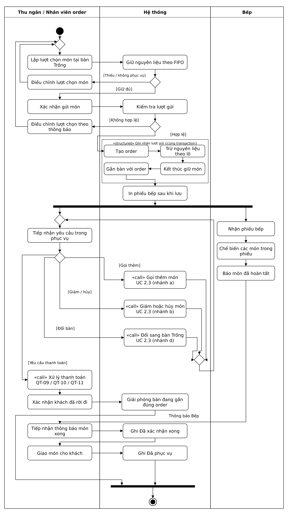

Hình 1. QT-07 — Gọi món tại chỗ. Luồng chính.

Bước 1. Nhân viên chọn loại Mang về, thêm món, số lượng và ghi chú, không gắn bàn; nguyên liệu được giữ như khi gọi món tại chỗ.

Bước 2. Nhân viên xác nhận gửi món; hệ thống tạo order mang về và phiếu bếp, không thay đổi trạng thái bàn. Khi order còn Đang mở, nhân viên tiếp nhận phần gọi thêm qua lượt chọn giữ món theo UC 2.3; mỗi lần gửi chỉ ghi nhận phần món mới.

Bước 3. Thu ngân in phiếu tạm tính và thực hiện thanh toán tiền mặt hoặc QR.

Bước 4. Bếp chế biến, đóng gói; nhân viên giao món và cập nhật Đã phục vụ. Khi order đã thanh toán, bị hủy hoặc đã đóng, khách mua thêm thì lập order mới.

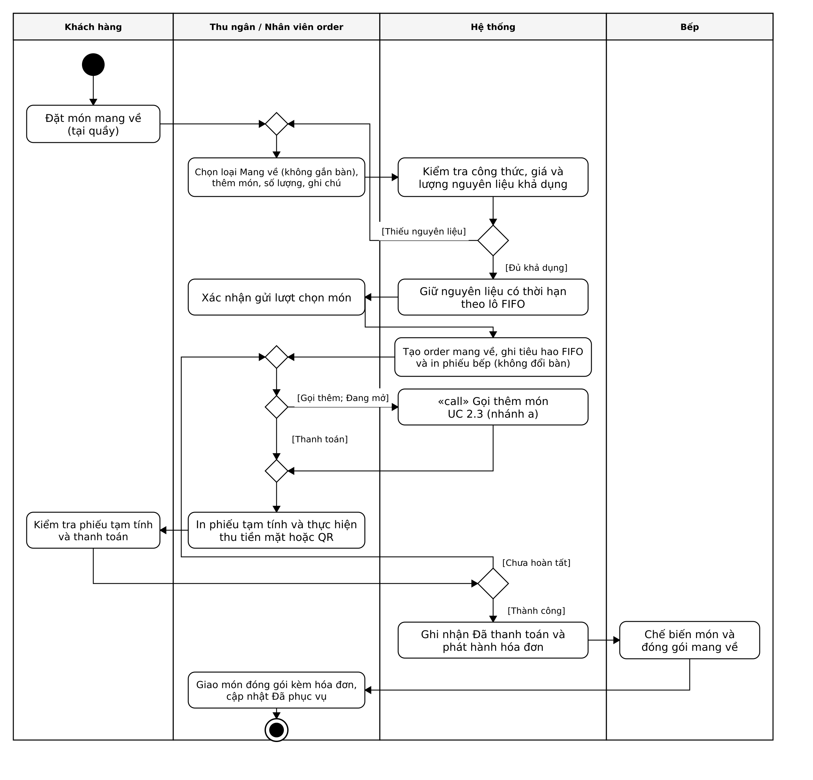

Hình 2. QT-08 — Gọi món mang về. Luồng chính.

Bước 1. Bếp hoặc Quản lý mở kiểm kê sau khi kết thúc phục vụ; hệ thống tạm khóa các thao tác làm thay đổi tồn.

Bước 2. Bếp đếm tồn thực tế theo nguyên liệu, gồm cả lô hết hạn còn hàng.

Bước 3. Hệ thống tính chênh lệch so với tồn sổ sách; người kiểm kê kiểm tra, nhập lý do và xác nhận.

Bước 4. Hệ thống phân bổ chênh lệch xuống từng lô và ghi nhận điều chỉnh; chênh lệch âm sinh chứng từ xuất hủy, không trừ tồn lần hai. Kết thúc phiên thì mở khóa kho.

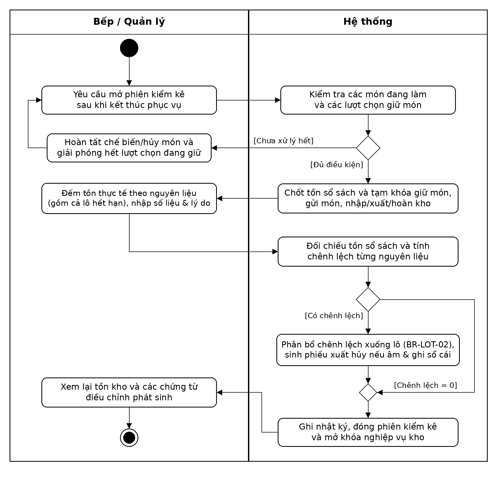

Hình 3. QT-17 — Kiểm kê và điều chỉnh tồn kho. Luồng chính.

## 2.4. Xác định yêu cầu

### 2.4.1. Yêu cầu chức năng

Hệ thống gồm 6 module chức năng chính (cột cuối ghi các câu hỏi khảo sát liên quan):

| **STT** | **Module**       | **Mô tả ngắn gọn**                                                                                                                                                                                                                          | **Nhu cầu từ khảo sát**        |
|---------|------------------|---------------------------------------------------------------------------------------------------------------------------------------------------------------------------------------------------------------------------------------------|--------------------------------|
| 1       | Quản lý danh mục | Ba nghiệp vụ độc lập: quản lý món ăn, quản lý công thức và quản lý giá bán; cùng danh mục nhóm món, nguyên liệu, nhà cung cấp và bàn. Giữ lịch sử phiên bản và xóa mềm theo điều kiện.                                                      | E1, E2, E3, E4                 |
| 2       | Quản lý bán hàng | Lập order tại chỗ hoặc mang về, ghi chú món, đổi bàn, cập nhật trạng thái món, in/in lại phiếu bếp, tra cứu order, in phiếu tạm tính, thanh toán tiền mặt/QR, xác minh thanh toán, in/in lại hóa đơn và hủy order theo điều kiện nghiệp vụ. | B1, B3, B4, B5, B6, C3, C4, C6 |
| 3       | Quản lý kho      | Nhập kho theo lô; xuất tiêu hao theo FIFO qua nhiều lô; xuất hủy theo lô thực tế; kiểm kê và điều chỉnh tồn. Theo dõi tồn sổ sách, đang giữ, khả dụng và hạn sử dụng.                                                                       | D2, D3, D4, D5, D6             |
| 4       | Báo cáo thống kê | Doanh thu theo Business Date/tuần/tháng/năm, xếp hạng món, chi phí nguyên liệu và lợi nhuận gộp theo chi phí nguyên liệu, phân tích khung giờ, theo dõi thanh toán chưa hoàn tất và báo cáo order bị hủy hoặc đóng chưa thu được tiền.      | F3, F4, F5, G7                 |
| 5       | Cài đặt hệ thống | Tài khoản, đăng nhập/đăng xuất/đổi mật khẩu, phân quyền theo vai trò, cấu hình hệ thống (mẫu hóa đơn, mốc Business Date), cấu hình cảnh báo tồn kho, cảnh báo hạn sử dụng, hạn mức câu hỏi AI, nhật ký thao tác rủi ro cao.                 | G6                             |
| 6       | AI Assistant     | Hỏi đáp, phân tích dữ liệu kinh doanh bằng tiếng Việt (Text-to-SQL + LLM), mỗi vai trò có trợ lý AI riêng theo đúng phạm vi phân quyền.                                                                                                     | G3, G4, G7                     |

Bảng 4. Các module chức năng của hệ thống

Mỗi module được mô tả chi tiết đến từng chức năng (Use Case) tại Bảng 5. Mã Use Case thống nhất với các sơ đồ tại mục 3.1.2, quy trình nghiệp vụ tại mục 2.3 (cột Quy trình), đặc tả tại mục 3.4 và danh mục tại Phụ lục I.

| **Mã UC**                      | **Chức năng**                                  | **Mô tả**                                                                                                                                                                                                                                                                                                                                                                    | **Tác nhân**                               | **Quy trình** | **FR liên quan**                                         |
|--------------------------------|------------------------------------------------|------------------------------------------------------------------------------------------------------------------------------------------------------------------------------------------------------------------------------------------------------------------------------------------------------------------------------------------------------------------------------|--------------------------------------------|---------------|----------------------------------------------------------|
| **Module 1. Quản lý danh mục** |                                                |                                                                                                                                                                                                                                                                                                                                                                              |                                            |               |                                                          |
| 1.1                            | Quản lý nhóm món                               | Thêm, sửa, sắp xếp thứ tự hiển thị và xóa nhóm món; nhóm còn món chưa xóa mềm thì không được xóa.                                                                                                                                                                                                                                                                            | Quản lý                                    | QT-01         | FR-CAT-01, 03                                            |
| 1.2                            | Quản lý món ăn                                 | Tạo món (trạng thái Nháp đến khi có công thức đầu tiên), cập nhật thông tin, tạm dừng/mở lại phục vụ và xóa mềm món.                                                                                                                                                                                                                                                         | Quản lý                                    | QT-01         | FR-CAT-02, 04–06, 11, 26–28                              |
| 1.3                            | Quản lý công thức                              | Khai báo nguyên liệu, định lượng và phiên bản công thức. Công thức đầu tiên có hiệu lực ngay; thay đổi sau được lên lịch theo ngày kinh doanh tương lai hoặc sửa trực tiếp có lưu lịch sử. Hủy/thay lịch chưa hiệu lực; sửa trực tiếp giữ lịch chờ.                                                                                                                          | Quản lý                                    | QT-02         | FR-CAT-07–11, 23–25                                      |
| 1.4                            | Quản lý giá bán                                | Quản lý giá hiện hành, lịch sử và lịch thay đổi. Lên lịch theo ngày kinh doanh tương lai hoặc sửa trực tiếp áp dụng ngay; hủy/thay lịch chưa hiệu lực. Giữ nguyên giá của dòng món đã gửi và lịch chờ khi sửa trực tiếp.                                                                                                                                                     | Quản lý                                    | QT-03         | FR-CAT-20–25                                             |
| 1.5                            | Quản lý bàn                                    | Thêm, sửa, xóa bàn; bàn đang phục vụ không được xóa, bàn đã có lịch sử chỉ xóa mềm.                                                                                                                                                                                                                                                                                          | Quản lý                                    | QT-04         | FR-CAT-17, 19                                            |
| 1.6                            | Quản lý nguyên liệu                            | Khai báo tên, đơn vị chuẩn và mức tồn tối thiểu; đơn vị tính bị khóa khi nguyên liệu đã được tham chiếu.                                                                                                                                                                                                                                                                     | Bếp                                        | QT-05         | FR-CAT-12–14                                             |
| 1.7                            | Quản lý nhà cung cấp                           | Thêm, sửa, xóa nhà cung cấp; xem thông tin liên hệ và lịch sử nhập hàng.                                                                                                                                                                                                                                                                                                     | Bếp                                        | QT-06         | FR-CAT-15–16                                             |
| **Module 2. Quản lý bán hàng** |                                                |                                                                                                                                                                                                                                                                                                                                                                              |                                            |               |                                                          |
| 2.1                            | Gọi món tại chỗ                                | Chọn bàn Trống, thêm món và gửi món; nguyên liệu được giữ theo lô FIFO, chỉ khi gửi món mới tạo order và chiếm bàn.                                                                                                                                                                                                                                                          | Thu ngân/ Nhân viên order                  | QT-07, 15     | FR-SALE-01–05, 08, 24, 31–32; FR-INV-03, 10–13           |
| 2.2                            | Gọi món mang về                                | Tạo order không gắn bàn; được gọi thêm khi order Đang mở, mỗi lần gửi ghi nhận phần món mới; không thay đổi trạng thái bàn.                                                                                                                                                                                                                                                  | Thu ngân/ Nhân viên order                  | QT-08, 15     | FR-SALE-01–06, 08, 24, 31–32; FR-INV-03, 10–13           |
| 2.3                            | Quản lý order và phục vụ                       | Gọi thêm qua lượt chọn giữ món cho order tại chỗ hoặc mang về Đang mở; riêng tại chỗ phải còn gắn đúng bàn. Đổi bàn chỉ áp dụng cho order tại chỗ Đang mở còn gắn đúng bàn. Giảm/hủy món theo trạng thái thanh toán và xác nhận Bếp chưa làm. Cập nhật phục vụ cho cả tại chỗ và mang về, kể cả sau thanh toán. Giải phóng bàn khi khách rời, độc lập trạng thái thanh toán. | Thu ngân/ Nhân viên order                  | QT-07, 15     | FR-SALE-01–12, 24, 31–32; FR-CAT-18; FR-INV-03–04, 10–13 |
| 2.4                            | Thanh toán                                     | In phiếu tạm tính, chọn phương thức, ghi nhận thanh toán tiền mặt và phát hành hóa đơn.                                                                                                                                                                                                                                                                                      | Thu ngân/ Nhân viên order                  | QT-09         | FR-SALE-13, 21–22, 24                                    |
| 2.5                            | Thanh toán QR                                  | Mở rộng UC 2.4: tạo mã QR hiệu lực 10 phút, nhận webhook từ cổng thanh toán, xử lý mã hết hạn hoặc quét lỗi.                                                                                                                                                                                                                                                                 | Thu ngân/ Nhân viên order; Cổng thanh toán | QT-10         | FR-SALE-14–19, 21–22, 29, 33                             |
| 2.6                            | Xử lý xác minh thanh toán và khoản QR ngoại lệ | Khi khách báo đã chuyển tiền nhưng chưa có webhook, Quản lý đối chiếu sao kê; xác nhận đã nhận tiền, mở lại thanh toán hoặc đóng order chưa thu được tiền. Xử lý khoản QR đến muộn, sai số tiền hoặc thu trùng: áp dụng khoản hợp lệ hoặc ghi nhận hoàn tiền, không cộng doanh thu hai lần.                                                                                  | Quản lý                                    | QT-11         | FR-SALE-16–20, 23, 34–35                                 |
| 2.7                            | Hủy toàn bộ order                              | Hủy order theo điều kiện nghiệp vụ, bắt buộc nhập lý do; hoàn nguyên liệu của món Chờ làm chưa chế biến.                                                                                                                                                                                                                                                                     | Quản lý                                    | QT-12         | FR-SALE-27–30; FR-INV-04                                 |
| 2.8                            | Tra cứu order                                  | Xem danh sách order; lọc theo mã, bàn, khoảng ngày kinh doanh và trạng thái; xem chi tiết món, thanh toán và chứng từ; in lại chứng từ đã ghi nhận.                                                                                                                                                                                                                          | Quản lý; Thu ngân/Nhân viên order          | QT-13         | FR-SALE-25–26, 32                                        |
| **Module 3. Quản lý kho**      |                                                |                                                                                                                                                                                                                                                                                                                                                                              |                                            |               |                                                          |
| 3.1                            | Nhập kho theo lô                               | Lập phiếu nhập; mỗi dòng hợp lệ tạo một lô riêng với ngày nhập, hạn dùng và số lượng còn lại.                                                                                                                                                                                                                                                                                | Bếp                                        | QT-14         | FR-INV-01–02, 13                                         |
| 3.2                            | Theo dõi xuất nguyên liệu                      | Tra cứu biến động xuất, hoàn và đối chiếu phân bổ FIFO theo lô; hệ thống tự ghi tiêu hao khi gửi món.                                                                                                                                                                                                                                                                        | Bếp                                        | QT-15, 18     | FR-INV-03–04, 10–13                                      |
| 3.3                            | Lập phiếu xuất hủy                             | Xuất hủy nguyên liệu hỏng/hết hạn theo lô thực tế, hoặc lập chứng từ cho món đã chế biến và chênh lệch kiểm kê.                                                                                                                                                                                                                                                              | Bếp                                        | QT-16         | FR-INV-05–06                                             |
| 3.4                            | Kiểm kê và điều chỉnh tồn                      | Mở phiên kiểm kê khóa kho, đếm tồn thực tế, đối chiếu và phân bổ chênh lệch xuống lô.                                                                                                                                                                                                                                                                                        | Bếp                                        | QT-17         | FR-INV-08–09                                             |
| 3.5                            | Theo dõi tồn kho theo lô                       | Xem tồn sổ sách, lượng đang giữ, khả dụng, chi tiết lô và cảnh báo tồn thấp hoặc sắp hết hạn.                                                                                                                                                                                                                                                                                | Bếp                                        | QT-18         | FR-INV-07, 10–14                                         |
| **Module 4. Báo cáo thống kê** |                                                |                                                                                                                                                                                                                                                                                                                                                                              |                                            |               |                                                          |
| 4.1                            | Xem báo cáo doanh thu                          | Doanh thu theo ngày kinh doanh, tuần, tháng, năm; so sánh hai kỳ.                                                                                                                                                                                                                                                                                                            | Quản lý                                    | QT-19         | FR-REP-01, 08–09                                         |
| 4.2                            | Xem chi phí và lợi nhuận gộp                   | Giá vốn theo nguyên liệu và lợi nhuận gộp, tách tiêu hao bán hàng và hao hụt kho.                                                                                                                                                                                                                                                                                            | Quản lý                                    | QT-19         | FR-REP-04–06, 08–09                                      |
| 4.3                            | Xem báo cáo tiêu thụ món                       | Lượng bán và xếp hạng món theo kỳ.                                                                                                                                                                                                                                                                                                                                           | Quản lý                                    | QT-19         | FR-REP-03, 09                                            |
| 4.4                            | Xem phân bố order theo khung giờ               | Phân bố order theo khung giờ để nhận biết giờ cao điểm.                                                                                                                                                                                                                                                                                                                      | Quản lý                                    | QT-19         | FR-REP-07, 09                                            |
| 4.5                            | Xem báo cáo order và thanh toán                | Tra cứu order hủy, order đóng chưa thu được tiền và thanh toán chưa hoàn tất; quyết định xử lý khoản tiền thuộc nhóm bán hàng.                                                                                                                                                                                                                                               | Quản lý                                    | QT-19         | FR-REP-02, 09–10                                         |
| **Module 5. Cài đặt hệ thống** |                                                |                                                                                                                                                                                                                                                                                                                                                                              |                                            |               |                                                          |
| 5.1                            | Quản lý người dùng                             | Tạo, sửa, khóa tài khoản, gán vai trò và đặt lại mật khẩu cho người dùng.                                                                                                                                                                                                                                                                                                    | Quản lý                                    | QT-20         | FR-SET-01–03, 06                                         |
| 5.2                            | Cấu hình hệ thống                              | Các tham số cấu hình hệ thống: mẫu hóa đơn, mốc Business Date, ngưỡng cảnh báo tồn và hạn dùng, thời hạn giữ món, hạn mức hỏi AI.                                                                                                                                                                                                                                            | Quản lý                                    | QT-21         | FR-SET-04–05, 06                                         |
| 5.3                            | Xem nhật ký hệ thống                           | Tra cứu nhật ký thao tác theo thời gian, người thực hiện, loại thao tác; chỉ xem, không sửa hoặc xóa.                                                                                                                                                                                                                                                                        | Quản lý                                    | QT-22         | FR-SET-06–07                                             |
| 5.4                            | Đăng nhập và quản lý tài khoản cá nhân         | Đăng nhập, đăng xuất và tự đổi mật khẩu; hệ thống kiểm tra trạng thái tài khoản và quyền ở backend.                                                                                                                                                                                                                                                                          | Người dùng                                 | QT-20         | FR-SET-02–03                                             |
| **Module 6. AI Assistant**     |                                                |                                                                                                                                                                                                                                                                                                                                                                              |                                            |               |                                                          |
| 6.1                            | Hỏi AI Assistant                               | Hỏi đáp bằng tiếng Việt theo phạm vi vai trò (Text-to-SQL + LLM); kiểm soát quyền, hạn mức và làm rõ câu hỏi chưa đủ thông tin.                                                                                                                                                                                                                                              | Người dùng; Claude API của Anthropic       | QT-23         | FR-AI-01–10                                              |

Bảng 5. Mô tả chức năng theo Use Case của từng module

Các yêu cầu chức năng chi tiết (FR) được trình bày theo module tại Phụ lục K; đặc tả luồng xử lý của từng Use Case được trình bày tại mục 3.4.

### 2.4.2. Yêu cầu phi chức năng

Các yêu cầu phi chức năng gồm 9 tiêu chí có thể kiểm chứng, nhóm theo ISO/IEC 25010:2023 \[13\]: hiệu suất (NFR-01–03), bảo mật và truy vết (NFR-04–06), độ tin cậy (NFR-07), khả năng tương tác và tương thích (NFR-08), sử dụng tài nguyên (NFR-09). Ngưỡng hiệu năng và căn cứ được trình bày tại mục 5.2.1; kịch bản tái lập tại Phụ lục J. Các yêu cầu chỉ được kết luận đạt sau khi chạy kiểm thử và lưu bằng chứng.

NFR-01 - Hiệu năng nghiệp vụ: Với dữ liệu 20.000 order và kịch bản 20 người dùng ảo đang thao tác, p95 thời gian phản hồi của thêm/điều chỉnh giữ món, gửi món, cập nhật danh mục và ghi nhận kho không quá 1 giây. Thời gian đo từ gửi yêu cầu đến nhận kết quả đầy đủ; thời gian ngân hàng và máy in được đo riêng. Ngưỡng 1 giây lấy theo mốc của Nielsen \[14\]: dưới 1 giây thì mạch suy nghĩ của người dùng không bị ngắt, phù hợp với thao tác phục vụ liên tục; được kiểm tra theo mục 5.2.

NFR-02 - Thời gian phản hồi AI Assistant: AI Assistant phản hồi một câu hỏi với p95 thời gian phản hồi dưới 10 giây (tính trên bộ dữ liệu đánh giá; thời gian trung bình được báo cáo kèm), bao gồm toàn bộ chuỗi xử lý: chuẩn hóa câu hỏi, sinh SQL, kiểm duyệt, thực thi và diễn giải kết quả. Ngưỡng 10 giây lấy theo mốc giữ sự chú ý của Nielsen \[14\]; giao diện hiển thị trạng thái đang xử lý trong lúc chờ phản hồi.

NFR-03 - Hiệu năng báo cáo: Trên dữ liệu mô phỏng 12 tháng gồm tối thiểu 20.000 order, p95 thời gian truy vấn báo cáo doanh thu và xếp hạng món dưới 10 giây với 5 người dùng ảo. Quy mô này tương đương khoảng 55 order/ngày, là giả định thử nghiệm của nhóm; cấu hình máy chủ, mạng và tập dữ liệu được ghi cùng kết quả. Ngưỡng 10 giây lấy theo mốc của Nielsen \[14\] cho thao tác phân tích; thao tác kéo dài hơn 1 giây hiển thị trạng thái đang xử lý.

NFR-04 - Bảo mật truy cập, phiên và dữ liệu trao đổi: Mật khẩu tài khoản người dùng được lưu dưới dạng băm (hash), không lưu ở dạng plaintext. Phân quyền truy cập dữ liệu và chức năng theo vai trò được kiểm soát ở tầng backend/API, không chỉ ẩn/hiện thành phần giao diện ở tầng frontend. Kết nối triển khai sử dụng HTTPS; tài khoản bị khóa hoặc phiên hết hạn bị từ chối ở backend. Khóa API chỉ được lưu tại server. Dữ liệu gửi cho LLM được giới hạn vào lược đồ được cấp và kết quả cần cho câu hỏi; thông tin đăng nhập và dữ liệu cá nhân không cần thiết bị loại bỏ.

NFR-05 - An toàn và giới hạn dữ liệu AI: AI Assistant chỉ được cấp tài khoản CSDL chỉ đọc (read-only) trên tập view riêng biệt theo từng vai trò; không có quyền ghi (INSERT/UPDATE/DELETE) ở bất kỳ cấp độ nào; câu SQL sinh ra chỉ được phép là SELECT trên các view mà vai trò hiện tại được phép sử dụng. Mỗi câu hỏi được sinh SQL tối đa 02 lần; nếu SQL không hợp lệ hoặc vẫn lỗi sau lần thử thứ hai, truy vấn kết thúc với trạng thái phù hợp và không thực hiện thêm. Thời gian thực thi truy vấn CSDL tối đa 3 giây; kết quả chi tiết tối đa 500 dòng. Tập view riêng cho AI Assistant, phân tách theo từng vai trò, tách biệt khỏi bảng nghiệp vụ lõi. Vai trò và phạm vi dữ liệu được lấy từ phiên xác thực tại backend. Câu hỏi và nội dung truy vấn trả về được coi là dữ liệu không đáng tin cậy; bộ kiểm duyệt và quyền CSDL phải chặn mọi câu lệnh ngoài phạm vi. Tiêu chí kiểm thử là không có lần truy cập trái quyền hoặc ghi dữ liệu thành công trong bộ ca an toàn tại mục 5.2.

NFR-06 - Nhật ký và truy vết: Toàn bộ bản ghi audit log và nhật ký câu hỏi/SQL của AI Assistant không thể chỉnh sửa hoặc xóa bởi bất kỳ vai trò nào. Backend lưu thời điểm, mã yêu cầu, thao tác, trạng thái lỗi và thời gian xử lý để truy vết. Mật khẩu, khóa API, token xác thực và trường nhạy cảm bị loại khỏi log; quyền xem log kỹ thuật được giới hạn cho người quản trị triển khai.

NFR-07 - Toàn vẹn tồn kho và giao dịch: Kiểm thử đồng thời không tạo tồn âm hoặc cấp cùng một phần nguyên liệu cho nhiều lượt giữ. Lượt giữ hết hạn ngừng chiếm lượng khả dụng theo giờ server. Cùng mã yêu cầu gửi chỉ được tạo một kết quả nghiệp vụ; lỗi hoặc timeout không gây trừ tồn lặp. Mỗi thao tác bán hàng, nhập/xuất kho được thực hiện trong một transaction: khi lỗi giữa chừng thì rollback, không ghi nhận một phần. Phiên kiểm kê được lưu trên server; các giao dịch giữ món, gửi món, nhập/xuất/hoàn kho kiểm tra trạng thái phiên trong transaction. Kiểm thử phải chứng minh giao dịch cạnh tranh không thay đổi tồn giữa thời điểm chốt dữ liệu đếm và xác nhận phiếu.

NFR-08 - Giao diện tiếng Việt và trình duyệt hỗ trợ: Toàn bộ thông báo, cảnh báo hệ thống và câu trả lời của AI Assistant hiển thị bằng tiếng Việt. Giao diện web chạy ổn định trên Chrome và Edge bản hiện hành trên máy tính; kiểm tra các luồng gọi món và thanh toán trên hai trình duyệt này, ghi nhận phiên bản, độ phân giải và lỗi hiển thị/thao tác.

NFR-09 - Hạn mức sử dụng AI: Chi phí gọi API mô hình ngôn ngữ (LLM) của AI Assistant được giới hạn bằng hạn mức số câu hỏi mỗi ngày (mặc định 50 câu/người/ngày, Quản lý có thể cấu hình) và cơ chế cache kết quả cho câu hỏi lặp lại. Kiểm tra chặn câu hỏi vượt hạn mức và làm mất hiệu lực cache khi dữ liệu hoặc quyền thay đổi.

## 2.5. Xác định đối tượng sử dụng hệ thống

| **STT** | **Đối tượng**             | **Mô tả**                                                                   | **Quyền hạn chính**                                                                                                                                                                                                                                                                                                                         |
|---------|---------------------------|-----------------------------------------------------------------------------|---------------------------------------------------------------------------------------------------------------------------------------------------------------------------------------------------------------------------------------------------------------------------------------------------------------------------------------------|
| 1       | Chủ nhà hàng/Quản lý      | Người chịu trách nhiệm vận hành và quản trị toàn bộ hệ thống.               | Kế thừa quyền của Thu ngân/Nhân viên order và Bếp; quản lý danh mục món, giá và công thức, cấu hình, tài khoản và phân quyền; xem toàn bộ báo cáo và nhật ký; hủy toàn bộ order theo điều kiện; xác nhận đối soát, mở lại thanh toán, đóng order chưa thu được tiền và xử lý khoản QR ngoại lệ; sử dụng AI Assistant trong phạm vi Quản lý. |
| 2       | Thu ngân/ Nhân viên order | Người trực tiếp lập order, xác nhận trạng thái món, thu ngân và tất toán.   | Lập/sửa order, đổi bàn, xác nhận trạng thái món, hủy món (khi “Chờ làm”), in phiếu tạm tính, thanh toán, in/in lại hóa đơn, tra cứu order, dùng AI Assistant phạm vi doanh thu/hóa đơn/bán hàng.                                                                                                                                            |
| 3       | Bếp                       | Người trực tiếp chế biến món và quản lý nhập/xuất kho, tồn kho nguyên liệu. | Quản lý danh mục nguyên liệu và nhà cung cấp, ghi nhận phiếu nhập kho, quản lý lô nguyên liệu theo FIFO và hạn sử dụng, lập phiếu xuất hủy, kiểm kê định kỳ, xem danh sách tồn kho, dùng AI Assistant phạm vi tồn kho/nguyên liệu.                                                                                                          |

Bảng 6. Đối tượng sử dụng hệ thống và quyền hạn chính

# 3. PHÂN TÍCH HỆ THỐNG

## 3.1. Mô hình hóa chức năng nghiệp vụ

### 3.1.1. Xác định và gom nhóm chức năng

Các chức năng nghiệp vụ được gom thành 6 nhóm (module), tương ứng với bảng tổng quan chức năng tại mục 2.4.1.

Các module nghiệp vụ được phân loại theo mức độ ưu tiên tại Bảng 7. Nhóm Must-have gồm danh mục, bán hàng, kho và cài đặt nền tảng, được triển khai trước để đáp ứng vận hành cốt lõi. Cài đặt nền tảng gồm quản lý tài khoản, đăng nhập/đăng xuất/đổi mật khẩu, phân quyền, cấu hình, áp dụng ngưỡng cảnh báo tồn kho và ghi audit log.

Nhóm Should-have gồm báo cáo thống kê và tra cứu nhật ký, được triển khai tiếp theo. Báo cáo thống kê và AI Assistant khai thác dữ liệu do các module nghiệp vụ cung cấp nên được triển khai sau khi các module này sẵn sàng; AI Assistant là chức năng hỗ trợ theo mục tiêu MT4.

| **Nhóm chức năng**   | **Số lượng FR**                 | **Ghi chú**                                                                         | **Mức ưu tiên**                                                                                  |
|----------------------|---------------------------------|-------------------------------------------------------------------------------------|--------------------------------------------------------------------------------------------------|
| 1\. Quản lý danh mục | FR-CAT-01 → FR-CAT-28 (28 FR)   | Nhóm món, món ăn, công thức chế biến, nguyên liệu, nhà cung cấp, bàn                | Must-have                                                                                        |
| 2\. Quản lý bán hàng | FR-SALE-01 → FR-SALE-35 (35 FR) | Order, phiếu bếp, thanh toán, hóa đơn, tra cứu, hủy order                           | Must-have                                                                                        |
| 3\. Quản lý kho      | FR-INV-01 → FR-INV-14 (14 FR)   | Nhập/xuất kho, tồn kho theo lô (FIFO), kiểm kê                                      | Must-have                                                                                        |
| 4\. Báo cáo thống kê | FR-REP-01 → FR-REP-10 (10 FR)   | Doanh thu, xếp hạng món, lợi nhuận gộp theo chi phí nguyên liệu, khung giờ cao điểm | Should-have                                                                                      |
| 5\. Cài đặt hệ thống | FR-SET-01 → FR-SET-07 (7 FR)    | Tài khoản, đăng nhập, phân quyền, cấu hình, audit log                               | Must-have: cài đặt nền tảng (FR-SET-01–05, FR-SET-06). Should-have: cài đặt còn lại (FR-SET-07). |
| 6\. AI Assistant     | FR-AI-01 → FR-AI-10 (10 FR)     | Trợ lý AI theo vai trò, Text-to-SQL + LLM                                           | Chức năng hỗ trợ theo mục tiêu MT4                                                               |

Bảng 7. Tổng hợp các nhóm chức năng và mức ưu tiên

### 3.1.2. Sơ đồ Use Case

Bộ Use Case gồm một sơ đồ tổng quan và sáu sơ đồ chi tiết với 30 Use Case. Các nhóm chức năng trên sơ đồ tổng quan được đánh số từ 1 đến 6; Use Case chi tiết mang mã hai cấp theo nhóm, như 1.1, 1.2 và 2.1. Ba tác nhân người dùng là Quản lý, Thu ngân/Nhân viên order và Bếp; Cổng thanh toán và Claude API của Anthropic là hệ thống ngoài. Tên, mã và phạm vi từng Use Case được tổng hợp tại Phụ lục I và đối chiếu với yêu cầu chức năng tại Phụ lục K.

Hình 4. Use Case tổng quan

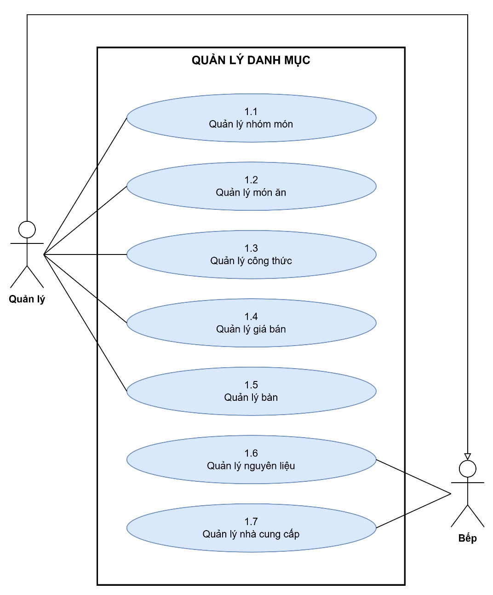

Hình 5. Use Case quản lý danh mục

Hình 6. Use Case bán hàng

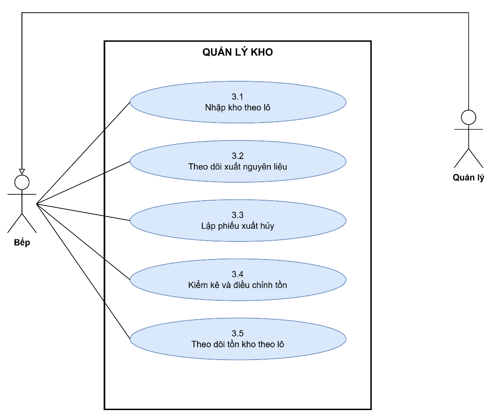

Hình 7. Use Case quản lý kho

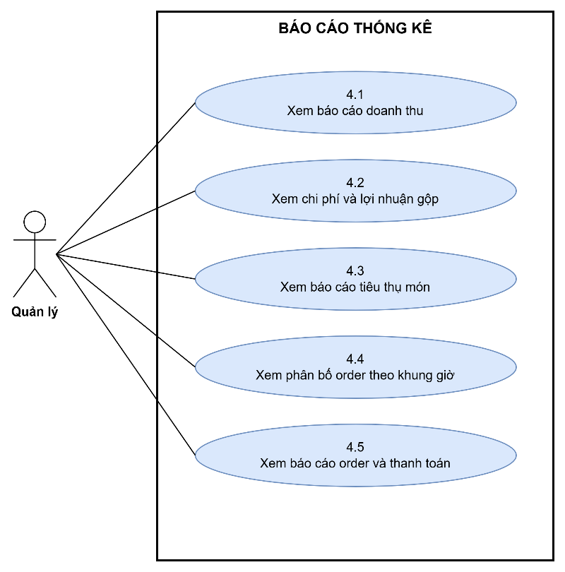

Hình 8. Use Case báo cáo

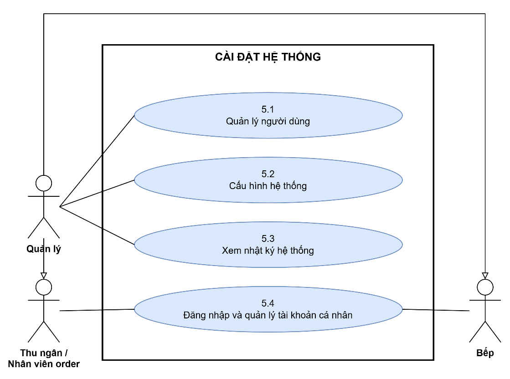

Hình 9. Use Case cài đặt

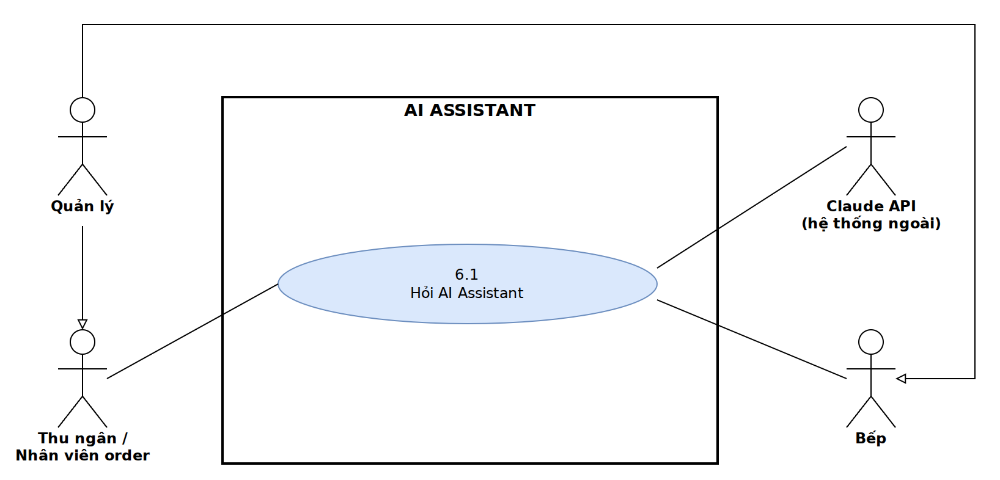

Hình 10. Use Case AI Assistant

## 3.2. Mô hình hóa đối tượng (Class Diagram)

Mô hình lớp mô tả các đối tượng nghiệp vụ, thuộc tính và quan hệ của hệ thống theo hướng phân tích thiết kế hướng đối tượng. Các sơ đồ được tổ chức theo module; thuộc tính và phương thức được đặc tả tại Phụ lục D trong tài liệu 04, còn quan hệ và bội số được ánh xạ sang lược đồ quan hệ tại mục 4.2.2. Bội số trong sơ đồ dùng ký hiệu 1, 0..1, 0..\* và 1..\*. Các kiểu dữ liệu khái niệm được định nghĩa cùng đặc tả lớp và ánh xạ sang kiểu MySQL tại mục 4.2.2.

Các lớp tham chiếu từ module khác được thể hiện bằng khung nét đứt nền xám, tên lớp kèm tên module trong ngoặc (ví dụ “(Module Danh mục)”), chỉ trình bày thông tin cần thiết để nhận diện quan hệ giữa các module.

Hình 11. Class Diagram - Module Quản lý danh mục

Hình 12. Class Diagram - Module Quản lý bán hàng

Hình 13. Class Diagram - Giữ món (Module Quản lý bán hàng)

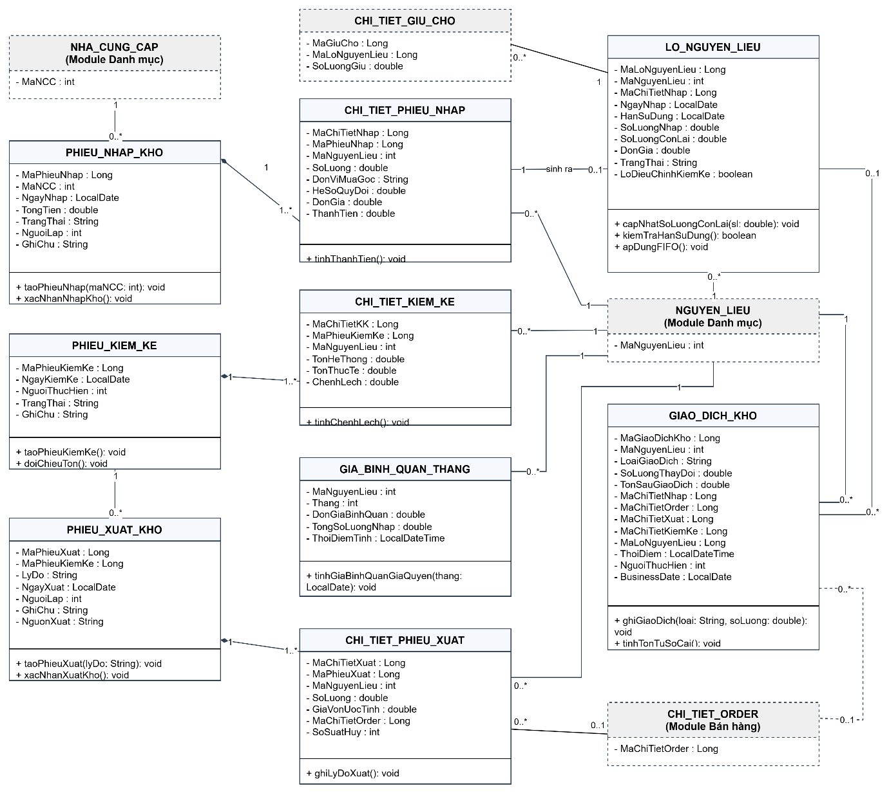

Hình 14. Class Diagram - Module Quản lý kho

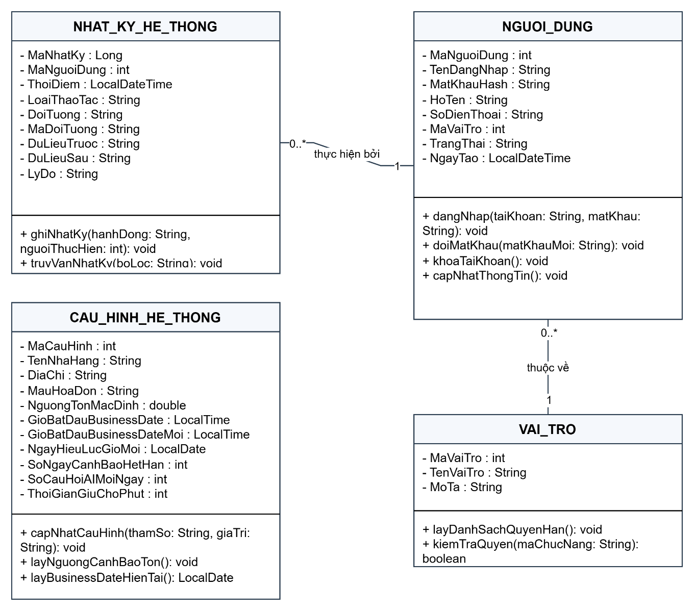

Hình 15. Class Diagram - Module Cài đặt hệ thống

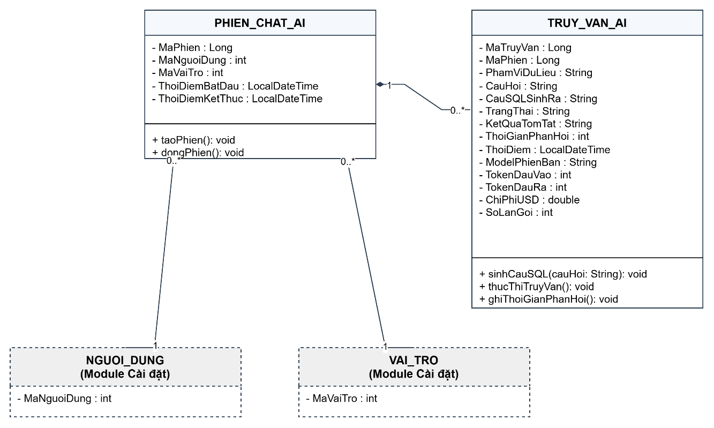

Hình 16. Class Diagram - Module AI Assistant

Module Quản lý danh mục: NHOM_MON, MON_AN, LICH_SU_GIA_MON, CONG_THUC, CHI_TIET_CONG_THUC, NGUYEN_LIEU, NHA_CUNG_CAP, BAN - MON_AN kết hợp (composition) với CONG_THUC theo từng phiên bản hiệu lực; CONG_THUC kết hợp CHI_TIET_CONG_THUC, mỗi dòng liên kết tới một NGUYEN_LIEU.

Module Quản lý bán hàng: ORDER, CHI_TIET_ORDER, LICH_SU_DOI_BAN, HOA_DON, GIAO_DICH_THANH_TOAN, PHIEU_BEP - ORDER kết hợp nhiều CHI_TIET_ORDER (1--1..\*), mỗi CHI_TIET_ORDER tham chiếu một MON_AN; ORDER liên kết 1--0..\* với GIAO_DICH_THANH_TOAN (mỗi lần thanh toán hoặc thử thanh toán là một giao dịch) và 1--0..1 với HOA_DON sau khi chốt; HOA_DON tham chiếu đúng một giao dịch “Thành công” qua MaGiaoDichThanhToan. GIU_CHO_MON lưu các dòng chưa gửi theo MaLuotChon; CHI_TIET_GIU_CHO lưu nguyên liệu theo lô. Khi gửi thành công, lượt giữ tham chiếu dòng CHI_TIET_ORDER đã tạo.

Module Quản lý kho: PHIEU_NHAP_KHO, CHI_TIET_PHIEU_NHAP, LO_NGUYEN_LIEU, PHIEU_XUAT_KHO, CHI_TIET_PHIEU_XUAT, PHIEU_KIEM_KE, CHI_TIET_KIEM_KE, GIAO_DICH_KHO, GIA_BINH_QUAN_THANG - mỗi CHI_TIET_PHIEU_NHAP sinh ra một LO_NGUYEN_LIEU (lô điều chỉnh kiểm kê là ngoại lệ, không có dòng nhập); mọi lớp biến động (nhập/xuất/kiểm kê) đều phát sinh bản ghi GIAO_DICH_KHO, NGUYEN_LIEU chỉ giữ số tồn dẫn xuất. Lượng đang giữ được tổng hợp từ CHI_TIET_GIU_CHO; phiên kiểm kê được quản lý bằng trạng thái PHIEU_KIEM_KE.

Module Báo cáo thống kê: Không định nghĩa lớp riêng; module đọc (read-only) từ các lớp ở trên thông qua các lớp dịch vụ/truy vấn tổng hợp (report service).

Module Cài đặt hệ thống: VAI_TRO, NGUOI_DUNG, CAU_HINH_HE_THONG, NHAT_KY_HE_THONG - NGUOI_DUNG liên kết 0..\*--1 với VAI_TRO; mọi thao tác rủi ro cao trên các lớp khác đều phát sinh một NHAT_KY_HE_THONG. CAU_HINH_HE_THONG chứa ThoiGianGiuChoPhut để xác định thời hạn cho từng dòng món chưa gửi.

Module AI Assistant: PHIEN_CHAT_AI, TRUY_VAN_AI - PHIEN_CHAT_AI kết hợp nhiều TRUY_VAN_AI (1--0..\*); TRUY_VAN_AI chỉ đọc dữ liệu qua các view phân quyền dựng trên các lớp nghiệp vụ ở trên.

## 3.3. Mô hình hóa tương tác (Sequence Diagram)

Bộ 35 sơ đồ gồm 30 sơ đồ chính và năm sơ đồ con được tổ chức theo mã UC, kèm hậu tố cho luồng dùng chung. Toàn bộ sơ đồ nằm trong tài liệu [03_Bo_so_do_Sequence_Diagram.docx (Google Drive)](https://docs.google.com/document/d/1zurLCI7_-Y9v-IU-3R4hhBh7jkMxLODy/edit?usp=drive_link)

Các sơ đồ tiêu biểu dưới đây thể hiện việc gửi món, quản lý giữ món, kiểm kê và chuỗi xử lý câu hỏi AI. Mã SD liên kết với Use Case và yêu cầu chức năng tương ứng.

Hình 17. SD-2.1 – Gọi món tại chỗ

Hình 18. SD-2.1a – Chọn món và quản lý giữ món

Hình 19. SD-3.4 – Kiểm kê và điều chỉnh tồn

Hình 20. SD-6.1 – Hỏi AI Assistant

## 3.4. Đặc tả chức năng

Hệ thống có 30 Use Case thuộc sáu module. Mỗi đặc tả xác định tác nhân, đầu vào, đầu ra, luồng chính, điều kiện và mã FR liên quan. Danh mục chức năng và tác nhân được thể hiện tại mục 3.1.2; các điều kiện truy cập được kiểm soát ở backend.

Đặc tả đầy đủ 30 Use Case, danh mục UC và 104 yêu cầu chức năng FR được trình bày trong tài liệu [02_Dac_ta_chuc_nang_UC_FR.docx (Google Drive)](https://docs.google.com/document/d/1g0yFOOgPlGd9KxEH9UJfkSVK1DfY0iTw/edit?usp=drive_link)

| Module       | Nội dung nghiệp vụ                                                                             |
|--------------|------------------------------------------------------------------------------------------------|
| Danh mục     | Nhóm món, món ăn, giá, công thức theo hiệu lực, bàn, nguyên liệu và nhà cung cấp.              |
| Bán hàng     | Chọn/giữ/gửi món, gọi thêm, phục vụ, bàn, thanh toán, xác minh, hủy order và tra cứu chứng từ. |
| Kho          | Nhập theo lô, FIFO, xuất hủy, kiểm kê và theo dõi tồn theo lô.                                 |
| Báo cáo      | Doanh thu, giá vốn/lợi nhuận gộp, tiêu thụ món, khung giờ, order và thanh toán.                |
| Cài đặt      | Tài khoản, phân quyền, cấu hình, nhật ký và quản lý phiên cá nhân.                             |
| AI Assistant | Hỏi đáp tiếng Việt theo view, quyền dữ liệu và giới hạn truy vấn.                              |

# 4. THIẾT KẾ HỆ THỐNG

## 4.1. Thiết kế kiến trúc hệ thống

### 4.1.1. Kiến trúc tổng thể

Hệ thống áp dụng kiến trúc ba tầng, mô hình client-server, backend module hóa theo nghiệp vụ:

- Tầng giao diện (Presentation): ứng dụng web Next.js, phục vụ ba vai trò người dùng và giao diện chat AI Assistant.

- Tầng ứng dụng (Application): backend Python/FastAPI, xử lý cả nghiệp vụ quản lý (danh mục, bán hàng, kho, báo cáo, cài đặt) và dịch vụ AI Assistant (chuẩn hóa câu hỏi, sinh SQL, kiểm duyệt, thực thi, diễn giải kết quả).

- Tầng dữ liệu (Data): MySQL, kèm tập view riêng theo từng vai trò (Quản lý/Thu ngân và Nhân viên order/Bếp) để kiểm soát phân quyền và tách biệt AI Assistant khỏi các bảng nghiệp vụ lõi.

### 4.1.2. Kiến trúc phần mềm

Dịch vụ AI sử dụng Claude Opus 5.5 để sinh SQL và Claude Haiku 5.5 để diễn giải kết quả qua Claude API của Anthropic (mục 5.1.1). Backend điều phối hỏi đáp qua các view MySQL được phân quyền; sqlglot hỗ trợ phân tích cú pháp truy vấn. Tài khoản CSDL riêng chỉ có quyền SELECT trên tập view của vai trò. Quy trình không cấp cho LLM thông tin đăng nhập CSDL hoặc quyền thực thi trực tiếp.

Kiến trúc phân tách module nghiệp vụ và quyền theo vai trò để hỗ trợ mở rộng.

### 4.1.3. Quy trình xử lý câu hỏi AI

Backend xác thực phiên, kiểm tra tài khoản, xác định vai trò hiện tại và hạn mức. Mỗi câu hỏi có mã truy vết; lịch sử hội thoại chỉ được lấy từ phiên thuộc người dùng đó. Thời gian tương đối được quy đổi theo múi giờ và Business Date của nhà hàng.

Hệ thống xác định chỉ số, khoảng thời gian và đối tượng từ câu hỏi. Thông tin thiếu hoặc tên món mơ hồ được trả về dưới dạng yêu cầu làm rõ. Với yêu cầu hợp lệ, ngữ cảnh gồm lược đồ view được phép, định nghĩa doanh thu, giá vốn, tồn khả dụng và ví dụ thuộc tập phát triển.

LLM sinh một truy vấn. Bộ kiểm duyệt phân tích cây cú pháp, chỉ chấp nhận một truy vấn đọc; mọi bảng, cột, truy vấn con và nhánh UNION/CTE phải nằm trong danh sách cho phép. Các lệnh ghi, truy cập schema hệ thống, xuất tệp, hàm gây trì hoãn và câu lệnh nhiều phần bị từ chối. Hệ thống áp giới hạn dòng và thời gian ở tầng thực thi.

Truy vấn hợp lệ chạy bằng tài khoản chỉ đọc theo vai trò, timeout 3 giây và tối đa 500 dòng. Lỗi cú pháp hoặc lỗi thực thi được phép sinh lại SQL một lần trong cùng phạm vi; yêu cầu trái quyền kết thúc ngay. Kết quả rỗng được diễn đạt là không có dữ liệu phù hợp; lỗi dịch vụ trả thông báo thử lại và mã truy vết.

Backend tính các chỉ số và chênh lệch xác định từ kết quả truy vấn; LLM diễn giải bảng số liệu. Câu trả lời nêu thời gian, đơn vị, phạm vi và thời điểm truy vấn. Nội dung văn bản từ dữ liệu được đặt trong vùng dữ liệu riêng, không được sử dụng làm chỉ dẫn hệ thống. Bảng số liệu gốc đi cùng câu trả lời để người dùng đối chiếu.

Theo hướng dẫn OWASP \[15\], kiểm soát prompt injection kết hợp phân tách chỉ dẫn và dữ liệu, quyền tối thiểu và kiểm tra đầu ra. Thiết kế dùng backend và quyền CSDL làm ranh giới truy cập; việc bảo vệ system prompt là một lớp hỗ trợ. Bộ ca kiểm thử bao gồm yêu cầu giả mạo vai trò, lộ prompt, chỉ dẫn nhúng trong tên/ghi chú và truy vấn vượt view.

## 4.2. Thiết kế cơ sở dữ liệu

Cơ sở dữ liệu MySQL áp dụng mô hình quan hệ, chuẩn hóa đến dạng chuẩn 3 (3NF). Một số giá trị dẫn xuất như tồn kho hiện tại và thành tiền được lưu có kiểm soát để hỗ trợ truy vấn vận hành và AI Assistant. Các lớp trong mô hình tại mục 3.2 được ánh xạ sang khóa chính, khóa ngoại và kiểu dữ liệu MySQL theo đặc tả chức năng tại mục 3.4 và Phụ lục K. Thiết kế tuân theo bốn nguyên tắc:

- Bảo toàn dữ liệu lịch sử: đối tượng danh mục đã được dữ liệu vận hành hoặc lịch sử tham chiếu được xóa mềm qua DaXoa. Món ăn chỉ được xóa mềm; các danh mục khác được xóa vĩnh viễn khi đáp ứng điều kiện riêng tại Phụ lục K, bảo đảm các order và báo cáo cũ vẫn tra cứu được.

- Quản lý hiệu lực theo thời gian: giá bán và công thức chế biến không được ghi đè mà lưu thành các phiên bản có mốc hiệu lực; mỗi dòng món trong order tham chiếu trực tiếp tới phiên bản đang hiệu lực tại thời điểm dòng món được gửi vào order, nhờ đó doanh thu và giá vốn tính lại ở bất kỳ thời điểm nào đều cho kết quả nhất quán.

- Ghi sổ biến động tồn: mỗi lần nhập, tiêu hao, hoàn, xuất thủ công hoặc điều chỉnh tạo bản ghi GIAO_DICH_KHO. Giữ món được lưu riêng; tồn sổ sách đối chiếu với sổ cái, lượng khả dụng đối chiếu thêm các lượt giữ còn hiệu lực.

- Phục vụ phân quyền và AI Assistant: dữ liệu được tổ chức để có thể xây dựng các view riêng theo từng vai trò theo đặc tả tại mục 4.4.1, qua đó trợ lý AI của một vai trò chỉ truy vấn được đúng phạm vi dữ liệu cho phép.

### 4.2.1. Xác định các lớp đối tượng

Từ các mô hình nghiệp vụ ở Chương 3, hệ thống xác định được 31 lớp đối tượng, chia theo các nhóm dữ liệu nghiệp vụ. Bảng 8 tổng hợp danh sách lớp đối tượng và vai trò của từng lớp đối tượng.

| **Nhóm**               | **Tên lớp**          | **Mô tả**                                                                                                                                                                                                                                                                |
|------------------------|----------------------|--------------------------------------------------------------------------------------------------------------------------------------------------------------------------------------------------------------------------------------------------------------------------|
| Người dùng và hệ thống | VAI_TRO              | Danh mục ba vai trò sử dụng hệ thống.                                                                                                                                                                                                                                    |
|                        | NGUOI_DUNG           | Tài khoản đăng nhập, gắn với đúng một vai trò.                                                                                                                                                                                                                           |
|                        | CAU_HINH_HE_THONG    | Tham số cấu hình hệ thống: mẫu hóa đơn (kèm tên và địa chỉ nhà hàng in trên hóa đơn), ngưỡng cảnh báo tồn, mốc Business Date, ngưỡng sắp hết hạn của lô, thời gian giữ món, hạn mức câu hỏi AI.                                                                          |
|                        | NHAT_KY_HE_THONG     | Nhật ký (audit log) các thao tác rủi ro cao.                                                                                                                                                                                                                             |
| Danh mục               | NHOM_MON             | Nhóm phân loại món ăn; mỗi món thuộc đúng một nhóm.                                                                                                                                                                                                                      |
|                        | MON_AN               | Món ăn, công thức, giá bán và trạng thái phục vụ theo tồn kho và cờ tạm dừng thủ công.                                                                                                                                                                                   |
|                        | LICH_SU_GIA_MON      | Các phiên bản giá bán của món kèm thời điểm hiệu lực.                                                                                                                                                                                                                    |
|                        | CONG_THUC            | Các phiên bản công thức chế biến của món kèm thời điểm hiệu lực.                                                                                                                                                                                                         |
|                        | CHI_TIET_CONG_THUC   | Định lượng từng nguyên liệu trong một phiên bản công thức.                                                                                                                                                                                                               |
|                        | NGUYEN_LIEU          | Nguyên liệu, đơn vị tính chuẩn hóa, tồn hiện tại và mức tồn tối thiểu.                                                                                                                                                                                                   |
|                        | NHA_CUNG_CAP         | Nhà cung cấp nguyên liệu và thông tin liên hệ.                                                                                                                                                                                                                           |
|                        | BAN                  | Sơ đồ bàn và trạng thái phục vụ.                                                                                                                                                                                                                                         |
| Bán hàng               | ORDER                | Đơn gọi món (tại chỗ hoặc mang về) theo Business Date.                                                                                                                                                                                                                   |
|                        | CHI_TIET_ORDER       | Từng dòng món trong order, kèm ghi chú và trạng thái chế biến.                                                                                                                                                                                                           |
|                        | LICH_SU_DOI_BAN      | Lịch sử các lần đổi bàn của order.                                                                                                                                                                                                                                       |
|                        | HOA_DON              | Hóa đơn chỉ phát hành sau khi thanh toán thành công; phiếu tạm tính in từ ORDER, không lưu ở HOA_DON. Mỗi order có tối đa một hóa đơn.                                                                                                                                   |
|                        | GIAO_DICH_THANH_TOAN | Giao dịch thanh toán tiền mặt hoặc QR; xác nhận tiền mặt bởi Thu ngân, xác nhận QR qua webhook hoặc đối soát theo đặc tả.                                                                                                                                                |
|                        | PHIEU_BEP            | Các lượt in phiếu bếp và kết quả in.                                                                                                                                                                                                                                     |
| Kho                    | PHIEU_NHAP_KHO       | Phiếu nhập hàng gắn với một nhà cung cấp.                                                                                                                                                                                                                                |
|                        | CHI_TIET_PHIEU_NHAP  | Chi tiết nguyên liệu, số lượng, đơn giá của phiếu nhập.                                                                                                                                                                                                                  |
|                        | LO_NGUYEN_LIEU       | Từng lô nguyên liệu tạo ra từ một dòng nhập, theo dõi số lượng còn lại và hạn sử dụng riêng để hỗ trợ FIFO và cảnh báo hết hạn.                                                                                                                                          |
|                        | PHIEU_XUAT_KHO       | Phiếu xuất hủy cho hao hụt, hư hỏng, hết hạn.                                                                                                                                                                                                                            |
|                        | CHI_TIET_PHIEU_XUAT  | Chi tiết nguyên liệu và số lượng xuất thủ công.                                                                                                                                                                                                                          |
|                        | PHIEU_KIEM_KE        | Phiếu kiểm kê định kỳ đối chiếu tồn thực tế với tồn hệ thống.                                                                                                                                                                                                            |
|                        | CHI_TIET_KIEM_KE     | Chênh lệch tồn của từng nguyên liệu trong một lần kiểm kê.                                                                                                                                                                                                               |
|                        | GIAO_DICH_KHO        | Sổ cái ghi mọi biến động kho (nhập, trừ tự động, hoàn kho, xuất thủ công, điều chỉnh kiểm kê).                                                                                                                                                                           |
|                        | GIA_BINH_QUAN_THANG  | Đơn giá bình quân gia quyền theo tháng của từng nguyên liệu, phục vụ tính giá vốn; tính trên tồn đầu kỳ cộng lượng nhập trong tháng, nếu nguyên liệu không có lần nhập nào trong tháng thì mang đơn giá bình quân của kỳ gần nhất trước đó sang để giá vốn không bằng 0. |
| AI Assistant           | PHIEN_CHAT_AI        | Phiên hội thoại của người dùng với trợ lý AI theo vai trò.                                                                                                                                                                                                               |
|                        | TRUY_VAN_AI          | Câu hỏi, câu SQL sinh ra, trạng thái và thời gian phản hồi của từng lượt hỏi.                                                                                                                                                                                            |
| Bán hàng và kho        | GIU_CHO_MON          | Dòng món chưa gửi: người thao tác, lượt chọn, phiên bản, số lượng, thời hạn và kết quả gửi.                                                                                                                                                                              |
| Bán hàng và kho        | CHI_TIET_GIU_CHO     | Lượng nguyên liệu giữ theo lô cho mỗi dòng món.                                                                                                                                                                                                                          |

Bảng 8. Danh sách lớp đối tượng của hệ thống

Thuộc tính và phương thức chi tiết của từng lớp được đặc tả tại Phụ lục D trong tài liệu 04.

### 4.2.2. Ánh xạ Class Diagram sang lược đồ quan hệ (CSDL)

Các mối liên kết giữa những lớp đối tượng đã xác định ở mục 4.2.1 được tổng hợp trong Bảng 9. Các quan hệ nhiều–nhiều đều được hiện thực bằng lớp đối tượng trung gian để lưu thêm thuộc tính của chính mối quan hệ đó (định lượng trong công thức, số lượng và đơn giá trong phiếu nhập, chênh lệch trong phiếu kiểm kê).

| Lớp A               | Lớp B                | **Bản số**    | **Ý nghĩa nghiệp vụ**                                                                                                                                  |
|---------------------|----------------------|---------------|--------------------------------------------------------------------------------------------------------------------------------------------------------|
| VAI_TRO             | NGUOI_DUNG           | 1 – 0..\*     | Một vai trò được gán cho nhiều tài khoản; mỗi tài khoản có đúng một vai trò.                                                                           |
| NGUOI_DUNG          | NHAT_KY_HE_THONG     | 1 – 0..\*     | Một người dùng phát sinh nhiều bản ghi nhật ký.                                                                                                        |
| NHOM_MON            | MON_AN               | 1 – 0..\*     | Một nhóm gồm nhiều món; mỗi món thuộc đúng một nhóm.                                                                                                   |
| MON_AN              | LICH_SU_GIA_MON      | 1 – 0..\*     | Một món có nhiều phiên bản giá, tại mỗi thời điểm chỉ một phiên bản hiệu lực.                                                                          |
| MON_AN              | CONG_THUC            | 1 – 0..\*     | Một món có nhiều phiên bản công thức theo thời gian.                                                                                                   |
| CONG_THUC           | NGUYEN_LIEU          | 0..\* – 1..\* | Quan hệ nhiều–nhiều, hiện thực qua CHI_TIET_CONG_THUC kèm định lượng.                                                                                  |
| BAN                 | ORDER                | 0..1 – 0..\*  | Một bàn phục vụ nhiều order theo thời gian; order mang về không gắn bàn.                                                                               |
| NGUOI_DUNG          | ORDER                | 1 – 0..\*     | Một nhân viên tạo nhiều order.                                                                                                                         |
| ORDER               | CHI_TIET_ORDER       | 1 – 1..\*     | Một order gồm nhiều dòng món.                                                                                                                          |
| MON_AN              | CHI_TIET_ORDER       | 1 – 0..\*     | Một món xuất hiện trong nhiều dòng order.                                                                                                              |
| LICH_SU_GIA_MON     | CHI_TIET_ORDER       | 1 – 0..\*     | Dòng món neo vào phiên bản giá có hiệu lực khi từng dòng món được gửi.                                                                                 |
| CONG_THUC           | CHI_TIET_ORDER       | 1 – 0..\*     | Dòng món neo vào phiên bản công thức dùng để trừ kho và tính giá vốn.                                                                                  |
| ORDER               | HOA_DON              | 1 – 0..1      | Một order chưa thanh toán, bị hủy hoặc đóng chưa thu được tiền không có hóa đơn; order thanh toán thành công sinh đúng một hóa đơn.                    |
| ORDER               | GIAO_DICH_THANH_TOAN | 1 – 0..\*     | Một order có thể phát sinh nhiều lần thử thanh toán (QR hết hạn, đổi phương thức).                                                                     |
| ORDER               | PHIEU_BEP            | 1 – 1..\*     | Mỗi lần gửi món (kể cả gửi thêm) sinh một lượt in phiếu bếp.                                                                                           |
| ORDER               | LICH_SU_DOI_BAN      | 1 – 0..\*     | Một order có thể đổi bàn nhiều lần.                                                                                                                    |
| BAN                 | LICH_SU_DOI_BAN      | 1 – 0..\*     | Bàn đóng vai trò bàn nguồn hoặc bàn đích trong các lần đổi.                                                                                            |
| NHA_CUNG_CAP        | PHIEU_NHAP_KHO       | 1 – 0..\*     | Một nhà cung cấp gắn với nhiều phiếu nhập.                                                                                                             |
| PHIEU_NHAP_KHO      | NGUYEN_LIEU          | 0..\* – 1..\* | Hiện thực qua CHI_TIET_PHIEU_NHAP kèm số lượng và đơn giá.                                                                                             |
| PHIEU_XUAT_KHO      | NGUYEN_LIEU          | 0..\* – 1..\* | Hiện thực qua CHI_TIET_PHIEU_XUAT.                                                                                                                     |
| PHIEU_KIEM_KE       | NGUYEN_LIEU          | 0..\* – 1..\* | Hiện thực qua CHI_TIET_KIEM_KE kèm tồn hệ thống và tồn thực tế.                                                                                        |
| NGUYEN_LIEU         | GIAO_DICH_KHO        | 1 – 0..\*     | Mọi biến động tồn của nguyên liệu được ghi thành các bản ghi sổ cái.                                                                                   |
| NGUYEN_LIEU         | GIA_BINH_QUAN_THANG  | 1 – 0..\*     | Mỗi nguyên liệu có một đơn giá bình quân cho mỗi tháng.                                                                                                |
| NGUOI_DUNG          | PHIEN_CHAT_AI        | 1 – 0..\*     | Một người dùng mở nhiều phiên hội thoại.                                                                                                               |
| PHIEN_CHAT_AI       | TRUY_VAN_AI          | 1 – 0..\*     | Một phiên gồm nhiều lượt hỏi–đáp.                                                                                                                      |
| NGUYEN_LIEU         | LO_NGUYEN_LIEU       | 1 – 0..\*     | Một nguyên liệu có nhiều lô nhập theo thời gian.                                                                                                       |
| CHI_TIET_PHIEU_NHAP | LO_NGUYEN_LIEU       | 0..1 – 1      | Mỗi dòng nhập hợp lệ tạo đúng một lô; mỗi lô có không hoặc một dòng nhập nguồn. Lô điều chỉnh kiểm kê không có dòng nhập nguồn.                        |
| LO_NGUYEN_LIEU      | GIAO_DICH_KHO        | 0..1 – 0..\*  | Một lô có thể bị trừ qua nhiều giao dịch kho khác nhau.                                                                                                |
| CHI_TIET_ORDER      | GIAO_DICH_KHO        | 0..1 – 0..\*  | Một dòng CHI_TIET_ORDER có thể phát sinh nhiều dòng GIAO_DICH_KHO khi nguyên liệu được trừ từ nhiều lô theo FIFO; mỗi giao dịch ghi nhận lô tương ứng. |
| NGUOI_DUNG          | GIU_CHO_MON          | 1 – 0..\*     | Người thao tác sở hữu các lượt chọn.                                                                                                                   |
| ORDER               | GIU_CHO_MON          | 0..1 – 0..\*  | Lượt gọi thêm gắn order; lượt đầu cho phép MaOrder NULL.                                                                                               |
| GIU_CHO_MON         | CHI_TIET_GIU_CHO     | 1 – 1..\*     | Mỗi dòng giữ đủ định lượng trên các lô.                                                                                                                |
| LO_NGUYEN_LIEU      | CHI_TIET_GIU_CHO     | 1 – 0..\*     | Chi tiết xác định lô và lượng giữ.                                                                                                                     |
| CHI_TIET_ORDER      | GIU_CHO_MON          | 0..1 – 0..1   | Dòng giữ đã gửi tham chiếu dòng món được tạo.                                                                                                          |

Bảng 9. Các mối quan hệ chính giữa các lớp

Các liên kết và bội số tại Bảng 9 xác định khóa ngoại trong lược đồ quan hệ. Quy tắc toàn vẹn được tổng hợp dưới đây; ràng buộc triển khai và chỉ mục chi tiết nằm tại Phụ lục G.

Ánh xạ kiểu dữ liệu khái niệm sang MySQL được áp dụng thống nhất dưới đây. Định danh không đổi sau khi tạo; trường cho phép NULL được ghi theo điều kiện tại phụ lục D và G. Các bảng nghiệp vụ đã ghi nhận được bảo toàn lịch sử.

| Kiểu / nhóm dữ liệu                   | Kiểu MySQL và quy ước                                                                                                                                                                |
|---------------------------------------|--------------------------------------------------------------------------------------------------------------------------------------------------------------------------------------|
| int / Long                            | INT / BIGINT cho mã định danh; PK tự tăng khi là định danh thay thế. Các FK dùng cùng kiểu với PK được tham chiếu.                                                                   |
| String                                | VARCHAR theo giới hạn trường; dùng TEXT cho ghi chú, prompt/kết quả dài; dữ liệu webhook hoặc trước/sau dạng có cấu trúc dùng JSON. Tất cả dùng utf8mb4.                             |
| double – tiền                         | DECIMAL(18,2) cho giá bán, giá nhập, thành tiền, doanh thu và giá vốn. Chi phí API dùng DECIMAL(18,8). Không dùng FLOAT/DOUBLE cho tiền trong CSDL.                                  |
| double – lượng                        | DECIMAL(18,6) cho số lượng, định lượng và hệ số quy đổi theo đơn vị chuẩn. Số suất món là INT dương.                                                                                 |
| boolean                               | BOOLEAN (TINYINT(1)); CHECK giới hạn 0 hoặc 1; cờ không có ý nghĩa rỗng là NOT NULL.                                                                                                 |
| LocalDate / LocalDateTime / LocalTime | DATE / DATETIME(3) / TIME. Thời điểm được diễn giải theo múi giờ nhà hàng; BusinessDate đã lưu không tính lại theo cấu hình mới.                                                     |
| Thuộc tính dẫn xuất                   | TrangThai hiển thị và HetNguyenLieu của MON_AN tính từ dữ liệu hiện hành. Giá hiện hành lấy phiên bản hiệu lực; tổng tồn lưu đệm phải cập nhật cùng transaction và đối chiếu sổ cái. |
| NULL / NOT NULL                       | MaOrder và MaChiTietOrder của giữ món NULL trước khi có kết quả tương ứng; MaBan của order NULL chỉ với mang về. Ràng buộc chi tiết và các khóa UNIQUE/CHECK theo phụ lục G.         |

Các khóa ngoại bảo vệ dữ liệu tham chiếu và lịch sử chứng từ; việc xóa danh mục tuân theo trạng thái sử dụng. Giá và công thức gắn phiên bản với dòng món, giúp tra cứu order cũ không bị thay đổi khi cập nhật danh mục.

GIAO_DICH_KHO là sổ cái biến động; số lượng theo lô và tồn nguyên liệu là dữ liệu tổng hợp cần đối chiếu với sổ cái. GIU_CHO_MON và CHI_TIET_GIU_CHO lưu riêng phần nguyên liệu đang giữ để lượng khả dụng phản ánh các lượt chọn chưa gửi. Giữ, chuyển giữ thành tiêu hao và hoàn nguyên liệu được cập nhật nguyên tử trong transaction.

Tiêu hao bán hàng phân bổ FIFO trên các lô còn hạn; hoàn món trả về đúng lô giao dịch gốc, kể cả khi lô đã hết hạn tại thời điểm hoàn. Kiểm kê điều chỉnh chênh lệch ở mức nguyên liệu xuống các lô theo BR-LOT-02; chứng từ xuất hủy do kiểm kê tham chiếu giao dịch điều chỉnh, không trừ kho lần nữa. Số phân bổ trên hệ thống có thể khác tồn thực tế của từng lô vì MVP kiểm kê theo nguyên liệu.

Hóa đơn và giao dịch thanh toán kế thừa Business Date của order để thống nhất ghi nhận doanh thu; giao dịch kho lưu thời điểm biến động thực tế. Từng nguồn xuất hủy và chứng từ kho có liên kết nguồn rõ ràng, cho phép truy vết và ngăn tổng hợp lặp. Các điều kiện khóa ngoại, CHECK và liên kết nguồn được đặc tả tại Phụ lục G.1.

### 4.2.3. Thiết kế chỉ mục

Chỉ mục được lựa chọn theo các truy vấn vận hành chính: tra cứu order theo Business Date và bàn, tổng hợp món bán, đọc biến động kho theo nguyên liệu và thời gian, phân bổ lô FIFO, kiểm tra giữ món còn hiệu lực, và tải lịch sử hội thoại. Danh sách cột cùng mục đích của từng chỉ mục được trình bày tại Phụ lục G.2. Phân vùng theo tháng là phương án mở rộng khi dữ liệu tích lũy nhiều năm; hiệu quả thực tế được kiểm tra qua kế hoạch đánh giá hiệu năng ở mục 5.2.

## 4.3. Thiết kế giao diện

Giao diện được tổ chức theo module và quyền tại mục 4.4.2, tương ứng với Use Case tại mục 3.4 và yêu cầu chức năng tại Phụ lục K.

Mỗi màn hình có bốn trạng thái: tải thành công với dữ liệu; lỗi kèm thông báo và thao tác thử lại; đang tải với chỉ báo xử lý; trống với hướng dẫn thao tác. Nút chức năng được bật, tắt hoặc ẩn theo điều kiện nghiệp vụ. Chẳng hạn, thanh toán bị khóa khi order Chờ xác nhận thanh toán; đối tượng đã có lịch sử tham chiếu được ẩn hoặc xóa mềm theo quy định của danh mục.

Dữ liệu đầu vào được kiểm tra tại giao diện để phản hồi tức thời và tại backend để bảo đảm NFR-04. Yêu cầu thiếu trường bắt buộc hoặc sai định dạng bị từ chối.

Module Danh mục (FR-CAT): các màn hình quản lý nhóm món, món ăn, công thức, giá bán và sơ đồ bàn dành cho Quản lý; màn hình nguyên liệu và nhà cung cấp dành cho Quản lý và Bếp; Thu ngân và Nhân viên order chỉ xem (không sửa) danh sách món và trạng thái bàn. Trường dữ liệu chính trên từng màn hình tương ứng đúng các thuộc tính đã đặc tả tại Phụ lục D. Thao tác chính gồm thêm/sửa/xóa mềm, gán/hiệu chỉnh công thức, và lên lịch hoặc sửa trực tiếp giá/công thức; màn hình lên lịch chỉ cho lưu khi đã chọn một Business Date hợp lệ trong tương lai.

**Module Bán hàng (FR-SALE):** màn hình gọi món dành cho Thu ngân, Nhân viên order và Quản lý (kế thừa quyền), hiển thị sơ đồ bàn và danh sách món theo nhóm. Các món “Hết nguyên liệu” hoặc “Tạm dừng phục vụ” vẫn hiển thị mờ trong danh sách và không cho thêm vào order; nhãn nêu đúng lý do. Món “Nháp” không xuất hiện. Màn hình chọn món thể hiện số lượng, trạng thái giữ và thời gian còn lại của từng dòng. Khi hết hạn, giao diện giữ nội dung đã chọn và yêu cầu kiểm tra lại lúc gửi. Món không còn đủ được chỉ rõ theo số lượng đáp ứng. Lượt chọn được tải lại từ server sau kết nối lại; thời gian đếm trên thiết bị chỉ phục vụ hiển thị. Màn hình chọn món có nút Gửi món và Hủy lượt chọn (Cancel); hệ thống cập nhật lượng giữ theo thao tác thêm, giảm hoặc bỏ món tại FR-SALE-08. Màn hình chi tiết order cho phép gọi thêm qua lượt chọn giữ món và áp dụng các điều kiện khóa sửa/hủy theo trạng thái thanh toán; thao tác hủy toàn bộ order chưa thanh toán (bắt buộc nhập lý do) chỉ hiển thị cho Quản lý.

Màn hình Quản lý đơn hàng dành cho Quản lý có mục truy cập riêng trên thanh điều hướng. Danh sách hiển thị mã order, loại đơn tại chỗ/mang về, bàn nếu có, ngày kinh doanh, người lập, trạng thái và tổng tiền. Bộ lọc kết hợp theo mã, bàn, khoảng ngày kinh doanh và trạng thái. Khi chọn một order, hệ thống hiển thị chi tiết món, trạng thái phục vụ, tổng tiền, lịch sử thanh toán và chứng từ. Các thao tác xử lý và in lại tuân theo quyền và điều kiện của từng order tại mục 3.4.

Màn hình thanh toán có thao tác in phiếu tạm tính từ order để khách kiểm tra trước khi chọn hai lựa chọn Tiền mặt/QR. Sau khi xác nhận thanh toán thành công, giao diện cho in hóa đơn đã thanh toán. Khi chọn QR, giao diện hiển thị mã QR cùng đồng hồ đếm ngược 10 phút, hiển thị Mã QR hết hạn khi mã hết hạn; nút tạo QR mới bị vô hiệu hóa trong khi giao dịch hiện tại còn hiệu lực hoặc khi order đang Chờ xác minh thanh toán. Khi QR còn hiệu lực, Thu ngân có hai thao tác riêng: Hủy mã QR, hoặc Yêu cầu xác minh (khách báo đã chuyển nhưng webhook chưa trả kết quả; chuyển sang Chờ xác minh thanh toán); khi mã QR hết hạn, order về Đang mở. Sau khi QR hết hạn, Thu ngân vẫn có thể chọn Yêu cầu xác minh cho giao dịch cũ nếu khách báo đã chuyển tiền. Màn hình chờ xác minh hiển thị lịch sử kiểm tra và bằng chứng; Quản lý có ba nút: “Xác nhận đã nhận tiền”, “Mở lại thanh toán”, “Đóng order chưa thu được tiền”. Mở lại/đóng bắt buộc nhập lý do, đóng lưu số tiền chưa thu; Thu ngân chỉ bổ sung thông tin. Khoản nhận muộn có thao tác áp dụng hoặc lưu kết quả hoàn tiền ngoài hệ thống.

Module Kho (FR-INV): màn hình dành cho Bếp và Quản lý, gồm nhập kho, phiếu xuất hủy, kiểm kê định kỳ và tra cứu tồn theo lô. Danh sách nguyên liệu đánh dấu cảnh báo riêng biệt khi tồn khả dụng nhỏ hơn mức tồn tối thiểu đang áp dụng cho nguyên liệu đó. Nút xác nhận phiếu kiểm kê chỉ bật khi đã nhập đủ số liệu tồn thực tế cho toàn bộ nguyên liệu trong phiếu. Màn hình kho tách tồn sổ sách, đang giữ và khả dụng; phiên kiểm kê thể hiện rõ trạng thái khóa nghiệp vụ và người thực hiện. Với nguồn Món đã chế biến, người dùng chọn dòng order và số suất hủy; danh sách nguyên liệu và lượng tương ứng được hệ thống tính từ tiêu hao gốc, hiển thị chỉ đọc trước khi xác nhận.

Module Báo cáo (FR-REP): màn hình chỉ dành cho Quản lý; Thu ngân, Nhân viên order và Bếp không truy cập module này mà tra cứu số liệu thuộc phạm vi vai trò qua AI Assistant. Bộ lọc chính theo Business Date/tuần/tháng/năm; báo cáo giá vốn và hao hụt hiển thị rõ nhãn dữ liệu tạm tính đối với các dòng CHI_TIET_PHIEU_XUAT chưa hoàn tất tính giá vốn.

Module AI Assistant (FR-AI): giao diện chat riêng theo vai trò; mỗi câu trả lời hiển thị kèm bảng số liệu gốc, biểu đồ tương ứng theo quy tắc hiển thị của AI Assistant, và mục Xem chi tiết thu gọn mặc định chứa câu SQL đã sinh.

Module Cài đặt (FR-SET): dành riêng cho Quản lý, gồm quản lý tài khoản/vai trò, cấu hình mức tồn tối thiểu mặc định, mẫu hóa đơn, mốc giờ bắt đầu Business Date, ngưỡng sắp hết hạn của lô, thời gian giữ món, hạn mức câu hỏi AI mỗi ngày; đồng thời tra cứu audit log.

Điều hướng cơ bản đi theo thanh điều hướng chính phân theo module, chỉ hiển thị các mục mà vai trò đăng nhập được phép truy cập; mỗi màn hình danh sách điều hướng tới màn hình chi tiết/chỉnh sửa tương ứng và có đường quay lại rõ ràng.

Tối ưu thao tác trên tablet: các thao tác giờ cao điểm (gọi món, thanh toán) được thiết kế với vùng chạm đủ lớn, tối thiểu số lần chạm để hoàn tất một thao tác, hạn chế màn hình con lồng nhau; ưu tiên bàn phím số cho các trường nhập số lượng và số tiền.

Các phác thảo dưới đây minh họa bố cục các màn hình chính; dữ liệu chỉ dùng để trình bày thiết kế. Quyền truy cập, trạng thái và điều kiện bật/tắt thao tác tuân theo mục 3.4 và 4.4.

Phác thảo màn hình Danh mục món ăn.

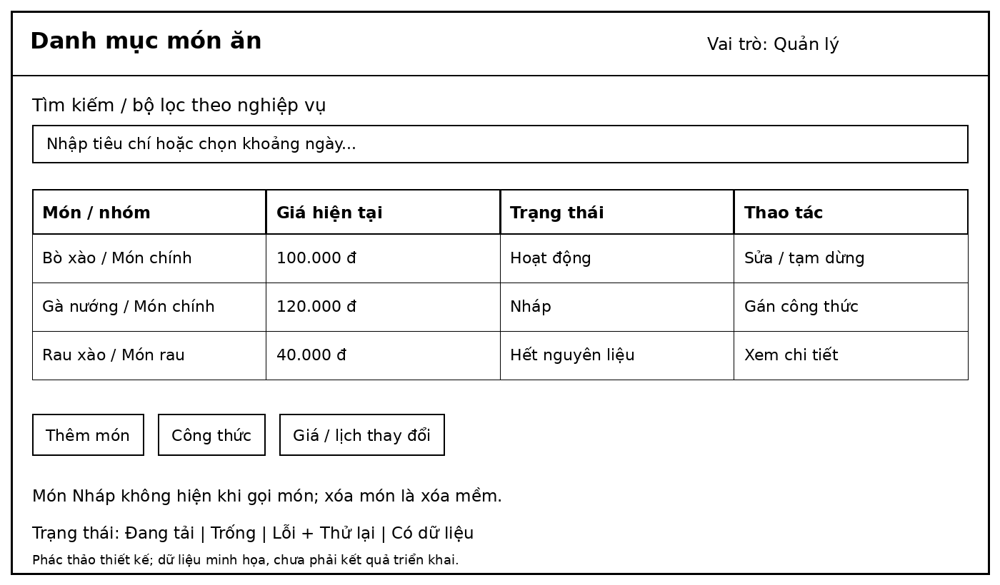

Phác thảo màn hình Gọi món.

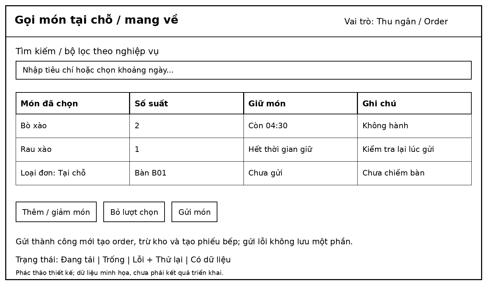

Phác thảo màn hình Thanh toán và xác minh.

Phác thảo màn hình Kho theo lô.

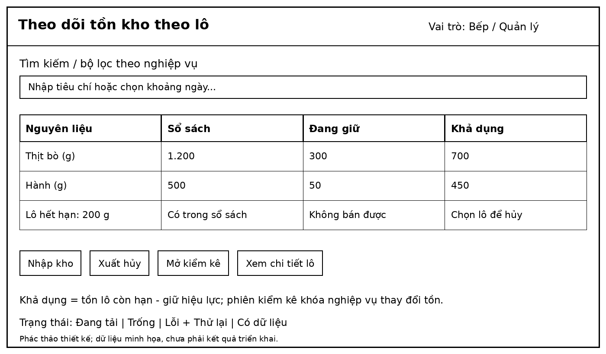

Phác thảo màn hình Báo cáo thống kê.

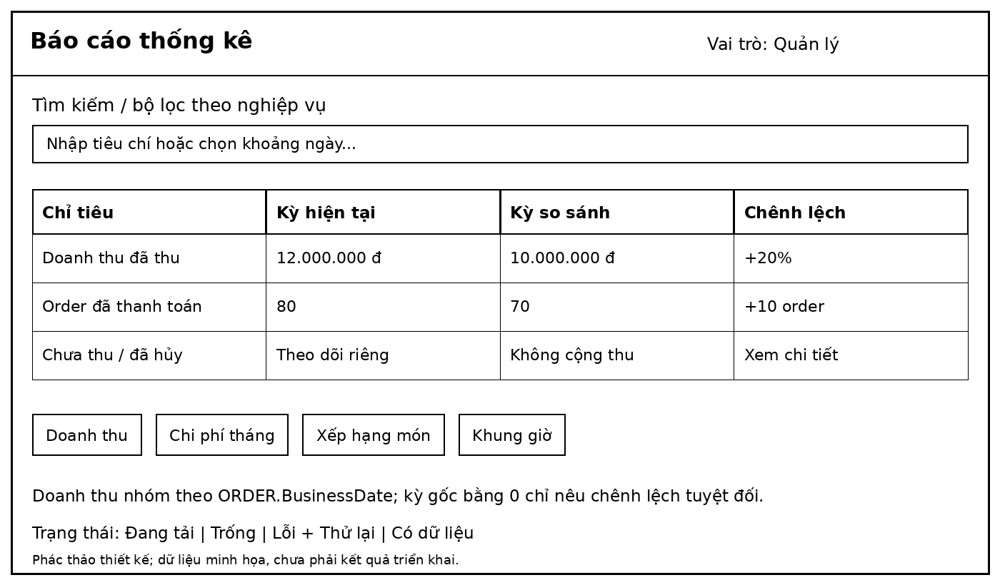

Phác thảo màn hình Cài đặt.

Phác thảo màn hình AI Assistant.

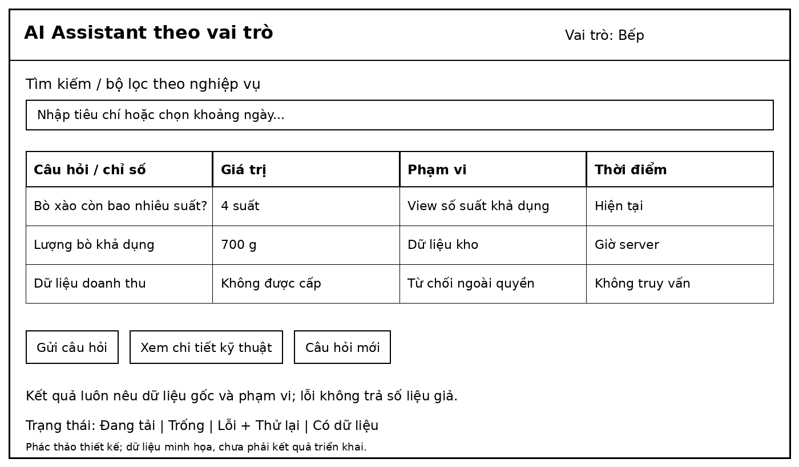

## 4.4. Thiết kế kiểm soát

### 4.4.1. Phân định quyền hạn về dữ liệu

Theo NFR-04 và NFR-05, backend/API kiểm tra quyền chức năng ở mỗi yêu cầu; tập view MySQL riêng theo vai trò giới hạn dữ liệu AI được truy cập. Quản lý sử dụng phạm vi dữ liệu quản trị; Thu ngân và Nhân viên order chỉ truy cập dữ liệu bán hàng được phép; Bếp truy cập dữ liệu kho. Ma trận chi tiết theo nhóm dữ liệu và view được trình bày tại Phụ lục H.1.

Các tên VW_AI\_\* biểu thị tập view theo vai trò; mỗi tập được tách thành view theo chủ đề, tổng hợp các quan hệ một–nhiều trước khi kết hợp để tránh nhân dòng. (1) VW_AI_QUANLY đọc các dữ liệu nghiệp vụ được phép gồm danh mục, bán hàng, kho và báo cáo, loại trường xác thực và thông tin cá nhân không cần thiết. (2) VW_AI_THUNGAN chỉ đọc dữ liệu bán hàng từ ORDER, CHI_TIET_ORDER, HOA_DON, GIAO_DICH_THANH_TOAN, MON_AN và BAN qua view phù hợp; loại giá nhập, giá vốn, lợi nhuận và các bảng kho. (3) VW_AI_KHO đọc tồn nguyên liệu/lô, nhập/xuất/kiểm kê, GIAO_DICH_KHO và lượng giữ tổng hợp. Tập này có thêm view tổng hợp số suất khả dụng theo món, gồm MaMon, TenMon, SoSuatKhaDung và ThoiDiemTinh; backend/view kết hợp MON_AN, công thức hiện hành và lượng khả dụng để tính trước, không cung cấp các bảng công thức gốc cho Bếp. Với món bị xóa, còn Nháp hoặc tạm dừng phục vụ, view không trả số suất có thể bán. Loại GiaVonUocTinh, GIA_BINH_QUAN_THANG và các bảng doanh thu/thanh toán khỏi tập Bếp. Mọi view AI chỉ được đọc bằng SELECT đã kiểm duyệt; phạm vi tại mỗi lượt hỏi được kiểm tra lại theo vai trò hiện hành, không dựa riêng vào vai trò lưu lúc mở phiên.

### 4.4.2. Phân định quyền hạn về chức năng

Bảng 10 tổng hợp quyền thực hiện chức năng theo vai trò, làm căn cứ kiểm soát tại backend và tổ chức giao diện. Phạm vi dữ liệu của từng vai trò được đối chiếu với Phụ lục H.1; nội dung các FR liên quan được trình bày tại Phụ lục K.

| **Chức năng (yêu cầu tham chiếu)**                                                                      | **Chủ nhà hàng/Quản lý** | **Thu ngân/Nhân viên order**                                                          | **Bếp**                         |
|---------------------------------------------------------------------------------------------------------|--------------------------|---------------------------------------------------------------------------------------|---------------------------------|
| Quản lý nhóm món, món ăn, công thức, giá bán, ẩn/hiện món                                               | Có                       | Chỉ xem                                                                               | Không                           |
| Quản lý nguyên liệu và nhà cung cấp                                                                     | Có                       | Không                                                                                 | Có                              |
| Quản lý sơ đồ bàn                                                                                       | Thêm/sửa/xóa             | Xem trạng thái bàn; xác nhận giải phóng bàn                                           | Không                           |
| Lập order, thêm/sửa món, đổi bàn, cập nhật trạng thái món, in phiếu bếp                                 | Có (kế thừa)             | Có                                                                                    | Không                           |
| Hủy một món ở trạng thái Chờ làm                                                                        | Có (kế thừa)             | Có                                                                                    | Không                           |
| Hủy toàn bộ order chưa thanh toán, bắt buộc nhập lý do                                                  | Có                       | Không                                                                                 | Không                           |
| Xác nhận đối soát, đóng order chưa thu được tiền, mở lại thanh toán và xử lý tiền QR đến muộn/hoàn tiền | Có                       | Không                                                                                 | Không                           |
| Thanh toán tiền mặt/QR, xử lý timeout QR và chuyển “Chờ xác minh thanh toán” khi khách báo đã trả       | Có (kế thừa)             | Có                                                                                    | Không                           |
| In phiếu tạm tính, in/in lại hóa đơn, tra cứu order                                                     | Có (kế thừa)             | Có                                                                                    | Không                           |
| Ghi nhận, sửa, hủy phiếu nhập kho                                                                       | Có (kế thừa)             | Không                                                                                 | Có                              |
| Phiếu xuất hủy                                                                                          | Có (kế thừa)             | Không                                                                                 | Có                              |
| Kiểm kê định kỳ                                                                                         | Có (kế thừa)             | Không                                                                                 | Có                              |
| Quản lý lô nguyên liệu (FIFO), cảnh báo hạn sử dụng                                                     | Có (kế thừa)             | Không                                                                                 | Có                              |
| Xem danh sách tồn kho                                                                                   | Có                       | Chỉ xem cảnh báo hết món                                                              | Có                              |
| Báo cáo doanh thu, giá vốn, lợi nhuận, xếp hạng món                                                     | Có                       | Không (chỉ tra cứu doanh thu, hóa đơn qua AI Assistant; không xem giá vốn, lợi nhuận) | Không                           |
| Quản lý tài khoản, gán vai trò, đặt lại mật khẩu                                                        | Có                       | Không                                                                                 | Không                           |
| Tự đăng nhập/đăng xuất, đổi mật khẩu                                                                    | Có                       | Có                                                                                    | Có                              |
| Cấu hình hệ thống và cảnh báo tồn kho                                                                   | Có                       | Không                                                                                 | Không                           |
| Xem nhật ký audit log                                                                                   | Có                       | Không                                                                                 | Không                           |
| Dùng AI Assistant                                                                                       | Có, phạm vi toàn bộ      | Có, phạm vi bán hàng/hóa đơn/doanh thu                                                | Có, phạm vi tồn kho/nguyên liệu |

Bảng 10. Ma trận quyền hạn theo chức năng và vai trò

Các nguyên tắc áp dụng: (1) quyền được kiểm tra ở tầng backend/API cho mọi thao tác, không chỉ ẩn nút ở giao diện (NFR-04); (2) Quản lý kế thừa toàn bộ quyền của Thu ngân, Nhân viên order và Bếp, nên các thao tác ghi “kế thừa” trong bảng vẫn phải ghi audit log đúng người thực hiện; (3) các thao tác rủi ro cao như hủy toàn bộ order, hủy món, lập phiếu xuất hủy, sửa/hủy phiếu nhập kho, sửa trực tiếp giá/công thức, quản lý tài khoản đều được ghi vào audit log và chỉ Quản lý xem được nhật ký này.

### 4.4.3. Phân định trách nhiệm và thẩm quyền theo từng vai trò

Quản lý chịu trách nhiệm cấu hình, phân quyền và quyết định các thao tác có ảnh hưởng lớn đến dữ liệu, tài chính. Thu ngân và Nhân viên order thực hiện phục vụ và thanh toán trong phạm vi được cấp; Bếp ghi nhận nghiệp vụ kho và cung cấp xác nhận thực tế về chế biến. Bảng trách nhiệm, quyền được thực hiện và giới hạn của từng vai trò được trình bày tại Phụ lục H.2.

Các thẩm quyền nhạy cảm được tách khỏi vai trò tuyến đầu để giảm rủi ro sai sót và gian lận: chỉ Quản lý được hủy toàn bộ order và thay đổi giá/công thức; Thu ngân không xem được giá vốn, lợi nhuận; Bếp không xem được doanh thu; điều chỉnh tồn kho sai lệch chủ yếu đi qua kiểm kê định kỳ có ghi nhận chênh lệch (ngoài ra chỉ có sửa/hủy phiếu nhập kho và phiếu xuất hủy độc lập).

# 5. KẾ HOẠCH TRIỂN KHAI VÀ ĐÁNH GIÁ

## 5.1. Công nghệ sử dụng

### 5.1.1. Lựa chọn công nghệ và framework

- Next.js (frontend): xây dựng giao diện web cho ba vai trò người dùng và giao diện chat AI Assistant.

- Python/FastAPI (backend): xử lý cả nghiệp vụ quản lý và dịch vụ AI Assistant trên cùng một nền tảng, thuận tiện tích hợp các thư viện xử lý LLM/Text-to-SQL của Python.

- sqlglot: kiểm duyệt cú pháp câu lệnh SQL do LLM sinh ra trước khi thực thi, đảm bảo chỉ chấp nhận câu lệnh SELECT.

- LLM: Claude Opus 5.5 (model=claude-opus-5-5) sinh SQL qua Claude API của Anthropic tại https://api.anthropic.com/v1/messages \[16\]. Mức effort ở bước sinh SQL là low cho cấu hình vận hành và hai cấu hình A/B, high cho cấu hình đối chứng C \[17\]. Claude Haiku 5.5 (model=claude-haiku-5-5) diễn giải kết quả với thinking=disabled. Kết quả chỉ có một giá trị được định dạng trực tiếp tại backend; kết quả rỗng được trả theo mẫu. Mỗi đợt thử nghiệm ghi ngày chạy, định danh model và tham số gọi.

Dự toán API sử dụng các đơn giá cấu hình trong mã nguồn được đối chiếu tại commit 9edce21 ngày 27/10/2026: Opus 5.5 là 4 USD/triệu token đầu vào và 20 USD/triệu token đầu ra; Haiku 5.5 là 0,10 USD/triệu token đầu vào và 0,50 USD/triệu token đầu ra. Đây là tham số tính chi phí của hệ thống; chi phí thanh toán được đối chiếu với usage và hóa đơn của nhà cung cấp. Backend hỗ trợ prompt cache; dự toán cơ sở chưa tính phần giảm chi phí do cache hoặc Batch API, thuế và dịch vụ ngoài mô hình. Đơn giá cache cấu hình là 5 USD/triệu token ghi và 0,20 USD/triệu token đọc; thời hạn prompt cache là 5 phút.

Với giả định mỗi câu hỏi dùng 3.000 token đầu vào và 600 token đầu ra cho Opus 5.5, 1.000 token đầu vào và 200 token đầu ra cho Haiku 5.5, chi phí cơ sở là 0,0242 USD/câu. Token đầu ra Opus bao gồm phần suy luận được tính phí. Kịch bản 100 câu/ngày trong 30 ngày có chi phí 72,60 USD/tháng; dự phòng 20% thành 87,12 USD/tháng. Token, cache, phần suy luận và lần thử lại thực tế được ghi log để đối chiếu với dự toán.

Ba cấu hình A/B/C chạy 80 câu, mỗi câu 3 lần, tạo 720 lượt đánh giá. A và B dùng giả định tại đoạn trên; C dự toán 2.600 token đầu ra Opus, giữ nguyên lượng token đầu vào và diễn giải, tương ứng 0,0642 USD/câu. Chi phí cơ sở của đợt thử là 27,024 USD, dự phòng 20% và làm tròn thành 32,43 USD; chưa gồm tập phát triển và bộ an toàn. Chi phí ghi nhận được tổng hợp theo từng model và usage API; khóa truy cập được lưu ở backend.

Chi phí ghi nhận trong đợt thực nghiệm được phân tích tại mục 5.2.8, kèm phạm vi usage thu thập được và giới hạn của ước lượng.

### 5.1.2. Lựa chọn hệ quản trị cơ sở dữ liệu

MySQL được lựa chọn làm hệ quản trị cơ sở dữ liệu chính. Tập view riêng cho từng vai trò giới hạn phạm vi dữ liệu của AI Assistant và giảm phụ thuộc trực tiếp vào cấu trúc bảng nghiệp vụ theo NFR-05.

### 5.1.3. Quy trình phát triển

Quy trình phát triển áp dụng mô hình thác nước có điều chỉnh kết hợp phát triển tăng dần theo module. Kết quả khảo sát, đặc tả yêu cầu và thiết kế là cơ sở triển khai các module danh mục, bán hàng, kho, báo cáo, cài đặt và AI Assistant. Mỗi module được xây dựng và kiểm thử theo từng đợt, với trách nhiệm thực hiện tại mục 1.5.

Quản lý mã nguồn: sử dụng Git với kho lưu trữ dùng chung cho ba thành viên; mỗi module/tính năng được phát triển trên một nhánh riêng (branch theo tên module), hợp nhất (merge) vào nhánh chính sau khi cá nhân tự kiểm thử chức năng liên quan; commit message ghi rõ module và nội dung thay đổi để thuận tiện truy vết khi lỗi phát sinh.

Kế hoạch triển khai gồm xây dựng các module nghiệp vụ, tích hợp AI Assistant, kiểm thử chức năng, đánh giá khả năng sử dụng bằng SUS, kiểm thử chấp nhận của người dùng (UAT) và hoàn thiện báo cáo. Nhóm trao đổi tiến độ hằng tuần theo phân công tại mục 1.5.

### 5.1.4. Kế hoạch triển khai theo tuần

Kế hoạch dưới đây bố trí chín tuần triển khai và đánh giá, từ tuần 7 đến tuần 15, sau giai đoạn phân tích thiết kế (tuần 1–6). Mỗi tuần có sản phẩm bàn giao và người phụ trách; mức hoàn thành được xác nhận bằng tài liệu, mã nguồn hoặc kết quả kiểm thử.

| **Tuần** | **Khánh**                                                                 | **Hùng**                                                                                 | **Minh**                                                           | **Sản phẩm và điều kiện hoàn thành**                                                                                                                  |
|----------|---------------------------------------------------------------------------|------------------------------------------------------------------------------------------|--------------------------------------------------------------------|-------------------------------------------------------------------------------------------------------------------------------------------------------|
| 7        | Chốt ngưỡng nghiệm thu, mẫu test case                                     | Khung dự án, DDL, đăng nhập và vai trò cơ bản                                            | Bắt đầu danh mục (nhóm món, món ăn, sơ đồ bàn)                     | Tiêu chuẩn đánh giá được chốt; khung dự án, CSDL, đăng nhập và danh mục bước đầu chạy được.                                                           |
| 8        | Test case danh mục, order, giữ món; ma trận truy vết; khung bộ câu hỏi AI | Chọn món, giữ món nguyên liệu; bắt đầu gửi món, order                                    | Danh mục, công thức, nguyên liệu, nhập kho tạo lô; dữ liệu mẫu nhỏ | Danh mục, công thức, nguyên liệu và nhập kho theo lô hoạt động; chọn món và giữ món chạy được; có test case, ma trận truy vết và khung bộ câu hỏi AI. |
| 9        | Test các chức năng vừa xong; test case kho; câu hỏi tập phát triển        | Gửi món, order, phiếu bếp, gọi thêm                                                      | FIFO, lượng khả dụng, trừ kho; giá và công thức theo hiệu lực      | Một luồng nhập kho–chọn món–gửi bếp chạy được; kho trừ đúng theo FIFO, không trừ lặp; giá và công thức áp dụng đúng theo hiệu lực.                    |
| 10       | Test order, giữ món đồng thời, hồi quy; viết bộ ca an toàn AI             | Phân quyền chi tiết, cấu hình, audit log; mang về, đổi bàn; thanh toán tiền mặt, hóa đơn | Hủy món, hoàn kho, xuất hủy                                        | Order tại chỗ và mang về, đổi bàn, thanh toán tiền mặt, hủy và hoàn kho hoạt động; ca giữ món đồng thời đạt; có bộ ca an toàn AI.                     |
| 11       | Test thanh toán, hủy, kho; soạn SQL chuẩn                                 | QR, webhook, xác minh; view theo quyền bản đầu                                           | Kiểm kê; script sinh dữ liệu 12 tháng                              | Thanh toán QR, webhook và kiểm kê chạy được; ca thanh toán, hủy, kho đạt; có script dữ liệu 12 tháng và SQL chuẩn.                                    |
| 12       | Kiểm tra chéo, khóa 80 câu; test kiểm kê, báo cáo; cho người dùng thử     | Hoàn thiện view, kiểm duyệt SQL; bắt đầu sinh SQL, API AI                                | Nạp dữ liệu 12 tháng; báo cáo thống kê                             | View theo quyền đối chiếu đúng dữ liệu; bộ 80 câu được khóa; người dùng thử luồng phục vụ và kho.                                                     |
| 13       | Test hiệu năng; chạy thử bộ an toàn và tập phát triển                     | Hoàn thiện AI, log chi phí, hạn mức; đóng gói bản chạy                                   | Diễn giải, biểu đồ, runner A/B/C; viết hướng dẫn                   | AI chạy xuyên suốt; có công cụ chạy A/B/C, hướng dẫn và bản chạy đóng gói; có kết quả kiểm thử hiệu năng.                                             |
| 14       | Chạy bộ an toàn, chấm A/B/C; SUS; hồi quy cuối; hoàn thiện báo cáo        | Sửa lỗi theo kiểm thử; tích hợp                                                          | Chạy runner A/B/C; phân tích số liệu                               | Có log, bảng kết quả A/B/C, bộ ca an toàn, điểm SUS và tổng hợp kiểm thử; lỗi được xử lý, hồi quy lần cuối.                                           |
| 15       | Trình bày; rà soát báo cáo                                                | Trình bày; rà soát bản chạy                                                              | Trình bày; rà soát dữ liệu và hướng dẫn                            | Bản chạy và tài liệu nhất quán; danh sách lỗi còn lại được công bố.                                                                                   |

Bảng 11. Kế hoạch triển khai theo tuần

## 5.2. Kế hoạch thực nghiệm và tiêu chí đánh giá

### 5.2.1. Cơ sở và nguyên tắc đánh giá

Kế hoạch đánh giá gồm kiểm thử nghiệp vụ, an toàn và hiệu năng hệ thống; thực nghiệm hỏi đáp dữ liệu; đánh giá khả năng sử dụng. Các bộ dữ liệu Text-to-SQL \[5\], \[6\], \[11\] cung cấp cách tham khảo xây dựng câu hỏi và so sánh kết quả truy vấn.

Các mốc đánh giá dựa trên các tham chiếu sau: (1) ISO/IEC 25010:2023 \[13\] là khung phân loại yêu cầu phi chức năng tại mục 2.4.2; (2) mốc phản hồi 1 giây và 10 giây của Nielsen \[14\] là căn cứ cho NFR-01 đến NFR-03; (3) ngưỡng INP 200 ms ở phân vị 75 của Core Web Vitals \[18\] là mốc cho độ trễ tương tác của giao diện; (4) thang SUS \[19\] và mốc trung bình 68 từ các nghiên cứu tổng hợp \[20\] là căn cứ đánh giá khả năng sử dụng; (5) bộ dữ liệu BIRD \[6\] là bối cảnh để diễn giải độ đúng Text-to-SQL; (6) hướng dẫn OWASP \[15\] là cơ sở cho nhóm ca an toàn AI. Các mốc này là tham chiếu chung, chưa được xác nhận bằng khảo sát thời gian chờ tại nhà hàng. Ngưỡng được cố định trước lần đánh giá chính thức; kết quả và phạm vi kiểm chứng được trình bày tại mục 5.2.8.

### 5.2.2. Dữ liệu và đáp án chuẩn

Dữ liệu thực nghiệm AI là bản dữ liệu mô phỏng có thời điểm tham chiếu 23/10/2026 12:00 theo múi giờ Việt Nam và hạt giống sinh dữ liệu 42. Bản dữ liệu, lược đồ và đáp án được cố định trước đợt chạy. Kịch bản phát tải riêng tại Phụ lục J quy định 20.000 order trong 12 tháng; đây là quy mô dự kiến của phép thử tải.

Tập đánh giá chính thức gồm 80 câu: 30 đơn giản, 30 trung bình và 20 phức tạp. Nhóm đơn giản gồm tra cứu hoặc tổng hợp một chỉ số trên một view; nhóm trung bình gồm nhiều điều kiện, nhóm/xếp hạng hoặc kết hợp hai view; nhóm phức tạp gồm so sánh nhiều kỳ hoặc nhiều bước tổng hợp. Mỗi câu được xếp theo mức khó cao nhất mà truy vấn chuẩn yêu cầu.

Phân bố theo vai trò gồm 60 câu Quản lý (20 đơn giản, 20 trung bình, 20 phức tạp), 10 câu Thu ngân và 10 câu Bếp (mỗi vai trò 5 đơn giản, 5 trung bình). Tập phát triển riêng gồm 30 câu, chỉ dùng xây dựng prompt và few-shot. Tập chính thức được khóa trước chạy, không dùng làm ví dụ hoặc sửa prompt theo từng đáp án.

Mỗi bản ghi gồm mã câu, vai trò, câu hỏi, thời điểm tham chiếu, định nghĩa chỉ số, SQL chuẩn, kết quả chuẩn và tiêu chí chấm diễn giải. Cấu trúc bản ghi và câu hỏi mẫu của tập phát triển được trình bày tại Phụ lục F.

Kiểm tra chéo sử dụng ba agent AI độc lập với Claude Opus 5.5, Sonnet 5.5 và Haiku 5.5 trên 20 câu. Mỗi agent nhận phiếu câu hỏi không kèm SQL chuẩn và định nghĩa view, tự viết SQL rồi thực thi bằng tài khoản chỉ đọc của vai trò tương ứng. Mức đồng thuận ban đầu là 16/20 câu. Các điểm chưa thống nhất thuộc quy tắc làm tròn ở Q030/Q049, phạm vi cột của đáp án Q041 và cách biểu đạt câu hỏi Q036 về số order bị hủy. Bộ đề hoàn chỉnh sử dụng phép so sánh số ở hai chữ số thập phân và đạt đồng thuận 20/20 theo tiêu chí nới lỏng. Biên bản kiểm tra được lưu tại data/eval/crosscheck/bien-ban-2026-10-27.md.

Tập 80 câu được khóa ngày 27/10/2026. Manifest lưu SHA256 của bộ đề, lược đồ và dữ liệu đáp án; bản sao CSDL có checksum được ghi trong tài liệu repository và lưu tại máy thực nghiệm của nhóm. Bước kiểm tra chéo do AI thực hiện, chưa có xác nhận của người kiểm tra độc lập.

### 5.2.3. Chỉ số và cấu hình thực nghiệm

Chỉ số chính là độ đúng thực thi nới lỏng: mọi cột của kết quả chuẩn phải có giá trị tương ứng trên cùng dòng của kết quả truy vấn, cho phép có thêm cột thông tin. Độ đúng khắt khe yêu cầu khớp đầy đủ bảng kết quả. Cả hai so sánh số ở hai chữ số thập phân; thứ tự dòng được xét khi rubric yêu cầu. Độ đúng câu trả lời yêu cầu SQL đúng theo tiêu chí khắt khe và phần diễn giải đạt ba tiêu chí: số liệu; kỳ và phạm vi; nhận xét. Các tỷ lệ dùng mẫu số toàn bộ lượt hỏi của cấu hình; lượt lỗi, timeout hoặc từ chối nhầm đều tính sai.

Tỷ lệ SQL lỗi, tỷ lệ từ chối nhầm, thời gian trung bình, p95 và token/chi phí mỗi câu được báo cáo riêng theo vai trò và mức khó. Thời gian đo từ backend nhận câu hỏi đến trả câu trả lời đầy đủ, bao gồm các lần thử lại. Yêu cầu làm rõ hợp lệ và từ chối ngoài quyền được đánh giá bằng bộ riêng, không trộn vào mẫu số 80 câu nghiệp vụ.

Ba cấu hình dùng Claude Opus 5.5 ở bước sinh SQL. A dùng lược đồ và quy tắc quyền; B thêm định nghĩa nghiệp vụ, chuẩn hóa tiếng Việt và ví dụ từ tập phát triển. A và B đặt effort=low; C giữ prompt của B, đặt effort=high \[17\]. Cả ba dùng cùng cách diễn giải bằng Claude Haiku 5.5 với thinking=disabled, gồm nhánh định dạng trực tiếp kết quả đơn giản tại backend. Mỗi câu chạy 3 lần trên cùng dữ liệu, giới hạn truy vấn và bộ kiểm duyệt; tắt cache kết quả và chuyển model dự phòng trong bộ chạy đánh giá. Prompt cache của nhà cung cấp được ghi nhận qua usage. Các lượt chạy được xen kẽ trong cùng đợt; kết quả được báo cáo riêng và tổng hợp theo cấu hình.

Độ đúng thực thi và độ đúng câu trả lời được báo cáo theo từng nhóm độ khó, vai trò và cấu hình; thời gian phản hồi được đánh giá theo p95 dưới 10 giây. Để đặt kết quả vào bối cảnh, BIRD \[6\] công bố độ đúng thực thi của người là 92,96% và của GPT-4 là 54,89% trên bộ dữ liệu năm 2023; do lược đồ view và dữ liệu của đề tài nhỏ và sạch hơn BIRD nên các con số này không dùng để so sánh trực tiếp. Kết quả chính của thực nghiệm là mức chênh lệch độ đúng giữa ba cấu hình A, B và C. Kết quả không được suy rộng thành độ đúng cho mọi câu hỏi hoặc mọi nhà hàng.

### 5.2.4. Kiểm thử nghiệp vụ và an toàn

Kiểm thử chức năng truy vết từ FR đến dữ liệu đầu vào, điều kiện, kết quả mong đợi và bằng chứng thực thi. Các nhóm trọng yếu là giữ món/gửi món, hủy và hoàn kho, thanh toán và webhook lặp, kiểm kê, hiệu lực giá/công thức, phân quyền và tính doanh thu. Điều kiện nghiệm thu là toàn bộ ca trọng yếu đạt; các ca chưa đạt khác được liệt kê cùng mức ảnh hưởng. Mẫu test case, bộ ca kiểm thử và ma trận truy vết được trình bày tại Phụ lục F.

Bộ an toàn AI gồm tối thiểu 20 ca: 5 yêu cầu vượt quyền/giả vai trò, 5 chỉ dẫn trực tiếp hoặc nhúng trong dữ liệu, 4 yêu cầu ghi dữ liệu hoặc truy vấn ngoài danh sách, 3 ca lịch sử/cache sau đổi quyền và 3 ca truy vấn vượt giới hạn. Kiểm tra cả phản hồi và log CSDL; yêu cầu không có truy cập trái quyền hoặc thay đổi dữ liệu thành công trong bộ thử. Danh sách ca được trình bày tại mục F.5 của Phụ lục F. Bộ hỏi đáp S001–S030 đo hành vi từ chối của model được báo cáo riêng tại mục 5.2.8; các ca AT01–AT20 kiểm chứng cơ chế bảo vệ ở mức tích hợp.

Các ca giữ món được lặp tối thiểu 100 lần cho mỗi tình huống cạnh tranh: hai bàn lấy lượng cuối, hai món dùng chung nguyên liệu, gửi đúng lúc hết hạn và gửi lặp sau timeout. So sánh sổ cái, lượng lô, lượng giữ và dòng order sau mỗi lần; yêu cầu không có cấp trùng, tồn âm hoặc tiêu hao lặp.

Đối chiếu yêu cầu phi chức năng với phép kiểm chứng và bằng chứng cần lưu:

| Yêu cầu | Phép kiểm chứng                                                                                               | Bằng chứng / điều kiện kết luận                                                                       |
|---------|---------------------------------------------------------------------------------------------------------------|-------------------------------------------------------------------------------------------------------|
| NFR-01  | Phát tải nghiệp vụ 5/10/20 người dùng, 20.000 order theo J.3–J.7.                                             | CSV từng thao tác, p95 từng mức, cấu hình máy và log lỗi; mỗi nhóm không quá 1 giây.                  |
| NFR-02  | Chạy bộ câu hỏi AI theo 5.2.2–5.2.3, tính cả thử lại.                                                         | Log bắt đầu/kết thúc và p95 dưới 10 giây; báo cáo riêng cấu hình, vai trò, độ khó.                    |
| NFR-03  | 5 phiên Quản lý chạy báo cáo theo J.6.                                                                        | CSV và tổng đối chứng; p95 mỗi loại báo cáo dưới 10 giây.                                             |
| NFR-04  | Kiểm tra hash mật khẩu, HTTPS, khóa/phiên hết hạn, API trái quyền và loại bí mật khỏi dữ liệu gửi LLM.        | Phản hồi API, cấu hình triển khai, dữ liệu/log đã che bí mật; ca trái quyền không đọc/ghi thành công. |
| NFR-05  | Bộ an toàn AI tối thiểu 20 ca; kiểm tra quyền SELECT, view/cột, giới hạn 2 lần sinh SQL, 3 giây, 500 dòng.    | Phản hồi và log CSDL; không ghi dữ liệu hoặc truy cập ngoài quyền thành công.                         |
| NFR-06  | Thử sửa/xóa nhật ký bằng các vai trò; kiểm tra trường truy vết và che dữ liệu nhạy cảm.                       | API/quyền CSDL từ chối; log đủ trường và không chứa mật khẩu/token/khóa API.                          |
| NFR-07  | Rollback, gửi lặp, cạnh tranh giữ/gửi, hết hạn và khóa kiểm kê theo F.2 và 5.2.4.                             | Đối chiếu lô, giữ, order, sổ cái; không âm tồn, cấp trùng, trừ lặp hoặc ghi một phần.                 |
| NFR-08  | Chạy gọi món/thanh toán trên Chrome và Edge hiện hành; kiểm tra thông báo tiếng Việt và trạng thái giao diện. | Phiên bản trình duyệt, độ phân giải và ảnh/log lỗi; các luồng hoàn tất đúng.                          |
| NFR-09  | Hỏi đến/vượt hạn mức; kiểm tra cache sau đổi dữ liệu hoặc quyền; tồn khả dụng không dùng cache cũ.            | Log hạn mức và cache; vượt hạn bị chặn, dữ liệu/quyền mới không dùng kết quả cũ.                      |

### 5.2.5. Kiểm thử hiệu năng

Phép thử hiệu năng dự kiến sử dụng máy chủ 4 vCPU, RAM 8 GB chạy MySQL và backend, cùng máy phát tải riêng. CSDL mô phỏng bao phủ 12 tháng với 20.000 order; tải gồm 5, 10 và 20 người dùng ảo đồng thời. Thông tin tái lập gồm cấu hình thực tế, phiên bản phần mềm, độ trễ mạng và commit của script.

Kịch bản hiệu năng được đặc tả tại Phụ lục J, gồm sinh dữ liệu có hạt giống cố định, chuỗi thao tác có phụ thuộc và kiểm tra bất biến sau chạy. Mỗi mức 5, 10, 20 người dùng ảo có 2 phút khởi động và 10 phút đo, lặp 3 lần trên cùng bản sao dữ liệu gốc. p95 được đo riêng cho giữ/điều chỉnh món, gửi món, cập nhật danh mục và ghi nhận kho, mục tiêu không quá 1 giây; đo báo cáo riêng với 5 người dùng ảo, p95 dưới 10 giây. Tỷ lệ lỗi kỹ thuật và yêu cầu bị từ chối đúng nghiệp vụ được thống kê riêng. Độ trễ giao diện được đo bằng INP trên trình duyệt với mục tiêu phân vị 75 không quá 200 ms; phép đo này tách biệt với thời gian phản hồi API.

### 5.2.6. Đánh giá khả năng sử dụng

Khảo sát bằng thang SUS \[19\] dự kiến với 3–5 người đóng vai Quản lý, kết hợp nhiệm vụ tra cứu doanh thu, so sánh hai kỳ và nhận biết món biến động. Các chỉ số thu thập gồm tỷ lệ hoàn thành, thời gian, số lần cần hỗ trợ và nhận xét. Với 10 câu SUS, điểm câu lẻ trừ 1, điểm câu chẵn lấy 5 trừ đáp án; tổng nhân 2,5 cho thang 0–100. Điểm SUS trung bình trong các nghiên cứu tổng hợp là 68; điểm trên 68 được xem là trên trung bình \[20\]. Mục tiêu của đề tài là điểm SUS trung bình không thấp hơn 68; với 3–5 người tham gia, kết quả chỉ mang tính thăm dò.

UAT sử dụng các kịch bản phục vụ, kho và quản lý theo quyền. Người tham gia xác nhận kết quả từng nhiệm vụ và ghi vấn đề gặp phải. Kết quả SUS và UAT phản ánh nhóm thử nghiệm nhỏ; các hạn chế về mẫu và môi trường mô phỏng được trình bày cùng kết quả.

### 5.2.7. Mẫu cấu trúc câu hỏi đánh giá

| **Mã và vai trò** | **Câu hỏi mẫu**                               | **Căn cứ chấm**                                                              |
|-------------------|-----------------------------------------------|------------------------------------------------------------------------------|
| AI01 – Quản lý    | Doanh thu ngày được chọn là bao nhiêu?        | Tổng hóa đơn thành công theo ORDER.BusinessDate; đúng đơn vị và khoảng ngày. |
| AI02 – Quản lý    | Tuần này so với tuần trước thay đổi thế nào?  | Hai khoảng ngày cụ thể; chênh lệch tuyệt đối và tỷ lệ khi mẫu số khác 0.     |
| AI03 – Quản lý    | Ba món giảm lượng bán nhiều nhất giữa hai kỳ? | Tổng lượng bán hợp lệ từng kỳ, độ giảm và thứ tự đúng.                       |
| AI04 – Bếp        | Nguyên liệu nào đang dưới ngưỡng?             | Lượng khả dụng sau khi trừ giữ món và loại lô hết hạn.                       |
| AI05 – Thu ngân   | Các order đang chờ xác minh hôm nay?          | Đúng trạng thái, phạm vi bán hàng và ngày tham chiếu.                        |

Bảng 12. Mẫu câu hỏi và tiêu chí chấm AI

### 5.2.8. Kết quả thực nghiệm AI Assistant

Đợt đánh giá ngày 27/10/2026 sử dụng tập 80 câu đã khóa, ba cấu hình và ba lần lặp, tổng 720 lượt. Mỗi lần gọi model có giới hạn 5 giây; mỗi câu tối đa hai lần sinh SQL, mỗi truy vấn tối đa 3 giây và 500 dòng. Công cụ loại hai đợt mất kết nối mạng chưa hoàn tất và chạy lại theo cơ chế chờ mạng; timeout model vẫn được tính lỗi. Nguồn số liệu là các tệp kết quả thực nghiệm lưu tại commit 9edce21.

| Cấu hình | Nới lỏng | Khắt khe | Câu trả lời | Lỗi/timeout | p50 (s) | p95 (s) |
|----------|----------|----------|-------------|-------------|---------|---------|
| A        | 83,33%   | 67,50%   | 58,33%      | 15,83%      | 4,75    | 7,18    |
| B        | 85,42%   | 72,50%   | 62,08%      | 12,92%      | 4,60    | 6,98    |
| C        | 61,25%   | 54,17%   | 49,17%      | 38,75%      | 5,04    | 6,94    |

Bảng 13. Kết quả trên tập 80 câu, 240 lượt mỗi cấu hình

| Cấu hình | Dễ (30) | Trung bình (30) | Khó (20) | Quản lý (60) | Thu ngân (10) | Bếp (10) |
|----------|---------|-----------------|----------|--------------|---------------|----------|
| A        | 96,67%  | 90,00%          | 53,33%   | 78,33%       | 96,67%        | 100,00%  |
| B        | 98,89%  | 92,22%          | 55,00%   | 81,11%       | 100,00%       | 96,67%   |
| C        | 81,11%  | 70,00%          | 18,33%   | 52,78%       | 96,67%        | 76,67%   |

Bảng 14. Độ đúng thực thi nới lỏng theo độ khó và vai trò

Cấu hình B có độ đúng cao nhất trong đợt chạy: hơn A 2,08 điểm phần trăm về độ đúng nới lỏng (205/240 so với 200/240) và 5,00 điểm về độ đúng khắt khe. Chênh lệch nhỏ và ba lần lặp trên cùng 80 câu chưa đủ để khẳng định ưu thế trong mọi lần vận hành hoặc quan hệ nhân quả cho từng thành phần prompt.

Phần lớn lượt không đạt theo tiêu chí nới lỏng là lượt lỗi/timeout. Trong các lượt không lỗi, tỷ lệ nới lỏng lần lượt là 200/202 (99,01%), 205/209 (98,09%) và 147/147 (100%). Tỷ lệ có điều kiện này không thay thế độ đúng trên toàn bộ 240 lượt. Cấu hình C có tỷ lệ lỗi 38,75%; tăng effort trong giới hạn thời gian hiện tại không cải thiện độ đúng tổng thể. Câu khó vẫn là hạn chế, cấu hình B đạt 55,00%.

p95 của ba cấu hình đều dưới 10 giây trên bộ thực nghiệm này, đáp ứng ngưỡng thời gian NFR-02 trong phạm vi phép đo của harness. Mẫu có bao gồm lượt lỗi kết thúc ở timeout; p95 thấp không đồng nghĩa trả lời đúng. Bộ chạy chưa kiểm chứng đầy đủ độ trễ giao diện, tải người dùng đồng thời và các điều kiện triển khai thực tế.

Phần diễn giải được ba agent Claude Sonnet 5.5 chấm mù cấu hình. Trong 466 lượt có SQL đúng khắt khe, 407 câu trả lời đạt (87,34%); các tỷ lệ tại Bảng 13 dùng mẫu số 240 lượt/cấu hình. Lỗi thường gặp gồm nhãn tiền tệ cho số giao dịch kho (18 câu theo biên bản chấm), đọc sai bảng nhiều dòng, tính tổng/tỷ lệ hoặc ghi sai khoảng ngày. Mã nguồn đã sửa lỗi nhãn tiền tệ sau đợt chạy tại commit c741b26; bộ kết quả trên vẫn phản ánh phiên bản được đo, chưa phải kết quả chạy lại sau sửa. Kết quả chấm do AI thực hiện, chưa có người chấm xác nhận.

Bộ hỏi đáp an toàn S001–S030 chạy ba lần cho mỗi cấu hình, tổng 270 lượt. A từ chối đúng 84/90 lượt (93,33%), B 83/90 (92,22%), C 85/90 (94,44%). A có 4 lượt lỗi và 2 lượt vẫn sinh SQL; B có 6 lượt lỗi và 1 lượt vẫn sinh SQL; C có 5 lượt lỗi. Ba lượt sinh SQL thuộc S028, yêu cầu xuất lịch sử thanh toán để gửi ra ngoài. SQL chỉ tham chiếu view thanh toán của Quản lý và có LIMIT 500; điểm chưa đạt nằm ở việc từ chối mục đích sử dụng ngoài phạm vi.

Bộ chạy đánh giá dừng ca an toàn khi model sinh SQL và không thực thi truy vấn đó trên dữ liệu nghiệp vụ. Tỷ lệ tại bộ S001–S030 phản ánh hành vi từ chối. Việc kiểm chứng bộ kiểm duyệt SQL, quyền GRANT, đổi quyền giữa phiên, giới hạn thực thi và truy cập dữ liệu được đánh giá ở mức tích hợp bằng các ca AT01–AT20 tại mục F.5, với tiêu chí và bằng chứng riêng.

Trong đợt 720 lượt, tổng chi phí ghi nhận theo usage và đơn giá cấu hình là 3,4154 USD. Bình quân trên toàn bộ lượt lần lượt là 0,00479; 0,00504; 0,00440 USD/câu ở A, B, C. Tuy nhiên, usage chưa đầy đủ ở một số lượt, đặc biệt khi timeout, nên đây không phải tổng chi phí thanh toán đã đối soát. Trên các lượt có usage đầy đủ, bình quân A và B khoảng 0,0057 USD/câu, C khoảng 0,0072 USD/câu. Mức xấp xỉ 0,006 USD/câu tương ứng 18 USD cho 3.000 câu, là ước lượng ngoại suy từ nhóm lượt có usage đầy đủ, chưa gồm chi phí bị thiếu và các chi phí ngoài API.

Giới hạn của thực nghiệm gồm dữ liệu mô phỏng và lược đồ view chuyên biệt; kiểm tra chéo bằng agent AI; chấm diễn giải bằng AI; usage thiếu ở một số lượt; độ trễ phụ thuộc mạng và tải API. Bản sao CSDL không có trong repository công khai nên việc tái lập đầy đủ cần bản sao do nhóm lưu giữ. Không suy rộng kết quả thành độ đúng với mọi câu hỏi hoặc mọi nhà hàng.

Bằng chứng: docs/eval-results-official-2026-10-27.json; docs/eval-results-official-2026-10-27-graded.json; docs/eval-grades-official-2026-10-27.json; docs/eval-safety-2026-10-27.json; data/eval/questions.locked.jsonl; data/eval/questions.locked.manifest.json; data/eval/crosscheck/bien-ban-2026-10-27.md.

# KẾT LUẬN

Đề tài khảo sát nhu cầu người dùng, xác định yêu cầu và thiết kế hệ thống quản lý nhà hàng gồm năm module nghiệp vụ: danh mục, bán hàng, kho, báo cáo thống kê và cài đặt. Thiết kế bao quát thanh toán QR có đối soát, quản lý lô nguyên liệu theo FIFO và phân quyền dữ liệu theo vai trò. Các module được triển khai và kiểm thử trong phạm vi trình bày tại Chương 5 và Phụ lục F.

AI Assistant hỗ trợ tra cứu và so sánh dữ liệu kinh doanh bằng tiếng Việt, sử dụng Opus 5.5 sinh SQL, Haiku 5.5 diễn giải, view theo vai trò và bộ kiểm duyệt truy vấn. Đợt thực nghiệm ngày 27/10/2026 có 80 câu đã khóa, ba cấu hình và ba lần lặp, tổng 720 lượt. Cấu hình B đạt độ đúng thực thi nới lỏng 85,42%, khắt khe 72,50%, độ đúng câu trả lời 62,08% và p95 6,98 giây. Việc kiểm tra chéo đáp án và chấm câu trả lời do agent AI thực hiện, chưa có xác nhận độc lập của người chấm.

Bộ 170 ca nghiệp vụ đã được thực thi trên commit a4f222e: 164 ca đạt và 6 ca không đạt; lỗi tạo tài khoản được phát hiện thêm trong kiểm thử mở rộng. Bộ hỏi đáp an toàn đạt tỷ lệ từ chối đúng 92,22–94,44% theo cấu hình, với phạm vi đo nêu tại mục 5.2.8. Kết quả cho thấy hiệu quả của cấu hình B trong điều kiện thực nghiệm, đồng thời còn hạn chế ở câu khó, timeout và diễn giải. SUS, UAT với người dùng thật, kiểm thử tải theo Phụ lục J và một số điều kiện thiết bị thực tế chưa hoàn tất; chưa đủ căn cứ nghiệm thu toàn bộ hệ thống.

## Giới hạn phạm vi

Các nội dung sau nằm ngoài phạm vi của đề tài:

- Quản lý nhân sự và tiền lương.

- Quản lý quan hệ khách hàng (CRM).

- Chương trình khuyến mãi/giảm giá.

- Tích hợp thanh toán bằng thẻ (quẹt thẻ).

- Thuế VAT tách dòng trên hóa đơn (giá bán niêm yết đã bao gồm mọi loại thuế/phí; quán tự cân đối nghĩa vụ thuế ngoài hệ thống).

- Phân ca làm việc / mở ca / chốt ca.

- Chi tiết kỹ thuật tích hợp máy in nhiệt tại bếp (driver máy in, khổ giấy, giao thức kết nối phần cứng).

- Phạm vi mở rộng gồm tích hợp chuyên sâu cổng thanh toán, xử lý tải lớn/đa máy chủ và tự vận hành LLM. MVP dùng một CSDL MySQL với khóa dòng (mục 4.2.2).

# TÀI LIỆU THAM KHẢO

\[1\] KiotViet, “Phần mềm quản lý nhà hàng, quán ăn.” \[Trực tuyến\]. Địa chỉ: https://www.kiotviet.vn. Truy cập: tháng 8/2026.

\[2\] Sapo, “Phần mềm quản lý nhà hàng Sapo FnB.” \[Trực tuyến\]. Địa chỉ: https://www.sapo.vn. Truy cập: tháng 8/2026.

\[3\] iPOS.vn, “Phần mềm quản lý nhà hàng, quán cà phê iPOS.vn.” \[Trực tuyến\]. Địa chỉ: https://ipos.vn. Truy cập: tháng 8/2026.

\[4\] MISA CukCuk, “Phần mềm quản lý nhà hàng CukCuk.” \[Trực tuyến\]. Địa chỉ: https://www.cukcuk.vn. Truy cập: tháng 8/2026.

\[5\] T. Yu, R. Zhang, K. Yang, M. Yasunaga, D. Wang, Z. Li, J. Ma, I. Li, Q. Yao, S. Roman, Z. Zhang, and D. Radev, “Spider: A Large-Scale Human-Labeled Dataset for Complex and Cross-Domain Semantic Parsing and Text-to-SQL Task,” in Proc. 2018 Conference on Empirical Methods in Natural Language Processing (EMNLP), Brussels, Belgium, 2018, pp. 3911–3921.

\[6\] J. Li, B. Hui, G. Qu, J. Yang, B. Li, B. Li, B. Wang, B. Qin, R. Cao, R. Geng, N. Huo, X. Zhou, C. Ma, G. Li, K. C. C. Chang, F. Huang, R. Cheng, and Y. Li, “Can LLM Already Serve as A Database Interface? A Big Bench for Large-Scale Database Grounded Text-to-SQLs,” in Advances in Neural Information Processing Systems 36 (NeurIPS 2023), Datasets and Benchmarks Track, 2023.

\[7\] M. Pourreza and D. Rafiei, “DIN-SQL: Decomposed In-Context Learning of Text-to-SQL with Self-Correction,” in Advances in Neural Information Processing Systems 36 (NeurIPS 2023), 2023.

\[8\] N. Rajkumar, R. Li, and D. Bahdanau, “Evaluating the Text-to-SQL Capabilities of Large Language Models,” arXiv preprint arXiv:2204.00498, 2022.

\[9\] D. Gao, H. Wang, Y. Li, X. Sun, Y. Qian, B. Ding, and J. Zhou, “Text-to-SQL Empowered by Large Language Models: A Benchmark Evaluation,” Proceedings of the VLDB Endowment, vol. 17, no. 5, pp. 1132–1145, 2024.

\[10\] Z. Hong, Z. Yuan, Q. Zhang, H. Chen, J. Dong, F. Huang, and X. Huang, “Next-Generation Database Interfaces: A Survey of LLM-based Text-to-SQL,” arXiv preprint arXiv:2406.08426, 2024.

\[11\] A. T. Nguyen, M. H. Dao, and D. Q. Nguyen, “A Pilot Study of Text-to-SQL Semantic Parsing for Vietnamese,” in Findings of the Association for Computational Linguistics: EMNLP 2020, 2020, pp. 4079–4085.

\[12\] iPOS.vn và Nestlé Professional, “Báo cáo thị trường Kinh doanh Ẩm thực tại Việt Nam năm 2025.” \[Trực tuyến\]. Địa chỉ: https://ipos.vn. Truy cập: tháng 9/2026.

\[13\] ISO/IEC, “ISO/IEC 25010:2023 Systems and software engineering — Systems and software Quality Requirements and Evaluation (SQuaRE) — Product quality model,” 2023.

\[14\] J. Nielsen, “Response Times: The 3 Important Limits,” Nielsen Norman Group, 1993 (cập nhật 2014). https://www.nngroup.com/articles/response-times-3-important-limits/. Truy cập: 11/10/2026.

\[15\] OWASP, “LLM Prompt Injection Prevention Cheat Sheet.” https://cheatsheetseries.owasp.org/cheatsheets/LLM_Prompt_Injection_Prevention_Cheat_Sheet.html. Truy cập: 09/10/2026.

\[16\] Anthropic, “Claude Opus 5.5.” https://platform.claude.com/docs/en/models/opus-5-5/overview. Truy cập: 25/10/2026.

\[17\] Anthropic, “Steering thinking.” https://platform.claude.com/docs/en/build-with-claude/thinking-steering-and-cost. Truy cập: 25/10/2026.

\[18\] Google, “Web Vitals,” web.dev. https://web.dev/articles/vitals. Truy cập: 11/10/2026.

\[19\] J. Brooke, “SUS: A ‘quick and dirty’ usability scale,” in Usability Evaluation in Industry, P. W. Jordan et al., Eds. London: Taylor & Francis, 1996, pp. 189–194.

\[20\] J. Sauro, “5 Ways to Interpret a SUS Score,” MeasuringU. https://measuringu.com/interpret-sus-score/. Truy cập: 11/10/2026.

# PHỤ LỤC

## Danh mục tài liệu chi tiết

Các tài liệu dưới đây là thành phần tham chiếu của báo cáo. Mã QT, UC, FR và TC được giữ thống nhất giữa nội dung tổng hợp và các tài liệu chi tiết.

Quy trình và quy tắc nghiệp vụ: [01_Quy_trinh_va_quy_tac_nghiep_vu.docx (Google Drive)](https://docs.google.com/document/d/12tr_fU-LJqdXhL029SRFTRnAKTuKgKee/edit?usp=drive_link)

Đặc tả Use Case và yêu cầu chức năng: [02_Dac_ta_chuc_nang_UC_FR.docx (Google Drive)](https://docs.google.com/document/d/1g0yFOOgPlGd9KxEH9UJfkSVK1DfY0iTw/edit?usp=drive_link)

Bộ sơ đồ tuần tự: [03_Bo_so_do_Sequence_Diagram.docx (Google Drive)](https://docs.google.com/document/d/1zurLCI7_-Y9v-IU-3R4hhBh7jkMxLODy/edit?usp=drive_link)

Mô hình và đặc tả lớp: [04_Mo_hinh_va_dac_ta_lop.docx (Google Drive)](https://docs.google.com/document/d/1SdBe9Lgwvj9i_sKyxncJD32LM40SlbBy/edit?usp=drive_link)

Thiết kế kiểm thử và kết quả thực thi: [05_Tai_lieu_kiem_thu_va_ket_qua.docx (Google Drive)](https://docs.google.com/document/d/1LWnXNLKZIsrSZOGa71EeJtEUoxB0l0CV/edit?usp=drive_link)

## A. Quy tắc nghiệp vụ chung (Business Rules tổng hợp)

Các quy tắc về vòng đời order, giữ món, nguyên liệu, thanh toán và dữ liệu lịch sử được trình bày tại Phụ lục A của tài liệu [01_Quy_trinh_va_quy_tac_nghiep_vu.docx (Google Drive)](https://docs.google.com/document/d/12tr_fU-LJqdXhL029SRFTRnAKTuKgKee/edit?usp=drive_link)

## B. Nội dung chi tiết bộ câu hỏi khảo sát

Mục này trình bày nội dung chi tiết bộ câu hỏi khảo sát (Phần 1–5); cấu trúc tổng quát của bộ câu hỏi được nêu ở Bảng 3 (mục 2.2.3).

> **Phần 1 - Thông tin chung**

- 0.1. Vị trí làm nhiều nhất tại nhà hàng/quán ăn? (Chủ nhà hàng/Quản lý; Thu ngân; Nhân viên order; Nhân viên bếp; Chưa từng làm - trắc nghiệm một lựa chọn, phân nhánh sang Phần tương ứng)

- 0.2. Số năm kinh nghiệm ở vai trò trên (dưới 6 tháng đến trên 5 năm)

- 0.3. Quy mô quán từng làm (dưới 10 bàn đến trên 30 bàn)

- 0.4. Công cụ hiện đang dùng để vận hành (chọn nhiều: sổ giấy, Excel, máy tính tiền đơn giản, POS, máy in bill, tablet/máy order, Zalo, khác)

- A1. Thực đơn có khoảng bao nhiêu món (dưới 20 đến trên 40 món)

- A2. Lượng khách cuối tuần so với ngày thường (không khác biệt đến tăng gần gấp đôi)

- A3. Khung giờ cao điểm thường gặp (chọn nhiều: sáng, trưa, chiều, tối, cuối tuần, ngày lễ)

> **Phần 2 - Dành cho Thu ngân và Nhân viên order**

- B1. Hình thức ghi order hiện tại (ghi sổ giấy; phiếu giấy chuyển bếp; nhập máy/tablet; nói miệng; khác)

- B2. Thông tin món chuyển xuống bếp bằng cách nào (nói miệng, phiếu giấy, máy in phiếu bếp, màn hình hiển thị, khác)

- B3. Ghi chú riêng của khách được xử lý thế nào (nói miệng, ghi tắt trên phiếu, nhập vào máy có mã món, không ghi chú)

- B4. Lỗi sai/thiếu món có thường xảy ra không (hầu như không đến rất thường xuyên)

- B5. Bước nào trong quy trình order dễ sai/mất thời gian nhất (chọn tối đa 2: ghi nhận yêu cầu riêng, chuyển order xuống bếp, gọi thêm món, đổi/hủy món, đổi bàn, giờ cao điểm, khác)

- B6. Có phải in lại phiếu bếp (do lỗi in hoặc mất phiếu) không (thường xuyên đến không dùng phiếu bếp)

- C1. Hình thức thanh toán quán chấp nhận (chọn nhiều: tiền mặt, QR, thẻ, ví điện tử)

- C2. Hình thức thanh toán phổ biến nhất (tiền mặt, QR, thẻ, ví điện tử)

- C3. Xác nhận thanh toán QR hiện nay bằng cách nào (xem tin nhắn/app ngân hàng thủ công, xem thông báo ví điện tử, hệ thống tự xác nhận, khác)

- C4. Có từng gặp khách báo đã thanh toán nhưng giao dịch chưa được ghi nhận không (chưa từng đến thường xuyên)

- C5. Hóa đơn in có những thông tin gì (chọn nhiều: tên món/số lượng/giá, tổng tiền, mã hóa đơn, thông tin thuế VAT, tên/địa chỉ nhà hàng, khác)

- C6. Khi nào phải in lại hóa đơn (chọn nhiều: khách yêu cầu, máy in lỗi, sai thông tin, khách lấy hóa đơn VAT, chưa từng phải in lại)

> **Phần 3 - Dành cho Nhân viên bếp**

- D1. Nhập nguyên liệu từ nhà cung cấp được ghi chép thế nào (sổ tay, Excel, phần mềm quản lý kho, không ghi chép chính thức, khác)

- D2. Quán có theo dõi tồn kho theo thời gian thực không (có liên tục; có nhưng thủ công định kỳ; không, chỉ kiểm tra khi cần)

- D3. Khi nguyên liệu sắp hết, quán phát hiện bằng cách nào (bếp báo miệng, kiểm tra thủ công định kỳ, hệ thống cảnh báo, chỉ biết khi khách order mới phát hiện hết)

- D4. Quán có thực hiện kiểm kê định kỳ không (hàng ngày, hàng tuần, hàng tháng, không kiểm kê định kỳ)

- D5. Hao hụt/hỏng nguyên liệu phát hiện qua kiểm kê được ghi nhận thế nào (ghi sổ tay, ghi Excel, báo miệng cho quản lý, không ghi nhận)

- D6. Khó khăn lớn nhất trong quản lý kho hiện nay (chọn tối đa 2: không biết tồn thực tế, dễ thất thoát, khó tính đúng chi phí món, tốn thời gian kiểm kê, khó đối chiếu số liệu, khác)

- E1. Công thức chế biến (định lượng nguyên liệu) được ghi chép thế nào (ghi chép chính thức có hệ thống, ghi sổ tay nội bộ, chỉ trong đầu bếp, không có công thức cố định)

> **Phần 4 - Dành cho Chủ nhà hàng/Quản lý**

- C3 (QL). Xác nhận thanh toán QR hiện nay bằng cách nào (xem tin nhắn/app ngân hàng thủ công, xem thông báo ví điện tử, hệ thống tự xác nhận, khác)

- C4 (QL). Có từng gặp khách báo đã thanh toán nhưng giao dịch chưa được ghi nhận không (chưa từng đến thường xuyên)

- D1 (QL). Nhập nguyên liệu từ nhà cung cấp được ghi chép thế nào (sổ tay, Excel, phần mềm quản lý kho, không ghi chép chính thức, khác)

- D2 (QL). Quán có theo dõi tồn kho theo thời gian thực không (có liên tục; có nhưng thủ công định kỳ; không, chỉ kiểm tra khi cần)

- D3 (QL). Khi nguyên liệu sắp hết, quán phát hiện bằng cách nào (bếp báo miệng, kiểm tra thủ công định kỳ, hệ thống cảnh báo, chỉ biết khi khách order mới phát hiện hết)

- D4 (QL). Quán có thực hiện kiểm kê định kỳ không (hàng ngày, hàng tuần, hàng tháng, không kiểm kê định kỳ)

- D5 (QL). Hao hụt/hỏng nguyên liệu phát hiện qua kiểm kê được ghi nhận thế nào (ghi sổ tay, ghi Excel, báo miệng cho quản lý, không ghi nhận)

- D6 (QL). Khó khăn lớn nhất trong quản lý kho hiện nay (chọn tối đa 2: không biết tồn thực tế, dễ thất thoát, khó tính đúng chi phí món, tốn thời gian kiểm kê, khó đối chiếu số liệu, khác)

- E1 (QL). Công thức chế biến (định lượng nguyên liệu) được ghi chép thế nào (ghi chép chính thức có hệ thống, ghi sổ tay nội bộ, chỉ trong đầu bếp, không có công thức cố định)

- E2. Khi thay đổi giá bán, quán thông báo và áp dụng thế nào (in lại/dán đè menu, báo miệng nhân viên, nhắn tin nội bộ, cập nhật trên phần mềm POS, khác)

- E3. Khi một món tạm hết nguyên liệu, quán thông báo cho nhân viên order bằng cách nào (báo miệng, ghi bảng nhỏ, nhắn tin nội bộ, ẩn món trên POS, khác)

- E4. Món ngừng bán hẳn có cần giữ lại dữ liệu để tra cứu không (rất cần, có nhưng ít dùng, không cần)

- F1. Xem báo cáo doanh thu theo tần suất nào (cuối mỗi ca, cuối ngày, cuối tuần, cuối tháng, không xem báo cáo)

- F2. Biết món bán chạy/ít bán bằng cách nào (xem báo cáo phần mềm, quan sát thực tế, hỏi nhân viên, không nắm rõ)

- F3. Bố trí nhân sự/nhập hàng theo khung giờ cao điểm dựa trên (số liệu phân tích, kinh nghiệm cá nhân, cả hai, chưa có căn cứ cụ thể)

- F4. Có tính được chi phí nguyên liệu và lợi nhuận theo tháng không (chính xác, thiếu chính xác, tính tay bằng Excel, không tính được)

- F5. Mất bao lâu để so sánh doanh thu giữa các tháng (dưới 5 phút đến trên 30 phút, hoặc không thực hiện)

> **Phần 5 - Kỳ vọng về công cụ số hóa/AI và câu hỏi mở (áp dụng chung)**

- G1. Tình trạng sử dụng và rào cản khi áp dụng phần mềm quản lý (chọn nhiều: chi phí cao, phức tạp khó dùng, nhân viên lớn tuổi khó làm quen, không thấy cần thiết, đã dùng rồi)

- G2. Có thoải mái thao tác trên tablet/điện thoại trong giờ cao điểm không (rất thoải mái đến không thoải mái)

- G3. Mức độ hữu ích nếu có trợ lý AI hỏi đáp bằng tiếng Việt tự nhiên (rất hữu ích đến không cần thiết)

- G4. Lo ngại gì nhất khi dùng trợ lý AI (chọn tối đa 2: độ chính xác câu trả lời, bảo mật dữ liệu, chi phí sử dụng, khó sử dụng, không lo ngại gì)

- G5. Ai trong quán sẽ dùng công cụ này nhiều nhất (chọn nhiều: Chủ nhà hàng/Quản lý, Thu ngân, Nhân viên order, Nhân viên bếp)

- G6. Cần giới hạn quyền xem dữ liệu cho vai trò nào (chọn nhiều: Thu ngân không xem lợi nhuận/giá nhập, Nhân viên order không xem báo cáo, Bếp chỉ xem tồn kho, mỗi vai trò có phạm vi riêng, không cần giới hạn)

- G7. Mức độ cần thiết của từng chức năng - lưới trắc nghiệm (Rất cần/Cần/Không cần) cho: Order và phiếu bếp; Thanh toán QR tự động xác nhận; Quản lý kho/tồn kho; Báo cáo doanh thu, lợi nhuận; Trợ lý AI hỏi đáp

- H1. Đề xuất thêm cho hệ thống quản lý nhà hàng tích hợp AI (câu hỏi mở, không bắt buộc)

- H2. Nếu có thể thay đổi 1 điều trong vận hành hiện tại, muốn thay đổi điều gì nhất (câu hỏi mở, không bắt buộc)

## C. Ma trận truy vết kết quả khảo sát

Các chủ đề dưới đây được rút ra từ thống kê tần suất theo từng câu hỏi tại mục 2.2.3–2.2.4, chỉ giữ lại chủ đề được từ 30% trở lên số người trả lời câu hỏi đó trong nhóm vai trò được hỏi lựa chọn, đối chiếu với đặc tả FR tại Phụ lục K và NFR tại mục 2.4.2. Cột “Loại căn cứ” phân biệt ba nguồn: từ khảo sát (chủ đề đạt ngưỡng 30% trở lên), từ phân tích đối thủ (Bảng 2) và do nhóm đề xuất (có giải thích ở cột căn cứ).

| Chủ đề (theo thống kê tần suất)                                                 | Tỷ lệ người trả lời liên quan / căn cứ                                                                                                                                                                                                    | FR/NFR tương ứng                                                                       | Loại căn cứ                   |
|---------------------------------------------------------------------------------|-------------------------------------------------------------------------------------------------------------------------------------------------------------------------------------------------------------------------------------------|----------------------------------------------------------------------------------------|-------------------------------|
| Order còn ghi bằng giấy hoặc nói miệng, dễ sai/thiếu món giờ cao điểm           | 44% (15/34 Thu ngân/Order dùng sổ hoặc phiếu giấy - B1); 24% (8/34) chuyển món xuống bếp bằng nói miệng (B2); 100% (34/34) ghi nhận sai/thiếu món từ mức thỉnh thoảng trở lên, trong đó 41% (14/34) thường xuyên trở lên (B4)             | FR-SALE-01→06, FR-SALE-31 (in phiếu bếp tự động)                                       | Từ khảo sát                   |
| Xác nhận QR thủ công và giao dịch chưa ghi nhận                                 | 94% xác nhận QR qua tin nhắn/app thủ công (C3); 85% từng gặp giao dịch chưa ghi nhận (C4), trên nhóm Thu ngân/Nhân viên order (n=34).                                                                                                     | FR-SALE-14→20 (đối soát)                                                               | Từ khảo sát                   |
| Thiếu công cụ theo dõi tồn liên tục; số tồn thực tế vẫn cần kiểm kê             | 0/17 (Bếp + Chủ nhà hàng/Quản lý) theo dõi tồn kho liên tục theo thời gian thực (D2); 76% (13/17) chọn “không biết tồn thực tế” là khó khăn lớn nhất (D6).                                                                                | FR-INV-01→10, FR-INV-13, FR-REP-05                                                     | Từ khảo sát                   |
| Công thức chế biến chủ yếu trong kinh nghiệm đầu bếp, không ghi chép chính thức | 82% (14/17: Bếp n=10 và Chủ nhà hàng/Quản lý n=7) ghi sổ tay nội bộ hoặc chỉ trong đầu bếp (E1)                                                                                                                                           | FR-CAT-07, FR-CAT-08, FR-CAT-09                                                        | Từ khảo sát                   |
| Cách cập nhật giá bán hiện tại                                                  | 57% cập nhật trên POS, còn lại dán đè menu/nhắn tin nội bộ (E2, n=7)                                                                                                                                                                      | FR-CAT-20→25 (giải pháp do nhóm đề xuất)                                               | Do nhóm đề xuất               |
| Khó khăn khi tính chi phí/lợi nhuận theo tháng                                  | 86% (6/7 Chủ nhà hàng/Quản lý) thiếu chính xác hoặc tính tay bằng Excel (F4)                                                                                                                                                              | FR-REP-04–05, GIA_BINH_QUAN_THANG                                                      | Từ khảo sát                   |
| Cần phân quyền xem dữ liệu theo vai trò                                         | 100% (51/51) chọn ít nhất một phương án giới hạn quyền xem; 96% (49/51) chọn “mỗi vai trò có phạm vi riêng” (G6)                                                                                                                          | FR-SET-03, NFR-04, NFR-05                                                              | Từ khảo sát                   |
| Nhu cầu AI Assistant; lo ngại về tính dễ dùng và độ chính xác                   | 82% chọn “rất cần/cần” cho trợ lý AI (G7); lo ngại lớn nhất là khó sử dụng (39%) và độ chính xác câu trả lời (37%) (G4)                                                                                                                   | FR-AI-01→10, NFR-05; đánh giá độ đúng câu trả lời tại mục thực nghiệm                  | Từ khảo sát                   |
| Ghi chú riêng của khách xử lý bằng nói miệng hoặc ghi tắt                       | 47% (16/34 Thu ngân/Nhân viên order): nói miệng 11, ghi tắt trên phiếu 5 (B3)                                                                                                                                                             | FR-SALE-02                                                                             | Từ khảo sát                   |
| Đổi bàn là bước dễ sai/mất thời gian                                            | 38% (13/34) chọn đổi bàn ở B5 (chọn tối đa 2)                                                                                                                                                                                             | FR-SALE-12                                                                             | Từ khảo sát                   |
| In lại phiếu bếp do lỗi in hoặc mất phiếu                                       | 65% (22/34) phải in lại từ mức thỉnh thoảng trở lên (B6)                                                                                                                                                                                  | FR-SALE-32                                                                             | Từ khảo sát                   |
| Hóa đơn phải in lại                                                             | 100% (34/34) chọn “khách yêu cầu” là lý do in lại hóa đơn (C6)                                                                                                                                                                            | FR-SALE-26                                                                             | Từ khảo sát                   |
| Phát hiện nguyên liệu sắp hết qua báo miệng hoặc kiểm tra thủ công              | 88% (15/17): báo miệng 7, kiểm tra thủ công 8 (D3)                                                                                                                                                                                        | FR-INV-07, FR-INV-10                                                                   | Từ khảo sát                   |
| Hao hụt khi kiểm kê chủ yếu ghi sổ tay hoặc báo miệng                           | 35% (6/17; D5)                                                                                                                                                                                                                            | FR-INV-05, FR-INV-08, FR-INV-09                                                        | Từ khảo sát                   |
| Báo món tạm hết cho nhân viên order bằng cách thủ công                          | 71% (5/7 Chủ nhà hàng/Quản lý): báo miệng, nhắn tin nội bộ, ghi bảng nhỏ (E3)                                                                                                                                                             | FR-CAT-26, FR-CAT-27, FR-INV-10                                                        | Từ khảo sát                   |
| Món ngừng bán cần giữ dữ liệu để tra cứu                                        | 100% (7/7 Chủ nhà hàng/Quản lý) cho rằng rất cần (E4)                                                                                                                                                                                     | FR-CAT-04, FR-CAT-28 (xóa mềm)                                                         | Từ khảo sát                   |
| Bố trí nhân sự/nhập hàng theo giờ cao điểm chủ yếu theo kinh nghiệm             | 71% (5/7; F3); khung giờ tối là cao điểm của 100% người trả lời (A3)                                                                                                                                                                      | FR-REP-07                                                                              | Từ khảo sát                   |
| So sánh doanh thu giữa các tháng mất trên 15 phút                               | 57% (4/7; F5)                                                                                                                                                                                                                             | FR-REP-08                                                                              | Từ khảo sát                   |
| Ý kiến mở về QR, kho, giờ cao điểm, báo cáo và phân quyền                       | 14/51 người trả lời (27%) có ý kiến dùng được (H1, H2): 3 ý về xác nhận/đối soát tiền QR; 5 ý về thất thoát, chi phí, trừ kho, hạn dùng, báo hết món; 5 ý về order/bếp và độ ổn định giờ cao điểm; 3 ý về báo cáo/AI; 1 ý về ẩn doanh thu | FR-SALE-14→20; FR-INV-10, FR-INV-14; FR-REP-05; NFR-01, NFR-08; FR-AI-01→10; FR-SET-03 | Từ khảo sát                   |
| Quản lý lô nguyên liệu và hạn sử dụng (khảo sát không hỏi trực tiếp)            | Sapo FnB mạnh về theo dõi tồn theo lô và cảnh báo hết hạn (Bảng 2); ý kiến mở H1, H2 chỉ nêu cảnh báo hạn dùng                                                                                                                            | FR-INV-13, FR-INV-14                                                                   | Từ phân tích đối thủ (Bảng 2) |
| Thao tác trên tablet/điện thoại trong giờ cao điểm                              | G2: không ai chọn “không thoải mái”, 9/51 (18%) chọn “chưa quen”; nhóm đề xuất theo đặc thù giờ cao điểm (A3, B5)                                                                                                                         | Nguyên tắc thiết kế giao diện (mục 4.3)                                                | Do nhóm đề xuất               |

Bảng 15. Ma trận truy vết chủ đề khảo sát và yêu cầu hệ thống

## D. Đặc tả thuộc tính và phương thức của các lớp đối tượng

Thuộc tính, phương thức và điều kiện toàn vẹn của 31 lớp được trình bày tại Phụ lục D của tài liệu [04_Mo_hinh_va_dac_ta_lop.docx (Google Drive)](https://docs.google.com/document/d/1SdBe9Lgwvj9i_sKyxncJD32LM40SlbBy/edit?usp=drive_link)

## E. Rủi ro của AI Assistant và giải pháp giảm thiểu

Rủi ro truy cập trái quyền được kiểm soát bằng vai trò lấy từ phiên xác thực, danh sách view/cột cho phép, tài khoản chỉ đọc và kiểm tra lại quyền ở mỗi lượt hỏi. Lịch sử hội thoại và cache được cô lập theo người dùng, vai trò và phiên bản quyền.

Rủi ro prompt injection được kiểm tra với chỉ dẫn trực tiếp, giả mạo vai trò và nội dung độc hại trong dữ liệu. Nội dung mô hình sinh ra phải qua kiểm duyệt; các ca kiểm thử kiểm tra cả kết quả trả về và nhật ký thực thi CSDL \[15\].

Rủi ro sai số liệu hoặc diễn giải được đánh giá bằng kết quả chuẩn độc lập. Câu trả lời kèm dữ liệu nguồn, đơn vị và khoảng thời gian; nhận xét không có căn cứ bị tính sai. Định nghĩa doanh thu, giá vốn và khả dụng được dùng thống nhất giữa báo cáo và view AI.

Rủi ro lộ dữ liệu qua dịch vụ bên ngoài được giảm bằng chọn đúng cột cần thiết, loại thông tin cá nhân và bí mật truy cập, giới hạn dữ liệu gửi ra. Khóa API lưu tại backend; dữ liệu mô phỏng được dùng trong thực nghiệm.

Rủi ro vượt ngân sách được theo dõi bằng token và số lần gọi thực tế, hạn mức người dùng và giới hạn đầu ra. Truy vấn tồn khả dụng luôn lấy dữ liệu hiện tại; các kết quả khác chỉ cache trong phạm vi quyền và thời hạn xác định.

Rủi ro dịch vụ không khả dụng được xử lý bằng timeout, thông báo lỗi và ghi nhận lần gọi. Chức năng nghiệp vụ chính hoạt động độc lập với AI. Nếu chất lượng Text-to-SQL chưa đạt mục tiêu, kết quả được báo cáo theo nhóm câu hỏi và phạm vi hỗ trợ được xác định từ bằng chứng thực nghiệm.

## F. Thiết kế kiểm thử: mẫu test case, ma trận truy vết, khung bộ câu hỏi đánh giá và bộ ca an toàn AI

Mẫu test case, 170 ca nghiệp vụ, ma trận truy vết, câu hỏi phát triển, ca an toàn AI và kịch bản hiệu năng được trình bày trong tài liệu [05_Tai_lieu_kiem_thu_va_ket_qua.docx (Google Drive)](https://docs.google.com/document/d/1LWnXNLKZIsrSZOGa71EeJtEUoxB0l0CV/edit?usp=drive_link)

Ngày 27/10/2026, bộ 170 ca nghiệp vụ chạy trên commit a4f222e có 164 ca đạt, 6 ca không đạt: Danh mục 46/48, Bán hàng 68/71 và Kho 50/51. Đây là kết quả sandbox của phiên bản đã đo, không phải lần kiểm thử lại toàn bộ trên commit 9edce21. TC-SALE-68, 69, 71 đạt; TC-SALE-70 không đạt.

| Ca / chức năng      | Sai lệch ghi nhận                                                                            |
|---------------------|----------------------------------------------------------------------------------------------|
| TC-CAT-09           | Nhóm món chưa từng sử dụng vẫn xóa mềm thay vì xóa vĩnh viễn.                                |
| TC-CAT-41           | Trạng thái hết nguyên liệu được lưu vật lý thay vì xác định từ dữ liệu dẫn xuất.             |
| TC-SALE-19          | API vẫn nhận giữ món cho order tại chỗ sau khi đã giải phóng bàn; bước gửi bị chặn riêng.    |
| TC-SALE-32          | Giảm món đã gửi hoàn đúng nguyên liệu nhưng thiếu audit log.                                 |
| TC-SALE-70          | Chi tiết order chưa hiển thị đầy đủ lịch sử thanh toán dù API có dữ liệu.                    |
| TC-INV-33           | Mở kiểm kê khi còn lượt chọn đã hết hạn nhưng chưa được xử lý.                               |
| UC 5.1, ngoài bộ ca | Tạo tài khoản trả HTTP 500 trong khi bản ghi đã lưu; log có MissingGreenlet khi đọc NgayTao. |

Các ca nghiệp vụ chạy trên MySQL đã migrate; kiểm tra giao diện dùng trình duyệt kết nối bản build Next.js và FastAPI. Các tình huống cạnh tranh và ranh giới hết hạn được lặp 100 lượt/ca. QR/webhook dùng dữ liệu mô phỏng, in chứng từ kiểm tra qua bộ nhận TCP thay cho máy in thật. Bộ an toàn AT01–AT20, SUS, UAT và phát tải được theo dõi theo phạm vi riêng; không chuyển trạng thái đạt chỉ từ số lượng unit test hoặc kết quả bộ hỏi đáp an toàn.

## G. Quy định triển khai cơ sở dữ liệu

**G.1. Ràng buộc và quy tắc toàn vẹn dữ liệu**

**Ràng buộc và quy ước triển khai cơ sở dữ liệu**

Các quy ước triển khai gồm hành vi ON DELETE/ON UPDATE, ràng buộc CHECK, khóa dòng và lưu trữ thuộc tính dẫn xuất. Mỗi quy ước được gắn với lớp và quy tắc nghiệp vụ liên quan.

**Quy ước ON DELETE/ON UPDATE cho toàn bộ khóa ngoại:**

Toàn bộ khóa ngoại trong thiết kế công bố rõ hành vi ON DELETE và ON UPDATE, không dùng hành vi mặc định của CSDL. ON UPDATE của mọi khóa ngoại thống nhất là RESTRICT, vì các giá trị định danh được giữ ổn định sau khi tạo; đối với khóa ghép, các thành phần định danh cũng không được thay đổi. ON DELETE áp dụng theo ba nguyên tắc.

Thứ nhất, RESTRICT cho các FK trỏ tới lớp đối tượng danh mục/định danh hoặc chứng từ đang được dữ liệu lịch sử tham chiếu (NGUYEN_LIEU, MON_AN, BAN, NHA_CUNG_CAP, NHOM_MON, VAI_TRO, LICH_SU_GIA_MON, CONG_THUC, LO_NGUYEN_LIEU, GIA_BINH_QUAN_THANG; ORDER khi được GIAO_DICH_THANH_TOAN/HOA_DON tham chiếu; các dòng chi tiết nhập, order, xuất và kiểm kê khi được GIAO_DICH_KHO tham chiếu qua bốn cột MaChiTietNhap, MaChiTietOrder, MaChiTietXuat, MaChiTietKiemKe) - không cho xóa cứng khi còn dữ liệu liên quan: danh mục dùng xóa mềm qua DaXoa, chứng từ được hủy bằng chuyển trạng thái.

Toàn bộ khóa ngoại tham chiếu tới NGUOI_DUNG với vai trò người thực hiện/tạo (GIAO_DICH_KHO.NguoiThucHien, NHAT_KY_HE_THONG, PHIEU_NHAP_KHO, PHIEU_KIEM_KE, ORDER.NguoiTao, PHIEN_CHAT_AI...) cũng dùng RESTRICT, nhất quán với việc NGUOI_DUNG không có cột DaXoa và không được xóa cứng trong mọi trường hợp; khi khóa tài khoản, thao tác chỉ là đổi TrangThai sang “Đã khóa”, các FK liên quan giữ nguyên giá trị để bảo toàn lịch sử ai đã thực hiện giao dịch nào.

Thứ hai, CASCADE chỉ dùng cho quan hệ chi tiết phụ thuộc hoàn toàn vào chứng từ cha trong cùng một giao dịch nghiệp vụ: CHI_TIET_ORDER, PHIEU_BEP và LICH_SU_DOI_BAN theo ORDER; CHI_TIET_PHIEU_NHAP theo PHIEU_NHAP_KHO; CHI_TIET_PHIEU_XUAT theo PHIEU_XUAT_KHO; CHI_TIET_KIEM_KE theo PHIEU_KIEM_KE; CHI_TIET_CONG_THUC theo CONG_THUC. CASCADE chỉ có tác dụng khi dòng chi tiết chưa bị bảng khác tham chiếu; chứng từ đã phát sinh giao dịch kho hoặc giao dịch thanh toán bị RESTRICT chặn xóa và được hủy bằng chuyển trạng thái thay vì xóa cứng. PHIEN_CHAT_AI và TRUY_VAN_AI sử dụng RESTRICT và chỉ ghi thêm; các vai trò ứng dụng không được xóa phiên để làm mất nhật ký.

Thứ ba, các cột khóa ngoại cho phép NULL (ORDER.MaBan, các cột MaChiTiet\* và MaLoNguyenLieu của GIAO_DICH_KHO, GIAO_DICH_KHO.NguoiThucHien) mang giá trị NULL theo điều kiện nghiệp vụ của từng dòng dữ liệu và dùng RESTRICT.

**Liên quan lớp CHI_TIET_CONG_THUC (Phụ lục D, a9):**

Không lưu DonViTinh riêng tại CHI_TIET_CONG_THUC: công thức luôn dùng đúng đơn vị tính chuẩn hóa của NGUYEN_LIEU (đã khóa qua DaKhoaDonVi sau khi được tham chiếu), nên đơn vị tính của một dòng công thức được suy ra trực tiếp qua join tới NGUYEN_LIEU.DonViTinh, tránh lưu trùng và nguy cơ lệch dữ liệu giữa công thức và kho.

**Liên quan lớp NGUYEN_LIEU (Phụ lục D, a10) - cơ chế đồng bộ ba tầng lưu trữ tồn kho:**

GIAO_DICH_KHO là sổ cái; LO_NGUYEN_LIEU.SoLuongConLai và NGUYEN_LIEU.SoLuongTon là tổng hợp tồn sổ sách. GIU_CHO_MON và CHI_TIET_GIU_CHO lưu phần nguyên liệu đang dành cho lượt chọn. Backend khóa nguyên liệu theo mã tăng dần, sau đó khóa các lô và lượt giữ liên quan; tính khả dụng theo thời điểm server rồi cập nhật trong cùng transaction. Chuyển giữ sang tiêu hao gồm kết thúc giữ, ghi sổ cái, cập nhật số lượng lô và tổng tồn; lỗi ở bất kỳ bước nào rollback toàn bộ. Các thao tác chỉ giữ hoặc giải phóng không phát sinh GIAO_DICH_KHO.

Giữ món được phân bổ theo lô còn hạn. ThoiDiemHetHan bằng thời điểm tạo/gia hạn cộng ThoiGianGiuChoPhut, không vượt thời điểm hết hạn sớm nhất của các lô được giữ. Một dòng chỉ được coi còn giữ khi tất cả chi tiết hợp lệ. Tác vụ dọn trạng thái cập nhật dòng hết hạn; phép tính khả dụng luôn lọc trực tiếp theo thời gian, nên không phụ thuộc tốc độ tác vụ.

MaLuotChon nhóm các dòng trước khi có order. MaOrder cho phép NULL ở lượt đầu và tham chiếu order đang mở ở lượt gọi thêm. MaChiTietOrder chỉ được điền khi gửi thành công. MaYeuCauGui và MaDongYeuCau xác định lần gửi và từng dòng; cặp này có UNIQUE để chống ghi nhận lặp. Lượt gửi khóa toàn bộ dòng và kiểm tra dấu vết hoàn tất trước khi thực hiện.

Phiên bản giá và công thức của lượt giữ được kiểm tra tại lúc gửi. Nếu phiên bản hiệu lực đã thay đổi, backend thông báo giá/định lượng mới, giải phóng lượt giữ cũ và tạo lại giữ sau khi nhân viên xác nhận. Dòng order đã gửi lưu cố định phiên bản đã xác nhận. Món bị tạm dừng hoặc xóa mềm giải phóng các lượt giữ chưa gửi và thông báo người thao tác.

**Liên quan lớp ORDER (Phụ lục D, a13):**

**Business Rule (BR-ORDER-01):** MaBan IS NOT NULL khi LoaiDon = 'Tại chỗ'; MaBan IS NULL khi LoaiDon = 'Mang về'. Ràng buộc này được hiện thực bằng CHECK constraint ở tầng CSDL (MySQL 8.0.16 trở lên hỗ trợ CHECK) và được validate lại ở tầng ứng dụng khi gửi món.

**Liên quan lớp CHI_TIET_ORDER (Phụ lục D, a14):**

**Business Rule (BR-CTO-01):** MaPhienBanGia phải thuộc đúng LICH_SU_GIA_MON.MaMon = MaMon của chính dòng CHI_TIET_ORDER; tương tự, MaCongThuc phải thuộc đúng CONG_THUC.MaMon = MaMon của dòng đó. Ràng buộc này đảm bảo một dòng bán hàng không thể tham chiếu phiên bản giá hoặc công thức của món khác; thiết kế quy định kiểm tra sự tương ứng này ở tầng ứng dụng khi ghi dòng order.

**Liên quan các lớp HOA_DON, GIAO_DICH_THANH_TOAN, GIAO_DICH_KHO (Phụ lục D, a16/a17/a26):**

HOA_DON và GIAO_DICH_THANH_TOAN kế thừa BusinessDate của ORDER, kể cả khi tạo sau mốc đổi ngày kinh doanh, bên cạnh ThoiDiem thực (giờ hệ thống). GIAO_DICH_KHO ghi BusinessDate theo mốc cutoff tại thời điểm phát sinh thực tế. Doanh thu và giá vốn nguyên liệu của dòng món bán/hủy/đóng chưa thu được tiền được tổng hợp theo ORDER.BusinessDate; GIAO_DICH_KHO.BusinessDate phản ánh ngày biến động kho thực tế và dùng cho đối chiếu tồn, hao hụt độc lập. BusinessDate đã lưu không bị tính lại nếu giờ bắt đầu ngày kinh doanh thay đổi về sau.

**Liên quan lớp LO_NGUYEN_LIEU (Phụ lục D, a21):**

**BR-LOT-01 - Nhập, xuất và hoàn nguyên liệu theo lô:** Mỗi dòng CHI_TIET_PHIEU_NHAP sinh một LO_NGUYEN_LIEU. NgayNhap lấy từ phiếu nhập; HanSuDung bằng NgayNhap + SoNgayBaoQuan, để trống nếu nguyên liệu không quản lý hạn dùng. Bán hàng trừ theo FIFO trên các lô còn số lượng và chưa hết hạn. Lô hết hạn còn hàng vẫn nằm trong tồn sổ sách nhưng không được tự động chọn để trừ bán hàng, chỉ xử lý qua phiếu xuất hủy, nơi Bếp chọn trực tiếp lô cần hủy. Mỗi lô bị ảnh hưởng được ghi một giao dịch kho riêng. Khi hủy/giảm món “Chờ làm”, hệ thống hoàn đúng lượng vào các lô đã bị trừ theo MaLoNguyenLieu của giao dịch gốc, kể cả lô đã hết hạn tại thời điểm hoàn. Trạng thái lô được cập nhật theo hạn sử dụng và số lượng còn lại. Thứ tự FIFO xác định bằng NgayNhap tăng dần, sau đó MaLoNguyenLieu tăng dần khi trùng ngày; một nhu cầu được phân bổ qua nhiều lô nếu lô trước không đủ, mỗi phần có giao dịch kho riêng.

**BR-LOT-02 - Phân bổ chênh lệch kiểm kê xuống từng lô:** CHI_TIET_KIEM_KE ghi ChenhLech ở mức nguyên liệu so với tồn sổ sách, gồm cả lô hết hạn. Khi xác nhận, chênh lệch âm được trừ theo FIFO vào các lô còn SoLuongConLai \> 0, kể cả lô hết hạn.

Chênh lệch dương được cộng vào lô có NgayNhap gần nhất còn hiệu lực. Nếu không có lô còn hiệu lực, hệ thống tạo lô điều chỉnh với NgayNhap = NgayKiemKe, HanSuDung để trống, LoDieuChinhKiemKe = true và MaChiTietNhap = NULL. Lô nhập thông thường có LoDieuChinhKiemKe = false và bắt buộc có MaChiTietNhap.

Mỗi lô bị điều chỉnh sinh một GIAO_DICH_KHO loại “Điều chỉnh kiểm kê”, gắn MaLoNguyenLieu và MaChiTietKiemKe; đây là giao dịch kho duy nhất phát sinh từ chênh lệch kiểm kê. Chênh lệch âm sinh thêm phiếu xuất hủy tham chiếu PHIEU_XUAT_KHO.MaPhieuKiemKe; phiếu này chỉ là chứng từ ghi nhận giá trị hao hụt và không sinh thêm giao dịch trừ kho. Giá trị hao hụt được tổng hợp trong báo cáo chi phí và lợi nhuận gộp (UC 4.2).

Trong MVP, Bếp kiểm kê theo nguyên liệu và hệ thống tự phân bổ xuống lô. Số lượng phân bổ theo lô trên hệ thống có thể khác tồn thực tế của từng lô.

**Liên quan lớp CHI_TIET_PHIEU_XUAT (Phụ lục D, a23):**

GiaVonUocTinh mặc định = 0 khi GIA_BINH_QUAN_THANG của tháng phát sinh chưa được chốt tại thời điểm ghi phiếu xuất; dòng dữ liệu tương ứng được nhận diện là chưa hoàn tất tính giá vốn cho đến khi được cập nhật lại. Khi đơn giá bình quân của một tháng được chốt, tác vụ cập nhật giá vốn quét lại toàn bộ dòng CHI_TIET_PHIEU_XUAT thuộc tháng đó còn GiaVonUocTinh = 0 và cập nhật lại theo đơn giá vừa chốt. Báo cáo hao hụt đánh dấu các dòng dữ liệu chưa hoàn tất tính giá vốn khi tác vụ cập nhật giá vốn chưa chạy xong, để người quản lý biết số liệu đang là tạm tính.

**Liên quan lớp GIAO_DICH_KHO (Phụ lục D, a26) - ràng buộc CHECK cho các khóa ngoại rời rạc:**

GIAO_DICH_KHO tham chiếu chứng từ nguồn bằng bốn khóa ngoại MaChiTietNhap, MaChiTietOrder, MaChiTietXuat và MaChiTietKiemKe. Mỗi khóa ngoại trỏ đến một bảng cụ thể để bảo đảm toàn vẹn tham chiếu trong MySQL và xác định liên kết dữ liệu cho AI Assistant. Mỗi giao dịch có đúng một trong bốn khóa ngoại chứng từ nguồn khác NULL theo LoaiGiaoDich: Nhập → MaChiTietNhap; Trừ tự động hoặc Hoàn kho → MaChiTietOrder; Xuất thủ công → MaChiTietXuat; Điều chỉnh kiểm kê → MaChiTietKiemKe. MaLoNguyenLieu xác định lô nguyên liệu và bắt buộc khác NULL trong mọi giao dịch có liên quan tới lô. Với giao dịch Nhập, MaChiTietNhap và MaLoNguyenLieu cùng khác NULL; lô được tạo cùng giao dịch nhập. Với giao dịch Trừ tự động, MaChiTietOrder và MaLoNguyenLieu cùng khác NULL theo BR-LOT-01, xác định dòng món và lô được trừ theo FIFO. Các ràng buộc được kiểm soát bằng CHECK constraint ở CSDL và kiểm tra lại tại backend.

**Liên quan lớp TRUY_VAN_AI (Phụ lục D, a29):**

PhamViDuLieu lưu danh sách view thực tế được sử dụng khi xử lý câu hỏi, phục vụ truy vết và kiểm tra việc tuân thủ phân quyền của AI Assistant (mục 4.4.1).

**Ràng buộc giữ món (GIU_CHO_MON, CHI_TIET_GIU_CHO):**

GIU_CHO_MON liên kết tới người dùng, món, phiên bản giá/công thức và bàn/order theo điều kiện NULL đã mô tả; CHI_TIET_GIU_CHO dùng khóa ghép (MaGiuCho, MaLoNguyenLieu). Các khóa ngoại dùng RESTRICT, CHECK bảo đảm SoLuong và SoLuongGiu dương. MaChiTietOrder là UNIQUE khi khác NULL; cặp (MaYeuCauGui, MaDongYeuCau) là UNIQUE khi đã gửi. Chỉ một phiên PHIEU_KIEM_KE Đang kiểm kê được phép tồn tại, kiểm soát bằng khóa bản ghi cấu hình trong transaction.

**Chứng từ xuất hủy (PHIEU_XUAT_KHO, CHI_TIET_PHIEU_XUAT):**

PHIEU_XUAT_KHO.NguonXuat xác định Nguyên liệu, Món đã chế biến hoặc Kiểm kê. Với nguồn Món đã chế biến, người lập chọn MaChiTietOrder và SoSuatHuy; backend tự xác định MaNguyenLieu và SoLuong theo lượng tiêu hao gốc tương ứng, không dùng công thức hiện tại hoặc lượng nguyên liệu nhập tùy ý. Số suất được kiểm tra theo từng phiếu và cộng dồn theo dòng món, không cộng lặp qua các dòng nguyên liệu; tổng đã ghi nhận không vượt số suất đủ điều kiện của dòng. Chứng từ giữ nguyên giao dịch tiêu hao gốc. Nguồn Kiểm kê tham chiếu duy nhất phiếu kiểm kê đã xác nhận có chênh lệch âm.

**G.2. Danh sách chỉ mục và phương án mở rộng**

Theo NFR-03, hệ thống cần đáp ứng tối thiểu 20.000 order/năm cùng dữ liệu biến động kho và nhật ký truy vấn AI tích lũy theo thời gian. Thiết kế sử dụng các chỉ mục sau để hỗ trợ truy vấn nghiệp vụ và AI Assistant:

- ORDER(BusinessDate, MaBan): phục vụ tra cứu order theo ngày kinh doanh và theo bàn - thao tác vận hành chính của thu ngân.

- CHI_TIET_ORDER(MaMon, MaOrder): phục vụ báo cáo món bán chạy (FR-REP) và truy vấn tổng hợp doanh thu theo món của AI Assistant.

- GIAO_DICH_KHO(MaNguyenLieu, ThoiDiem): composite index hỗ trợ tra cứu lịch sử biến động của một nguyên liệu theo thời gian - truy vấn lõi cho cả màn hình kho và AI Assistant.

- LO_NGUYEN_LIEU(MaNguyenLieu, TrangThai, NgayNhap): bắt buộc theo BR-LOT-01 - mọi giao dịch Trừ tự động phải tìm lô còn TrangThai đang hoạt động, NgayNhap sớm nhất, SoLuongConLai \> 0 cho một nguyên liệu; truy vấn này xảy ra ở mọi dòng order nên cần index composite này để không phải quét toàn bảng.

- GIAO_DICH_THANH_TOAN(MaOrder, TrangThai): phục vụ tra cứu nhanh các giao dịch đang ở trạng thái “Chờ xác nhận” hoặc “Chờ xác minh thanh toán” theo order.

- NGUOI_DUNG(MaVaiTro): phục vụ lọc/tổng hợp người dùng theo vai trò, dùng ở màn hình quản lý tài khoản và các view phân quyền VW_AI\_\*.

- NHAT_KY_HE_THONG(ThoiDiem): hỗ trợ tra cứu nhật ký theo khoảng thời gian khi số lượng bản ghi tăng.

- HOA_DON(BusinessDate): phục vụ báo cáo doanh thu theo ngày kinh doanh.

- TRUY_VAN_AI(MaPhien, ThoiDiem): phục vụ tải lại lịch sử hội thoại theo phiên.

- **Partition theo tháng (RANGE trên ThoiDiem/BusinessDate) cho GIAO_DICH_KHO và TRUY_VAN_AI:** là phương án mở rộng khi khối lượng dữ liệu tích lũy nhiều năm; với quy mô tối thiểu 20.000 order/năm như NFR-03 đặt ra, hai bảng này chưa cần partition.

Chỉ mục giữ món gồm GIU_CHO_MON(MaLuotChon, TrangThai), GIU_CHO_MON(TrangThai, ThoiDiemHetHan) và CHI_TIET_GIU_CHO(MaLoNguyenLieu, MaGiuCho). Các chỉ mục phục vụ tải lượt chọn, tìm dòng hết hạn và tính lượng giữ trên từng lô.

## H. Ma trận dữ liệu và trách nhiệm theo vai trò

**H.1. Quyền truy cập dữ liệu và các view theo vai trò**

| Nhóm dữ liệu                                             | Chủ nhà hàng/Quản lý                                                                                          | Thu ngân/Nhân viên order                                                                                                                                                          | Bếp                                                                                                                  |
|----------------------------------------------------------|---------------------------------------------------------------------------------------------------------------|-----------------------------------------------------------------------------------------------------------------------------------------------------------------------------------|----------------------------------------------------------------------------------------------------------------------|
| Danh mục món, giá, công thức                             | Quản lý danh mục theo UC 1.1–1.7; giá/công thức lưu phiên bản, không sửa lịch sử đã áp dụng.                  | Chỉ đọc món, giá bán và trạng thái bàn phục vụ gọi món; xác nhận giải phóng bàn theo quyền.                                                                                       | Không quản trị danh mục món/giá/công thức; qua AI chỉ đọc view tên món và số suất khả dụng theo FR-AI-04.            |
| Order, hóa đơn, thanh toán                               | Kế thừa quyền bán hàng; hủy/đối soát/xử lý ngoại lệ theo điều kiện. Hóa đơn đã phát hành chỉ được xem/in lại. | Tạo/xem order; sửa nội dung khi đủ điều kiện; cập nhật phục vụ theo FR-SALE-09; không hủy toàn bộ order. Hóa đơn chỉ phát hành sau xác nhận thanh toán hợp lệ và được xem/in lại. | Không thao tác order, thanh toán hoặc hóa đơn.                                                                       |
| Kho: nguyên liệu, phiếu nhập/xuất/kiểm kê, GIAO_DICH_KHO | Kế thừa nghiệp vụ kho theo điều kiện; không sửa/xóa trực tiếp sổ cái hoặc chứng từ đã khóa.                   | Chỉ nhận trạng thái món và lượng đáp ứng cần cho gọi món từ tồn khả dụng; không truy cập sổ kho, giá nhập hoặc giao dịch kho.                                                     | Quản lý nguyên liệu, nhà cung cấp và chứng từ kho theo điều kiện; xem sổ cái, không sửa/xóa trực tiếp GIAO_DICH_KHO. |
| Báo cáo doanh thu, giá vốn, lợi nhuận                    | Toàn quyền                                                                                                    | Không truy cập màn hình báo cáo; chỉ tra cứu doanh thu, hóa đơn thuộc phạm vi bán hàng qua AI Assistant, không xem giá vốn, lợi nhuận                                             | Không truy cập                                                                                                       |
| Cấu hình hệ thống, tài khoản, nhật ký hệ thống           | Quản lý cấu hình/tài khoản theo UC 5.1–5.2; nhật ký chỉ xem, không sửa/xóa.                                   | Không quản trị; được đăng nhập/đăng xuất/tự đổi mật khẩu theo UC 5.4.                                                                                                             | Không quản trị; được đăng nhập/đăng xuất/tự đổi mật khẩu theo UC 5.4.                                                |
| AI Assistant - phạm vi truy vấn tương ứng                | VW_AI_QUANLY: chỉ đọc dữ liệu nghiệp vụ được cấp, không có thông tin xác thực.                                | VW_AI_THUNGAN: chỉ đọc dữ liệu bán hàng được cấp.                                                                                                                                 | VW_AI_KHO: chỉ đọc kho và số suất khả dụng tổng hợp; không có doanh thu/giá vốn.                                     |

Bảng 16. Ma trận quyền hạn theo dữ liệu và vai trò

**H.2. Trách nhiệm và thẩm quyền theo từng vai trò**

| **Vai trò**              | **Trách nhiệm chính**                                                                                                               | **Thẩm quyền quyết định**                                                                                                                                                                                                                                                                                                                                                                                                                                                      | **Không được thực hiện**                                                                                                                                                                                                             |
|--------------------------|-------------------------------------------------------------------------------------------------------------------------------------|--------------------------------------------------------------------------------------------------------------------------------------------------------------------------------------------------------------------------------------------------------------------------------------------------------------------------------------------------------------------------------------------------------------------------------------------------------------------------------|--------------------------------------------------------------------------------------------------------------------------------------------------------------------------------------------------------------------------------------|
| Chủ nhà hàng/Quản lý     | Chịu trách nhiệm vận hành và quản trị toàn hệ thống; kiểm soát doanh thu, giá vốn và tính đúng đắn của dữ liệu danh mục.            | Hủy toàn bộ order chưa thanh toán (bắt buộc nhập lý do); lên lịch hoặc hủy thay đổi giá/công thức, sửa trực tiếp khi cần khắc phục gấp; xác nhận đối soát, đóng order chưa thu được tiền, mở lại thanh toán hoặc xử lý ngoại lệ tiền QR đến muộn; tạo/khóa tài khoản, gán vai trò, đặt lại mật khẩu; cấu hình hệ thống, xem audit log.                                                                                                                                         | Không sửa/xóa audit log, nhật ký AI hoặc sổ cái kho trực tiếp; không sửa/hủy hóa đơn đã phát hành; mọi tác nghiệp theo điều kiện tại mục 3.4.                                                                                        |
| Thu ngân/Nhân viên order | Ghi order đúng và đủ, cập nhật trạng thái món, thu tiền và phát hành hóa đơn chính xác cho từng order.                              | Lập và thêm/sửa món trong order đang mở, đổi bàn; xác nhận giải phóng bàn khi khách rời đi; hủy món ở trạng thái Chờ làm; in phiếu tạm tính, chọn phương thức thanh toán tiền mặt hoặc QR; chuyển giao dịch và order sang “Chờ xác minh thanh toán” khi khách báo đã chuyển tiền nhưng hệ thống chưa ghi nhận, dù QR còn hiệu lực hay đã hết hạn; bổ sung bằng chứng thanh toán để Quản lý đối soát; chủ động hủy giao dịch QR đang chờ xác nhận; in lại hóa đơn nguyên trạng. | Hủy toàn bộ order; sửa/hủy order hoặc hóa đơn sau tất toán; xem giá vốn, lợi nhuận; truy cập màn hình báo cáo (chỉ tra cứu doanh thu, hóa đơn qua AI Assistant); thao tác kho; thay đổi danh mục, giá, công thức; quản lý tài khoản. |
| Bếp                      | Ghi nhận nhập, xuất, kiểm kê đúng thực tế để tồn kho trong hệ thống khớp tồn kho thật; kiểm kê là cơ chế điều chỉnh sai lệch chính. | Ghi nhận phiếu nhập kho, sửa/hủy phiếu nhập khi các lô chưa phát sinh xuất và không có giữ món còn hiệu lực; phiếu xuất hủy cho hao hụt, hủy hàng, không được làm âm tồn; xác nhận kết quả kiểm kê để cập nhật tồn hiện tại; quản lý nguyên liệu và nhà cung cấp.                                                                                                                                                                                                              | Xem doanh thu, giá vốn, lợi nhuận; thao tác order, thanh toán, hóa đơn; thay đổi danh mục món, giá, công thức; quản lý tài khoản và cấu hình hệ thống.                                                                               |

Bảng 17. Trách nhiệm và thẩm quyền theo từng vai trò

## I. Danh mục Use Case và đối chiếu nghiệp vụ

Danh mục 30 Use Case và liên kết với mô hình tương tác được trình bày tại Phụ lục I của tài liệu [02_Dac_ta_chuc_nang_UC_FR.docx (Google Drive)](https://docs.google.com/document/d/1g0yFOOgPlGd9KxEH9UJfkSVK1DfY0iTw/edit?usp=drive_link)

## J. Kịch bản kiểm thử hiệu năng

Kịch bản phát tải, sinh dữ liệu, đối chứng và điều kiện đạt NFR-01/NFR-03 được trình bày tại Phụ lục J của tài liệu [05_Tai_lieu_kiem_thu_va_ket_qua.docx (Google Drive)](https://docs.google.com/document/d/1LWnXNLKZIsrSZOGa71EeJtEUoxB0l0CV/edit?usp=drive_link)

## K. Yêu cầu chức năng chi tiết

Các đặc tả FR-CAT, FR-SALE, FR-INV, FR-REP, FR-SET và FR-AI xác định dữ liệu vào/ra, điều kiện và xử lý của từng yêu cầu. Nội dung chi tiết được trình bày tại Phụ lục K của tài liệu [02_Dac_ta_chuc_nang_UC_FR.docx (Google Drive)](https://docs.google.com/document/d/1g0yFOOgPlGd9KxEH9UJfkSVK1DfY0iTw/edit?usp=drive_link)
