Hệ thống quản lý nhà hàng tích hợp AI hỗ trợ hoạt động kinh doanh

Phiên bản tài liệu V33  
Ngày 27 tháng 10 năm 2026

Các quy trình nghiệp vụ QT-01 đến QT-23, sơ đồ hoạt động và bộ quy tắc nghiệp vụ chung của hệ thống quản lý nhà hàng.

## 2.3. Quy trình nghiệp vụ

Các quy trình đề xuất sau số hóa được tách theo mục tiêu nghiệp vụ và chỉ mô tả ở mức tổng quan: ai thực hiện, làm gì và cho kết quả gì. Thu ngân/Nhân viên order là một vai trò chung, thực hiện cả gọi món và thanh toán. Quản lý kế thừa quyền tác nghiệp của vai trò này và Bếp (quyền chi tiết tại Bảng 10). Khách hàng tham gia giao dịch thực tế nhưng không trực tiếp sử dụng hệ thống. Các sơ đồ QT trình bày luồng chính; các quy tắc nghiệp vụ chi tiết được xác định ở mục 2.4 và đặc tả ở Chương 3.

### 2.3.1. Quản lý món ăn

Bước 1. Quản lý tạo nhóm món và khai báo món ăn: tên, nhóm, mô tả, ảnh và thông tin bán.

Bước 2. Món mới ở trạng thái Nháp, chưa hiển thị khi gọi món cho đến khi được gán công thức đầu tiên.

Bước 3. Quản lý cập nhật thông tin, tạm dừng hoặc mở lại phục vụ món.

Bước 4. Đối tượng đã có dữ liệu lịch sử chỉ được xóa mềm để order cũ vẫn được bảo toàn.

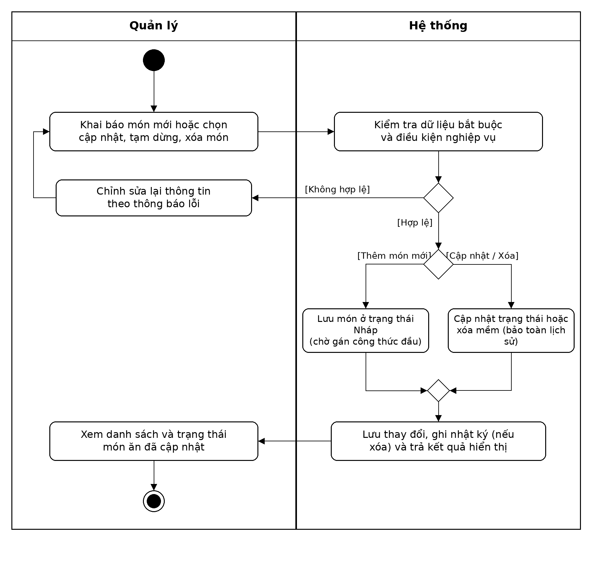

Hình 1. QT-01 — Quản lý món ăn. Luồng chính.

### 2.3.2. Quản lý công thức

Bước 1. Quản lý chọn món, chọn nguyên liệu và nhập định lượng theo đơn vị chuẩn.

Bước 2. Công thức đầu tiên có hiệu lực ngay và món thoát khỏi trạng thái Nháp.

Bước 3. Khi thay đổi công thức, Quản lý chọn lên lịch từ một ngày kinh doanh trong tương lai hoặc sửa trực tiếp để khắc phục sai sót và áp dụng ngay. Trước khi lịch có hiệu lực, Quản lý có thể hủy hoặc thay lịch; sửa trực tiếp không hủy lịch đang chờ.

Bước 4. Order đã gửi giữ nguyên công thức đã ghi nhận lúc gọi món.

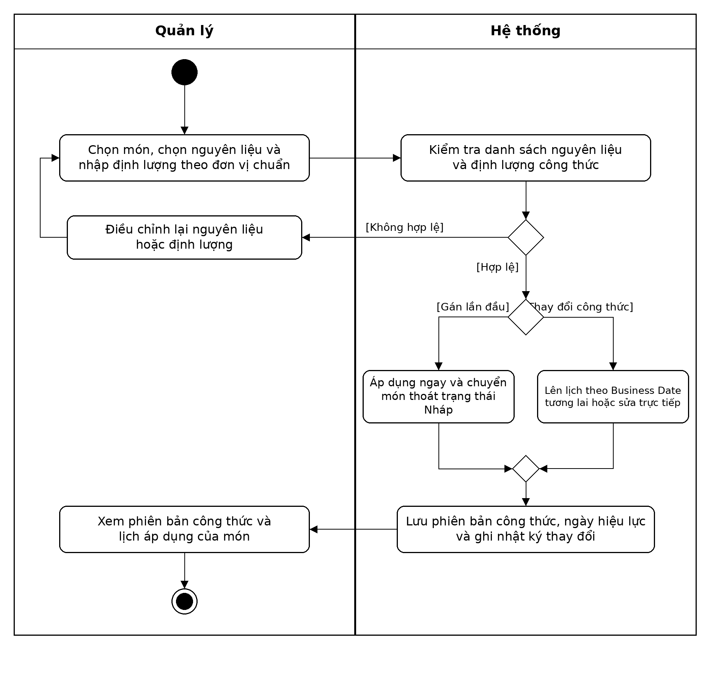

Hình 2. QT-02 — Quản lý công thức. Luồng chính.

### 2.3.3. Quản lý giá bán

Bước 1. Quản lý chọn món, nhập giá bán và ngày hiệu lực.

Bước 2. Quản lý chọn lên lịch giá cho ngày kinh doanh tương lai hoặc sửa trực tiếp để áp dụng ngay; có thể thay hoặc hủy lịch chưa áp dụng.

Bước 3. Khi gửi món, order lấy giá hiện hành; thay đổi giá không làm đổi các món đã bán.

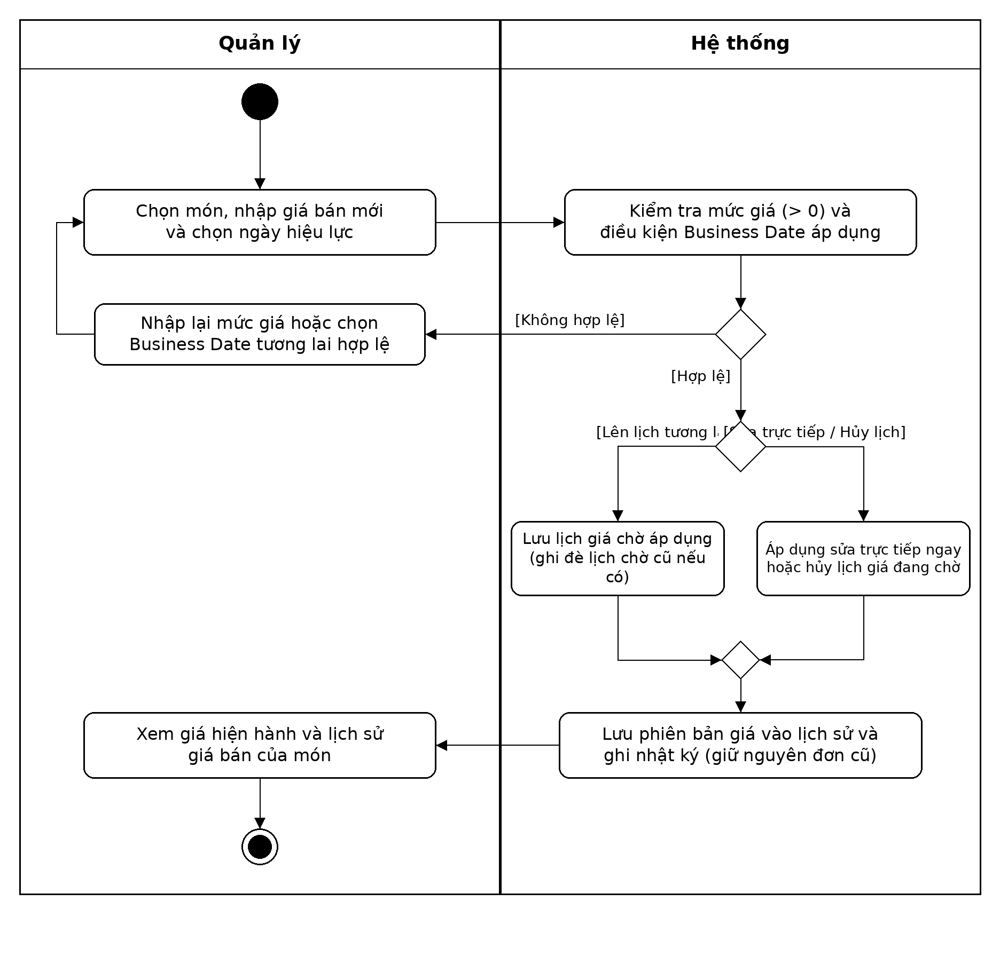

Hình 3. QT-03 — Quản lý giá bán. Luồng chính.

### 2.3.4. Quản lý danh mục bàn

Bước 1. Quản lý xem danh mục bàn, thêm, sửa thông tin hoặc xóa bàn.

Bước 2. Bàn đang phục vụ không được xóa; bàn đã có lịch sử chỉ được xóa mềm.

Bước 3. Hệ thống cập nhật danh mục và ghi nhật ký thao tác xóa.

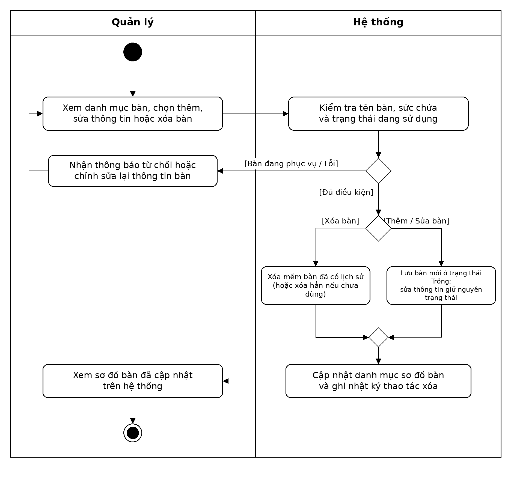

Hình 4. QT-04 — Quản lý danh mục bàn. Luồng chính.

### 2.3.5. Quản lý nguyên liệu

Bước 1. Bếp hoặc Quản lý thêm, sửa nguyên liệu: tên, đơn vị chuẩn và mức tồn tối thiểu riêng nếu có.

Bước 2. Đơn vị tính không đổi được sau khi nguyên liệu đã được tham chiếu trong dữ liệu.

Bước 3. Nguyên liệu đã có lịch sử chỉ được xóa mềm; hệ thống ghi nhật ký thao tác xóa.

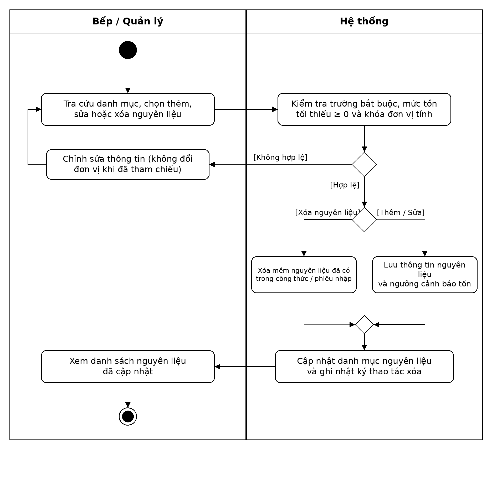

Hình 5. QT-05 — Quản lý nguyên liệu. Luồng chính.

### 2.3.6. Quản lý nhà cung cấp

Bước 1. Bếp hoặc Quản lý tìm nhà cung cấp, xem thông tin liên hệ và lịch sử nhập hàng.

Bước 2. Người dùng thêm, sửa hoặc xóa nhà cung cấp; thông tin không hợp lệ được trả về để sửa.

Bước 3. Nhà cung cấp đã có lịch sử nhập chỉ được xóa mềm; danh sách được dùng khi nhập kho.

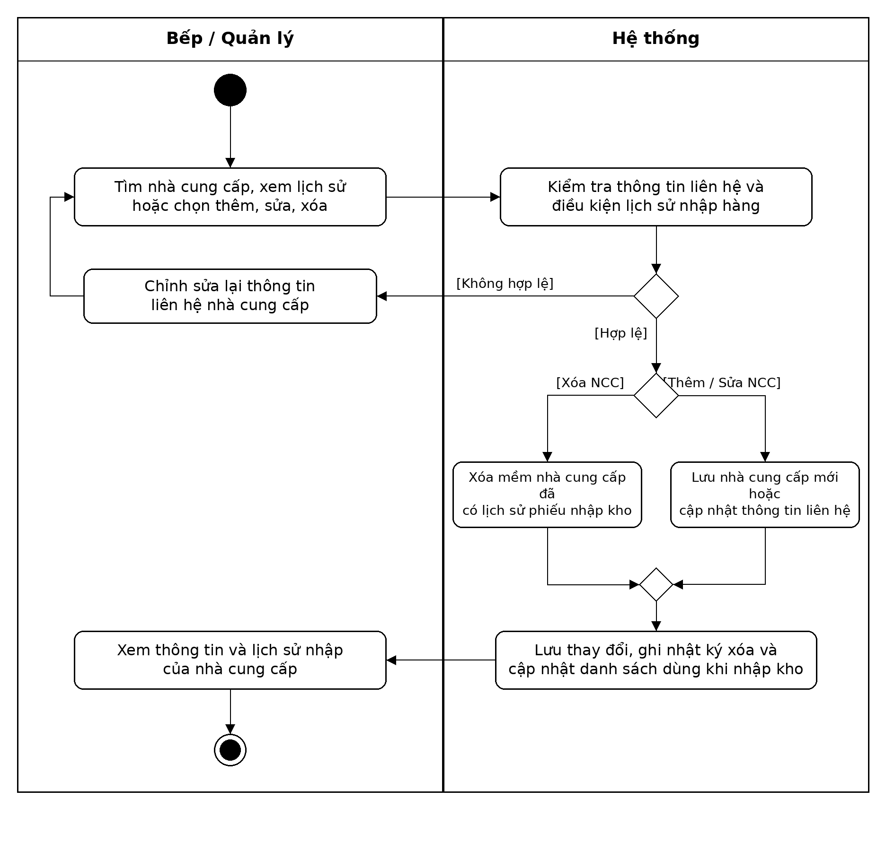

Hình 6. QT-06 — Quản lý nhà cung cấp. Luồng chính.

### 2.3.7. Gọi món tại chỗ

Bước 1. Nhân viên order tiếp nhận khách, chọn bàn trống, thêm món, số lượng và ghi chú; hệ thống giữ nguyên liệu cho các món đã chọn.

Bước 2. Khi nhân viên xác nhận gửi món, hệ thống tạo order, chuyển bàn sang Đang phục vụ và tạo phiếu bếp. Nếu giá hoặc công thức đã thay đổi, nhân viên xác nhận lại nội dung mới trước khi gửi.

Bước 3. Bếp chế biến và báo món xong để nhân viên cập nhật trạng thái phục vụ. Khi order Đang mở và còn gắn đúng bàn, khách có thể gọi thêm qua lượt chọn giữ món hoặc đổi sang bàn trống. Nếu khách yêu cầu giảm hoặc hủy món, nhân viên xác nhận với Bếp trước khi xử lý theo UC 2.3.

Bước 4. Thu ngân thực hiện thanh toán. Khi khách rời đi, nhân viên giải phóng bàn; thanh toán thành công không tự giải phóng bàn khi khách còn ngồi.

Hình 7. QT-07 — Gọi món tại chỗ. Luồng chính.

### 2.3.8. Gọi món mang về

Bước 1. Nhân viên chọn loại Mang về, thêm món, số lượng và ghi chú, không gắn bàn; nguyên liệu được giữ như khi gọi món tại chỗ.

Bước 2. Nhân viên xác nhận gửi món; hệ thống tạo order mang về và phiếu bếp, không thay đổi trạng thái bàn. Khi order còn Đang mở, nhân viên tiếp nhận phần gọi thêm qua lượt chọn giữ món theo UC 2.3; mỗi lần gửi chỉ ghi nhận phần món mới.

Bước 3. Thu ngân in phiếu tạm tính và thực hiện thanh toán tiền mặt hoặc QR.

Bước 4. Bếp chế biến, đóng gói; nhân viên giao món và cập nhật Đã phục vụ. Khi order đã thanh toán, bị hủy hoặc đã đóng, khách mua thêm thì lập order mới.

Hình 8. QT-08 — Gọi món mang về. Luồng chính.

### 2.3.9. Thanh toán tiền mặt

Bước 1. Thu ngân mở order cần thanh toán và xử lý hết các món gọi thêm chưa gửi.

Bước 2. Thu ngân in phiếu tạm tính để khách kiểm tra món và tổng tiền.

Bước 3. Khách giao tiền; Thu ngân kiểm đếm và xác nhận đã nhận đủ trên hệ thống.

Bước 4. Hệ thống ghi nhận thanh toán thành công, chuyển order sang Đã thanh toán và phát hành hóa đơn; hóa đơn đã phát hành chỉ được in lại nguyên trạng.

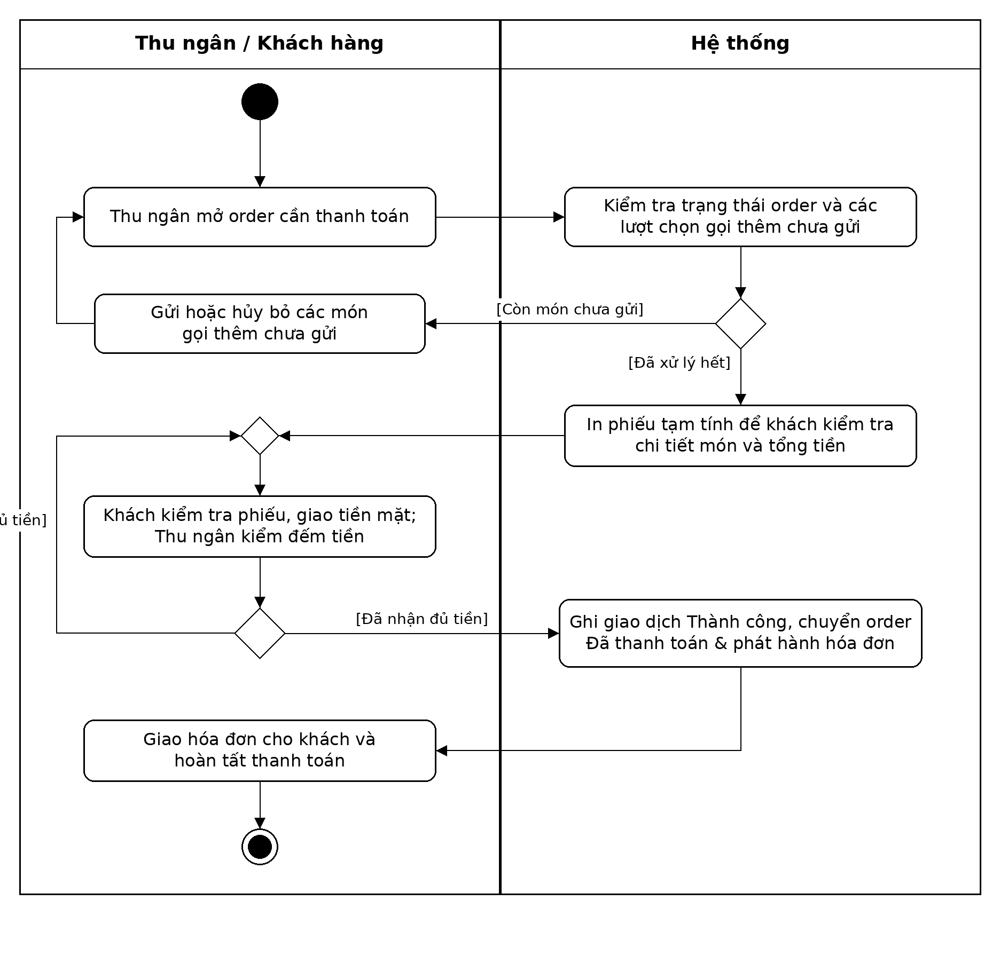

Hình 9. QT-09 — Thanh toán tiền mặt. Luồng chính.

### 2.3.10. Thanh toán QR

Bước 1. Thu ngân in phiếu tạm tính và chọn QR; hệ thống tạo mã đúng order, đúng số tiền, có hiệu lực 10 phút và chuyển order sang Chờ xác nhận thanh toán.

Bước 2. Khách quét mã. Khi hệ thống nhận kết quả hợp lệ từ cổng thanh toán, order chuyển sang Đã thanh toán và hóa đơn được phát hành.

Bước 3. Nếu mã hết hạn hoặc Thu ngân hủy mã còn chờ, order về Đang mở; Thu ngân chọn tạo mã QR mới, thanh toán tiền mặt hoặc kết thúc lần thanh toán hiện tại khi khách chưa trả tiền.

Bước 4. Nếu khách báo đã bị trừ tiền nhưng chưa có kết quả hợp lệ, Thu ngân chuyển sang quy trình xác minh thanh toán, không yêu cầu khách trả lại ngay.

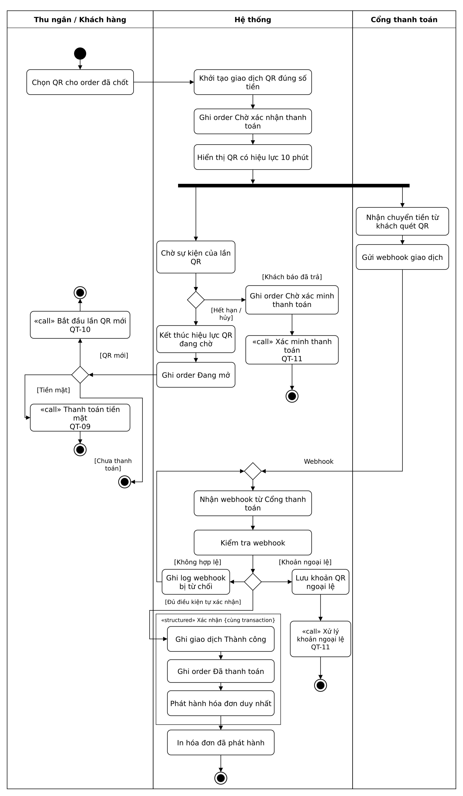

Hình 10. QT-10 — Thanh toán QR. Luồng chính.

### 2.3.11. Xác minh thanh toán

Bước 1. Thu ngân ghi nhận khách báo đã trả tiền, mã giao dịch và bằng chứng nếu có; order chuyển sang Chờ xác minh thanh toán và tạm khóa sửa, hủy món.

Bước 2. Quản lý đối chiếu sao kê tài khoản nhận tiền của nhà hàng theo mã giao dịch, số tiền và thời điểm; ảnh khách cung cấp chỉ để tham khảo.

Bước 3. Nếu đã nhận đủ tiền, Quản lý xác nhận; hệ thống ghi thanh toán thành công và phát hành hóa đơn đúng một lần. Nếu chưa đủ căn cứ, Quản lý lưu kết quả kiểm tra, giữ Chờ xác minh và tiếp tục tra soát. Khi đã thống nhất thu lại thì mở lại thanh toán; khi quyết định ngừng theo dõi thu tiền thì đóng order chưa thu được tiền, bắt buộc lưu lý do.

Bước 4. Các khoản QR đến muộn, sai số tiền hoặc thu trùng được theo dõi riêng và xử lý theo UC 2.6: áp dụng khoản hợp lệ hoặc ghi kết quả hoàn tiền ngoài hệ thống, không cộng doanh thu hai lần. Mọi kết quả và quyết định được ghi thêm vào nhật ký, không cho sửa hoặc xóa.

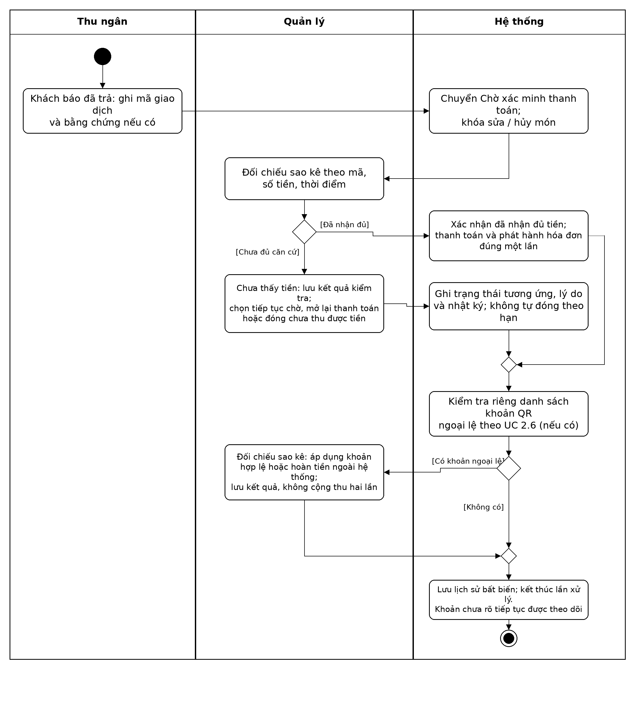

Hình 11. QT-11 — Xác minh thanh toán. Luồng chính.

### 2.3.12. Hủy toàn bộ order

Bước 1. Quản lý mở order cần hủy, kiểm tra trạng thái thanh toán và trao đổi với Bếp về các món chưa chế biến.

Bước 2. Quản lý nhập lý do và xác nhận hủy.

Bước 3. Hệ thống xét từng dòng món: món chưa chế biến và đủ điều kiện được hoàn nguyên liệu về đúng lô gốc; món đã chế biến giữ nguyên tiêu hao. Một order có thể đồng thời có cả hai nhóm món. Sau khi xử lý hết dòng, hệ thống chuyển order Đã hủy trong cùng giao dịch.

Bước 4. Hệ thống lưu kết quả và nhật ký. Bàn chỉ được giải phóng khi khách rời đi.

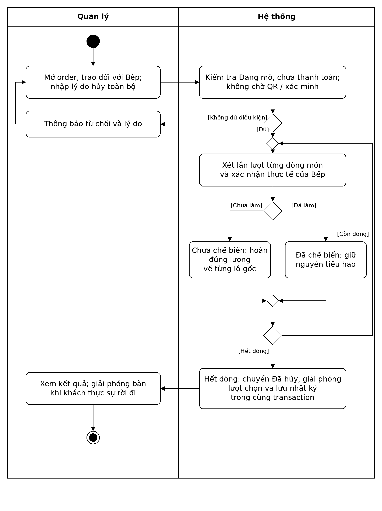

Hình 12. QT-12 — Hủy toàn bộ order. Luồng chính.

### 2.3.13. Tra cứu order và in lại chứng từ

Bước 1. Quản lý mở màn hình Quản lý đơn hàng; Thu ngân/Nhân viên order mở danh sách order theo quyền. Người dùng lọc theo mã, bàn, khoảng ngày kinh doanh hoặc trạng thái.

Bước 2. Hệ thống hiển thị danh sách và chi tiết order phù hợp với quyền của người dùng.

Bước 3. Người dùng chọn xem và in lại hóa đơn hoặc phiếu bếp đã ghi nhận.

Bước 4. In lại chỉ in dữ liệu đã lưu; không sửa hóa đơn, không phát sinh thêm tiêu hao hay doanh thu.

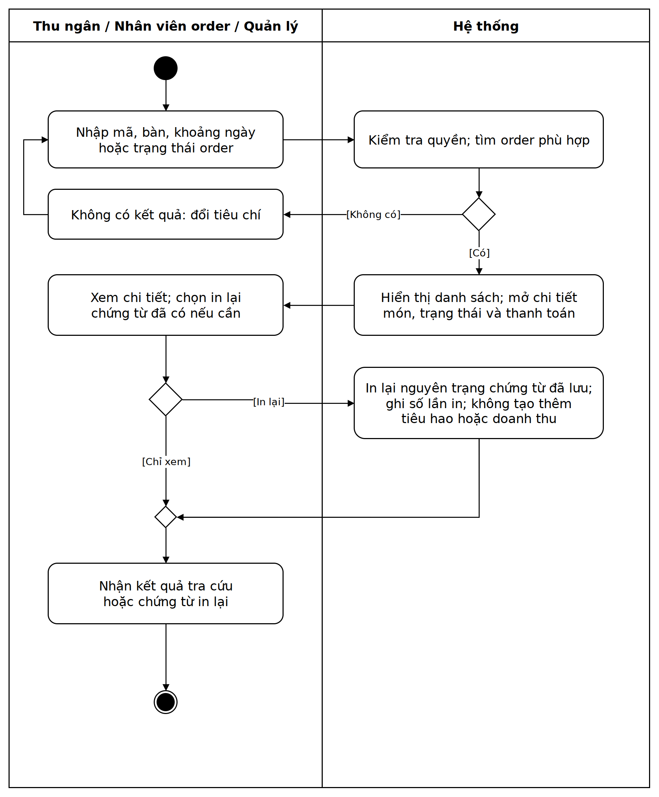

Hình 13. QT-13 — Tra cứu order và in lại chứng từ. Luồng chính.

### 2.3.14. Nhập kho nguyên liệu theo lô

Bước 1. Bếp hoặc Quản lý nhận hàng, kiểm tra thực tế, chọn nhà cung cấp; khai báo nguyên liệu, số lượng, đơn giá và ngày nhập.

Bước 2. Mỗi dòng nhập hợp lệ tạo một lô riêng, có ngày nhập, hạn dùng và số lượng còn lại.

Bước 3. Người lập xác nhận; hệ thống lưu phiếu, tạo lô và tăng tồn kho.

Bước 4. Phiếu chỉ được sửa hoặc hủy khi các lô chưa xuất và chưa được giữ; dữ liệu đã sử dụng được xử lý qua kiểm kê.

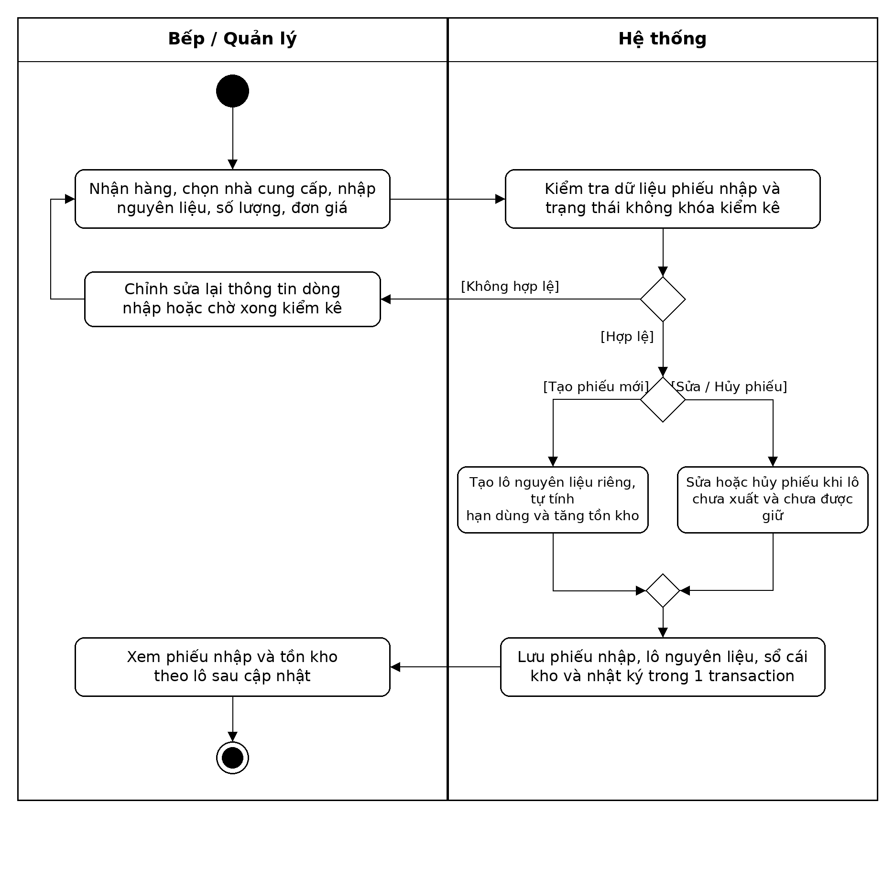

Hình 14. QT-14 — Nhập kho nguyên liệu theo lô. Luồng chính.

### 2.3.15. Xuất nguyên liệu theo FIFO

Bước 1. Khi nhân viên gửi món, hệ thống xác định tổng lượng nguyên liệu cần dùng theo công thức.

Bước 2. Hệ thống xuất theo nguyên tắc nhập trước xuất trước: lấy từ lô nhập sớm nhất còn hạn, nếu không đủ thì lấy tiếp từ lô kế tiếp.

Bước 3. Mỗi phần xuất được ghi theo lô và theo dòng món. Không đủ tổng lượng thì từ chối gửi món, không trừ một phần.

Bước 4. Khi hủy hợp lệ trước chế biến, nguyên liệu được hoàn về đúng lô đã xuất. Bếp xem lịch sử xuất và tồn theo lô.

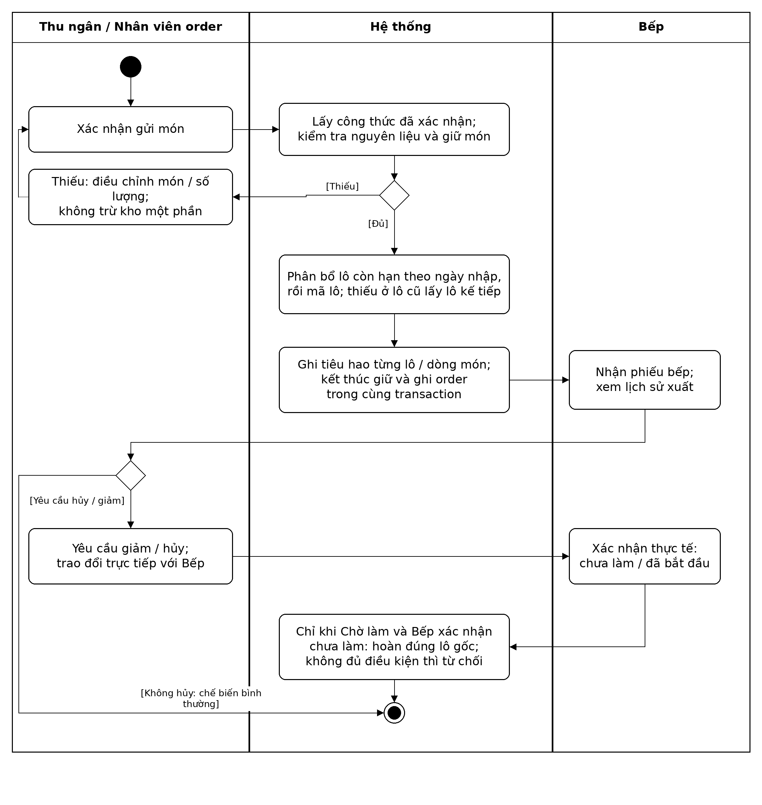

Hình 15. QT-15 — Xuất nguyên liệu theo FIFO. Luồng chính.

### 2.3.16. Xuất hủy nguyên liệu và món đã chế biến

Bước 1. Bếp hoặc Quản lý chọn nguồn xuất hủy và nhập lý do. Với nguồn Nguyên liệu, người lập chọn lô và lượng hủy; với nguồn Món đã chế biến, chọn dòng order và số suất bị bỏ.

Bước 2. Với nguyên liệu hỏng hoặc hết hạn, người lập chọn đúng lô thực tế cần hủy; lượng hủy không vượt tồn.

Bước 3. Hệ thống kiểm tra giới hạn. Với món đã chế biến, hệ thống tự tính lượng nguyên liệu theo số suất hủy và tiêu hao gốc của dòng order. Nếu lô nguyên liệu hỏng đang được giữ, hệ thống giải phóng lượt giữ bị ảnh hưởng và thông báo nhân viên kiểm tra lại.

Bước 4. Người lập xác nhận; hệ thống lưu phiếu và nhật ký. Nguồn Nguyên liệu trừ tồn theo lô; nguồn Món đã chế biến và chứng từ Kiểm kê sử dụng giao dịch gốc để phân loại hao hụt.

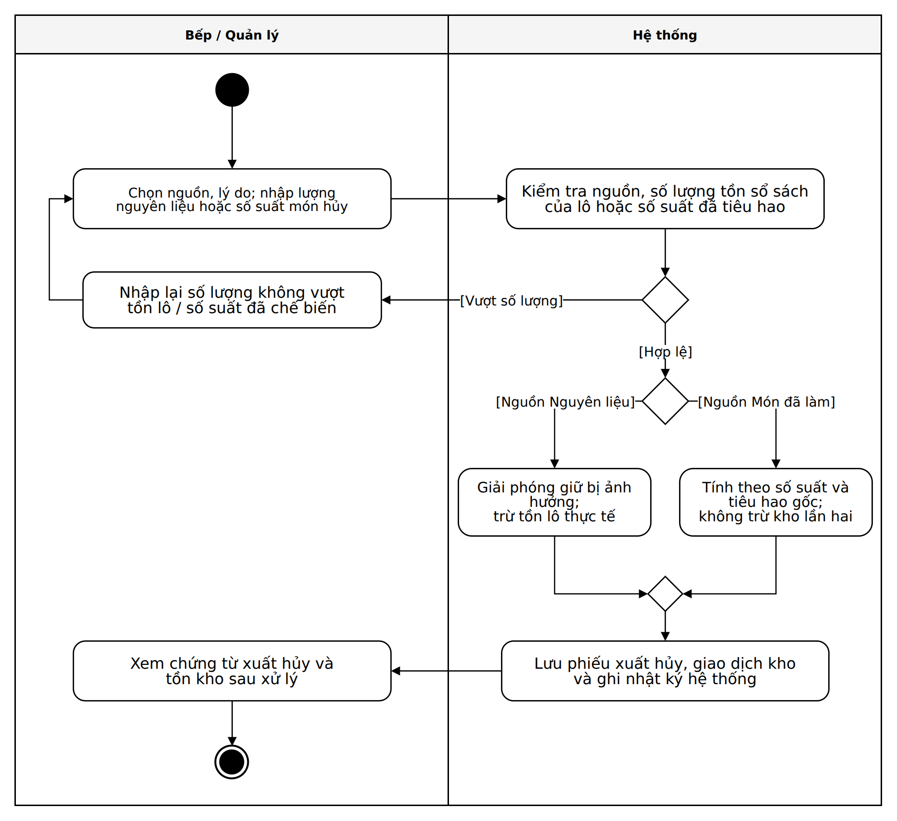

Hình 16. QT-16 — Xuất hủy nguyên liệu và món đã chế biến. Luồng chính.

### 2.3.17. Kiểm kê và điều chỉnh tồn kho

Bước 1. Bếp hoặc Quản lý mở kiểm kê sau khi kết thúc phục vụ; hệ thống tạm khóa các thao tác làm thay đổi tồn.

Bước 2. Bếp đếm tồn thực tế theo nguyên liệu, gồm cả lô hết hạn còn hàng.

Bước 3. Hệ thống tính chênh lệch so với tồn sổ sách; người kiểm kê kiểm tra, nhập lý do và xác nhận.

Bước 4. Hệ thống phân bổ chênh lệch xuống từng lô và ghi nhận điều chỉnh; chênh lệch âm sinh chứng từ xuất hủy, không trừ tồn lần hai. Kết thúc phiên thì mở khóa kho.

Hình 17. QT-17 — Kiểm kê và điều chỉnh tồn kho. Luồng chính.

### 2.3.18. Theo dõi tồn kho và cảnh báo theo lô

Bước 1. Bếp hoặc Quản lý mở màn hình kho, tìm nguyên liệu hoặc lọc theo tồn và hạn sử dụng.

Bước 2. Hệ thống hiển thị tồn sổ sách, lượng đang giữ và lượng khả dụng; lô hết hạn không tính vào lượng bán được.

Bước 3. Hệ thống cảnh báo khi lượng khả dụng thấp hơn mức tồn tối thiểu hoặc lô sắp hết hạn.

Bước 4. Người dùng xem chi tiết lô và lịch sử xuất, hoàn. Bếp quyết định nhập bổ sung hoặc xử lý lô hỏng; cảnh báo không tự tạo phiếu.

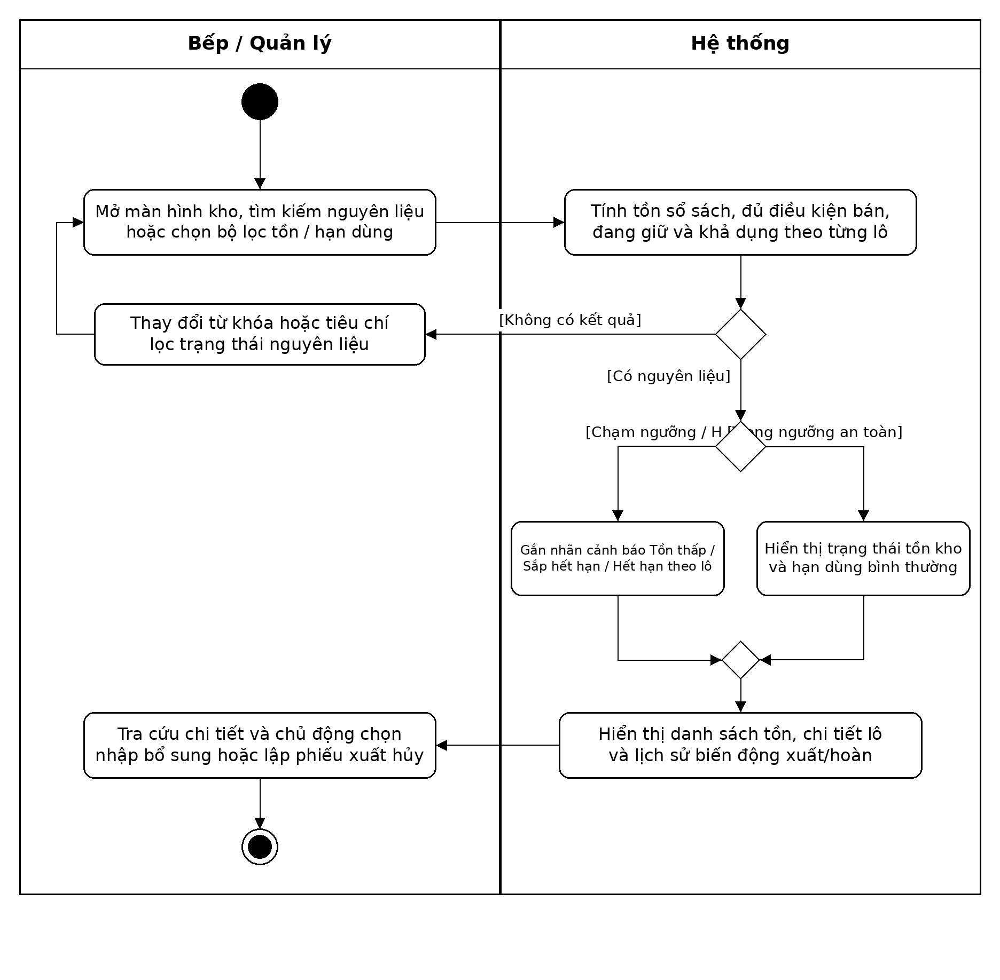

Hình 18. QT-18 — Theo dõi tồn kho và cảnh báo theo lô. Luồng chính.

### 2.3.19. Xem báo cáo thống kê

Bước 1. Quản lý chọn loại báo cáo: doanh thu, chi phí và lợi nhuận gộp, tiêu thụ món, phân bố order hoặc tình trạng order và thanh toán.

Bước 2. Quản lý chọn khoảng ngày kinh doanh hoặc kỳ báo cáo; chọn kỳ so sánh nếu báo cáo hỗ trợ.

Bước 3. Hệ thống tổng hợp và hiển thị bảng, biểu đồ; doanh thu chỉ tính từ order đã thanh toán, các khoản chưa thu, order hủy và order đóng chưa thu được tiền được tách riêng.

Bước 4. Quản lý xem kết quả hoặc đổi bộ lọc; nếu không có dữ liệu, hệ thống thông báo.

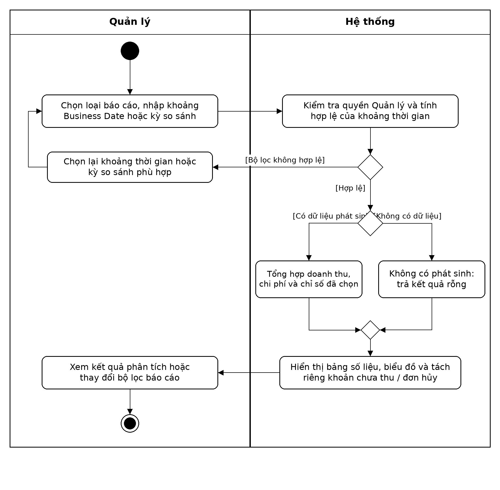

Hình 19. QT-19 — Xem báo cáo thống kê. Luồng chính.

### 2.3.20. Quản lý người dùng và phân quyền

Bước 1. Quản lý tạo tài khoản và gán một trong ba vai trò: Quản lý, Thu ngân/Nhân viên order hoặc Bếp.

Bước 2. Người dùng đăng nhập; hệ thống kiểm tra trạng thái tài khoản và quyền. Quản lý có thêm quyền tác nghiệp của Thu ngân/Nhân viên order và Bếp.

Bước 3. Người dùng tự đổi mật khẩu và đăng xuất khi kết thúc; Quản lý có thể đặt lại mật khẩu hoặc khóa tài khoản.

Bước 4. Đăng nhập sai hoặc tài khoản bị khóa bị từ chối; các thao tác quản trị được ghi nhật ký.

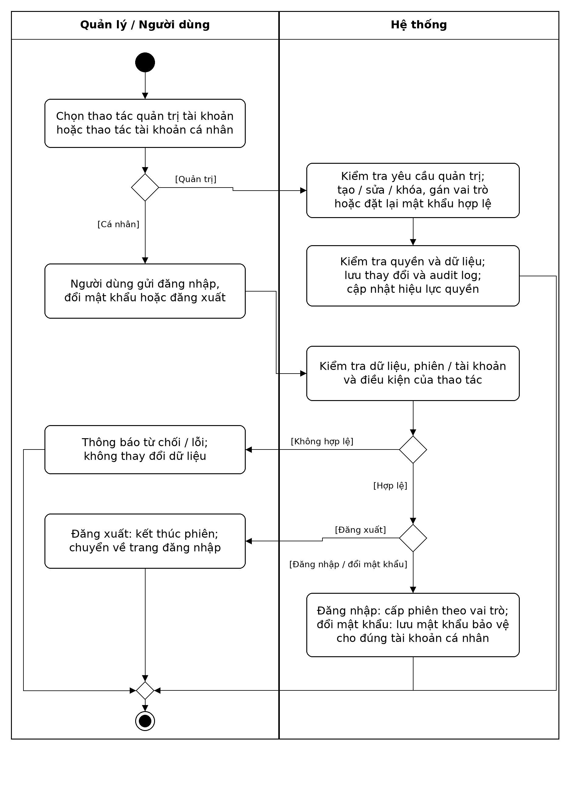

Hình 20. QT-20 — Quản lý người dùng và phân quyền. Luồng chính.

### 2.3.21. Cấu hình hệ thống

Bước 1. Quản lý mở cấu hình và xem các tham số: mẫu hóa đơn, mốc ngày kinh doanh, ngưỡng cảnh báo, thời hạn giữ món và hạn mức hỏi AI.

Bước 2. Quản lý sửa giá trị cần thiết và lưu; giá trị không hợp lệ được trả về để sửa.

Bước 3. Hệ thống lưu cấu hình và ghi nhật ký; mốc ngày kinh doanh mới có hiệu lực từ ngày kế tiếp.

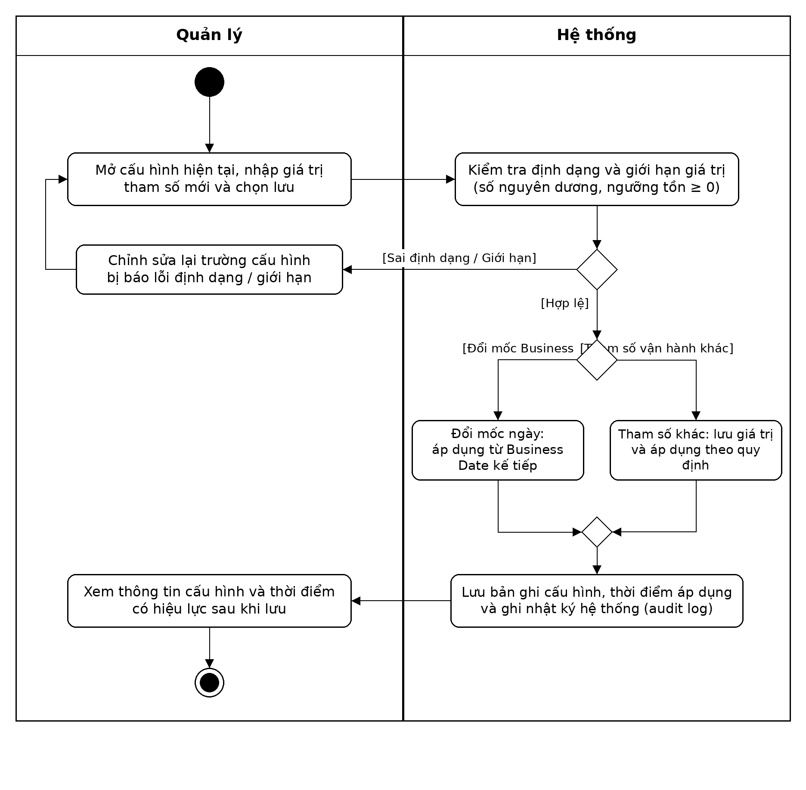

Hình 21. QT-21 — Cấu hình hệ thống. Luồng chính.

### 2.3.22. Tra cứu nhật ký hệ thống

Bước 1. Quản lý chọn khoảng thời gian, người thực hiện, loại thao tác hoặc đối tượng cần tra cứu.

Bước 2. Hệ thống trả danh sách nhật ký phù hợp; Quản lý chọn một bản ghi để xem người thực hiện, thời điểm, dữ liệu trước/sau và lý do.

Bước 3. Nhật ký chỉ để xem; mọi yêu cầu sửa hoặc xóa đều bị từ chối.

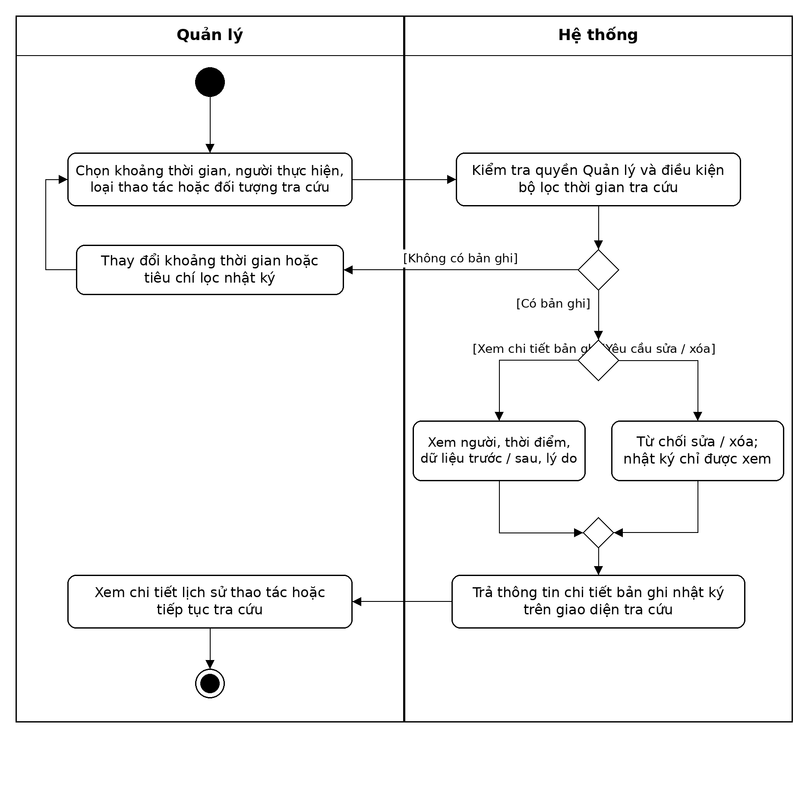

Hình 22. QT-22 — Tra cứu nhật ký hệ thống. Luồng chính.

### 2.3.23. Hỏi AI Assistant

Bước 1. Người dùng mở trợ lý theo vai trò và nhập câu hỏi bằng tiếng Việt.

Bước 2. Hệ thống kiểm tra quyền và hạn mức; câu hỏi ngoài phạm vi bị từ chối, câu hỏi chưa rõ đối tượng hoặc thời gian được yêu cầu làm rõ.

Bước 3. Hệ thống lấy dữ liệu trong phạm vi được phép và trả lời bằng tiếng Việt kèm bảng số liệu hoặc biểu đồ phù hợp; nếu không xử lý được thì thông báo và gợi ý diễn đạt lại.

Bước 4. Khi xử lý thành công, người dùng xem câu trả lời và mở chi tiết kỹ thuật nếu cần. Nếu ngoài quyền hoặc hết hạn mức, hệ thống từ chối và kết thúc yêu cầu; nếu câu hỏi chưa rõ, người dùng bổ sung thông tin; nếu không tạo được kết quả hợp lệ, hệ thống thông báo lỗi và gợi ý diễn đạt lại. Mỗi lượt được lưu theo quyền, người dùng có thể đặt câu hỏi tiếp theo.

Hình 23. QT-23 — Hỏi AI Assistant. Luồng chính.

**Đối chiếu quy trình và nhóm chức năng**

Các quy trình tại mục 2.3 là căn cứ xác định sáu module tại mục 2.4.1, nơi mã Use Case, quy trình và yêu cầu chi tiết tương ứng được đối chiếu.

| Nhóm             | Quy trình nghiệp vụ                                                                                                                                              |
|------------------|------------------------------------------------------------------------------------------------------------------------------------------------------------------|
| 1\. Danh mục     | Món ăn và nhóm món; công thức; giá bán; bàn; nguyên liệu; nhà cung cấp.                                                                                          |
| 2\. Bán hàng     | Gọi món tại chỗ/mang về; gọi thêm, sửa/hủy món và trạng thái phục vụ; bàn đang phục vụ; thanh toán; xác minh và khoản QR ngoại lệ; hủy order; tra cứu và in lại. |
| 3\. Kho          | Nhập theo lô; xuất FIFO và hoàn; xuất hủy; kiểm kê; theo dõi tồn, lịch sử và cảnh báo.                                                                           |
| 4\. Báo cáo      | Xem báo cáo thống kê theo loại báo cáo và điều kiện lọc.                                                                                                         |
| 5\. Cài đặt      | Người dùng và phân quyền, đăng nhập/đăng xuất/đổi mật khẩu; cấu hình; nhật ký.                                                                                   |
| 6\. AI Assistant | Hỏi đáp dữ liệu theo vai trò.                                                                                                                                    |

## A. Quy tắc nghiệp vụ chung (Business Rules tổng hợp)

1\. Mỗi món ăn thuộc đúng một nhóm món duy nhất.

2\. Order chỉ được ghi nhận kể từ lần gửi món đầu tiên. Phiếu tạm tính lấy từ order để khách đối chiếu trước khi thanh toán, không tạo bản ghi HOA_DON hoặc ghi nhận doanh thu; order chỉ phát sinh hóa đơn sau khi thanh toán thành công.

3\. Sau khi thanh toán thành công, order/hóa đơn bị khóa hoàn toàn, chỉ cho phép in lại nguyên trạng; việc giải phóng bàn thực hiện theo UC 2.3.

4\. Chỉ hỗ trợ tiền mặt hoặc QR do hệ thống tạo; không tích hợp thanh toán thẻ ngân hàng và không hỗ trợ chuyển khoản ngoài mã QR do hệ thống tạo. Giao dịch QR ở “Chờ xác nhận” cho đến khi webhook xác nhận hoặc quá 10 phút thì chuyển sang “Hết hạn”; khi khách báo đã thanh toán, Thu ngân chuyển sang “Chờ xác minh thanh toán”. Hệ thống lưu bằng chứng, lịch sử và kết quả xử lý, hỗ trợ xác nhận đã nhận tiền, mở lại thanh toán hoặc đóng order chưa thu được tiền; tra soát với ngân hàng và hoàn tiền thực hiện ngoài hệ thống, kết quả được lưu theo UC 2.6.

5\. Không áp dụng khuyến mãi/giảm giá; hóa đơn không tách dòng thuế VAT.

6\. Không hỗ trợ gộp bàn; hỗ trợ đổi bàn khi bàn đích đang trống.

7\. Lượng khả dụng xác định khả năng nhận món mới theo UC 3.5. Giữ món chiếm lượng nguyên liệu cần cho số suất đã chọn trong thời hạn cấu hình; các bàn khác tiếp tục đặt phần khả dụng còn lại.

8\. Thêm món vào lượt chọn chưa gửi tạo giữ món; giảm hoặc xóa dòng giải phóng phần tương ứng. Gửi lượt chọn chuyển giữ món thành tiêu hao. Cả lượt gọi ban đầu và gọi thêm đều thực hiện qua giữ món. Hủy món đã gửi và được Bếp xác nhận chưa làm thì hoàn theo giao dịch gốc.

9\. Cảnh báo tồn kho dựa trên mức tồn tối thiểu riêng của từng nguyên liệu; nguyên liệu không cấu hình thì dùng mức tồn tối thiểu mặc định của hệ thống.

10\. Thay đổi giá/công thức có hai cơ chế độc lập: lên lịch theo Business Date, và sửa trực tiếp có hiệu lực ngay.

11\. Business Date là mốc do Quản lý cấu hình, dùng làm căn cứ hiệu lực giá/công thức và đơn vị nhóm báo cáo theo ngày.

12\. Lợi nhuận gộp theo chi phí nguyên liệu = Doanh thu − Giá vốn nguyên liệu tiêu hao, tính bằng tiền theo tháng ở mức tổng toàn nhà hàng.

13\. AI Assistant: mỗi vai trò có trợ lý AI riêng, chỉ truy cập dữ liệu thuộc phạm vi vai trò, kiểm soát ở tầng backend/data layer.

14\. Mọi câu trả lời của AI Assistant phải kèm bảng số liệu gốc và chú thích phạm vi dữ liệu.

15\. Kiểm kê do Bếp/Quản lý tổ chức định kỳ theo UC 3.4, sau khi kết thúc chế biến và xử lý hết giữ món; các nghiệp vụ làm thay đổi tồn bị khóa trong phiên kiểm kê.

16\. Nguyên tắc xóa mềm áp dụng thống nhất cho toàn bộ danh mục khi đối tượng đã có dữ liệu lịch sử tham chiếu.

17\. Quản lý có quyền hủy toàn bộ order chưa thanh toán; nguyên liệu chỉ hoàn kho cho các món đang ở trạng thái “Chờ làm” tại thời điểm hủy (chi tiết tại UC 2.7).

## B. Điều kiện triển khai các quy trình trọng yếu

QT-17 chỉ mở sau khi đã xử lý món và lượt chọn chưa gửi; các lượt giữ hết hạn được giải quyết theo giờ server trong bước kiểm tra, không chờ tác vụ nền. QT-23 kiểm tra phiên/tài khoản/quyền sở hữu hội thoại, chỉ thực thi SELECT qua view vai trò, tối đa 3 giây và 500 dòng; tối đa hai lần sinh SQL, ghi mã yêu cầu, trạng thái và usage nhưng không ghi bí mật.
