# 02. QUY TRÌNH VÀ QUY TẮC NGHIỆP VỤ

Xây dựng hệ thống quản lý nhà hàng tích hợp AI hỗ trợ hoạt động kinh doanh

Các quy trình nghiệp vụ QT-01 đến QT-21, sơ đồ hoạt động và bộ quy tắc nghiệp vụ chung của hệ thống quản lý nhà hàng.

## 1. Quy trình nghiệp vụ

Các quy trình đề xuất sau số hóa được tách theo mục tiêu nghiệp vụ và chỉ mô tả ở mức tổng quan: ai thực hiện, làm gì và cho kết quả gì. Thu ngân/Nhân viên order là một vai trò chung, thực hiện cả gọi món và thanh toán. Quản lý kế thừa quyền tác nghiệp của vai trò này và Bếp (quyền chi tiết tại Bảng 4.3 của báo cáo chính). Khách hàng tham gia giao dịch thực tế nhưng không trực tiếp sử dụng hệ thống. Các sơ đồ QT trình bày luồng chính; các quy tắc nghiệp vụ chi tiết được xác định ở mục 2.4 và đặc tả ở Chương 3 của báo cáo chính.

### 1.1. Quản lý món ăn

Bước 1. Quản lý tạo nhóm món và khai báo món ăn: tên, nhóm, mô tả, ảnh và thông tin bán.

Bước 2. Món mới ở trạng thái Nháp, chưa hiển thị khi gọi món cho đến khi được gán công thức đầu tiên.

Bước 3. Quản lý cập nhật thông tin, tạm dừng hoặc mở lại phục vụ món.

Bước 4. Món ăn chỉ được xóa mềm. Nhóm chưa từng có món được xóa vĩnh viễn; nhóm còn món chưa xóa mềm không được xóa; nhóm chỉ còn món đã xóa mềm được xóa mềm. Thao tác xóa được ghi nhật ký.

Bước 5. Danh sách món hiển thị cho Quản lý giá vốn ước tính theo công thức hiện hành và đơn giá bình quân của nguyên liệu, tỷ lệ giá vốn so với giá bán và lãi gộp mỗi suất; món vượt ngưỡng cấu hình được đánh dấu cảnh báo.

Hình 1. QT-01 — Quản lý món ăn. Luồng chính.

### 1.2. Thiết lập công thức của món

Bước 1. Trong chi tiết món, Quản lý mở phần Công thức, chọn nguyên liệu và nhập định lượng theo đơn vị chuẩn.

Bước 2. Công thức đầu tiên có hiệu lực ngay và món thoát khỏi trạng thái Nháp.

Bước 3. Khi thay đổi công thức, Quản lý chọn lên lịch từ một ngày kinh doanh trong tương lai hoặc sửa trực tiếp để khắc phục sai sót và áp dụng ngay. Trước khi lịch có hiệu lực, Quản lý có thể hủy hoặc thay lịch; sửa trực tiếp không hủy lịch đang chờ.

Bước 4. Dòng món đã gửi giữ nguyên phiên bản công thức được xác nhận khi gửi.

Hình 2. QT-02 — Thiết lập công thức của món. Luồng chính.

### 1.3. Quản lý giá bán

Bước 1. Quản lý chọn món, nhập giá bán và ngày hiệu lực.

Bước 2. Quản lý chọn lên lịch giá cho ngày kinh doanh tương lai hoặc sửa trực tiếp để áp dụng ngay; có thể thay hoặc hủy lịch chưa áp dụng.

Bước 3. Khi gửi món, order lấy giá hiện hành; thay đổi giá không làm đổi các món đã bán.

Bước 4. Khi giá nhập nguyên liệu tăng làm tỷ lệ giá vốn của món vượt ngưỡng, món được đánh dấu cảnh báo trên danh sách món. Quản lý xem chi tiết giá vốn theo nguyên liệu rồi quyết định sửa trực tiếp hoặc lên lịch giá mới; hệ thống không tự đổi giá bán.

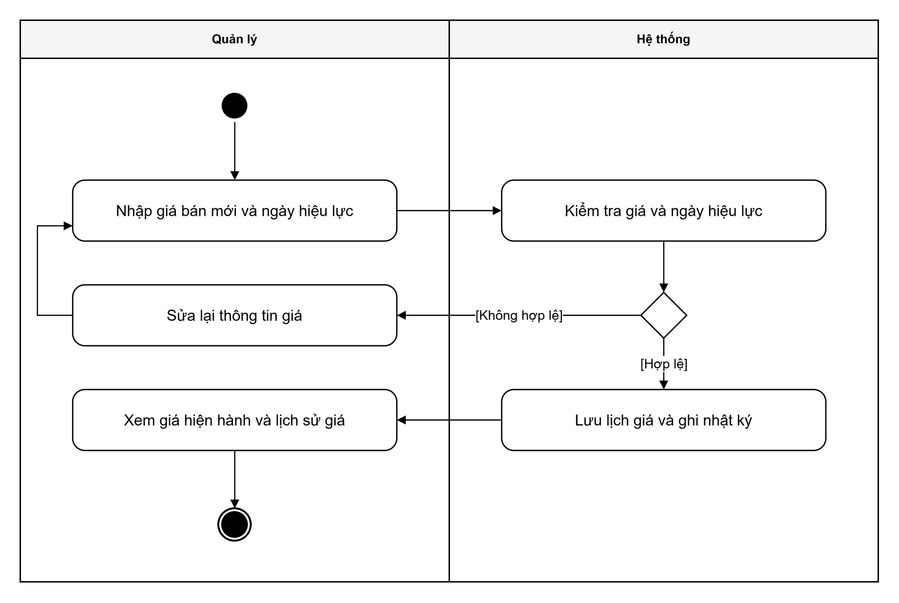

Hình 3. QT-03 — Quản lý giá bán. Luồng chính.

### 1.4. Quản lý danh mục bàn

Bước 1. Quản lý xem danh mục bàn, thêm, sửa thông tin hoặc xóa bàn.

Bước 2. Bàn đang phục vụ không được xóa; bàn đã có lịch sử chỉ được xóa mềm.

Bước 3. Hệ thống cập nhật danh mục và ghi nhật ký thao tác xóa.

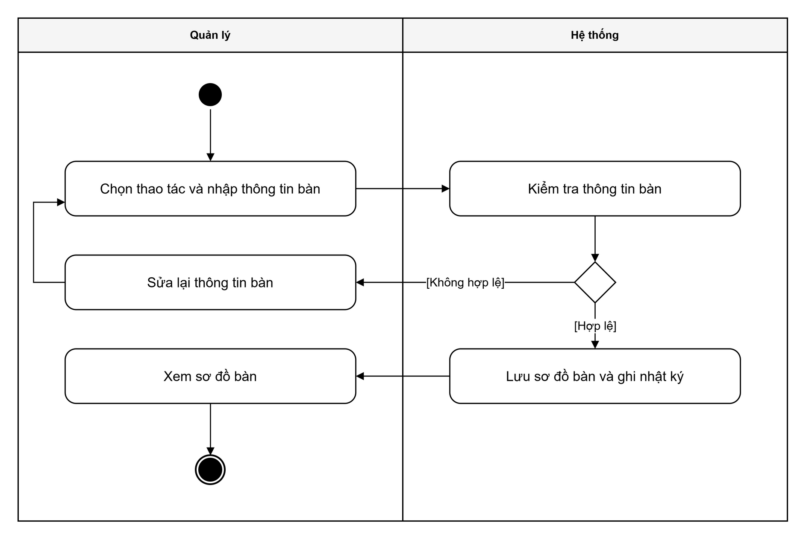

Hình 4. QT-04 — Quản lý danh mục bàn. Luồng chính.

### 1.5. Quản lý nguyên liệu

Bước 1. Bếp hoặc Quản lý thêm, sửa nguyên liệu: tên, đơn vị chuẩn và mức tồn tối thiểu riêng nếu có.

Bước 2. Đơn vị tính không đổi được sau khi nguyên liệu đã được tham chiếu trong dữ liệu.

Bước 3. Nguyên liệu đã có lịch sử chỉ được xóa mềm; hệ thống ghi nhật ký thao tác xóa.

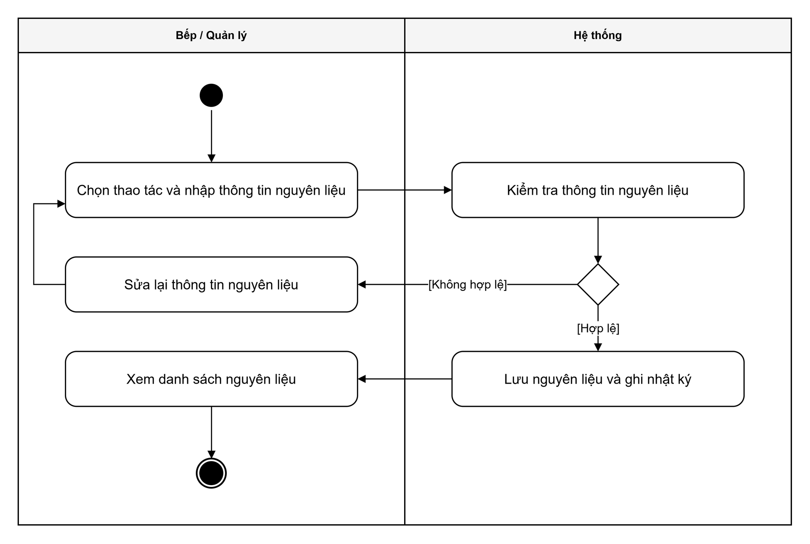

Hình 5. QT-05 — Quản lý nguyên liệu. Luồng chính.

### 1.6. Quản lý nhà cung cấp

Bước 1. Bếp hoặc Quản lý tìm nhà cung cấp, xem thông tin liên hệ và lịch sử nhập hàng.

Bước 2. Người dùng thêm, sửa hoặc xóa nhà cung cấp; thông tin không hợp lệ được trả về để sửa.

Bước 3. Nhà cung cấp đã có lịch sử nhập chỉ được xóa mềm; danh sách được dùng khi nhập kho.

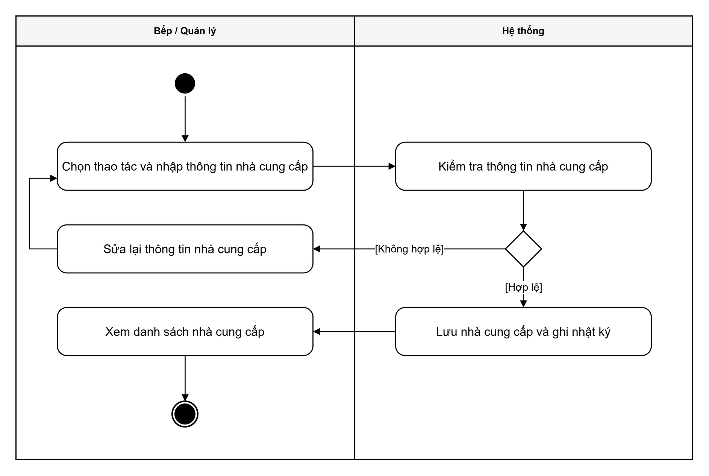

Hình 6. QT-06 — Quản lý nhà cung cấp. Luồng chính.

### 1.7. Gọi món

Bước 1. Nhân viên chọn loại order: tại chỗ thì chọn bàn trống, mang về thì không gắn bàn; sau đó thêm món, số lượng và ghi chú.

Bước 2. Hệ thống kiểm tra nguyên liệu khả dụng; nếu thiếu, nhân viên chọn lại món; nếu đủ, hệ thống giữ nguyên liệu cho lượt chọn.

Bước 3. Nhân viên xác nhận gửi món; hệ thống tạo order, trừ nguyên liệu theo lô FIFO (lô nhập sớm nhất còn hạn được dùng trước), kết thúc giữ món và in phiếu bếp. Order tại chỗ chuyển bàn sang Đang phục vụ; order mang về không thay đổi trạng thái bàn. Gọi thêm, giảm/hủy món, đổi bàn và giải phóng bàn thuộc UC 2.3; thanh toán theo QT-08.

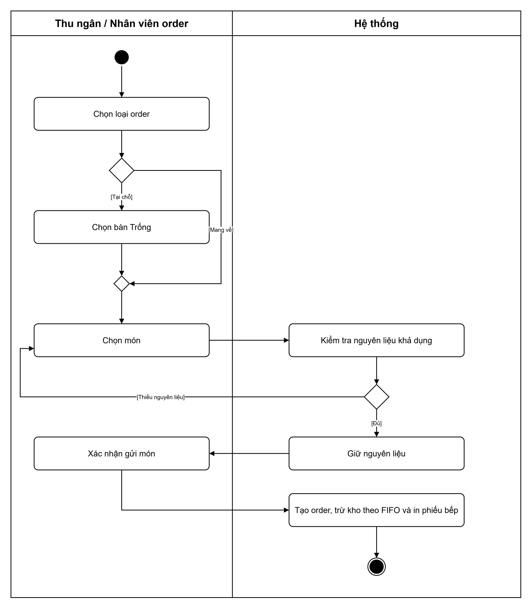

Hình 7. QT-07 — Gọi món. Luồng chính.

### 1.8. Thanh toán

Bước 1. Thu ngân mở order cần thanh toán và xử lý hết các món gọi thêm chưa gửi; hệ thống in phiếu tạm tính để khách kiểm tra món và tổng tiền.

Bước 2. Thu ngân chọn phương thức. Tiền mặt: Thu ngân nhận, kiểm đếm và xác nhận đã nhận đủ trên hệ thống. QR: hệ thống tạo mã đúng order, đúng số tiền, có hiệu lực 10 phút; khách quét mã và cổng thanh toán gửi kết quả về hệ thống.

Bước 3. Hệ thống ghi nhận thanh toán thành công, chuyển order sang Đã thanh toán và phát hành hóa đơn; hóa đơn đã phát hành chỉ được in lại nguyên trạng.

Bước 4. Mã QR hết hạn hoặc bị hủy thì Thu ngân tạo mã mới hoặc chuyển sang tiền mặt; trường hợp khách đã trả nhưng hệ thống lỗi, chưa hiển thị kết quả được xử lý theo QT-09 Xác minh thanh toán.

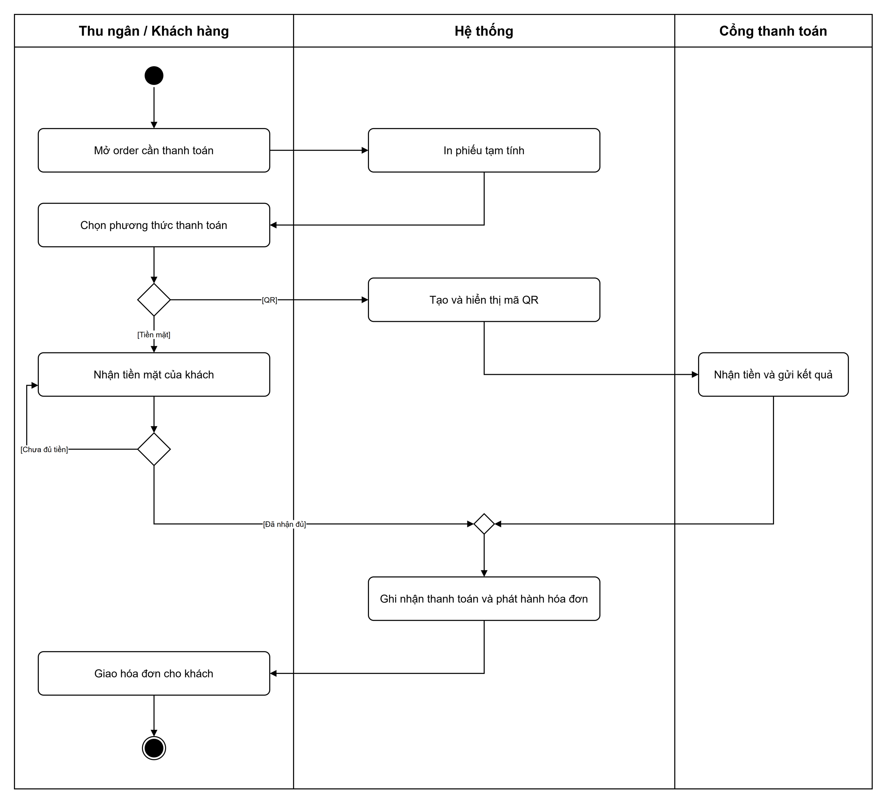

Hình 8. QT-08 — Thanh toán. Luồng chính.

### 1.9. Xác minh thanh toán

Bước 1. Thu ngân ghi nhận khách báo đã trả tiền, mã giao dịch và bằng chứng nếu có; order chuyển sang Chờ xác minh thanh toán và tạm khóa sửa, hủy món.

Bước 2. Quản lý đối chiếu sao kê tài khoản nhận tiền của nhà hàng theo mã giao dịch, số tiền và thời điểm; ảnh khách cung cấp chỉ để tham khảo.

Bước 3. Nếu đã nhận đủ tiền, Quản lý xác nhận; hệ thống ghi thanh toán thành công và phát hành hóa đơn đúng một lần. Nếu chưa đủ căn cứ, Quản lý lưu kết quả kiểm tra, giữ Chờ xác minh và tiếp tục tra soát. Khi đã thống nhất thu lại thì mở lại thanh toán; khi quyết định ngừng theo dõi thu tiền thì đóng order chưa thu được tiền, bắt buộc lưu lý do.

Bước 4. Các khoản QR đến muộn, sai số tiền hoặc thu trùng được theo dõi riêng và xử lý theo UC 2.6: áp dụng khoản hợp lệ hoặc ghi kết quả hoàn tiền ngoài hệ thống, không cộng doanh thu hai lần. Mọi kết quả và quyết định được ghi thêm vào nhật ký, không cho sửa hoặc xóa.

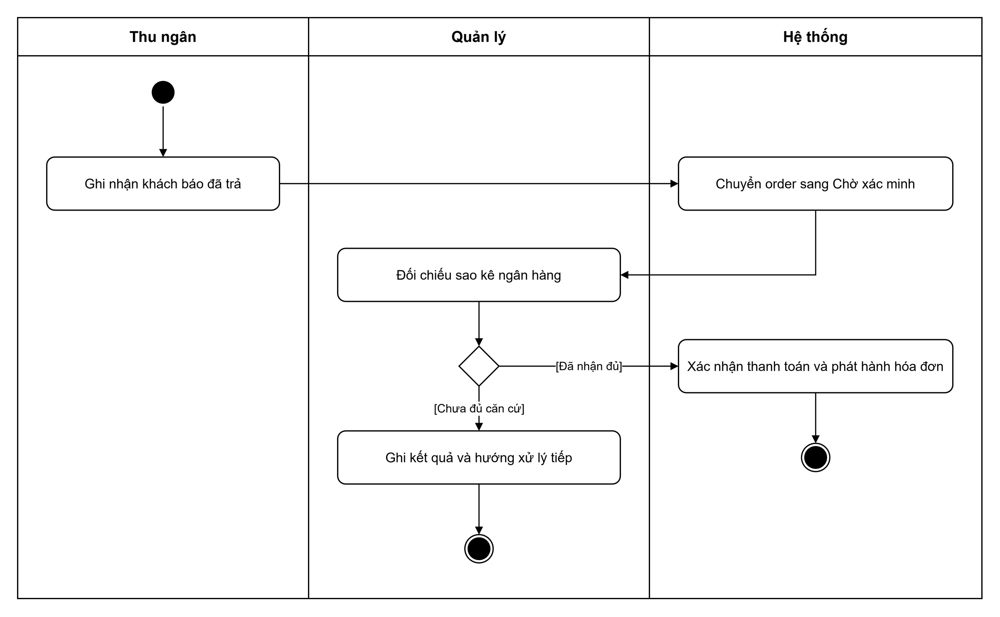

Hình 9. QT-09 — Xác minh thanh toán. Luồng chính.

### 1.10. Hủy toàn bộ order

Bước 1. Quản lý chọn order cần hủy và nhập lý do hủy; chỉ Quản lý có quyền thực hiện thao tác này.

Bước 2. Quản lý trao đổi với Bếp rồi đánh dấu các món đã chế biến; các món này giữ nguyên tiêu hao, không hoàn kho.

Bước 3. Hệ thống hoàn nguyên liệu của các món chưa chế biến về đúng lô gốc, chuyển order sang Đã hủy và ghi nhật ký trong cùng giao dịch.

Bước 4. Đây là thao tác thủ công cho trường hợp hiếm gặp; bàn chỉ được giải phóng khi khách rời đi.

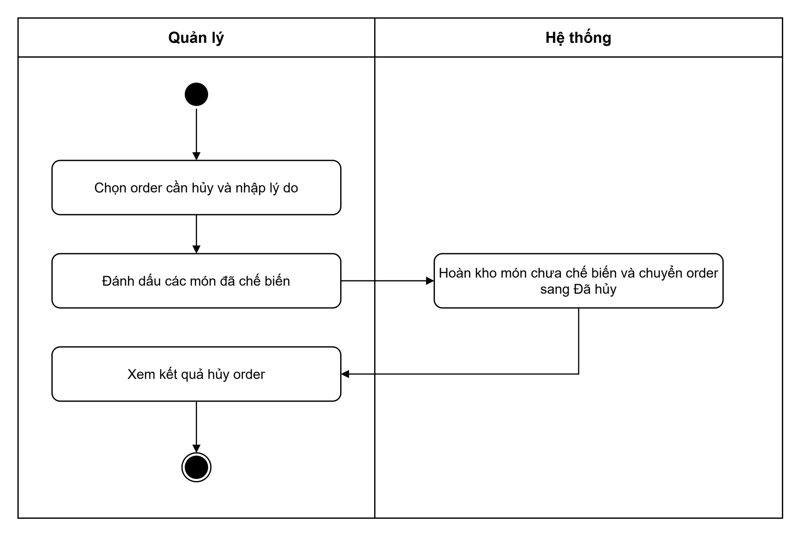

Hình 10. QT-10 — Hủy toàn bộ order. Luồng chính.

### 1.11. Tra cứu order và in lại hóa đơn, phiếu bếp

Bước 1. Quản lý mở màn hình Quản lý đơn hàng; Thu ngân/Nhân viên order mở danh sách order theo quyền. Người dùng lọc theo mã, bàn, khoảng ngày kinh doanh hoặc trạng thái.

Bước 2. Hệ thống hiển thị danh sách và chi tiết order phù hợp với quyền của người dùng.

Bước 3. Người dùng chọn xem và in lại hóa đơn hoặc phiếu bếp đã ghi nhận.

Bước 4. In lại chỉ in dữ liệu đã lưu; không sửa hóa đơn, không phát sinh thêm tiêu hao hay doanh thu.

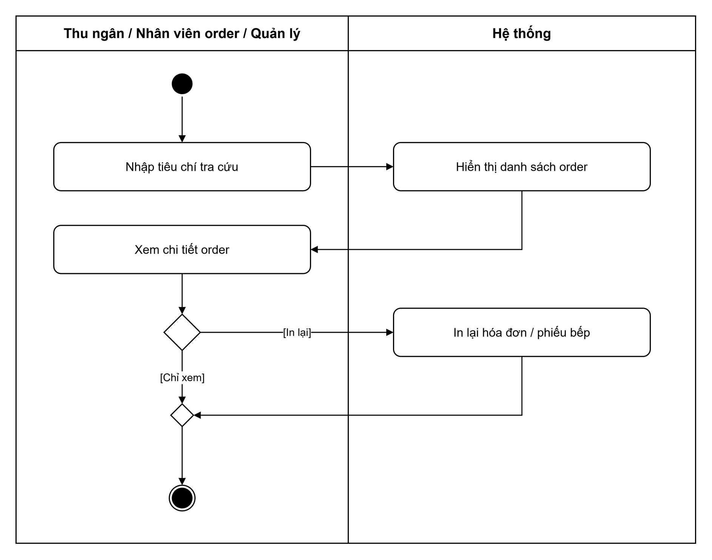

Hình 11. QT-11 — Tra cứu order và in lại hóa đơn, phiếu bếp. Luồng chính.

### 1.12. Nhập kho nguyên liệu theo lô

Bước 1. Bếp hoặc Quản lý nhận hàng, kiểm tra thực tế, chọn nhà cung cấp; khai báo nguyên liệu, số lượng, đơn giá và ngày nhập.

Bước 2. Mỗi dòng nhập hợp lệ tạo một lô riêng, có ngày nhập, hạn dùng và số lượng còn lại.

Bước 3. Người lập xác nhận; hệ thống lưu phiếu, tạo lô và tăng tồn kho.

Bước 4. Phiếu chỉ được sửa hoặc hủy khi các lô chưa phát sinh xuất và không có giữ món còn hiệu lực; dữ liệu đã sử dụng được xử lý qua kiểm kê.

Khi hủy phiếu nhập, hệ thống đảo lượng nhập bằng giao dịch kho loại Hủy nhập gắn với dòng nhập nguồn, đưa số lượng còn lại của các lô sinh từ phiếu về 0 và chuyển các lô này sang Đã hủy; giữ phiếu, lô và lịch sử giao dịch để truy vết. Lô Đã hủy không được phân bổ FIFO, giữ món hoặc nhận điều chỉnh tăng tồn. Thao tác đồng thời loại phiếu khỏi dữ liệu nhập hiệu lực và tính lại đơn giá bình quân hiện hành của nguyên liệu. Xuất hủy nguyên liệu là nghiệp vụ riêng: chỉ trừ lượng được chọn trong lô, phần còn lại tiếp tục được sử dụng nếu đủ điều kiện; không chuyển cả lô sang Đã hủy.

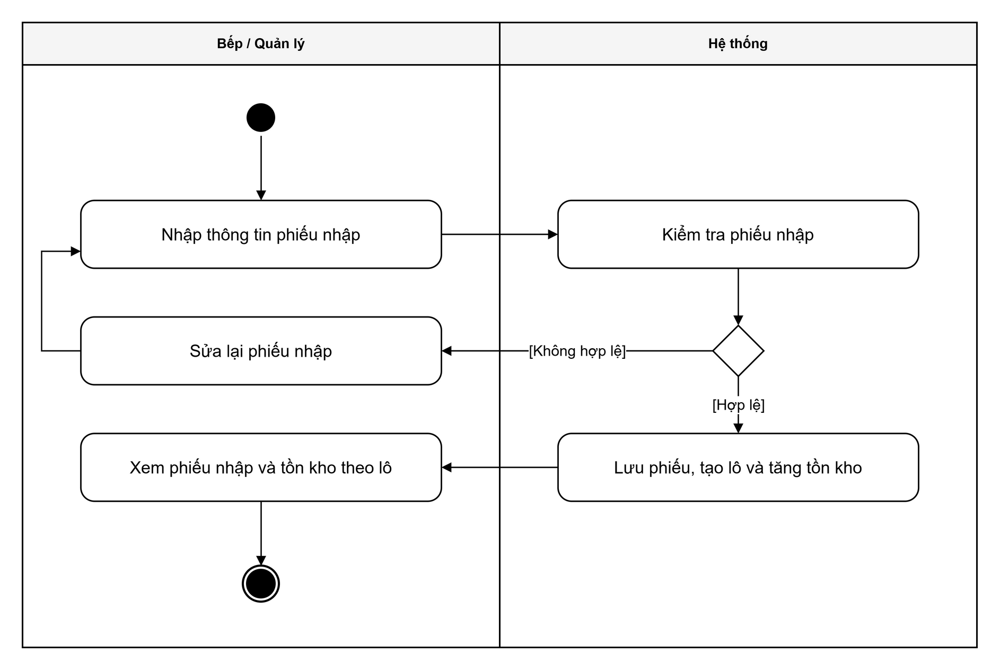

Hình 12. QT-12 — Nhập kho nguyên liệu theo lô. Luồng chính.

Giá trị nguyên liệu được tính theo phương pháp bình quân gia quyền di động. Mỗi lần lưu phiếu nhập, hệ thống tính lại đơn giá bình quân của từng nguyên liệu: đơn giá mới = (giá trị tồn trước khi nhập + số lượng nhập × đơn giá nhập) / (lượng tồn trước khi nhập + số lượng nhập). Sửa số lượng, đơn giá hoặc hủy phiếu theo FR-INV-02 được ghi thành một lần tính lại tại thời điểm thao tác; nếu thao tác làm lượng tồn về 0, đơn giá hiện hành được giữ nguyên; giá trị các lần xuất đã ghi nhận trước đó giữ nguyên. Sửa ngày nhập chỉ cập nhật hạn dùng và thứ tự FIFO của lô, không làm thay đổi đơn giá bình quân.

### 1.13. Xuất hủy nguyên liệu và món đã chế biến

Bước 1. Bếp hoặc Quản lý chọn nguồn xuất hủy và nhập lý do. Với nguồn Nguyên liệu, người lập chọn lô và lượng hủy; với nguồn Món đã chế biến, chọn dòng order và số suất bị bỏ.

Bước 2. Với nguyên liệu hỏng hoặc hết hạn, người lập chọn đúng lô thực tế cần hủy; lượng hủy không vượt tồn.

Bước 3. Hệ thống kiểm tra giới hạn và trạng thái kiểm kê. Với món đã chế biến, hệ thống tự tính lượng nguyên liệu theo số suất hủy và tiêu hao gốc của dòng order.

Bước 4. Hệ thống hiển thị bản xem trước gồm lô, lượng hủy, tồn còn lại sau hủy, giá trị hủy theo đơn giá bình quân hiện hành và các lượt giữ sẽ bị giải phóng nếu lô đang được giữ. Người lập kiểm tra rồi xác nhận.

Bước 5. Sau khi người lập xác nhận, hệ thống lưu phiếu và nhật ký trong một transaction. Nguồn Nguyên liệu trừ tồn theo lô, giải phóng lượt giữ bị ảnh hưởng và thông báo nhân viên kiểm tra lại; nguồn Món đã chế biến và chứng từ Kiểm kê sử dụng giao dịch gốc để phân loại hao hụt.

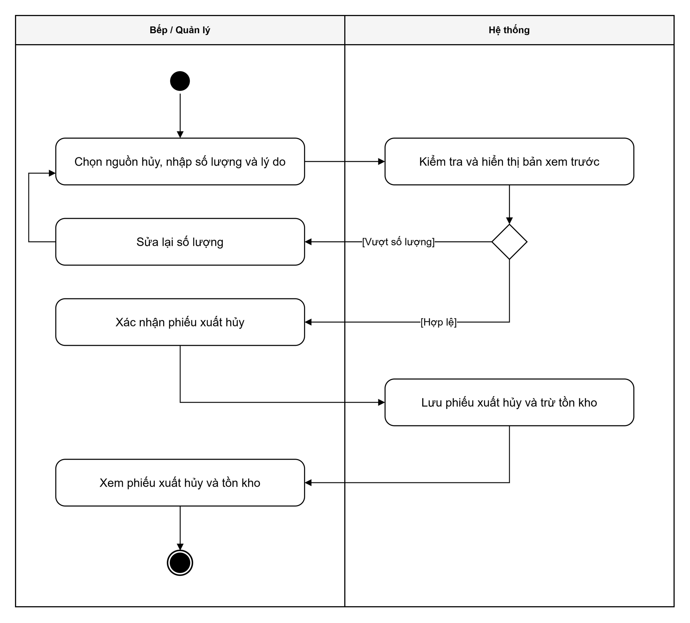

Hình 13. QT-13 — Xuất hủy nguyên liệu và món đã chế biến. Luồng chính.

### 1.14. Duyệt phiếu đề xuất hủy lô hết hạn

Bước 1. Sau mốc bắt đầu Business Date hệ thống tự lập một phiếu đề xuất hủy cho các lô đã quá hạn sử dụng nhưng còn số lượng.

Bước 2. Phiếu đề xuất có lý do Hết hạn, trạng thái Chờ duyệt và chưa trừ tồn; lô đã có trong phiếu đang chờ duyệt hoặc đã bị từ chối không được đề xuất lại.

Bước 3. Bếp hoặc Quản lý kiểm tra phiếu đề xuất vào cuối ngày hoặc đầu giờ sáng hôm sau. Khi duyệt, hệ thống trừ tồn đúng lô ghi trên phiếu, tối đa bằng lượng còn lại của lô, chuyển phiếu sang Đã xác nhận và ghi người duyệt, thời điểm duyệt; khi từ chối, phiếu chuyển sang Đã từ chối và tồn không đổi.

Bước 4. Nếu kiểm tra thực tế còn nguyên liệu hỏng hoặc hết hạn chưa có trong phiếu, người dùng lập thêm phiếu xuất hủy thủ công theo QT-13.

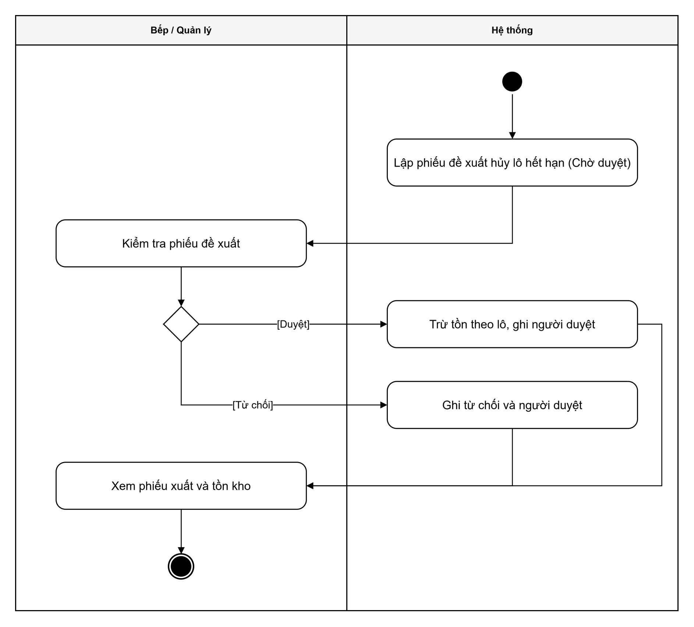

Hình 14. QT-14 — Duyệt phiếu đề xuất hủy lô hết hạn. Luồng chính.

### 1.15. Kiểm kê và điều chỉnh tồn kho

Bước 1. Bếp hoặc Quản lý yêu cầu mở kiểm kê sau khi kết thúc phục vụ. Hệ thống từ chối nếu còn lượt chọn chưa gửi/hủy, kể cả giữ đã hết hạn; nhân viên xử lý các lượt đó trước khi yêu cầu lại. Khi đủ điều kiện, hệ thống mở một phiên duy nhất và khóa biến động kho trong cùng transaction.

Bước 2. Bếp đếm tồn thực tế theo nguyên liệu, gồm cả lô hết hạn còn hàng, nhập số lượng thực tế và lý do cho dòng có chênh lệch, rồi chọn Xem trước. Dưới mỗi nguyên liệu, hệ thống liệt kê các lô còn số lượng theo thứ tự nhập trước đến nhập sau; mỗi lô chỉ ghi mã lô, lượng còn lại và hạn sử dụng theo dạng ngày/tháng/năm. Lô đã dùng hết hoặc đã hủy không được liệt kê; lô hết hạn đang nằm trong phiếu đề xuất hủy chờ duyệt vẫn được liệt kê vì chưa bị trừ tồn. Tổng lượng các lô được liệt kê bằng tồn trên hệ thống của nguyên liệu.

Bước 3. Hệ thống hiển thị bản xem trước gồm tồn trên hệ thống trước điều chỉnh, tồn sau điều chỉnh theo số thực tế và chênh lệch của từng nguyên liệu; bản xem trước chưa ghi dữ liệu. Bếp kiểm tra rồi chọn Xác nhận.

Bước 4. Khi Bếp xác nhận, hệ thống phân bổ chênh lệch xuống từng lô và ghi nhận điều chỉnh trong một transaction; chênh lệch âm sinh chứng từ xuất hủy, không trừ tồn lần hai. Người dùng không nhập đơn giá: giá trị điều chỉnh bằng lượng chênh lệch nhân đơn giá bình quân hiện hành; nguyên liệu chưa có đơn giá vẫn được ghi số lượng, giá trị hiển thị chưa xác định. Phiếu chuyển sang Đã xác nhận và kho được mở khóa.

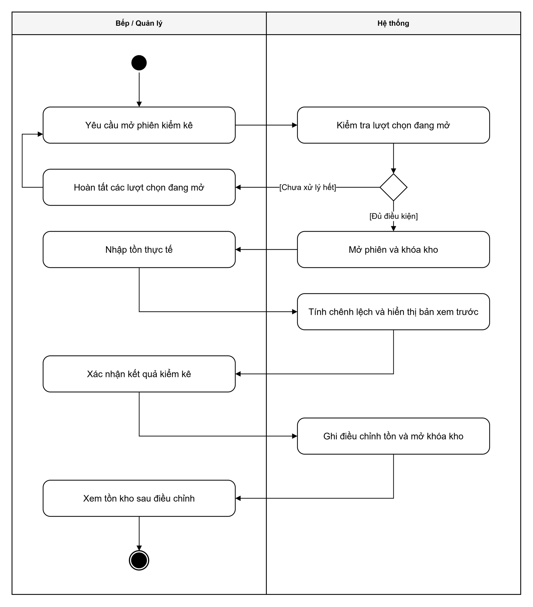

Hình 15. QT-15 — Kiểm kê và điều chỉnh tồn kho. Luồng chính.

### 1.16. Theo dõi tồn kho và cảnh báo theo lô

Bước 1. Bếp hoặc Quản lý mở màn hình kho, tìm nguyên liệu hoặc lọc theo tồn và hạn sử dụng.

Bước 2. Hệ thống hiển thị tồn sổ sách, lượng đang giữ, lượng khả dụng, đơn giá bình quân hiện hành và giá trị tồn; lô hết hạn không tính vào lượng bán được.

Bước 3. Hệ thống cảnh báo khi lượng khả dụng thấp hơn mức tồn tối thiểu hoặc lô sắp hết hạn.

Bước 4. Người dùng xem chi tiết lô, lịch sử xuất, hoàn và lịch sử đơn giá bình quân. Bếp quyết định nhập bổ sung hoặc xử lý lô hỏng; cảnh báo không tự tạo phiếu.

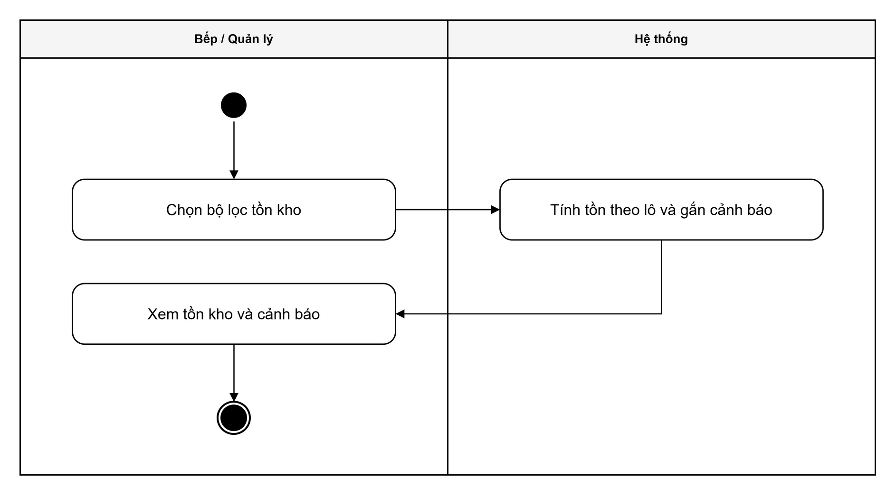

Hình 16. QT-16 — Theo dõi tồn kho và cảnh báo theo lô. Luồng chính.

### 1.17. Xem báo cáo thống kê

Bước 1. Quản lý chọn loại báo cáo: doanh thu, chi phí và lợi nhuận gộp, tiêu thụ món, phân bố order hoặc tình trạng order và thanh toán.

Bước 2. Quản lý chọn khoảng ngày kinh doanh hoặc kỳ báo cáo; chọn kỳ so sánh nếu báo cáo hỗ trợ.

Bước 3. Hệ thống tổng hợp và hiển thị bảng, biểu đồ; doanh thu chỉ tính từ order đã thanh toán, các khoản chưa thu, order hủy và order đóng chưa thu được tiền được tách riêng.

Bước 4. Quản lý xem kết quả.

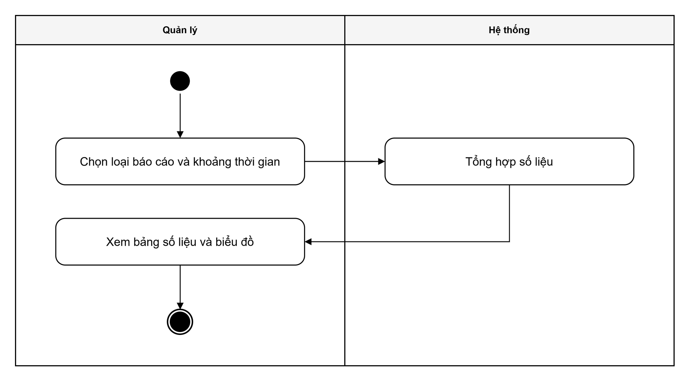

Hình 17. QT-17 — Xem báo cáo thống kê. Luồng chính.

### 1.18. Quản lý người dùng và phân quyền

Bước 1. Quản lý tạo tài khoản và gán một trong ba vai trò: Quản lý, Thu ngân/Nhân viên order hoặc Bếp.

Bước 2. Quản lý sửa thông tin, đặt lại mật khẩu hoặc khóa tài khoản khi cần; hệ thống kiểm tra quyền và dữ liệu, dữ liệu không hợp lệ được trả về để sửa.

Bước 3. Hệ thống lưu thay đổi và ghi nhật ký; Quản lý có thêm quyền tác nghiệp của Thu ngân/Nhân viên order và Bếp.

Bước 4. Đăng nhập, đổi mật khẩu cá nhân và đăng xuất là chức năng tài khoản theo UC 5.4, không thuộc luồng quản trị này.

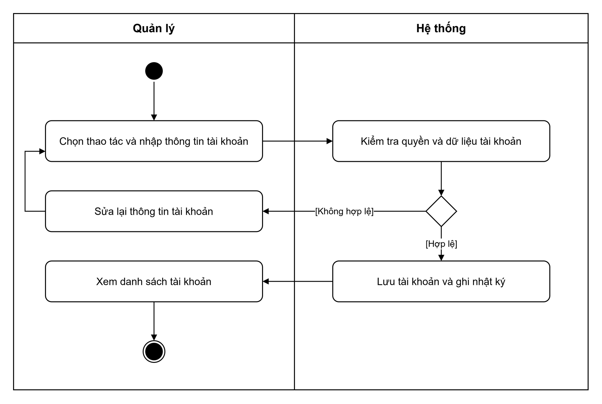

Hình 18. QT-18 — Quản lý người dùng và phân quyền. Luồng chính.

### 1.19. Cấu hình hệ thống

Bước 1. Quản lý mở cấu hình và xem các tham số: mẫu hóa đơn, mốc ngày kinh doanh, ngưỡng cảnh báo, thời hạn giữ món và hạn mức hỏi AI.

Bước 2. Quản lý sửa giá trị cần thiết và lưu; giá trị không hợp lệ được trả về để sửa.

Bước 3. Hệ thống lưu cấu hình và ghi nhật ký; mốc ngày kinh doanh mới có hiệu lực từ ngày kế tiếp.

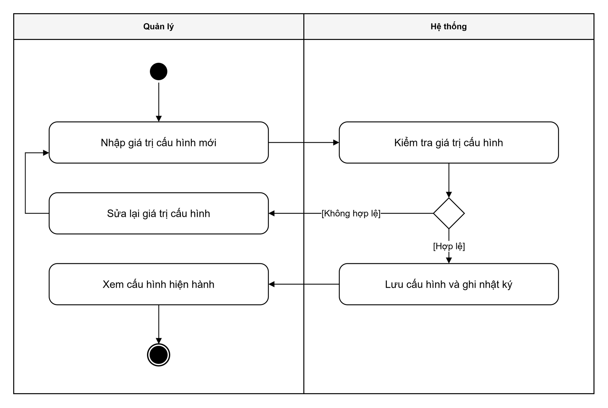

Hình 19. QT-19 — Cấu hình hệ thống. Luồng chính.

### 1.20. Tra cứu nhật ký hệ thống

Bước 1. Quản lý chọn khoảng thời gian, người thực hiện, loại thao tác hoặc đối tượng cần tra cứu.

Bước 2. Hệ thống trả danh sách nhật ký phù hợp; Quản lý chọn một bản ghi để xem người thực hiện, thời điểm, dữ liệu trước/sau và lý do.

Bước 3. Nhật ký chỉ để xem; mọi yêu cầu sửa hoặc xóa đều bị từ chối.

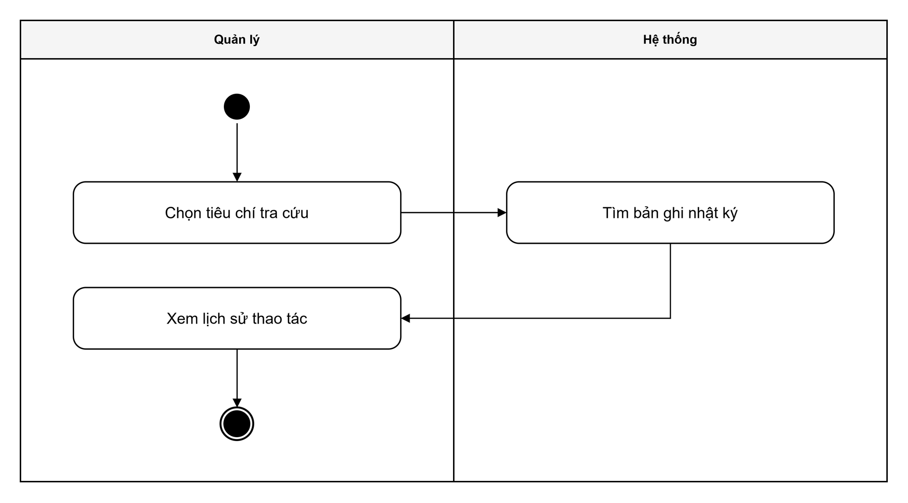

Hình 20. QT-20 — Tra cứu nhật ký hệ thống. Luồng chính.

### 1.21. Hỏi AI Assistant

Bước 1. Người dùng mở trợ lý theo vai trò và nhập câu hỏi bằng tiếng Việt.

Bước 2. Hệ thống kiểm tra quyền và hạn mức; câu hỏi ngoài phạm vi bị từ chối, câu hỏi chưa rõ đối tượng hoặc thời gian được yêu cầu làm rõ.

Bước 3. Hệ thống lấy dữ liệu trong phạm vi được phép và trả lời bằng tiếng Việt kèm bảng số liệu hoặc biểu đồ phù hợp; nếu không xử lý được thì thông báo và gợi ý diễn đạt lại.

Bước 4. Khi xử lý thành công, người dùng xem câu trả lời và mở chi tiết kỹ thuật nếu cần. Nếu ngoài quyền hoặc hết hạn mức, hệ thống từ chối và kết thúc yêu cầu; nếu câu hỏi chưa rõ, người dùng bổ sung thông tin; nếu không tạo được kết quả hợp lệ, hệ thống thông báo lỗi và gợi ý diễn đạt lại. Mỗi lượt được lưu theo quyền, người dùng có thể đặt câu hỏi tiếp theo.

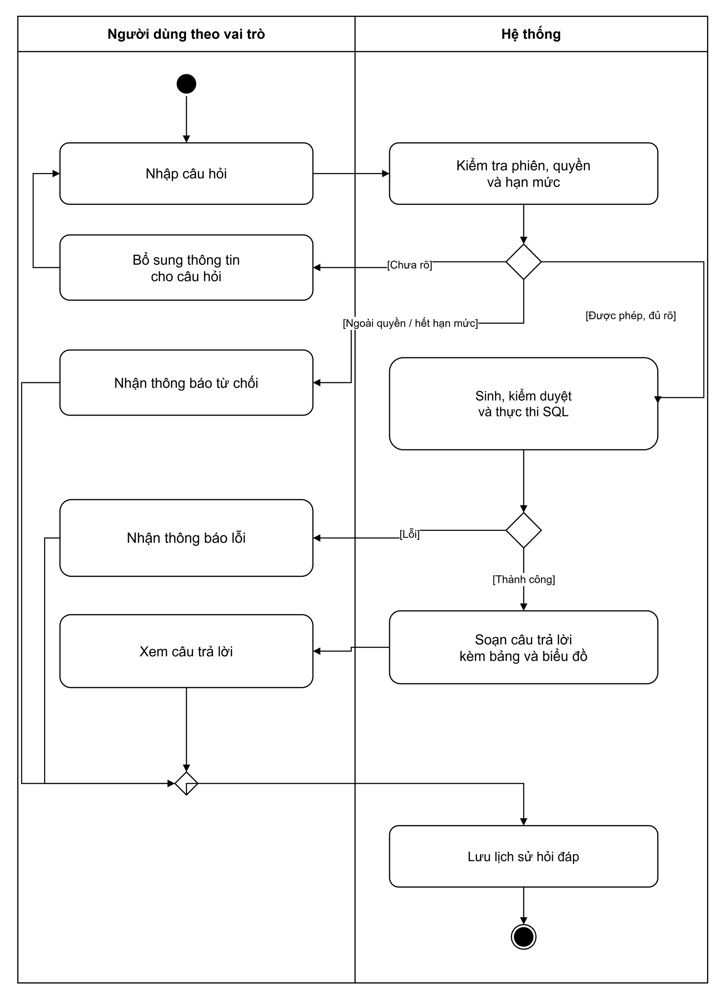

Hình 21. QT-21 — Hỏi AI Assistant. Luồng chính.

**Đối chiếu quy trình và nhóm chức năng**

Các quy trình tại mục 1 là căn cứ xác định sáu module tại mục 2.4.1 của báo cáo chính, nơi mã Use Case, quy trình và yêu cầu chi tiết tương ứng được đối chiếu.

| Nhóm | Quy trình nghiệp vụ |
|---|---|
| 1. Danh mục | Món ăn và nhóm món; công thức; giá bán; bàn; nguyên liệu; nhà cung cấp. |
| 2. Bán hàng | Gọi món tại chỗ/mang về; gọi thêm, sửa/hủy món và trạng thái phục vụ; bàn đang phục vụ; thanh toán; xác minh và khoản QR ngoại lệ; hủy order; tra cứu và in lại. |
| 3. Kho | Nhập theo lô; xuất FIFO và hoàn; xuất hủy; kiểm kê; theo dõi tồn, lịch sử và cảnh báo. |
| 4. Báo cáo | Xem báo cáo thống kê theo loại báo cáo và điều kiện lọc. |
| 5. Cài đặt | Người dùng và phân quyền, đăng nhập/đăng xuất/đổi mật khẩu; cấu hình; nhật ký. |
| 6. AI Assistant | Hỏi đáp dữ liệu theo vai trò. |

## 2. Quy tắc nghiệp vụ chung

- 1. Mỗi món ăn thuộc đúng một nhóm món duy nhất.

- 2. Order chỉ được ghi nhận kể từ lần gửi món đầu tiên. Phiếu tạm tính lấy từ order để khách đối chiếu trước khi thanh toán, không tạo bản ghi HOA_DON hoặc ghi nhận doanh thu; order chỉ phát sinh hóa đơn sau khi thanh toán thành công.

3. Sau khi thanh toán thành công, nội dung món và số tiền của order cùng hóa đơn được giữ nguyên; hóa đơn chỉ được in lại nguyên trạng. Nhân viên vẫn cập nhật trạng thái chế biến/phục vụ của dòng chưa hủy và giải phóng bàn khi khách rời đi theo UC 2.3.

- 4. Chỉ hỗ trợ tiền mặt hoặc QR do hệ thống tạo; không tích hợp thanh toán thẻ ngân hàng và không hỗ trợ chuyển khoản ngoài mã QR do hệ thống tạo. Giao dịch QR ở “Chờ xác nhận” cho đến khi webhook xác nhận hoặc quá 10 phút thì chuyển sang “Hết hạn”; khi khách báo đã thanh toán, Thu ngân chuyển sang “Chờ xác minh thanh toán”. Hệ thống lưu bằng chứng, lịch sử và kết quả xử lý, hỗ trợ xác nhận đã nhận tiền, mở lại thanh toán hoặc đóng order chưa thu được tiền; tra soát với ngân hàng và hoàn tiền thực hiện ngoài hệ thống, kết quả được lưu theo UC 2.6.

- 5. Không áp dụng khuyến mãi/giảm giá; hóa đơn không tách dòng thuế VAT.

- 6. Không hỗ trợ gộp bàn; hỗ trợ đổi bàn khi bàn đích đang trống.

- 7. Lượng khả dụng xác định khả năng nhận món mới theo UC 3.5. Giữ món chiếm lượng nguyên liệu cần cho số suất đã chọn trong thời hạn cấu hình; các bàn khác tiếp tục đặt phần khả dụng còn lại.

- 8. Thêm món vào lượt chọn chưa gửi tạo giữ món; giảm hoặc xóa dòng giải phóng phần tương ứng. Gửi lượt chọn chuyển giữ món thành tiêu hao. Cả lượt gọi ban đầu và gọi thêm đều thực hiện qua giữ món. Hủy món đã gửi và được Bếp xác nhận chưa làm thì hoàn theo giao dịch gốc.

- 9. Cảnh báo tồn kho dựa trên mức tồn tối thiểu riêng của từng nguyên liệu; nguyên liệu không cấu hình thì dùng mức tồn tối thiểu mặc định của hệ thống.

- 10. Thay đổi giá/công thức có hai cơ chế độc lập: lên lịch theo Business Date, và sửa trực tiếp có hiệu lực ngay.

- 11. Business Date là mốc do Quản lý cấu hình, dùng làm căn cứ hiệu lực giá/công thức và đơn vị nhóm báo cáo theo ngày.

- 12. Lợi nhuận gộp theo chi phí nguyên liệu = Doanh thu − Giá vốn nguyên liệu tiêu hao, tính bằng tiền theo tháng ở mức tổng toàn nhà hàng. Giá vốn của mỗi lần xuất kho bằng lượng xuất nhân đơn giá bình quân gia quyền di động tại thời điểm xuất.

- 13. AI Assistant: mỗi vai trò có trợ lý AI riêng, chỉ truy cập dữ liệu thuộc phạm vi vai trò, kiểm soát ở tầng backend/data layer.

- 14. Mọi câu trả lời của AI Assistant phải kèm bảng số liệu gốc và chú thích phạm vi dữ liệu.

- 15. Kiểm kê do Bếp/Quản lý tổ chức định kỳ theo UC 3.4, sau khi kết thúc chế biến và xử lý hết giữ món; các nghiệp vụ làm thay đổi tồn bị khóa trong phiên kiểm kê. Kết quả kiểm đếm chỉ được ghi vào tồn kho sau khi người kiểm kê xem trước tồn trước và sau điều chỉnh rồi xác nhận.

- 16. Nguyên tắc xóa mềm áp dụng thống nhất cho toàn bộ danh mục khi đối tượng đã có dữ liệu lịch sử tham chiếu.

- 17. Quản lý có quyền hủy toàn bộ order chưa thanh toán; nguyên liệu chỉ hoàn kho cho các món đang ở trạng thái “Chờ làm” tại thời điểm hủy (chi tiết tại UC 2.7).

- 18. Phiếu xuất hủy do người dùng lập chỉ trừ tồn sau khi người lập xem bản xem trước gồm lô, lượng hủy, tồn còn lại và giá trị hủy, rồi xác nhận; phiếu đề xuất hủy do hệ thống lập cho lô hết hạn chỉ trừ tồn sau khi Bếp hoặc Quản lý duyệt theo QT-14, và phiếu ghi người duyệt.

- 19. Giá vốn ước tính của món bằng tổng định lượng từng nguyên liệu trong công thức hiện hành nhân đơn giá bình quân hiện hành, dùng để cảnh báo và hỗ trợ quyết định giá bán; giá vốn trong báo cáo lợi nhuận vẫn là giá trị ghi tại thời điểm xuất kho.

## 3. Điều kiện triển khai các quy trình trọng yếu

QT-15 chỉ mở sau khi đã xử lý món và lượt chọn chưa gửi; các lượt giữ hết hạn được giải quyết theo giờ server trong bước kiểm tra, không chờ tác vụ nền. QT-21 kiểm tra phiên/tài khoản/quyền sở hữu hội thoại, chỉ thực thi SELECT qua view vai trò, tối đa 3 giây và 500 dòng; tối đa hai lần sinh SQL, ghi mã yêu cầu, trạng thái và usage nhưng không ghi bí mật.
