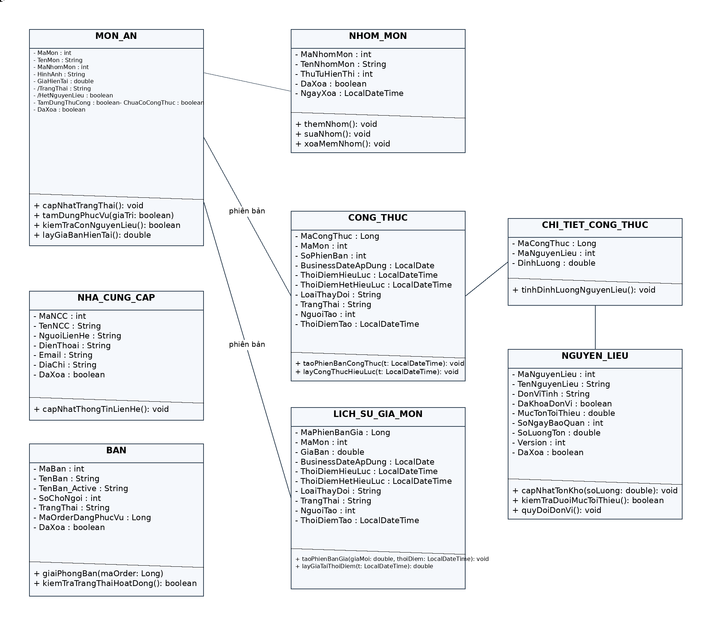
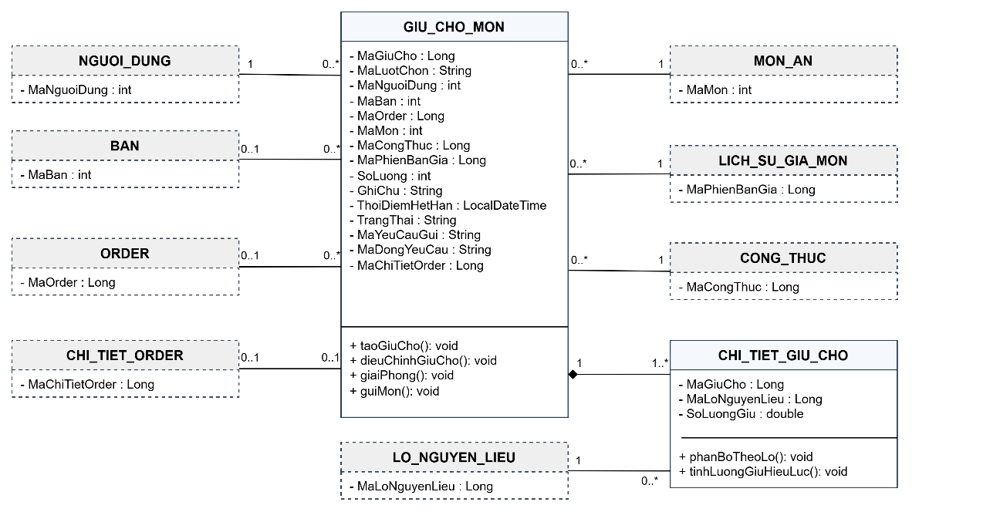
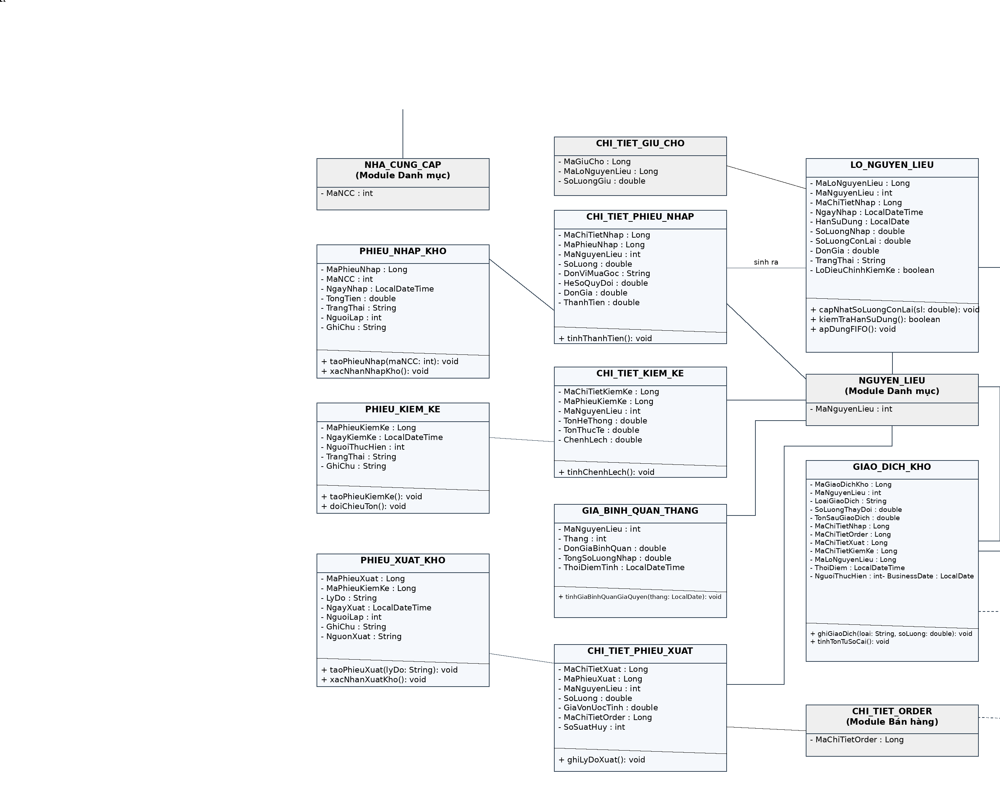
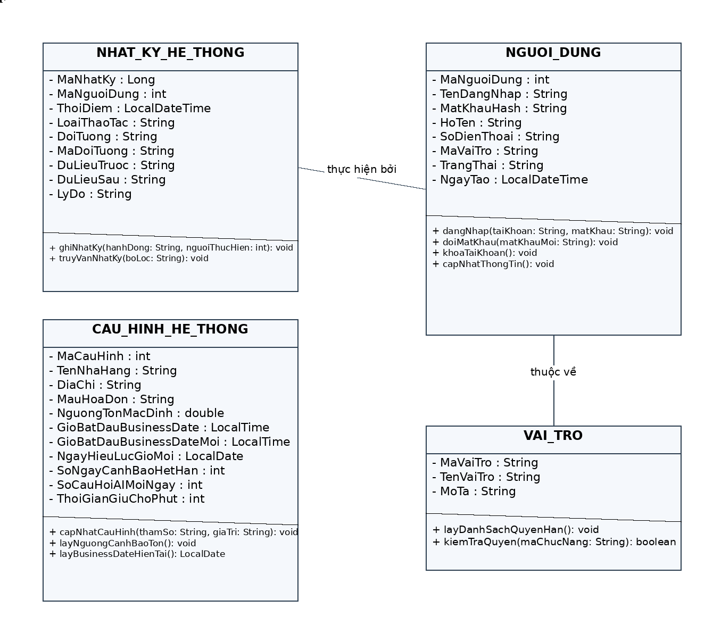
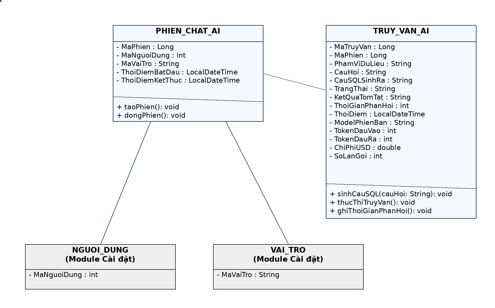
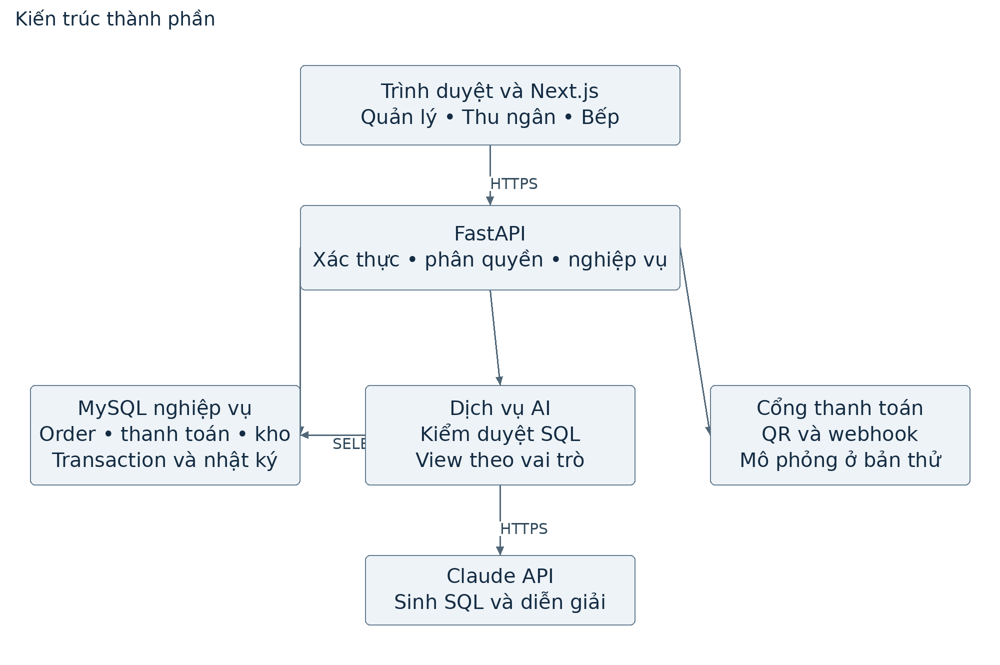
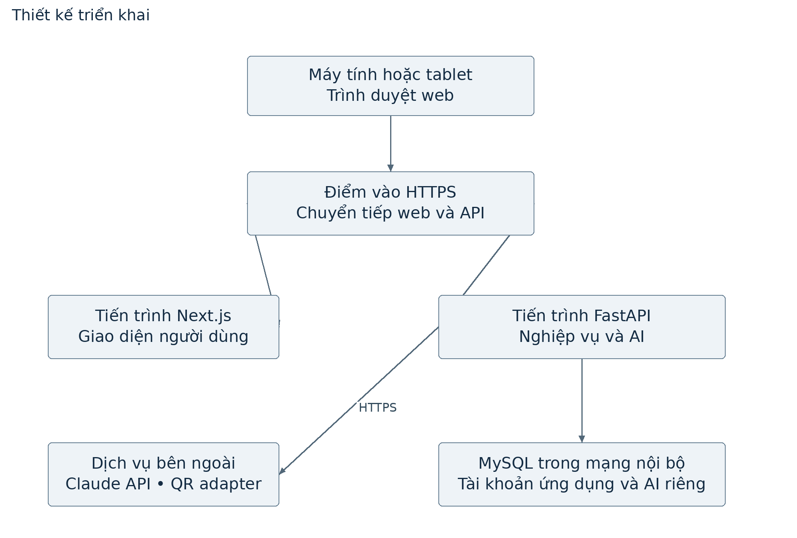
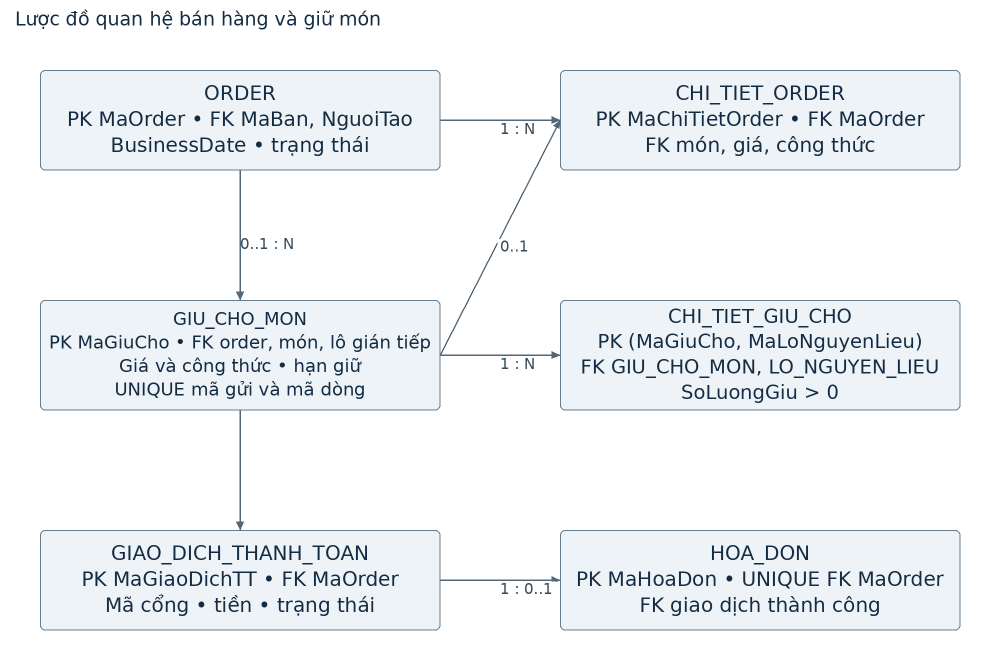
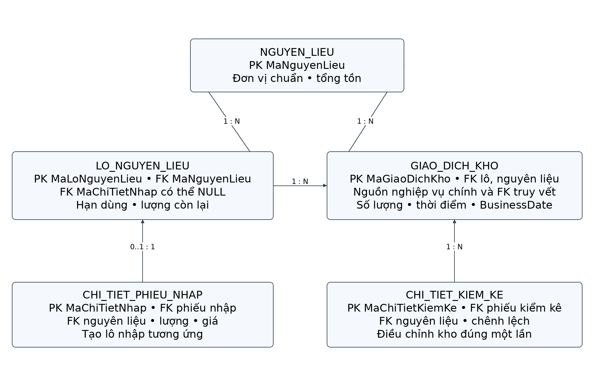
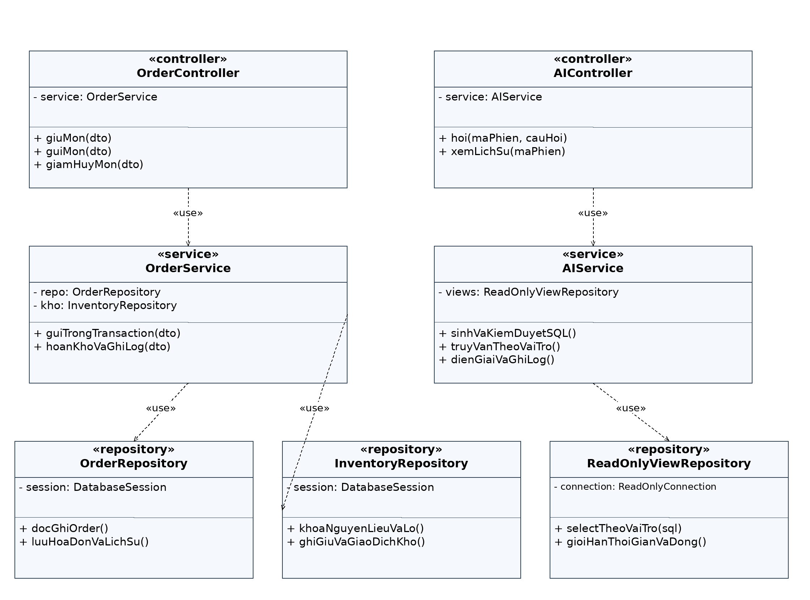

# 04. MÔ HÌNH LỚP VÀ THIẾT KẾ DỮ LIỆU

Hệ thống quản lý nhà hàng tích hợp AI hỗ trợ hoạt động kinh doanh

Mô hình lớp, ánh xạ sang lược đồ quan hệ và đặc tả thuộc tính, phương thức của các lớp đối tượng trong hệ thống quản lý nhà hàng.

## 3.2. Mô hình hóa đối tượng (Class Diagram)

Mô hình lớp mô tả các đối tượng nghiệp vụ, thuộc tính và quan hệ của hệ thống theo hướng phân tích thiết kế hướng đối tượng. Các sơ đồ được tổ chức theo module; thuộc tính và phương thức được đặc tả tại phần D của tài liệu này, còn quan hệ và bội số được ánh xạ sang lược đồ quan hệ tại mục 4.2.2 của báo cáo. Bội số trong sơ đồ dùng ký hiệu 1, 0..1, 0..\* và 1..\*. Kiểu dữ liệu trong các sơ đồ lớp là kiểu khái niệm, được định nghĩa tại phần D và ánh xạ sang kiểu dữ liệu MySQL tại mục 4.2.2 của báo cáo.

Các lớp tham chiếu từ module khác được thể hiện bằng khung nét đứt nền xám, tên lớp kèm tên module trong ngoặc (ví dụ “(Module Danh mục)”), chỉ trình bày thông tin cần thiết để nhận diện quan hệ giữa các module.

Hình 31. Class Diagram - Module Quản lý danh mục

Hình 32. Class Diagram - Module Quản lý bán hàng

Hình 33. Class Diagram - Giữ chỗ món (Module Quản lý bán hàng)

Hình 34. Class Diagram - Module Quản lý kho

Hình 35. Class Diagram - Module Cài đặt hệ thống

Hình 36. Class Diagram - Module AI Assistant

Module Quản lý danh mục: NHOM_MON, MON_AN, LICH_SU_GIA_MON, CONG_THUC, CHI_TIET_CONG_THUC, NGUYEN_LIEU, NHA_CUNG_CAP, BAN - MON_AN kết hợp (composition) với CONG_THUC theo từng phiên bản hiệu lực; CONG_THUC kết hợp CHI_TIET_CONG_THUC, mỗi dòng liên kết tới một NGUYEN_LIEU.

Module Quản lý bán hàng: ORDER, CHI_TIET_ORDER, LICH_SU_DOI_BAN, HOA_DON, GIAO_DICH_THANH_TOAN, PHIEU_BEP - ORDER kết hợp nhiều CHI_TIET_ORDER (1--1..\*), mỗi CHI_TIET_ORDER tham chiếu một MON_AN; ORDER liên kết 1--0..\* với GIAO_DICH_THANH_TOAN (mỗi lần thanh toán hoặc thử thanh toán là một giao dịch) và 1--0..1 với HOA_DON sau khi chốt; HOA_DON tham chiếu đúng một giao dịch “Thành công” qua MaGiaoDichThanhToan. GIU_CHO_MON lưu các dòng chưa gửi theo MaLuotChon; CHI_TIET_GIU_CHO lưu nguyên liệu theo lô. Khi gửi thành công, lượt giữ tham chiếu dòng CHI_TIET_ORDER đã tạo.

Module Quản lý kho: PHIEU_NHAP_KHO, CHI_TIET_PHIEU_NHAP, LO_NGUYEN_LIEU, PHIEU_XUAT_KHO, CHI_TIET_PHIEU_XUAT, PHIEU_KIEM_KE, CHI_TIET_KIEM_KE, GIAO_DICH_KHO, GIA_BINH_QUAN_THANG - mỗi CHI_TIET_PHIEU_NHAP sinh ra một LO_NGUYEN_LIEU (lô điều chỉnh kiểm kê là ngoại lệ, không có dòng nhập); mọi lớp biến động (nhập/xuất/kiểm kê) đều phát sinh bản ghi GIAO_DICH_KHO, NGUYEN_LIEU chỉ giữ số tồn dẫn xuất. Lượng đang giữ được tổng hợp từ CHI_TIET_GIU_CHO; phiên kiểm kê được quản lý bằng trạng thái PHIEU_KIEM_KE.

Module Báo cáo thống kê: Không định nghĩa lớp riêng; module đọc (read-only) từ các lớp ở trên thông qua các lớp dịch vụ/truy vấn tổng hợp (report service).

Module Cài đặt hệ thống: VAI_TRO, NGUOI_DUNG, CAU_HINH_HE_THONG, NHAT_KY_HE_THONG - NGUOI_DUNG liên kết 0..\*--1 với VAI_TRO; mọi thao tác rủi ro cao trên các lớp khác đều phát sinh một NHAT_KY_HE_THONG. CAU_HINH_HE_THONG chứa ThoiGianGiuChoPhut để xác định thời hạn cho từng dòng món chưa gửi.

Module AI Assistant: PHIEN_CHAT_AI, TRUY_VAN_AI - PHIEN_CHAT_AI kết hợp nhiều TRUY_VAN_AI (1--0..\*); TRUY_VAN_AI chỉ đọc dữ liệu qua các view phân quyền dựng trên các lớp nghiệp vụ ở trên.

## D. Đặc tả thuộc tính và phương thức của các lớp đối tượng

Mục này đặc tả chi tiết thuộc tính và phương thức của 31 lớp đối tượng đã liệt kê trong Bảng 10 tại mục 4.2.1 của báo cáo.

Mục này sử dụng các kiểu dữ liệu khái niệm String, int, Long, double, boolean, LocalDate, LocalDateTime và LocalTime. Thuộc tính cho phép rỗng được ghi ở cột “Ràng buộc” (ví dụ “Cho phép NULL”). Việc ánh xạ sang kiểu dữ liệu MySQL, quy tắc NULL/NOT NULL, thuộc tính dẫn xuất và các ràng buộc cơ sở dữ liệu được trình bày tại mục 4.2.2 của báo cáo. Chi tiết thuộc tính và phương thức của từng lớp đối tượng được trình bày lần lượt dưới đây. Trong cột “Ràng buộc”: thuộc tính đóng vai trò định danh của đối tượng được ghi “Định danh duy nhất” (hoặc “một phần” nếu là định danh phức hợp); thuộc tính đóng vai trò liên kết (tham chiếu) tới một lớp đối tượng khác được ghi rõ đối tượng được tham chiếu.

**a1. Lớp VAI_TRO**

Lưu ba vai trò cố định: Chủ nhà hàng/Quản lý, Thu ngân/Nhân viên order và Bếp. Mã kỹ thuật tương ứng là MANAGER, CASHIER và WAREHOUSE.

| **Thuộc tính** | **Kiểu dữ liệu** | **Ràng buộc**                    | **Mô tả**                 |
|----------------|------------------|----------------------------------|---------------------------|
| MaVaiTro       | String              | Định danh duy nhất của đối tượng | Định danh vai trò         |
| TenVaiTro      | String           | Không trùng lặp                  | Tên vai trò               |
| MoTa           | String           | –                                | Mô tả phạm vi trách nhiệm |

Bảng 14. Thuộc tính và phương thức của lớp VAI_TRO

Phương thức chính: layDanhSachQuyenHan(); kiemTraQuyen(maChucNang).

**a2. Lớp NGUOI_DUNG**

Tài khoản đăng nhập của nhân sự nhà hàng.

| **Thuộc tính** | **Kiểu dữ liệu** | **Ràng buộc**                    | **Mô tả**               |
|----------------|------------------|----------------------------------|-------------------------|
| MaNguoiDung    | int              | Định danh duy nhất của đối tượng | Định danh người dùng    |
| TenDangNhap    | String           | Không trùng lặp                  | Tên đăng nhập           |
| MatKhauHash    | String           | –                                | Mật khẩu đã băm         |
| HoTen          | String           | –                                | Họ tên nhân sự          |
| SoDienThoai    | String           | –                                | Số liên hệ              |
| MaVaiTro       | String              | Tham chiếu tới đối tượng VAI_TRO | Vai trò được gán        |
| TrangThai      | String           | –                                | Hoạt động / Đã khóa     |
| NgayTao        | LocalDateTime    | –                                | Thời điểm tạo tài khoản |

Bảng 15. Thuộc tính và phương thức của lớp NGUOI_DUNG

Phương thức chính: dangNhap(taiKhoan, matKhau); doiMatKhau(matKhauMoi); khoaTaiKhoan(); capNhatThongTin().

**a3. Lớp CAU_HINH_HE_THONG**

Bảng tham số dùng chung, chỉ có một bản ghi hiệu lực.

| **Thuộc tính**           | **Kiểu dữ liệu** | **Ràng buộc**                                                      | **Mô tả**                                                                                                         |
|--------------------------|------------------|--------------------------------------------------------------------|-------------------------------------------------------------------------------------------------------------------|
| MaCauHinh                | int              | Định danh duy nhất (đối tượng singleton, chỉ tồn tại một thực thể) | Định danh bản ghi cấu hình                                                                                        |
| TenNhaHang               | String           | –                                                                  | Tên nhà hàng in trên hóa đơn                                                                                      |
| DiaChi                   | String           | –                                                                  | Địa chỉ nhà hàng                                                                                                  |
| MauHoaDon                | String           | –                                                                  | Cấu hình mẫu hóa đơn                                                                                              |
| NguongTonMacDinh         | double           | –                                                                  | Mức tồn tối thiểu mặc định                                                                                        |
| GioBatDauBusinessDate    | LocalTime        | –                                                                  | Mốc bắt đầu Business Date đang áp dụng, do Quản lý cấu hình tại màn hình Cài đặt                                  |
| GioBatDauBusinessDateMoi | LocalTime        | –                                                                  | Mốc giờ mới đang chờ áp dụng, cho phép NULL; khi đến NgayHieuLucGioMoi thì được chuyển sang GioBatDauBusinessDate |
| NgayHieuLucGioMoi        | LocalDate        | –                                                                  | Business Date bắt đầu áp dụng mốc giờ mới (Business Date kế tiếp tại thời điểm thay đổi), cho phép NULL           |
| SoNgayCanhBaoHetHan      | int              | Mặc định 3; số nguyên dương                                        | Lô có hạn sử dụng còn không quá số ngày này được xếp “Sắp hết hạn”.                                               |
| SoCauHoiAIMoiNgay        | int              | Mặc định 50; số nguyên dương                                       | Số câu hỏi AI tối đa của mỗi người dùng trong một ngày.                                                           |
| ThoiGianGiuChoPhut       | int              | Số nguyên dương; mặc định 5                                        | Thời hạn dòng món chưa gửi; áp dụng ở lần tạo/gia hạn.                                                            |

Bảng 16. Thuộc tính và phương thức của lớp CAU_HINH_HE_THONG

Phương thức chính: capNhatCauHinh(thamSo, giaTri); layNguongCanhBaoTon(); layBusinessDateHienTai().

**a4. Lớp NHAT_KY_HE_THONG**

Ghi vết thao tác rủi ro cao, chỉ ghi thêm, không sửa/xóa. Đối với xử lý thanh toán, DoiTuong/MaDoiTuong gắn order; DuLieuTruoc/DuLieuSau lưu dữ liệu có cấu trúc gồm MaOrder, MaGiaoDichTT, trạng thái, nội dung và kết quả xác minh, mã tham chiếu/bằng chứng nếu có, số tiền chưa thu khi đóng. MaNguoiDung và ThoiDiem xác định người xử lý và thời điểm. Mỗi lần bổ sung thông tin hoặc cập nhật kết quả tạo bản ghi mới để tra cứu lịch sử.

| **Thuộc tính** | **Kiểu dữ liệu** | **Ràng buộc**                       | **Mô tả**                                                                                                                                                                                                                                                                                                   |
|----------------|------------------|-------------------------------------|-------------------------------------------------------------------------------------------------------------------------------------------------------------------------------------------------------------------------------------------------------------------------------------------------------------|
| MaNhatKy       | Long             | Định danh duy nhất của đối tượng    | Định danh bản ghi nhật ký                                                                                                                                                                                                                                                                                   |
| MaNguoiDung    | int              | Tham chiếu tới đối tượng NGUOI_DUNG | Người thực hiện                                                                                                                                                                                                                                                                                             |
| ThoiDiem       | LocalDateTime    | –                                   | Thời điểm thao tác                                                                                                                                                                                                                                                                                          |
| LoaiThaoTac    | String           | –                                   | Hủy order, hủy món, xóa danh mục, sửa/hủy phiếu nhập, đổi bàn, giải phóng bàn, quản lý tài khoản; hủy giao dịch QR chủ động, chuyển sang chờ xác minh thanh toán, bổ sung xác minh, xác nhận đã nhận tiền, mở lại thanh toán, đóng order chưa thu được tiền, áp dụng khoản đến muộn, lưu kết quả hoàn tiền. |
| DoiTuong       | String           | –                                   | Tên lớp đối tượng bị tác động                                                                                                                                                                                                                                                                               |
| MaDoiTuong     | String           | –                                   | Định danh của đối tượng bị tác động                                                                                                                                                                                                                                                                         |
| DuLieuTruoc    | String           | –                                   | Giá trị trước khi thay đổi                                                                                                                                                                                                                                                                                  |
| DuLieuSau      | String           | –                                   | Giá trị sau khi thay đổi                                                                                                                                                                                                                                                                                    |
| LyDo           | String           | –                                   | Lý do do người dùng nhập; bắt buộc khi mở lại thanh toán hoặc đóng order chưa thu được tiền.                                                                                                                                                                                                                |

Bảng 17. Thuộc tính và phương thức của lớp NHAT_KY_HE_THONG

Phương thức chính: ghiNhatKy(hanhDong, nguoiThucHien); truyVanNhatKy(boLoc).

**a5. Lớp NHOM_MON**

Nhóm phân loại món ăn, áp dụng xóa mềm.

| **Thuộc tính** | **Kiểu dữ liệu** | **Ràng buộc**                    | **Mô tả**          |
|----------------|------------------|----------------------------------|--------------------|
| MaNhomMon      | int              | Định danh duy nhất của đối tượng | Định danh nhóm món |
| TenNhomMon     | String           | –                                | Tên nhóm           |
| ThuTuHienThi   | int              | –                                | Thứ tự sắp xếp     |
| DaXoa          | boolean          | –                                | Cờ xóa mềm         |
| NgayXoa        | LocalDateTime    | –                                | Thời điểm xóa mềm  |

Bảng 18. Thuộc tính và phương thức của lớp NHOM_MON

Phương thức chính: themNhom(); suaNhom(); xoaMemNhom().

**a6. Lớp MON_AN**

Món ăn; giá và công thức hiện hành được suy ra từ hai bảng lịch sử tương ứng. Trạng thái phục vụ của món phụ thuộc HetNguyenLieu suy ra từ tồn khả dụng theo công thức và cờ TamDungThuCong do Quản lý bật/tắt. HetNguyenLieu là giá trị suy ra, không lưu trong MON_AN. ChuaCoCongThuc là cờ hệ thống tự đặt true khi món chưa từng được gán công thức mặc định lần nào và chuyển sang false khi công thức đầu tiên được gán; sau đó không trở lại true. TrangThai là thuộc tính tổng hợp, dùng để hiển thị. Cụ thể, cách hiển thị của một món ăn trên màn hình gọi món được quyết định như sau:

- Nếu ChuaCoCongThuc = true: Món ở trạng thái “Nháp” và bị ẩn hoàn toàn khỏi màn hình gọi món bất kể các cờ khác.

- Nếu ChuaCoCongThuc = false và HetNguyenLieu = true: Món ở trạng thái “Hết nguyên liệu”, vẫn hiển thị nhưng bị vô hiệu hóa và gắn đúng nhãn “Hết nguyên liệu”. Nếu đồng thời TamDungThuCong = true, màn hình quản trị hiển thị thêm lý do tạm dừng thủ công.

- Nếu ChuaCoCongThuc = false, HetNguyenLieu = false và TamDungThuCong = true: Món ở trạng thái “Tạm dừng phục vụ”, hiển thị mờ và không cho gọi. Chỉ khi HetNguyenLieu = false và TamDungThuCong = false, món mới ở trạng thái “Hoạt động” và cho phép gọi.

| **Thuộc tính**           | **Kiểu dữ liệu** | **Ràng buộc**                     | **Mô tả**                                                                                                                                                                                                                                                                |
|--------------------------|------------------|-----------------------------------|--------------------------------------------------------------------------------------------------------------------------------------------------------------------------------------------------------------------------------------------------------------------------|
| MaMon                    | int              | Định danh duy nhất của đối tượng  | Định danh món ăn                                                                                                                                                                                                                                                         |
| TenMon                   | String           | –                                 | Tên món                                                                                                                                                                                                                                                                  |
| MaNhomMon                | int              | Tham chiếu tới đối tượng NHOM_MON | Nhóm món (đúng một nhóm)                                                                                                                                                                                                                                                 |
| HinhAnh                  | String           | –                                 | Đường dẫn ảnh món                                                                                                                                                                                                                                                        |
| GiaHienTai               | double           | –                                 | Giá đang áp dụng (suy ra từ phiên bản giá đang hiệu lực trong LICH_SU_GIA_MON)                                                                                                                                                                                           |
| TrangThai                | String           | Giá trị suy ra tự động            | Giá trị suy ra, không ghi trực tiếp: Nháp nếu ChuaCoCongThuc; nếu đã có công thức thì Hết nguyên liệu khi HetNguyenLieu; nếu kho đủ nhưng TamDungThuCong thì Tạm dừng phục vụ; còn lại Hoạt động. Món Nháp bị ẩn; hai trạng thái chặn được hiển thị mờ và không cho gọi. |
| TamDungThuCong           | boolean          | –                                 | Cờ do Quản lý bật/tắt để tạm dừng phục vụ; độc lập với kết quả kiểm tra tồn kho.                                                                                                                                                                                         |
| HetNguyenLieu (dẫn xuất) | boolean          | Giá trị dẫn xuất                  | Suy từ tồn khả dụng của các nguyên liệu theo công thức hiện hành; true nếu không đủ làm một suất. Không lưu trong MON_AN, không bị Quản lý bật thủ công.                                                                                                                 |
| ChuaCoCongThuc           | boolean          | –                                 | Cờ hệ thống tự đặt true khi món chưa được gán công thức                                                                                                                                                                                                                  |
| DaXoa                    | boolean          | –                                 | Cờ xóa mềm                                                                                                                                                                                                                                                               |

Bảng 19. Thuộc tính và phương thức của lớp MON_AN

Phương thức chính: capNhatTrangThai(); tamDungPhucVu(giaTri: boolean); kiemTraConNguyenLieu(); layGiaBanHienTai().

**a7. Lớp LICH_SU_GIA_MON**

Mỗi lần đổi giá sinh một phiên bản; order tham chiếu đúng phiên bản có hiệu lực.

| **Thuộc tính**     | **Kiểu dữ liệu** | **Ràng buộc**                       | **Mô tả**                                          |
|--------------------|------------------|-------------------------------------|----------------------------------------------------|
| MaPhienBanGia      | Long             | Định danh duy nhất của đối tượng    | Định danh phiên bản giá                            |
| MaMon              | int              | Tham chiếu tới đối tượng MON_AN     | Món ăn tương ứng                                   |
| GiaBan             | double           | Phải lớn hơn 0                      | Giá bán của phiên bản                              |
| BusinessDateApDung | LocalDate        | –                                   | Business Date được chọn để áp dụng                 |
| ThoiDiemHieuLuc    | LocalDateTime    | –                                   | Thời điểm bắt đầu hiệu lực                         |
| ThoiDiemHetHieuLuc | LocalDateTime    | –                                   | Thời điểm bị phiên bản sau thay thế                |
| LoaiThayDoi        | String           | –                                   | Theo lịch / Sửa trực tiếp                          |
| TrangThai          | String           | –                                   | Chờ áp dụng / Đang áp dụng / Hết hiệu lực / Đã hủy |
| NguoiTao           | int              | Tham chiếu tới đối tượng NGUOI_DUNG | Người thực hiện thay đổi                           |
| ThoiDiemTao        | LocalDateTime    | –                                   | Thời điểm tạo phiên bản                            |

Bảng 20. Thuộc tính và phương thức của lớp LICH_SU_GIA_MON

Phương thức chính: taoPhienBanGia(giaMoi, thoiDiem); layGiaTaiThoiDiem(t).

**a8. Lớp CONG_THUC**

Phiên bản công thức chế biến của món, cơ chế hiệu lực giống bảng giá.

| **Thuộc tính**     | **Kiểu dữ liệu** | **Ràng buộc**                       | **Mô tả**                                          |
|--------------------|------------------|-------------------------------------|----------------------------------------------------|
| MaCongThuc         | Long             | Định danh duy nhất của đối tượng    | Định danh phiên bản công thức                      |
| MaMon              | int              | Tham chiếu tới đối tượng MON_AN     | Món ăn tương ứng                                   |
| SoPhienBan         | int              | –                                   | Số thứ tự phiên bản                                |
| BusinessDateApDung | LocalDate        | –                                   | Business Date áp dụng                              |
| ThoiDiemHieuLuc    | LocalDateTime    | –                                   | Thời điểm bắt đầu hiệu lực                         |
| ThoiDiemHetHieuLuc | LocalDateTime    | –                                   | Thời điểm bị thay thế                              |
| LoaiThayDoi        | String           | –                                   | Theo lịch / Sửa trực tiếp                          |
| TrangThai          | String           | –                                   | Chờ áp dụng / Đang áp dụng / Hết hiệu lực / Đã hủy |
| NguoiTao           | int              | Tham chiếu tới đối tượng NGUOI_DUNG | Người thực hiện                                    |
| ThoiDiemTao        | LocalDateTime    | –                                   | Thời điểm tạo                                      |

Bảng 21. Thuộc tính và phương thức của lớp CONG_THUC

Phương thức chính: taoPhienBanCongThuc(t); layCongThucHieuLuc(t).

**a9. Lớp CHI_TIET_CONG_THUC**

Lớp đối tượng trung gian giữa CONG_THUC và NGUYEN_LIEU.

| **Thuộc tính** | **Kiểu dữ liệu** | **Ràng buộc**                                                                    | **Mô tả**               |
|----------------|------------------|----------------------------------------------------------------------------------|-------------------------|
| MaCongThuc     | Long             | Định danh duy nhất (một phần) - Tham chiếu tới đối tượng CONG_THUC (composition) | Phiên bản công thức     |
| MaNguyenLieu   | int              | Định danh duy nhất (một phần) - Tham chiếu tới đối tượng NGUYEN_LIEU             | Nguyên liệu sử dụng     |
| DinhLuong      | double           | Phải lớn hơn 0                                                                   | Định lượng cho một suất |

Bảng 22. Thuộc tính và phương thức của lớp CHI_TIET_CONG_THUC

Phương thức chính: tinhDinhLuongNguyenLieu().

**a10. Lớp NGUYEN_LIEU**

Nguyên liệu kho; SoLuongTon được cập nhật bởi mọi giao dịch kho.

| **Thuộc tính** | **Kiểu dữ liệu** | **Ràng buộc**                    | **Mô tả**                                                                                                         |
|----------------|------------------|----------------------------------|-------------------------------------------------------------------------------------------------------------------|
| MaNguyenLieu   | int              | Định danh duy nhất của đối tượng | Định danh nguyên liệu                                                                                             |
| TenNguyenLieu  | String           | –                                | Tên nguyên liệu                                                                                                   |
| DonViTinh      | String           | –                                | Đơn vị tính chuẩn hóa                                                                                             |
| DaKhoaDonVi    | boolean          | –                                | Khóa sửa đơn vị sau khi đã tham chiếu                                                                             |
| MucTonToiThieu | double           | Không nhỏ hơn 0                  | Ngưỡng cảnh báo tồn riêng; NULL sử dụng mức mặc định, còn 0 là ngưỡng riêng hợp lệ; mặc định lấy từ CAU_HINH_HE_THONG |
| SoNgayBaoQuan  | int              | –                                | Số ngày bảo quản chuẩn kể từ ngày nhập; để trống nếu nguyên liệu không quản lý hạn sử dụng                        |
| SoLuongTon     | double           | Không nhỏ hơn 0                  | Tổng tồn sổ sách của các lô, kể cả lô hết hạn. Lượng khả dụng được tính từ lô còn hạn sau khi trừ giữ món.        |
| Version        | int              | Tăng mỗi lần ghi nhận thay đổi   | Số phiên bản của bản ghi (NFR-07)                                                                                 |
| DaXoa          | boolean          | –                                | Cờ xóa mềm                                                                                                        |

Bảng 23. Thuộc tính và phương thức của lớp NGUYEN_LIEU

Phương thức chính: capNhatTonKho(soLuong); kiemTraDuoiMucToiThieu(); quyDoiDonVi().

**a11. Lớp NHA_CUNG_CAP**

Nhà cung cấp nguyên liệu, áp dụng xóa mềm khi đã có lịch sử nhập.

| **Thuộc tính** | **Kiểu dữ liệu** | **Ràng buộc**                    | **Mô tả**              |
|----------------|------------------|----------------------------------|------------------------|
| MaNCC          | int              | Định danh duy nhất của đối tượng | Định danh nhà cung cấp |
| TenNCC         | String           | –                                | Tên nhà cung cấp       |
| NguoiLienHe    | String           | –                                | Người liên hệ          |
| DienThoai      | String           | –                                | Số điện thoại          |
| Email          | String           | –                                | Thư điện tử            |
| DiaChi         | String           | –                                | Địa chỉ                |
| DaXoa          | boolean          | –                                | Cờ xóa mềm             |

Bảng 24. Thuộc tính và phương thức của lớp NHA_CUNG_CAP

Phương thức chính: capNhatThongTinLienHe().

**a12. Lớp BAN**

Bàn trong sơ đồ nhà hàng; hệ thống cập nhật trạng thái khi ghi nhận order, đổi bàn hoặc nhân viên xác nhận khách đã rời đi. Thanh toán không tự giải phóng bàn.

| **Thuộc tính**    | **Kiểu dữ liệu** | **Ràng buộc**                                                     | **Mô tả**                                                                                          |
|-------------------|------------------|-------------------------------------------------------------------|----------------------------------------------------------------------------------------------------|
| MaBan             | int              | Định danh duy nhất của đối tượng                                  | Định danh bàn                                                                                      |
| TenBan            | String           | –                                                                 | Tên/số hiệu bàn                                                                                    |
| TenBan_Active     | String           | Giá trị suy ra tự động, không trùng lặp trong số các bàn chưa xóa | Tên hiển thị khi bàn chưa xóa mềm; cho phép đặt lại tên của một bàn đã xóa                         |
| SoChoNgoi         | int              | –                                                                 | Sức chứa (thông tin hiển thị tham khảo; không dùng để chặn order hay gợi ý xếp bàn)                |
| TrangThai         | String           | –                                                                 | Trống / Đang phục vụ; phản ánh khách còn sử dụng bàn, không phản ánh order đã thanh toán hay chưa. |
| MaOrderDangPhucVu | Long             | Tham chiếu tới ORDER đang chiếm bàn, NULL khi bàn Trống           | Chỉ order này được giải phóng bàn; thanh toán/đối soát của order cũ không ảnh hưởng order mới.     |
| DaXoa             | boolean          | –                                                                 | Cờ xóa mềm                                                                                         |

Bảng 25. Thuộc tính và phương thức của lớp BAN

Phương thức chính: giaiPhongBan(maOrder: Long); kiemTraTrangThaiHoatDong().

**a13. Lớp ORDER**

Đơn gọi món; chỉ được ghi nhận khi gửi món lần đầu.

| **Thuộc tính** | **Kiểu dữ liệu** | **Ràng buộc**                                                                                 | **Mô tả**                                                                                                                                  |
|----------------|------------------|-----------------------------------------------------------------------------------------------|--------------------------------------------------------------------------------------------------------------------------------------------|
| MaOrder        | Long             | Định danh duy nhất của đối tượng                                                              | Định danh order                                                                                                                            |
| MaOrderHienThi | String           | Không trùng lặp                                                                               | Mã tra cứu dạng ORD-ddMMyy-nnn                                                                                                             |
| BusinessDate   | LocalDate        | –                                                                                             | Business Date tại thời điểm gửi món đầu tiên của order; là ngày kinh doanh chuẩn cho hóa đơn, giao dịch thanh toán và báo cáo của order đó |
| MaBan          | int              | Tham chiếu tới đối tượng BAN (bắt buộc khi LoaiDon = Tại chỗ, để trống khi LoaiDon = Mang về) | Bàn phục vụ                                                                                                                                |
| LoaiDon        | String           | –                                                                                             | Tại chỗ / Mang về                                                                                                                          |
| TrangThai      | String           | –                                                                                             | Đang mở / Chờ xác nhận thanh toán / Đã thanh toán / Chờ xác minh thanh toán / Đóng – chưa thu được tiền / Đã hủy                           |
| TongTien       | double           | –                                                                                             | Tổng tiền order; nguồn in phiếu tạm tính trước khi thanh toán, chưa ghi nhận doanh thu                                                     |
| NguoiTao       | int              | Tham chiếu tới đối tượng NGUOI_DUNG                                                           | Nhân viên tạo order                                                                                                                        |
| NgayTao    | LocalDateTime    | –                                                                                             | Thời điểm gửi món đầu tiên                                                                                                                 |
| ThoiDiemDong   | LocalDateTime    | –                                                                                             | Thời điểm tất toán hoặc đóng                                                                                                               |
| LyDoHuy        | String           | –                                                                                             | Lý do hủy toàn bộ order                                                                                                                    |

Bảng 26. Thuộc tính và phương thức của lớp ORDER

Phương thức chính: taoOrder(maBan); themMonVaoOrder(maMon, soLuong); doiBan(maBanMoi); tinhTongTien(); huyOrder(lyDo); moLaiThanhToan(lyDo); dongOrderKhongThuDuocTien(lyDo, ketQuaXuLy).

**a14. Lớp CHI_TIET_ORDER**

Dòng món trong order, neo vào phiên bản giá và công thức tại thời điểm tạo.

| **Thuộc tính** | **Kiểu dữ liệu** | **Ràng buộc**                                                      | **Mô tả**                                                                           |
|----------------|------------------|--------------------------------------------------------------------|-------------------------------------------------------------------------------------|
| MaChiTietOrder | Long             | Định danh duy nhất của đối tượng                                   | Định danh dòng món                                                                  |
| MaOrder        | Long             | Tham chiếu tới đối tượng ORDER                                     | Order chứa dòng món                                                                 |
| MaMon          | int              | Tham chiếu tới đối tượng MON_AN                                    | Món được gọi                                                                        |
| MaPhienBanGia  | Long             | Tham chiếu tới đối tượng LICH_SU_GIA_MON (cùng món với dòng order) | Phiên bản giá có hiệu lực khi dòng món được gửi; giữ nguyên về sau                  |
| MaCongThuc     | Long             | Tham chiếu tới đối tượng CONG_THUC (cùng món với dòng order)       | Phiên bản công thức có hiệu lực khi dòng món được gửi, dùng trừ kho và tính giá vốn |
| SoLuong        | int              | Phải lớn hơn 0                                                     | Số suất                                                                             |
| DonGia         | double           | –                                                                  | Đơn giá tại thời điểm gọi                                                           |
| ThanhTien      | double           | –                                                                  | Thành tiền dòng món                                                                 |
| GhiChu         | String           | –                                                                  | Yêu cầu đặc biệt                                                                    |
| TrangThai      | String           | –                                                                  | Chờ làm / Đã xác nhận xong / Đã phục vụ / Đã hủy                                    |
| ThoiDiemThem   | LocalDateTime    | –                                                                  | Thời điểm thêm vào order                                                            |

Bảng 27. Thuộc tính và phương thức của lớp CHI_TIET_ORDER

Phương thức chính: capNhatTrangThaiCheBien(); huyDongMon(lyDo).

**a15. Lớp LICH_SU_DOI_BAN**

Vết chuyển bàn của order đang mở.

| **Thuộc tính** | **Kiểu dữ liệu** | **Ràng buộc**                       | **Mô tả**         |
|----------------|------------------|-------------------------------------|-------------------|
| MaLichSuDoiBan | Long             | Định danh duy nhất của đối tượng    | Định danh bản ghi |
| MaOrder        | Long             | Tham chiếu tới đối tượng ORDER      | Order được chuyển |
| MaBanNguon     | int              | Tham chiếu tới đối tượng BAN        | Bàn nguồn         |
| MaBanDich      | int              | Tham chiếu tới đối tượng BAN        | Bàn đích          |
| ThoiDiem       | LocalDateTime    | –                                   | Thời điểm đổi bàn |
| NguoiThucHien  | int              | Tham chiếu tới đối tượng NGUOI_DUNG | Người thực hiện   |

Bảng 28. Thuộc tính và phương thức của lớp LICH_SU_DOI_BAN

Phương thức chính: ghiLichSuDoiBan(banCu, banMoi).

**a16. Lớp HOA_DON**

Hóa đơn chốt sau thanh toán thành công; order bị khóa sau khi phát sinh.

| **Thuộc tính**      | **Kiểu dữ liệu** | **Ràng buộc**                                      | **Mô tả**                                                                                                                                                         |
|---------------------|------------------|----------------------------------------------------|-------------------------------------------------------------------------------------------------------------------------------------------------------------------|
| MaHoaDon            | Long             | Định danh duy nhất của đối tượng                   | Định danh hóa đơn                                                                                                                                                 |
| MaOrder             | Long             | Tham chiếu tới đối tượng ORDER, không trùng lặp    | Order tương ứng                                                                                                                                                   |
| MaGiaoDichThanhToan | Long             | Tham chiếu tới đối tượng GIAO_DICH_THANH_TOAN      | Giao dịch thanh toán thành công đã chốt hóa đơn này (truy vết khi có nhiều lần thử)                                                                               |
| SoHoaDon            | String           | Không trùng lặp                                    | Số hóa đơn                                                                                                                                                        |
| ThoiDiemXuat        | LocalDateTime    | –                                                  | Thời điểm xuất hóa đơn                                                                                                                                            |
| TongTien            | double           | –                                                  | Tổng tiền thanh toán                                                                                                                                              |
| PhuongThucThanhToan | String           | –                                                  | Tiền mặt / QR                                                                                                                                                     |
| NguoiLap            | int              | Tham chiếu tới đối tượng NGUOI_DUNG, cho phép NULL | Người xác nhận thanh toán dẫn đến hóa đơn (Thu ngân hoặc Quản lý); NULL khi hệ thống tự phát hành do webhook xác nhận                                             |
| SoLanIn             | int              | –                                                  | Số lần in                                                                                                                                                         |
| BusinessDate        | LocalDate        | –                                                  | Kế thừa BusinessDate của ORDER (không tính lại theo thời điểm xuất hóa đơn), để order đặt trước mốc giờ và thanh toán sau mốc giờ vẫn thuộc cùng một ngày báo cáo |

Bảng 29. Thuộc tính và phương thức của lớp HOA_DON

Phương thức chính: phatHanhHoaDon(); inLaiHoaDon().

**a17. Lớp GIAO_DICH_THANH_TOAN**

Lần thanh toán của order bằng tiền mặt hoặc QR; với QR gồm vòng đời mã QR và kết quả webhook.

| **Thuộc tính**      | **Kiểu dữ liệu** | **Ràng buộc**                        | **Mô tả**                                                                                                                                                                                 |
|---------------------|------------------|--------------------------------------|-------------------------------------------------------------------------------------------------------------------------------------------------------------------------------------------|
| MaGiaoDichTT        | Long             | Định danh duy nhất của đối tượng     | Định danh giao dịch                                                                                                                                                                       |
| MaOrder             | Long             | Tham chiếu tới đối tượng ORDER       | Order được thanh toán                                                                                                                                                                     |
| PhuongThuc          | String           | –                                    | Tiền mặt / QR                                                                                                                                                                             |
| SoTien              | double           | –                                    | Số tiền giao dịch                                                                                                                                                                         |
| TrangThai           | String           | –                                    | Chờ xác nhận / Thành công / Hết hạn / Chờ xác minh thanh toán / Đóng – chưa thu được tiền / Đã hủy                                                                                        |
| MaQR                | String           | –                                    | Nội dung mã QR động; NULL khi thanh toán tiền mặt                                                                                                                                         |
| ThoiDiemTaoQR       | LocalDateTime    | –                                    | Thời điểm sinh mã QR; NULL khi thanh toán tiền mặt                                                                                                                                        |
| ThoiDiemHetHan      | LocalDateTime    | –                                    | Mốc hết hạn 10 phút; NULL khi thanh toán tiền mặt                                                                                                                                         |
| MaGiaoDichCong      | String           | –                                    | Mã giao dịch phía cổng thanh toán; duy nhất khi khác NULL, dùng chống ghi nhận webhook lặp; NULL khi thanh toán tiền mặt hoặc khi chưa có webhook                                         |
| NoiDungWebhook      | String           | –                                    | Dữ liệu webhook nhận được; NULL khi thanh toán tiền mặt                                                                                                                                   |
| MaGiaoDichNganHang  | String           | –                                    | Mã giao dịch của ngân hàng/ví điện tử mà khách dùng để quét QR, do Thu ngân nhập khi đối soát thủ công; duy nhất khi khác NULL, dùng đối chiếu webhook lặp của khoản đã xác nhận thủ công |
| AnhChungTu          | String           | –                                    | Đường dẫn ảnh chụp xác nhận giao dịch đính kèm khi đối soát, không bắt buộc                                                                                                               |
| BusinessDate        | LocalDate        | –                                    | Kế thừa BusinessDate của ORDER (không tính lại theo thời điểm tạo giao dịch), để mọi giao dịch của một order thuộc cùng một ngày báo cáo                                                  |
| TrangThaiNgoaiLe    | String           | Cho phép NULL                        | Chờ xử lý / Đã hoàn tiền / Đã áp dụng cho order; chỉ dùng khi có tiền QR đến muộn cần đối soát                                                                                            |
| SoTienNgoaiLe       | double           | Cho phép NULL                        | Số tiền cổng báo đã nhận trong tình huống ngoại lệ, không tự cộng doanh thu                                                                                                               |
| MaThamChieuHoan     | String           | Cho phép NULL                        | Mã tham chiếu hoàn tiền từ cổng/ngân hàng, khi kết quả là Đã hoàn tiền                                                                                                                    |
| ThoiDiemXuLyNgoaiLe | LocalDateTime    | Cho phép NULL                        | Thời điểm Quản lý chốt cách xử lý ngoại lệ                                                                                                                                                |
| NguoiXuLyNgoaiLe    | int              | Tham chiếu NGUOI_DUNG, cho phép NULL | Quản lý quyết định xử lý ngoại lệ; ghi audit log                                                                                                                                          |

Bảng 30. Thuộc tính và phương thức của lớp GIAO_DICH_THANH_TOAN

Phương thức chính: xacNhanTienMat(); xacNhanThanhToan(); xuLyWebhook(duLieu); kiemTraTrangThai(); luuKetQuaXacMinh(noiDung, bangChung); apDungKhoanTienDenMuon(); ghiNhanKetQuaHoanTien(maThamChieu, soTien).

**a18. Lớp PHIEU_BEP**

Các lượt in phiếu bếp, phục vụ in lại khi máy in lỗi.

| **Thuộc tính** | **Kiểu dữ liệu** | **Ràng buộc**                    | **Mô tả**                                |
|----------------|------------------|----------------------------------|------------------------------------------|
| MaPhieuBep     | Long             | Định danh duy nhất của đối tượng | Định danh phiếu bếp                      |
| MaOrder        | Long             | Tham chiếu tới đối tượng ORDER   | Order tương ứng                          |
| ThoiDiemIn     | LocalDateTime    | –                                | Thời điểm gửi lệnh in                    |
| TrangThaiIn    | String           | –                                | Chờ in / Đang in / Chưa rõ kết quả / Thất bại / Đã gửi máy in |
| SoLanIn        | int              | –                                | Số lần in lại                            |
| NoiDung        | String           | –                                | Danh sách món, số lượng, ghi chú được in |

Bảng 31. Thuộc tính và phương thức của lớp PHIEU_BEP

Phương thức chính: inPhieuBep(); ghiKetQuaIn(trangThai).

**a19. Lớp PHIEU_NHAP_KHO**

Phiếu nhập hàng từ nhà cung cấp.

| **Thuộc tính** | **Kiểu dữ liệu** | **Ràng buộc**                         | **Mô tả**            |
|----------------|------------------|---------------------------------------|----------------------|
| MaPhieuNhap    | Long             | Định danh duy nhất của đối tượng      | Định danh phiếu nhập |
| MaNCC          | int              | Tham chiếu tới đối tượng NHA_CUNG_CAP | Nhà cung cấp         |
| NgayNhap       | LocalDateTime        | –                                     | Ngày nhập hàng       |
| TongTien       | double           | –                                     | Tổng giá trị phiếu   |
| TrangThai      | String           | –                                     | Hiệu lực / Đã hủy    |
| NguoiTao       | int              | Tham chiếu tới đối tượng NGUOI_DUNG   | Bếp lập phiếu        |
| GhiChu         | String           | –                                     | Ghi chú              |

Bảng 32. Thuộc tính và phương thức của lớp PHIEU_NHAP_KHO

Phương thức chính: taoPhieuNhap(maNCC); xacNhanNhapKho().

**a20. Lớp CHI_TIET_PHIEU_NHAP**

Dòng nguyên liệu của phiếu nhập, là nguồn tính đơn giá bình quân.

| **Thuộc tính** | **Kiểu dữ liệu** | **Ràng buộc**                           | **Mô tả**                                                               |
|----------------|------------------|-----------------------------------------|-------------------------------------------------------------------------|
| MaChiTietNhap  | Long             | Định danh duy nhất của đối tượng        | Định danh dòng nhập                                                     |
| MaPhieuNhap    | Long             | Tham chiếu tới đối tượng PHIEU_NHAP_KHO | Phiếu nhập                                                              |
| MaNguyenLieu   | int              | Tham chiếu tới đối tượng NGUYEN_LIEU    | Nguyên liệu nhập                                                        |
| SoLuong        | double           | Phải lớn hơn 0                          | Số lượng theo đơn vị chuẩn                                              |
| DonViMuaGoc    | String           | –                                       | Đơn vị tính ghi trên hóa đơn nhà cung cấp (trước quy đổi)               |
| HeSoQuyDoi     | double           | Phải lớn hơn 0                          | Hệ số quy đổi từ DonViMuaGoc sang đơn vị tính chuẩn hóa của NGUYEN_LIEU |
| DonGia         | double           | –                                       | Đơn giá nhập                                                            |
| ThanhTien      | double           | –                                       | Thành tiền dòng nhập                                                    |

Bảng 33. Thuộc tính và phương thức của lớp CHI_TIET_PHIEU_NHAP

Phương thức chính: tinhThanhTien().

**a21. Lớp LO_NGUYEN_LIEU**

Từng lô nguyên liệu, tạo tự động khi ghi nhận một dòng nhập; theo dõi số lượng còn lại và hạn sử dụng riêng cho từng lô, làm căn cứ để xuất kho theo nguyên tắc nhập trước xuất trước (FIFO) và cảnh báo khi sắp/đã hết hạn.

| **Thuộc tính**    | **Kiểu dữ liệu** | **Ràng buộc**                                                                                                | **Mô tả**                                                                                                                                     |
|-------------------|------------------|--------------------------------------------------------------------------------------------------------------|-----------------------------------------------------------------------------------------------------------------------------------------------|
| MaLoNguyenLieu    | Long             | Định danh duy nhất của đối tượng                                                                             | Định danh lô nguyên liệu                                                                                                                      |
| MaNguyenLieu      | int              | Tham chiếu tới đối tượng NGUYEN_LIEU                                                                         | Nguyên liệu của lô                                                                                                                            |
| MaChiTietNhap     | Long             | Tham chiếu tới đối tượng CHI_TIET_PHIEU_NHAP, không trùng lặp; NULL khi LoDieuChinhKiemKe = true (BR-LOT-02) | Dòng nhập đã tạo ra lô này                                                                                                                    |
| LoDieuChinhKiemKe | boolean          | Mặc định false                                                                                               | Đánh dấu lô điều chỉnh do kiểm kê phát hiện thừa, không có dòng nhập nguồn (BR-LOT-02)                                                        |
| NgayNhap          | LocalDateTime        | –                                                                                                            | Ngày nhập của lô - lấy tự động từ PHIEU_NHAP_KHO.NgayNhap tại thời điểm ghi nhận dòng nhập, dùng để sắp xếp thứ tự xuất theo FIFO             |
| HanSuDung         | LocalDate        | –                                                                                                            | Hạn sử dụng của lô - hệ thống tự tính bằng NgayNhap cộng số ngày bảo quản của nguyên liệu; để trống nếu nguyên liệu đó không quản lý hạn dùng |
| SoLuongNhap       | double           | Phải lớn hơn 0                                                                                               | Số lượng ban đầu của lô                                                                                                                       |
| SoLuongConLai     | double           | Không nhỏ hơn 0                                                                                              | Số lượng còn lại chưa xuất dùng của lô                                                                                                        |
| DonGia            | double           | Cho phép NULL với lô điều chỉnh thiếu giá | Giá nhập của lô mua; giá trị lô điều chỉnh do hệ thống xác định từ bình quân, không yêu cầu người kiểm kê nhập giá |
| TrangThai         | String           | –                                                                                                            | Còn hạn / Sắp hết hạn (còn không quá SoNgayCanhBaoHetHan ngày) / Hết hạn / Đã dùng hết                                                        |

Bảng 34. Thuộc tính và phương thức của lớp LO_NGUYEN_LIEU

Phương thức chính: capNhatSoLuongConLai(sl); kiemTraHanSuDung(); apDungFIFO().

**a22. Lớp PHIEU_XUAT_KHO**

Phiếu xuất hủy cho hao hụt, hư hỏng, hết hạn.

| **Thuộc tính** | **Kiểu dữ liệu** | **Ràng buộc**                                         | **Mô tả**                                                                           |
|----------------|------------------|-------------------------------------------------------|-------------------------------------------------------------------------------------|
| MaPhieuXuat    | Long             | Định danh duy nhất của đối tượng                      | Định danh phiếu xuất                                                                |
| MaPhieuKiemKe  | Long             | Tham chiếu tới đối tượng PHIEU_KIEM_KE, cho phép NULL | Phiếu kiểm kê sinh ra phiếu xuất hủy tự động; NULL với phiếu xuất hủy do Bếp tự lập |
| LyDo           | String           | –                                                     | Hao hụt / Hư hỏng / Hết hạn                                                         |
| NgayXuat       | LocalDateTime        | –                                                     | Ngày xuất                                                                           |
| NguoiLap       | int              | Tham chiếu tới đối tượng NGUOI_DUNG                   | Bếp thực hiện                                                                       |
| GhiChu         | String           | –                                                     | Diễn giải                                                                           |
| NguonXuat      | String           | Nguyên liệu / Món đã chế biến / Kiểm kê               | Xác định nguồn chứng từ và cách ghi nhận giao dịch.                                 |

Bảng 35. Thuộc tính và phương thức của lớp PHIEU_XUAT_KHO

Phương thức chính: taoPhieuXuat(lyDo); xacNhanXuatKho().

**a23. Lớp CHI_TIET_PHIEU_XUAT**

Dòng nguyên liệu xuất thủ công, tính vào chi phí hao hụt.

| **Thuộc tính** | **Kiểu dữ liệu** | **Ràng buộc**                           | **Mô tả**                                                                                                                                                                            |
|----------------|------------------|-----------------------------------------|--------------------------------------------------------------------------------------------------------------------------------------------------------------------------------------|
| MaChiTietXuat  | Long             | Định danh duy nhất của đối tượng        | Định danh dòng xuất                                                                                                                                                                  |
| MaPhieuXuat    | Long             | Tham chiếu tới đối tượng PHIEU_XUAT_KHO | Phiếu xuất                                                                                                                                                                           |
| MaNguyenLieu   | int              | Tham chiếu tới đối tượng NGUYEN_LIEU    | Nguyên liệu xuất                                                                                                                                                                     |
| SoLuong        | double           | Phải lớn hơn 0                          | Lượng nguyên liệu; nguồn Món đã chế biến được tự tính từ số suất hủy và tiêu hao gốc, hiển thị chỉ đọc.                                                                              |
| GiaVonUocTinh  | double           | Cho phép NULL                                       | Giá trị theo đơn giá bình quân tự động; NULL khi chưa đủ dữ liệu định giá, 0 là kết quả tính hợp lệ bằng 0 |
| MaChiTietOrder | Long             | FK; NULL theo nguồn                     | Dòng món đã chế biến bị bỏ; chỉ điền cho nguồn Món đã chế biến.                                                                                                                      |
| SoSuatHuy      | int              | Dương khi nguồn là món                  | Số suất người lập chọn để hủy; hệ thống tự tính lượng nguyên liệu theo tiêu hao gốc và kiểm tra cộng dồn theo dòng món.                                                              |

Bảng 36. Thuộc tính và phương thức của lớp CHI_TIET_PHIEU_XUAT

Phương thức chính: ghiLyDoXuat().

**a24. Lớp PHIEU_KIEM_KE**

Phiếu kiểm kê định kỳ, cơ chế điều chỉnh sai lệch tồn chính.

| **Thuộc tính** | **Kiểu dữ liệu** | **Ràng buộc**                       | **Mô tả**                                                    |
|----------------|------------------|-------------------------------------|--------------------------------------------------------------|
| MaPhieuKiemKe  | Long             | Định danh duy nhất của đối tượng    | Định danh phiếu kiểm kê                                      |
| NgayKiemKe     | LocalDateTime        | –                                   | Ngày kiểm kê                                                 |
| NguoiThucHien  | int              | Tham chiếu tới đối tượng NGUOI_DUNG | Người kiểm kê                                                |
| GhiChu         | String           | –                                   | Ghi chú                                                      |
| TrangThai      | String           | Đang kiểm kê / Đã xác nhận / Đã hủy | Chỉ một phiên Đang kiểm kê; dùng khóa nghiệp vụ trên server. |

Bảng 37. Thuộc tính và phương thức của lớp PHIEU_KIEM_KE

Phương thức chính: taoPhieuKiemKe(); doiChieuTon().

**a25. Lớp CHI_TIET_KIEM_KE**

Chênh lệch tồn của từng nguyên liệu trong một lần kiểm kê.

| **Thuộc tính** | **Kiểu dữ liệu** | **Ràng buộc**                          | **Mô tả**                               |
|----------------|------------------|----------------------------------------|-----------------------------------------|
| MaChiTietKiemKe    | Long             | Định danh duy nhất của đối tượng       | Định danh dòng kiểm kê                  |
| MaPhieuKiemKe  | Long             | Tham chiếu tới đối tượng PHIEU_KIEM_KE | Phiếu kiểm kê                           |
| MaNguyenLieu   | int              | Tham chiếu tới đối tượng NGUYEN_LIEU   | Nguyên liệu đối chiếu                   |
| TonHeThong     | double           | –                                      | Tồn theo hệ thống                       |
| TonThucTe      | double           | –                                      | Tồn đếm thực tế                         |
| ChenhLech      | double           | Giá trị suy ra tự động                 | Chênh lệch giữa TonThucTe và TonHeThong |

Bảng 38. Thuộc tính và phương thức của lớp CHI_TIET_KIEM_KE

Phương thức chính: tinhChenhLech().

**a26. Lớp GIAO_DICH_KHO**

Sổ cái biến động kho; mọi thay đổi tồn đều sinh một bản ghi tại đây.

| **Thuộc tính**  | **Kiểu dữ liệu** | **Ràng buộc**                                                                       | **Mô tả**                                                                                                                  |
|-----------------|------------------|-------------------------------------------------------------------------------------|----------------------------------------------------------------------------------------------------------------------------|
| MaGiaoDichKho   | Long             | Định danh duy nhất của đối tượng                                                    | Định danh giao dịch kho                                                                                                    |
| MaNguyenLieu    | int              | Tham chiếu tới đối tượng NGUYEN_LIEU                                                | Nguyên liệu biến động                                                                                                      |
| LoaiGiaoDich    | String           | –                                                                                   | Nhập / Trừ tự động / Hoàn kho / Xuất thủ công / Điều chỉnh kiểm kê                                                         |
| SoLuongThayDoi  | double           | –                                                                                   | Lượng tăng (+) hoặc giảm (−)                                                                                               |
| TonSauGiaoDich  | double           | –                                                                                   | Tồn sau khi ghi nhận                                                                                                       |
| MaChiTietNhap   | Long             | Tham chiếu tới đối tượng CHI_TIET_PHIEU_NHAP (khi LoaiGiaoDich = Nhập)              | Dòng nhập nguồn                                                                                                            |
| MaChiTietOrder  | Long             | Tham chiếu tới đối tượng CHI_TIET_ORDER (khi LoaiGiaoDich = Trừ tự động / Hoàn kho) | Dòng order nguồn                                                                                                           |
| MaChiTietXuat   | Long             | Tham chiếu tới đối tượng CHI_TIET_PHIEU_XUAT (khi LoaiGiaoDich = Xuất thủ công)     | Dòng xuất thủ công nguồn                                                                                                   |
| MaChiTietKiemKe | Long             | Tham chiếu tới đối tượng CHI_TIET_KIEM_KE (khi LoaiGiaoDich = Điều chỉnh kiểm kê)   | Dòng chênh lệch kiểm kê nguồn                                                                                              |
| MaLoNguyenLieu  | Long             | Tham chiếu tới đối tượng LO_NGUYEN_LIEU                                             | Lô nguyên liệu bị ảnh hưởng - gắn lô mới tạo khi Nhập, hoặc lô bị trừ theo FIFO khi Trừ tự động / Xuất thủ công / Hoàn kho |
| ThoiDiem        | LocalDateTime    | –                                                                                   | Thời điểm phát sinh                                                                                                        |
| NguoiThucHien   | int              | Tham chiếu tới đối tượng NGUOI_DUNG (để trống nếu do hệ thống tự động ghi)          | Người thực hiện                                                                                                            |
| BusinessDate    | LocalDate        | –                                                                                   | Ngày kinh doanh, ghi tại thời điểm phát sinh giao dịch theo cutoff đang áp dụng                                            |

Bảng 39. Thuộc tính và phương thức của lớp GIAO_DICH_KHO

Phương thức chính: ghiGiaoDich(loai, soLuong); tinhTonTuSoCai().

**a27. Lớp GIA_BINH_QUAN_THANG**

Đơn giá bình quân gia quyền theo tháng được sử dụng để tính giá vốn và lợi nhuận gộp theo chi phí nguyên liệu. Quản lý tồn kho và định giá nguyên liệu sử dụng hai cơ chế: xuất kho theo lô FIFO để theo dõi hạn sử dụng; tính giá vốn theo đơn giá bình quân tháng để hạn chế biến động giữa các đơn do chênh lệch giá nhập của từng lô.

| **Thuộc tính**  | **Kiểu dữ liệu** | **Ràng buộc**                                                        | **Mô tả**                               |
|-----------------|------------------|----------------------------------------------------------------------|-----------------------------------------|
| MaNguyenLieu    | int              | Định danh duy nhất (một phần) - Tham chiếu tới đối tượng NGUYEN_LIEU | Nguyên liệu                             |
| Thang           | int              | Định danh duy nhất (một phần), định dạng YYYYMM (ví dụ 202609)       | Tháng tính giá                          |
| DonGiaBinhQuan  | double           | –                                                                    | Đơn giá bình quân gia quyền trong tháng |
| TongSoLuongNhap | double           | –                                                                    | Tổng lượng nhập trong tháng             |
| ThoiDiemTinh    | LocalDateTime    | –                                                                    | Thời điểm tính toán gần nhất            |

Bảng 40. Thuộc tính và phương thức của lớp GIA_BINH_QUAN_THANG

Phương thức chính: tinhGiaBinhQuanGiaQuyen(thang); tinhLaiCacKyBiAnhHuong(nguyenLieu, thangBatDau).

**a28. Lớp PHIEN_CHAT_AI**

Phiên hội thoại với trợ lý AI, gắn với vai trò để giới hạn phạm vi dữ liệu.

| **Thuộc tính**  | **Kiểu dữ liệu** | **Ràng buộc**                       | **Mô tả**                  |
|-----------------|------------------|-------------------------------------|----------------------------|
| MaPhien         | Long             | Định danh duy nhất của đối tượng    | Định danh phiên chat       |
| MaNguoiDung     | int              | Tham chiếu tới đối tượng NGUOI_DUNG | Người dùng của phiên       |
| MaVaiTro        | String              | Tham chiếu tới đối tượng VAI_TRO    | Vai trò tại thời điểm chat |
| ThoiDiemBatDau  | LocalDateTime    | –                                   | Thời điểm mở phiên         |
| ThoiDiemKetThuc | LocalDateTime    | –                                   | Thời điểm kết thúc phiên   |

Bảng 41. Thuộc tính và phương thức của lớp PHIEN_CHAT_AI

Phương thức chính: taoPhien(); dongPhien().

**a29. Lớp TRUY_VAN_AI**

Nhật ký từng lượt hỏi–đáp, phục vụ chức năng “Xem chi tiết” và đánh giá thực nghiệm.

| **Thuộc tính**  | **Kiểu dữ liệu** | **Ràng buộc**                          | **Mô tả**                                                                                                                        |
|-----------------|------------------|----------------------------------------|----------------------------------------------------------------------------------------------------------------------------------|
| MaTruyVan       | Long             | Định danh duy nhất của đối tượng       | Định danh lượt truy vấn                                                                                                          |
| MaPhien         | Long             | Tham chiếu tới đối tượng PHIEN_CHAT_AI | Phiên chat tương ứng                                                                                                             |
| PhamViDuLieu    | String           | –                                      | Danh sách view thực tế được dùng để sinh SQL, thuộc phạm vi cho phép của vai trò; phục vụ audit quyền truy cập dữ liệu (NFR-05). |
| CauHoi          | String           | –                                      | Câu hỏi tiếng Việt của người dùng                                                                                                |
| CauSQLSinhRa    | String           | –                                      | Câu SQL do LLM sinh sau kiểm duyệt                                                                                               |
| TrangThai       | String           | –                                      | Thành công / Yêu cầu làm rõ / Từ chối / Lỗi                                                                                      |
| KetQuaTomTat    | String           | –                                      | Bảng số liệu trả về (rút gọn)                                                                                                    |
| ThoiGianPhanHoi | int              | –                                      | Thời gian phản hồi (ms), phục vụ NFR về hiệu năng                                                                                |
| ThoiDiem        | LocalDateTime    | –                                      | Thời điểm đặt câu hỏi                                                                                                            |
| ModelPhienBan   | String           | Bắt buộc khi gọi LLM                   | Định danh model thực tế.                                                                                                         |
| TokenDauVao     | int              | Không âm                               | Tổng token đầu vào của các lần gọi.                                                                                              |
| TokenDauRa      | int              | Không âm                               | Tổng token đầu ra được tính phí, gồm token suy luận nếu có.                                                                      |
| ChiPhiUSD       | double           | Không âm                               | Chi phí theo đơn giá ghi nhận tại lần chạy.                                                                                      |
| SoLanGoi        | int              | Không âm                               | Gồm sinh SQL, thử lại và diễn giải.                                                                                              |

Bảng 42. Thuộc tính và phương thức của lớp TRUY_VAN_AI

Phương thức chính: sinhCauSQL(cauHoi); thucThiTruyVan(); ghiThoiGianPhanHoi().

**a30. Lớp GIU_CHO_MON**

Dòng món chưa gửi, lưu trên server và tách khỏi trạng thái chế biến của CHI_TIET_ORDER.

| **Thuộc tính** | **Kiểu**      | **Ràng buộc**                               | **Mô tả**                         |
|----------------|---------------|---------------------------------------------|-----------------------------------|
| MaGiuCho       | Long          | PK                                          | Định danh dòng giữ.               |
| MaLuotChon     | String        | Bắt buộc                                    | Nhóm dòng của một lượt chọn.      |
| MaNguoiDung    | int           | FK NGUOI_DUNG                               | Người được thao tác lượt chọn.    |
| MaBan          | int           | FK BAN; NULL với mang về                    | Bàn dự kiến, chưa chiếm bàn.      |
| MaOrder        | Long          | FK ORDER; có thể NULL                       | Order của phần gọi thêm.          |
| MaMon          | int           | FK MON_AN                                   | Món được chọn.                    |
| MaCongThuc     | Long          | FK CONG_THUC                                | Phiên bản dùng tính giữ.          |
| MaPhienBanGia  | Long          | FK LICH_SU_GIA_MON                          | Giá hiển thị lúc giữ.             |
| SoLuong        | int           | Lớn hơn 0                                   | Số suất chưa gửi.                 |
| GhiChu         | String        | Cho phép rỗng                               | Yêu cầu chế biến.                 |
| ThoiDiemHetHan | LocalDateTime | Bắt buộc                                    | Mốc hết hiệu lực theo giờ server. |
| TrangThai      | String        | Đang giữ / Hết hạn / Đã giải phóng / Đã gửi | Vòng đời giữ món.                 |
| MaYeuCauGui    | String        | Có thể NULL                                 | Mã chống xử lý lặp của lượt gửi.  |
| MaDongYeuCau   | String        | Có thể NULL                                 | Định danh dòng trong lần gửi.     |
| MaChiTietOrder | Long          | FK; UNIQUE; có thể NULL                     | Dòng món sinh sau khi gửi.        |

Bảng 43. Thuộc tính của lớp GIU_CHO_MON

Phương thức chính: taoGiuCho(); dieuChinhGiuCho(); giaiPhong(); guiMon().

**a31. Lớp CHI_TIET_GIU_CHO**

Mỗi dòng lưu lượng nguyên liệu giữ trên một lô; tổng các dòng của cùng nguyên liệu bằng số suất nhân định lượng công thức.

| **Thuộc tính** | **Kiểu** | **Ràng buộc**                    | **Mô tả**                                    |
|----------------|----------|----------------------------------|----------------------------------------------|
| MaGiuCho       | Long     | PK thành phần; FK GIU_CHO_MON    | Dòng món chưa gửi.                           |
| MaLoNguyenLieu | Long     | PK thành phần; FK LO_NGUYEN_LIEU | Lô được giữ theo FIFO.                       |
| SoLuongGiu     | double   | Lớn hơn 0                        | Lượng giữ theo đơn vị chuẩn của nguyên liệu. |

Bảng 44. Thuộc tính của lớp CHI_TIET_GIU_CHO

Phương thức chính: phanBoTheoLo(); tinhLuongGiuHieuLuc().

## E. Kiến trúc và thiết kế lớp triển khai

Kiến trúc, triển khai, lớp xử lý và các lược đồ khóa được trình bày trong [ClassDiagram_HeThongQuanLyNhaHang.drawio](../So_do/ClassDiagram_HeThongQuanLyNhaHang.drawio). Controller tiếp nhận yêu cầu và DTO; Service kiểm tra nghiệp vụ và quản lý transaction; Repository truy cập dữ liệu. Các trách nhiệm này được tổ chức bằng module và hàm trong backend Python.

Kiến trúc thành phần

Thiết kế triển khai

Lược đồ khóa bán hàng và giữ món

Lược đồ khóa kho

Class Diagram mức thiết kế Controller Service Repository

## F. Từ điển dữ liệu vật lý

Mô hình phân tích gồm 31 lớp nghiệp vụ. Thiết kế vật lý gồm 37 bảng: 31 bảng gắn với các lớp và 6 bảng phụ trợ. Phần D mô tả đối tượng và thuộc tính khái niệm; phần F xác định tên cột, kiểu lưu trữ và liên kết vật lý. Thuộc tính đọc từ phiên bản, lịch hiệu lực hoặc phép tổng hợp được nêu riêng, không đồng thời coi là cột lưu độc lập.

Mã vai trò dùng VARCHAR(20), với ba giá trị MANAGER, CASHIER và WAREHOUSE, tương ứng Quản lý, Thu ngân/Nhân viên order và Bếp. WAREHOUSE chỉ là mã kỹ thuật của Bếp. Định danh thay thế và khóa ngoại tương ứng dùng BIGINT; tiền dùng DECIMAL(18,2), lượng và hệ số dùng DECIMAL(18,6), chi phí API dùng DECIMAL(18,10); thời điểm dùng DATETIME(3). Các kiểu này xác định thiết kế vật lý. NULL biểu thị giá trị chưa có hoặc không áp dụng theo trạng thái; các điều kiện bắt buộc của giao dịch hoàn tất được quy định tại phần G và tài liệu 03.

### F.1. VAI_TRO

| **Cột** | **Kiểu MySQL** | **Khóa và NULL** | **Ý nghĩa và điều kiện** |
|---|---|---|---|
| MaVaiTro | VARCHAR(20) | PK; NOT NULL | Mã vai trò; MANAGER / CASHIER / WAREHOUSE (Bếp). |
| TenVaiTro | VARCHAR(50) | UNIQUE; NOT NULL | Không trùng lặp; Tên vai trò |
| MoTa | VARCHAR(255) | NULL | Mô tả phạm vi trách nhiệm |

### F.2. NGUOI_DUNG

| **Cột** | **Kiểu MySQL** | **Khóa và NULL** | **Ý nghĩa và điều kiện** |
|---|---|---|---|
| MaNguoiDung | BIGINT | PK; NOT NULL | Định danh người dùng |
| TenDangNhap | VARCHAR(50) | UNIQUE; NOT NULL | Không trùng lặp; Tên đăng nhập |
| MatKhauHash | VARCHAR(255) | NOT NULL | Mật khẩu đã băm |
| HoTen | VARCHAR(100) | NOT NULL | Họ tên nhân sự |
| SoDienThoai | VARCHAR(20) | NULL | Số liên hệ |
| MaVaiTro | VARCHAR(20) | FK → VAI_TRO.MaVaiTro; NOT NULL | Mã vai trò; MANAGER / CASHIER / WAREHOUSE (Bếp). |
| TrangThai | VARCHAR(20) | NOT NULL | Hoạt động / Đã khóa |
| NgayTao | DATETIME(3) | NOT NULL | Thời điểm tạo tài khoản |
| PhienBanToken | INT | NOT NULL | Phiên bản xác thực; thay đổi thông tin bảo mật làm mất hiệu lực token mang phiên bản cũ theo chính sách xác thực. |

### F.3. CAU_HINH_HE_THONG

Lịch thay đổi mốc ngày kinh doanh được lưu ở LICH_GIO_BUSINESS_DATE; GioBatDauBusinessDateMoi và NgayHieuLucGioMoi là thông tin đọc từ lịch, không lưu trùng trong bảng cấu hình.

| **Cột** | **Kiểu MySQL** | **Khóa và NULL** | **Ý nghĩa và điều kiện** |
|---|---|---|---|
| MaCauHinh | BIGINT | PK; NOT NULL | Định danh duy nhất (đối tượng singleton, chỉ tồn tại một thực thể); Định danh bản ghi cấu hình |
| TenNhaHang | VARCHAR(100) | NOT NULL | Tên nhà hàng in trên hóa đơn |
| DiaChi | VARCHAR(255) | NULL | Địa chỉ nhà hàng |
| MauHoaDon | VARCHAR(50) | NULL | Cấu hình mẫu hóa đơn |
| NguongTonMacDinh | DECIMAL(18,6) | NOT NULL | Mức tồn tối thiểu mặc định |
| GioBatDauBusinessDate | TIME | NOT NULL | Mốc bắt đầu Business Date đang áp dụng, do Quản lý cấu hình tại màn hình Cài đặt |
| SoNgayCanhBaoHetHan | INT | NOT NULL | Mặc định 3; số nguyên dương; Lô có hạn sử dụng còn không quá số ngày này được xếp “Sắp hết hạn”. |
| SoCauHoiAIMoiNgay | INT | NOT NULL | Mặc định 50; số nguyên dương; Số câu hỏi AI tối đa của mỗi người dùng trong một ngày. |
| ThoiGianGiuChoPhut | INT | NOT NULL | Số nguyên dương; mặc định 5; Thời hạn dòng món chưa gửi; áp dụng ở lần tạo/gia hạn. |
| MocDongBoSepay | VARCHAR(50) | NULL | Mốc đồng bộ adapter SePay; không xác nhận đã có kiểm thử tiền thật. |

### F.4. NHAT_KY_HE_THONG

| **Cột** | **Kiểu MySQL** | **Khóa và NULL** | **Ý nghĩa và điều kiện** |
|---|---|---|---|
| MaNhatKy | BIGINT | PK; NOT NULL | Định danh bản ghi nhật ký |
| MaNguoiDung | BIGINT | FK → NGUOI_DUNG.MaNguoiDung; NULL | Tham chiếu tới đối tượng NGUOI_DUNG; Người thực hiện |
| ThoiDiem | DATETIME(3) | NOT NULL | Thời điểm thao tác |
| LoaiThaoTac | VARCHAR(50) | NOT NULL | Hủy order, hủy món, xóa danh mục, sửa/hủy phiếu nhập, đổi bàn, giải phóng bàn, quản lý tài khoản; hủy giao dịch QR chủ động, chuyển sang chờ xác minh thanh toán, bổ sung xác minh, xác nhận đã nhận tiền, mở lại thanh toán, đóng order chưa thu được tiền, áp dụng khoản đến muộn, lưu kết quả hoàn tiền. |
| DoiTuong | VARCHAR(50) | NOT NULL | Tên lớp đối tượng bị tác động |
| MaDoiTuong | VARCHAR(50) | NOT NULL | Định danh của đối tượng bị tác động |
| DuLieuTruoc | JSON | NULL | Giá trị trước khi thay đổi |
| DuLieuSau | JSON | NULL | Giá trị sau khi thay đổi |
| LyDo | VARCHAR(255) | NULL | Lý do do người dùng nhập; bắt buộc khi mở lại thanh toán hoặc đóng order chưa thu được tiền. |

### F.5. NHOM_MON

| **Cột** | **Kiểu MySQL** | **Khóa và NULL** | **Ý nghĩa và điều kiện** |
|---|---|---|---|
| MaNhomMon | BIGINT | PK; NOT NULL | Định danh nhóm món |
| TenNhomMon | VARCHAR(100) | NOT NULL | Tên nhóm |
| ThuTuHienThi | INT | NOT NULL | Thứ tự sắp xếp |
| DaXoa | BOOLEAN | NOT NULL | Cờ xóa mềm |
| NgayXoa | DATETIME(3) | NULL | Thời điểm xóa mềm NULL khi chưa xóa mềm. |

### F.6. MON_AN

GiaHienTai được đọc từ phiên bản giá hiệu lực; HetNguyenLieu được tính từ công thức và lượng khả dụng. TrangThai hiển thị được suy ra từ ChuaCoCongThuc, TamDungThuCong và tình trạng nguyên liệu; ba giá trị này không tạo thành các cột lưu độc lập trong bảng MON_AN.

| **Cột** | **Kiểu MySQL** | **Khóa và NULL** | **Ý nghĩa và điều kiện** |
|---|---|---|---|
| MaMon | BIGINT | PK; NOT NULL | Định danh món ăn |
| TenMon | VARCHAR(100) | NOT NULL | Tên món |
| MaNhomMon | BIGINT | FK → NHOM_MON.MaNhomMon; NULL | Tham chiếu tới đối tượng NHOM_MON; Nhóm món (đúng một nhóm) |
| HinhAnh | VARCHAR(500) | NULL | Đường dẫn ảnh món |
| TamDungThuCong | BOOLEAN | NOT NULL | Cờ do Quản lý bật/tắt để tạm dừng phục vụ; độc lập với kết quả kiểm tra tồn kho. |
| ChuaCoCongThuc | BOOLEAN | NOT NULL | Cờ hệ thống tự đặt true khi món chưa được gán công thức |
| DaXoa | BOOLEAN | NOT NULL | Cờ xóa mềm |

### F.7. LICH_SU_GIA_MON

| **Cột** | **Kiểu MySQL** | **Khóa và NULL** | **Ý nghĩa và điều kiện** |
|---|---|---|---|
| MaPhienBanGia | BIGINT | PK; NOT NULL | Định danh phiên bản giá |
| MaMon | BIGINT | FK → MON_AN.MaMon; NOT NULL | Tham chiếu tới đối tượng MON_AN; Món ăn tương ứng |
| GiaBan | DECIMAL(18,2) | NOT NULL | Phải lớn hơn 0; Giá bán của phiên bản |
| BusinessDateApDung | DATE | NOT NULL | Business Date được chọn để áp dụng |
| ThoiDiemHieuLuc | DATETIME(3) | NULL | Thời điểm bắt đầu hiệu lực |
| ThoiDiemHetHieuLuc | DATETIME(3) | NULL | Thời điểm bị phiên bản sau thay thế NULL khi phiên bản chưa kết thúc hiệu lực. |
| LoaiThayDoi | VARCHAR(20) | NOT NULL | Theo lịch / Sửa trực tiếp |
| TrangThai | VARCHAR(20) | NOT NULL | Chờ áp dụng / Đang áp dụng / Hết hiệu lực / Đã hủy |
| NguoiTao | BIGINT | FK → NGUOI_DUNG.MaNguoiDung; NULL | Tham chiếu tới đối tượng NGUOI_DUNG; Người thực hiện thay đổi |
| ThoiDiemTao | DATETIME(3) | NOT NULL | Thời điểm tạo phiên bản |

### F.8. CONG_THUC

| **Cột** | **Kiểu MySQL** | **Khóa và NULL** | **Ý nghĩa và điều kiện** |
|---|---|---|---|
| MaCongThuc | BIGINT | PK; NOT NULL | Định danh phiên bản công thức |
| MaMon | BIGINT | FK → MON_AN.MaMon; NOT NULL | Tham chiếu tới đối tượng MON_AN; Món ăn tương ứng |
| SoPhienBan | INT | NOT NULL | Số thứ tự phiên bản |
| BusinessDateApDung | DATE | NOT NULL | Business Date áp dụng |
| ThoiDiemHieuLuc | DATETIME(3) | NULL | Thời điểm bắt đầu hiệu lực |
| ThoiDiemHetHieuLuc | DATETIME(3) | NULL | Thời điểm bị thay thế NULL khi phiên bản chưa kết thúc hiệu lực. |
| LoaiThayDoi | VARCHAR(20) | NOT NULL | Theo lịch / Sửa trực tiếp |
| TrangThai | VARCHAR(20) | NOT NULL | Chờ áp dụng / Đang áp dụng / Hết hiệu lực / Đã hủy |
| NguoiTao | BIGINT | FK → NGUOI_DUNG.MaNguoiDung; NULL | Tham chiếu tới đối tượng NGUOI_DUNG; Người thực hiện |
| ThoiDiemTao | DATETIME(3) | NOT NULL | Thời điểm tạo |

### F.9. CHI_TIET_CONG_THUC

| **Cột** | **Kiểu MySQL** | **Khóa và NULL** | **Ý nghĩa và điều kiện** |
|---|---|---|---|
| MaCongThuc | BIGINT | PK; FK → CONG_THUC.MaCongThuc; NOT NULL | Định danh duy nhất (một phần) - Tham chiếu tới đối tượng CONG_THUC (composition); Phiên bản công thức |
| MaNguyenLieu | BIGINT | PK; FK → NGUYEN_LIEU.MaNguyenLieu; NOT NULL | Định danh duy nhất (một phần) - Tham chiếu tới đối tượng NGUYEN_LIEU; Nguyên liệu sử dụng |
| DinhLuong | DECIMAL(18,6) | NOT NULL | Phải lớn hơn 0; Định lượng cho một suất |

### F.10. NGUYEN_LIEU

| **Cột** | **Kiểu MySQL** | **Khóa và NULL** | **Ý nghĩa và điều kiện** |
|---|---|---|---|
| MaNguyenLieu | BIGINT | PK; NOT NULL | Định danh nguyên liệu |
| TenNguyenLieu | VARCHAR(100) | NOT NULL | Tên nguyên liệu |
| DonViTinh | VARCHAR(20) | NOT NULL | Đơn vị tính chuẩn hóa |
| DaKhoaDonVi | BOOLEAN | NOT NULL | Khóa sửa đơn vị sau khi đã tham chiếu |
| MucTonToiThieu | DECIMAL(18,6) | NULL | Không nhỏ hơn 0; Ngưỡng cảnh báo tồn riêng; NULL sử dụng mức mặc định, còn 0 là ngưỡng riêng hợp lệ; mặc định lấy từ CAU_HINH_HE_THONG |
| SoNgayBaoQuan | INT | NULL | Số ngày bảo quản chuẩn kể từ ngày nhập; để trống nếu nguyên liệu không quản lý hạn sử dụng |
| SoLuongTon | DECIMAL(18,6) | NOT NULL | Không nhỏ hơn 0; Tổng tồn sổ sách của các lô, kể cả lô hết hạn. Lượng khả dụng được tính từ lô còn hạn sau khi trừ giữ món. |
| Version | INT | NOT NULL | Tăng mỗi lần ghi nhận thay đổi; Số phiên bản của bản ghi (NFR-07) |
| DaXoa | BOOLEAN | NOT NULL | Cờ xóa mềm |

### F.11. NHA_CUNG_CAP

| **Cột** | **Kiểu MySQL** | **Khóa và NULL** | **Ý nghĩa và điều kiện** |
|---|---|---|---|
| MaNCC | BIGINT | PK; NOT NULL | Định danh nhà cung cấp |
| TenNCC | VARCHAR(100) | NOT NULL | Tên nhà cung cấp |
| NguoiLienHe | VARCHAR(100) | NULL | Người liên hệ |
| DienThoai | VARCHAR(20) | NULL | Số điện thoại |
| Email | VARCHAR(255) | NULL | Thư điện tử |
| DiaChi | VARCHAR(255) | NULL | Địa chỉ |
| DaXoa | BOOLEAN | NOT NULL | Cờ xóa mềm |

### F.12. BAN

| **Cột** | **Kiểu MySQL** | **Khóa và NULL** | **Ý nghĩa và điều kiện** |
|---|---|---|---|
| MaBan | BIGINT | PK; NOT NULL | Định danh bàn |
| TenBan | VARCHAR(50) | NOT NULL | Tên/số hiệu bàn |
| TenBan_Active | VARCHAR(50) | NULL | Giá trị suy ra tự động, không trùng lặp trong số các bàn chưa xóa; Tên hiển thị khi bàn chưa xóa mềm; cho phép đặt lại tên của một bàn đã xóa |
| SoChoNgoi | INT | NULL | Sức chứa (thông tin hiển thị tham khảo; không dùng để chặn order hay gợi ý xếp bàn) |
| TrangThai | VARCHAR(20) | NOT NULL | Trống / Đang phục vụ; phản ánh khách còn sử dụng bàn, không phản ánh order đã thanh toán hay chưa. |
| MaOrderDangPhucVu | BIGINT | FK → ORDER.MaOrder; NULL theo điều kiện | Tham chiếu tới ORDER đang chiếm bàn, NULL khi bàn Trống; Chỉ order này được giải phóng bàn; thanh toán/đối soát của order cũ không ảnh hưởng order mới. |
| DaXoa | BOOLEAN | NOT NULL | Cờ xóa mềm |
| KhuVuc | VARCHAR(100) | NULL | Khu vực bố trí bàn. |

### F.13. ORDER

| **Cột** | **Kiểu MySQL** | **Khóa và NULL** | **Ý nghĩa và điều kiện** |
|---|---|---|---|
| MaOrder | BIGINT | PK; NOT NULL | Định danh order |
| MaOrderHienThi | VARCHAR(30) | UNIQUE; NULL | Không trùng lặp; Mã tra cứu dạng ORD-ddMMyy-nnn |
| BusinessDate | DATE | NOT NULL | Business Date tại thời điểm gửi món đầu tiên của order; là ngày kinh doanh chuẩn cho hóa đơn, giao dịch thanh toán và báo cáo của order đó |
| MaBan | BIGINT | FK → BAN.MaBan; NULL | Tham chiếu tới đối tượng BAN (bắt buộc khi LoaiDon = Tại chỗ, để trống khi LoaiDon = Mang về); Bàn phục vụ |
| LoaiDon | VARCHAR(20) | NOT NULL | Tại chỗ / Mang về |
| TrangThai | VARCHAR(30) | NOT NULL | Đang mở / Chờ xác nhận thanh toán / Đã thanh toán / Chờ xác minh thanh toán / Đóng – chưa thu được tiền / Đã hủy |
| TongTien | DECIMAL(18,2) | NOT NULL | Tổng tiền order; nguồn in phiếu tạm tính trước khi thanh toán, chưa ghi nhận doanh thu |
| NguoiTao | BIGINT | FK → NGUOI_DUNG.MaNguoiDung; NULL | Tham chiếu tới đối tượng NGUOI_DUNG; Nhân viên tạo order |
| NgayTao | DATETIME(3) | NOT NULL | Thời điểm gửi món đầu tiên |
| ThoiDiemDong | DATETIME(3) | NULL | Thời điểm tất toán hoặc đóng NULL khi order chưa đóng. |
| LyDoHuy | VARCHAR(500) | NULL | Lý do hủy toàn bộ order |
| MaYeuCauGui | VARCHAR(36) | NULL; UNIQUE | Mã chống ghi nhận lặp yêu cầu gửi món. |
| NgayCapNhat | DATETIME(3) | NULL | Thời điểm cập nhật. |

### F.14. CHI_TIET_ORDER

| **Cột** | **Kiểu MySQL** | **Khóa và NULL** | **Ý nghĩa và điều kiện** |
|---|---|---|---|
| MaChiTietOrder | BIGINT | PK; NOT NULL | Định danh dòng món |
| MaOrder | BIGINT | FK → ORDER.MaOrder; NOT NULL | Tham chiếu tới đối tượng ORDER; Order chứa dòng món |
| MaMon | BIGINT | FK → MON_AN.MaMon; NOT NULL | Tham chiếu tới đối tượng MON_AN; Món được gọi |
| MaPhienBanGia | BIGINT | FK → LICH_SU_GIA_MON.MaPhienBanGia; NULL | Tham chiếu tới đối tượng LICH_SU_GIA_MON (cùng món với dòng order); Phiên bản giá có hiệu lực khi dòng món được gửi; giữ nguyên về sau |
| MaCongThuc | BIGINT | FK → CONG_THUC.MaCongThuc; NULL | Tham chiếu tới đối tượng CONG_THUC (cùng món với dòng order); Phiên bản công thức có hiệu lực khi dòng món được gửi, dùng trừ kho và tính giá vốn |
| SoLuong | INT | NOT NULL | Phải lớn hơn 0; Số suất |
| DonGia | DECIMAL(18,2) | NOT NULL | Đơn giá tại thời điểm gọi |
| ThanhTien | DECIMAL(18,2) | NULL | Thành tiền dòng món |
| GhiChu | VARCHAR(500) | NULL | Yêu cầu đặc biệt |
| TrangThai | VARCHAR(20) | NOT NULL | Chờ làm / Đã xác nhận xong / Đã phục vụ / Đã hủy |
| ThoiDiemThem | DATETIME(3) | NOT NULL | Thời điểm thêm vào order |
| MaYeuCauDong | VARCHAR(36) | NULL; UNIQUE | Mã nhận diện dòng trong yêu cầu gửi món. |

### F.15. LICH_SU_DOI_BAN

| **Cột** | **Kiểu MySQL** | **Khóa và NULL** | **Ý nghĩa và điều kiện** |
|---|---|---|---|
| MaLichSuDoiBan | BIGINT | PK; NOT NULL | Định danh bản ghi |
| MaOrder | BIGINT | FK → ORDER.MaOrder; NOT NULL | Tham chiếu tới đối tượng ORDER; Order được chuyển |
| MaBanNguon | BIGINT | FK → BAN.MaBan; NULL | Tham chiếu tới đối tượng BAN; Bàn nguồn |
| MaBanDich | BIGINT | FK → BAN.MaBan; NULL | Tham chiếu tới đối tượng BAN; Bàn đích |
| ThoiDiem | DATETIME(3) | NOT NULL | Thời điểm đổi bàn |
| NguoiThucHien | BIGINT | FK → NGUOI_DUNG.MaNguoiDung; NULL | Tham chiếu tới đối tượng NGUOI_DUNG; Người thực hiện |

### F.16. HOA_DON

| **Cột** | **Kiểu MySQL** | **Khóa và NULL** | **Ý nghĩa và điều kiện** |
|---|---|---|---|
| MaHoaDon | BIGINT | PK; NOT NULL | Định danh hóa đơn |
| MaOrder | BIGINT | FK → ORDER.MaOrder; NOT NULL | Tham chiếu tới đối tượng ORDER, không trùng lặp; Order tương ứng |
| MaGiaoDichThanhToan | BIGINT | FK → GIAO_DICH_THANH_TOAN.MaGiaoDichTT; NULL | Tham chiếu tới đối tượng GIAO_DICH_THANH_TOAN; Giao dịch thanh toán thành công đã chốt hóa đơn này (truy vết khi có nhiều lần thử) |
| SoHoaDon | VARCHAR(50) | UNIQUE; NULL | Không trùng lặp; Số hóa đơn |
| ThoiDiemXuat | DATETIME(3) | NOT NULL | Thời điểm xuất hóa đơn |
| TongTien | DECIMAL(18,2) | NOT NULL | Tổng tiền thanh toán |
| PhuongThucThanhToan | VARCHAR(20) | NULL | Tiền mặt / QR |
| NguoiLap | BIGINT | FK → NGUOI_DUNG.MaNguoiDung; NULL theo điều kiện | Tham chiếu tới đối tượng NGUOI_DUNG, cho phép NULL; Người xác nhận thanh toán dẫn đến hóa đơn (Thu ngân hoặc Quản lý); NULL khi hệ thống tự phát hành do webhook xác nhận |
| SoLanIn | INT | NOT NULL | Số lần in |
| BusinessDate | DATE | NOT NULL | Kế thừa BusinessDate của ORDER (không tính lại theo thời điểm xuất hóa đơn), để order đặt trước mốc giờ và thanh toán sau mốc giờ vẫn thuộc cùng một ngày báo cáo |
| NoiDungChup | JSON | NULL | Bản chụp nội dung hóa đơn khi phát hành; dùng in lại nguyên trạng. |

### F.17. GIAO_DICH_THANH_TOAN

Các thuộc tính ngoại lệ trong mô hình nghiệp vụ được ánh xạ sang NGOAI_LE_THANH_TOAN; một giao dịch có thể liên kết nhiều khoản ngoại lệ, mỗi mã khoản nhận được xử lý một lần.

| **Cột** | **Kiểu MySQL** | **Khóa và NULL** | **Ý nghĩa và điều kiện** |
|---|---|---|---|
| MaGiaoDichTT | BIGINT | PK; NOT NULL | Định danh giao dịch |
| MaOrder | BIGINT | FK → ORDER.MaOrder; NOT NULL | Tham chiếu tới đối tượng ORDER; Order được thanh toán |
| PhuongThuc | VARCHAR(20) | NOT NULL | Tiền mặt / QR |
| SoTien | DECIMAL(18,2) | NOT NULL | Số tiền giao dịch |
| TrangThai | VARCHAR(40) | NOT NULL | Chờ xác nhận / Thành công / Hết hạn / Chờ xác minh thanh toán / Đóng – chưa thu được tiền / Đã hủy |
| MaQR | VARCHAR(500) | NULL | Nội dung mã QR động; NULL khi thanh toán tiền mặt |
| ThoiDiemTaoQR | DATETIME(3) | NULL | Thời điểm sinh mã QR; NULL khi thanh toán tiền mặt |
| ThoiDiemHetHan | DATETIME(3) | NULL | Mốc hết hạn 10 phút; NULL khi thanh toán tiền mặt |
| MaGiaoDichCong | VARCHAR(100) | NULL | Mã giao dịch phía cổng thanh toán; duy nhất khi khác NULL, dùng chống ghi nhận webhook lặp; NULL khi thanh toán tiền mặt hoặc khi chưa có webhook |
| NoiDungWebhook | VARCHAR(2000) | NULL | Dữ liệu webhook nhận được; NULL khi thanh toán tiền mặt |
| MaGiaoDichNganHang | VARCHAR(100) | NULL | Mã giao dịch của ngân hàng/ví điện tử mà khách dùng để quét QR, do Thu ngân nhập khi đối soát thủ công; duy nhất khi khác NULL, dùng đối chiếu webhook lặp của khoản đã xác nhận thủ công |
| AnhChungTu | LONGTEXT | NULL | Ảnh xác nhận hoặc tham chiếu đính kèm để đối soát; không thay thế xác nhận đã nhận tiền. |
| BusinessDate | DATE | NOT NULL | Kế thừa BusinessDate của ORDER (không tính lại theo thời điểm tạo giao dịch), để mọi giao dịch của một order thuộc cùng một ngày báo cáo |
| NgayTao | DATETIME(3) | NOT NULL | Thời điểm tạo bản ghi. |

### F.18. PHIEU_BEP

TrangThaiIn thể hiện Chờ in / Đang in / Chưa rõ kết quả / Thất bại / Đã gửi máy in. Đã gửi máy in không khẳng định giấy đã in thành công; phiếu in không quyết định trạng thái chế biến món.

| **Cột** | **Kiểu MySQL** | **Khóa và NULL** | **Ý nghĩa và điều kiện** |
|---|---|---|---|
| MaPhieuBep | BIGINT | PK; NOT NULL | Định danh phiếu bếp |
| MaOrder | BIGINT | FK → ORDER.MaOrder; NOT NULL | Tham chiếu tới đối tượng ORDER; Order tương ứng |
| ThoiDiemIn | DATETIME(3) | NULL | Thời điểm gửi lệnh in NULL khi chưa ghi nhận lần gửi máy in. |
| TrangThaiIn | VARCHAR(20) | NOT NULL | Chờ in / Đang in / Chưa rõ kết quả / Thất bại / Đã gửi máy in. |
| SoLanIn | INT | NOT NULL | Số lần in lại |
| NoiDung | VARCHAR(2000) | NULL | Danh sách món, số lượng, ghi chú được in |
| TrangThai | VARCHAR(20) | NOT NULL | Trạng thái tác vụ in, đồng bộ với TrangThaiIn; độc lập trạng thái chế biến món. |
| SoLanThuTrongDot | INT | NOT NULL | Mặc định 0 |
| LanThuTiepTheo | DATETIME(3) | NULL | Dữ liệu phục vụ xử lý và truy vết. |
| MaKhoaIn | VARCHAR(36) | NULL | Dữ liệu phục vụ xử lý và truy vết. |
| HanKhoaIn | DATETIME(3) | NULL | Dữ liệu phục vụ xử lý và truy vết. |
| LoiIn | VARCHAR(500) | NULL | Dữ liệu phục vụ xử lý và truy vết. |
| NgayTao | DATETIME(3) | NOT NULL | Thời điểm tạo bản ghi. |

### F.19. PHIEU_NHAP_KHO

Phiếu nhập có trạng thái nghiệp vụ Hiệu lực hoặc Đã hủy. Nhập hàng hợp lệ ghi nhận lô và tồn trong cùng transaction; không coi bản nháp chưa ghi kho là phiếu đã nhập.

| **Cột** | **Kiểu MySQL** | **Khóa và NULL** | **Ý nghĩa và điều kiện** |
|---|---|---|---|
| MaPhieuNhap | BIGINT | PK; NOT NULL | Định danh phiếu nhập |
| MaNCC | BIGINT | FK → NHA_CUNG_CAP.MaNCC; NULL | Tham chiếu tới đối tượng NHA_CUNG_CAP; Nhà cung cấp |
| NgayNhap | DATETIME(3) | NOT NULL | Ngày nhập hàng |
| TongTien | DECIMAL(18,2) | NOT NULL | Tổng giá trị phiếu |
| TrangThai | VARCHAR(20) | NOT NULL | Hiệu lực / Đã hủy |
| NguoiTao | BIGINT | FK → NGUOI_DUNG.MaNguoiDung; NULL | Tham chiếu tới đối tượng NGUOI_DUNG; Bếp lập phiếu |
| GhiChu | VARCHAR(500) | NULL | Ghi chú |

### F.20. CHI_TIET_PHIEU_NHAP

| **Cột** | **Kiểu MySQL** | **Khóa và NULL** | **Ý nghĩa và điều kiện** |
|---|---|---|---|
| MaChiTietNhap | BIGINT | PK; NOT NULL | Định danh dòng nhập |
| MaPhieuNhap | BIGINT | FK → PHIEU_NHAP_KHO.MaPhieuNhap; NOT NULL | Tham chiếu tới đối tượng PHIEU_NHAP_KHO; Phiếu nhập |
| MaNguyenLieu | BIGINT | FK → NGUYEN_LIEU.MaNguyenLieu; NOT NULL | Tham chiếu tới đối tượng NGUYEN_LIEU; Nguyên liệu nhập |
| SoLuong | DECIMAL(18,6) | NOT NULL | Phải lớn hơn 0; Số lượng theo đơn vị chuẩn |
| DonViMuaGoc | VARCHAR(20) | NULL | Đơn vị tính ghi trên hóa đơn nhà cung cấp (trước quy đổi) |
| HeSoQuyDoi | DECIMAL(18,6) | NOT NULL | Phải lớn hơn 0; Hệ số quy đổi từ DonViMuaGoc sang đơn vị tính chuẩn hóa của NGUYEN_LIEU |
| DonGia | DECIMAL(18,2) | NOT NULL | Đơn giá nhập |
| ThanhTien | DECIMAL(18,2) | NOT NULL | Thành tiền dòng nhập |

### F.21. LO_NGUYEN_LIEU

TrangThai hiển thị được suy ra từ hạn sử dụng và số lượng còn lại. SoLuongNhap dương; SoLuongConLai không âm. Lô điều chỉnh kiểm kê có MaChiTietNhap NULL và LoDieuChinhKiemKe=true.

| **Cột** | **Kiểu MySQL** | **Khóa và NULL** | **Ý nghĩa và điều kiện** |
|---|---|---|---|
| MaLoNguyenLieu | BIGINT | PK; NOT NULL | Định danh lô nguyên liệu |
| MaNguyenLieu | BIGINT | FK → NGUYEN_LIEU.MaNguyenLieu; NOT NULL | Tham chiếu tới đối tượng NGUYEN_LIEU; Nguyên liệu của lô |
| MaChiTietNhap | BIGINT | FK → CHI_TIET_PHIEU_NHAP.MaChiTietNhap; NULL theo điều kiện | Tham chiếu tới đối tượng CHI_TIET_PHIEU_NHAP, không trùng lặp; NULL khi LoDieuChinhKiemKe = true (BR-LOT-02); Dòng nhập đã tạo ra lô này |
| LoDieuChinhKiemKe | BOOLEAN | NOT NULL | Mặc định false; Đánh dấu lô điều chỉnh do kiểm kê phát hiện thừa, không có dòng nhập nguồn (BR-LOT-02) |
| NgayNhap | DATETIME(3) | NOT NULL | Ngày nhập của lô - lấy tự động từ PHIEU_NHAP_KHO.NgayNhap tại thời điểm ghi nhận dòng nhập, dùng để sắp xếp thứ tự xuất theo FIFO |
| HanSuDung | DATE | NULL | Hạn sử dụng của lô - hệ thống tự tính bằng NgayNhap cộng số ngày bảo quản của nguyên liệu; để trống nếu nguyên liệu đó không quản lý hạn dùng |
| SoLuongNhap | DECIMAL(18,6) | NOT NULL | Phải lớn hơn 0; Số lượng ban đầu của lô |
| SoLuongConLai | DECIMAL(18,6) | NOT NULL | Không nhỏ hơn 0; Số lượng còn lại chưa xuất dùng của lô |
| DonGia | DECIMAL(18,2) | NULL theo điều kiện | Đơn giá nhập của lô mua; lô điều chỉnh dùng giá bình quân tham chiếu khi đủ căn cứ, NULL nếu chưa xác định |

### F.22. PHIEU_XUAT_KHO

| **Cột** | **Kiểu MySQL** | **Khóa và NULL** | **Ý nghĩa và điều kiện** |
|---|---|---|---|
| MaPhieuXuat | BIGINT | PK; NOT NULL | Định danh phiếu xuất |
| MaPhieuKiemKe | BIGINT | FK → PHIEU_KIEM_KE.MaPhieuKiemKe; NULL theo điều kiện | Tham chiếu tới đối tượng PHIEU_KIEM_KE, cho phép NULL; Phiếu kiểm kê sinh ra phiếu xuất hủy tự động; NULL với phiếu xuất hủy do Bếp tự lập |
| LyDo | VARCHAR(50) | NOT NULL | Hao hụt / Hư hỏng / Hết hạn |
| NgayXuat | DATETIME(3) | NULL | Ngày xuất |
| NguoiLap | BIGINT | FK → NGUOI_DUNG.MaNguoiDung; NULL | Tham chiếu tới đối tượng NGUOI_DUNG; Bếp thực hiện |
| GhiChu | VARCHAR(500) | NULL | Diễn giải |
| NguonXuat | VARCHAR(255) | NOT NULL | Nguyên liệu / Món đã chế biến / Kiểm kê; Xác định nguồn chứng từ và cách ghi nhận giao dịch. |
| TrangThai | VARCHAR(20) | NOT NULL | Trạng thái xử lý chứng từ; biến động kho tuân theo NguonXuat, không ghi nhận lần hai. |
| NgayTao | DATETIME(3) | NOT NULL | Thời điểm tạo bản ghi. |

### F.23. CHI_TIET_PHIEU_XUAT

| **Cột** | **Kiểu MySQL** | **Khóa và NULL** | **Ý nghĩa và điều kiện** |
|---|---|---|---|
| MaChiTietXuat | BIGINT | PK; NOT NULL | Định danh dòng xuất |
| MaPhieuXuat | BIGINT | FK → PHIEU_XUAT_KHO.MaPhieuXuat; NOT NULL | Tham chiếu tới đối tượng PHIEU_XUAT_KHO; Phiếu xuất |
| MaNguyenLieu | BIGINT | FK → NGUYEN_LIEU.MaNguyenLieu; NOT NULL | Tham chiếu tới đối tượng NGUYEN_LIEU; Nguyên liệu xuất |
| SoLuong | DECIMAL(18,6) | NOT NULL | Phải lớn hơn 0; Lượng nguyên liệu; nguồn Món đã chế biến được tự tính từ số suất hủy và tiêu hao gốc, hiển thị chỉ đọc. |
| GiaVonUocTinh | DECIMAL(18,2) | NULL | Giá trị theo đơn giá bình quân tự động; NULL khi chưa đủ dữ liệu định giá, 0 là kết quả tính hợp lệ bằng 0 |
| MaChiTietOrder | BIGINT | FK → CHI_TIET_ORDER.MaChiTietOrder; NULL theo điều kiện | FK; NULL theo nguồn; Dòng món đã chế biến bị bỏ; chỉ điền cho nguồn Món đã chế biến. |
| SoSuatHuy | INT | NULL | Dương khi nguồn là món; Số suất người lập chọn để hủy; hệ thống tự tính lượng nguyên liệu theo tiêu hao gốc và kiểm tra cộng dồn theo dòng món. |

### F.24. PHIEU_KIEM_KE

Trạng thái nghiệp vụ: Đang kiểm kê / Đã xác nhận / Đã hủy. Chỉ một phiên đang kiểm kê; xác nhận hoặc hủy kết thúc khóa nghiệp vụ.

| **Cột** | **Kiểu MySQL** | **Khóa và NULL** | **Ý nghĩa và điều kiện** |
|---|---|---|---|
| MaPhieuKiemKe | BIGINT | PK; NOT NULL | Định danh phiếu kiểm kê |
| NgayKiemKe | DATETIME(3) | NOT NULL | Ngày kiểm kê |
| NguoiThucHien | BIGINT | FK → NGUOI_DUNG.MaNguoiDung; NULL | Tham chiếu tới đối tượng NGUOI_DUNG; Người kiểm kê |
| GhiChu | VARCHAR(500) | NULL | Ghi chú |
| TrangThai | VARCHAR(20) | NOT NULL | Đang kiểm kê / Đã xác nhận / Đã hủy; Chỉ một phiên Đang kiểm kê; dùng khóa nghiệp vụ trên server. |

### F.25. CHI_TIET_KIEM_KE

| **Cột** | **Kiểu MySQL** | **Khóa và NULL** | **Ý nghĩa và điều kiện** |
|---|---|---|---|
| MaChiTietKiemKe | BIGINT | PK; NOT NULL | Định danh dòng kiểm kê |
| MaPhieuKiemKe | BIGINT | FK → PHIEU_KIEM_KE.MaPhieuKiemKe; NOT NULL | Tham chiếu tới đối tượng PHIEU_KIEM_KE; Phiếu kiểm kê |
| MaNguyenLieu | BIGINT | FK → NGUYEN_LIEU.MaNguyenLieu; NOT NULL | Tham chiếu tới đối tượng NGUYEN_LIEU; Nguyên liệu đối chiếu |
| TonHeThong | DECIMAL(18,6) | NOT NULL | Tồn theo hệ thống |
| TonThucTe | DECIMAL(18,6) | NOT NULL | Tồn đếm thực tế |
| ChenhLech | DECIMAL(18,6) | NULL | Giá trị suy ra tự động; Chênh lệch giữa TonThucTe và TonHeThong |
| LyDoChenhLech | VARCHAR(255) | NULL | Lý do chênh lệch kiểm kê. |

### F.26. GIAO_DICH_KHO

| **Cột** | **Kiểu MySQL** | **Khóa và NULL** | **Ý nghĩa và điều kiện** |
|---|---|---|---|
| MaGiaoDichKho | BIGINT | PK; NOT NULL | Định danh giao dịch kho |
| MaNguyenLieu | BIGINT | FK → NGUYEN_LIEU.MaNguyenLieu; NOT NULL | Tham chiếu tới đối tượng NGUYEN_LIEU; Nguyên liệu biến động |
| LoaiGiaoDich | VARCHAR(30) | NOT NULL | Nhập / Trừ tự động / Hoàn kho / Xuất thủ công / Điều chỉnh kiểm kê |
| SoLuongThayDoi | DECIMAL(18,6) | NOT NULL | Lượng tăng (+) hoặc giảm (−) |
| TonSauGiaoDich | DECIMAL(18,6) | NOT NULL | Tồn sau khi ghi nhận |
| MaChiTietNhap | BIGINT | FK → CHI_TIET_PHIEU_NHAP.MaChiTietNhap; NULL | Tham chiếu tới đối tượng CHI_TIET_PHIEU_NHAP (khi LoaiGiaoDich = Nhập); Dòng nhập nguồn NULL khi không thuộc nguồn tương ứng. |
| MaChiTietOrder | BIGINT | FK → CHI_TIET_ORDER.MaChiTietOrder; NULL | Tham chiếu tới đối tượng CHI_TIET_ORDER (khi LoaiGiaoDich = Trừ tự động / Hoàn kho); Dòng order nguồn NULL khi không thuộc nguồn tương ứng. |
| MaChiTietXuat | BIGINT | FK → CHI_TIET_PHIEU_XUAT.MaChiTietXuat; NULL | Tham chiếu tới đối tượng CHI_TIET_PHIEU_XUAT (khi LoaiGiaoDich = Xuất thủ công); Dòng xuất thủ công nguồn NULL khi không thuộc nguồn tương ứng. |
| MaChiTietKiemKe | BIGINT | FK → CHI_TIET_KIEM_KE.MaChiTietKiemKe; NULL | Tham chiếu tới đối tượng CHI_TIET_KIEM_KE (khi LoaiGiaoDich = Điều chỉnh kiểm kê); Dòng chênh lệch kiểm kê nguồn NULL khi không thuộc nguồn tương ứng. |
| MaLoNguyenLieu | BIGINT | FK → LO_NGUYEN_LIEU.MaLoNguyenLieu; NULL | Tham chiếu tới đối tượng LO_NGUYEN_LIEU; Lô nguyên liệu bị ảnh hưởng - gắn lô mới tạo khi Nhập, hoặc lô bị trừ theo FIFO khi Trừ tự động / Xuất thủ công / Hoàn kho |
| ThoiDiem | DATETIME(3) | NOT NULL | Thời điểm phát sinh |
| NguoiThucHien | BIGINT | FK → NGUOI_DUNG.MaNguoiDung; NULL | Tham chiếu tới đối tượng NGUOI_DUNG (để trống nếu do hệ thống tự động ghi); Người thực hiện |
| BusinessDate | DATE | NOT NULL | Ngày kinh doanh, ghi tại thời điểm phát sinh giao dịch theo cutoff đang áp dụng |

### F.27. GIA_BINH_QUAN_THANG

| **Cột** | **Kiểu MySQL** | **Khóa và NULL** | **Ý nghĩa và điều kiện** |
|---|---|---|---|
| MaNguyenLieu | BIGINT | PK; FK → NGUYEN_LIEU.MaNguyenLieu; NOT NULL | Định danh duy nhất (một phần) - Tham chiếu tới đối tượng NGUYEN_LIEU; Nguyên liệu |
| Thang | INT | PK; NOT NULL | Định danh duy nhất (một phần), định dạng YYYYMM (ví dụ 202609); Tháng tính giá |
| DonGiaBinhQuan | DECIMAL(18,2) | NOT NULL | Đơn giá bình quân gia quyền trong tháng |
| TongSoLuongNhap | DECIMAL(18,6) | NOT NULL | Tổng lượng nhập trong tháng |
| ThoiDiemTinh | DATETIME(3) | NOT NULL | Thời điểm tính toán gần nhất |

### F.28. PHIEN_CHAT_AI

| **Cột** | **Kiểu MySQL** | **Khóa và NULL** | **Ý nghĩa và điều kiện** |
|---|---|---|---|
| MaPhien | BIGINT | PK; NOT NULL | Định danh phiên chat |
| MaNguoiDung | BIGINT | FK → NGUOI_DUNG.MaNguoiDung; NOT NULL | Tham chiếu tới đối tượng NGUOI_DUNG; Người dùng của phiên |
| MaVaiTro | VARCHAR(20) | FK → VAI_TRO.MaVaiTro; NULL | Mã vai trò; MANAGER / CASHIER / WAREHOUSE (Bếp). |
| ThoiDiemBatDau | DATETIME(3) | NOT NULL | Thời điểm mở phiên |
| ThoiDiemKetThuc | DATETIME(3) | NULL | Thời điểm kết thúc phiên; NULL khi phiên còn mở |

### F.29. TRUY_VAN_AI

| **Cột** | **Kiểu MySQL** | **Khóa và NULL** | **Ý nghĩa và điều kiện** |
|---|---|---|---|
| MaTruyVan | BIGINT | PK; NOT NULL | Định danh lượt truy vấn |
| MaPhien | BIGINT | FK → PHIEN_CHAT_AI.MaPhien; NOT NULL | Tham chiếu tới đối tượng PHIEN_CHAT_AI; Phiên chat tương ứng |
| PhamViDuLieu | JSON | NULL | Danh sách view thực tế được sử dụng khi thực thi; không chứa thông tin xác thực. |
| CauHoi | TEXT | NOT NULL | Câu hỏi tiếng Việt của người dùng |
| CauSQLSinhRa | TEXT | NULL | Câu SQL do LLM sinh sau kiểm duyệt |
| TrangThai | VARCHAR(20) | NOT NULL | Thành công / Yêu cầu làm rõ / Từ chối / Lỗi |
| KetQuaTomTat | TEXT | NULL | Bảng số liệu trả về (rút gọn) |
| ThoiGianPhanHoi | INT | NULL | Thời gian phản hồi (ms), phục vụ NFR về hiệu năng |
| ThoiDiem | DATETIME(3) | NOT NULL | Thời điểm đặt câu hỏi |
| ModelPhienBan | TEXT | NULL | Bắt buộc khi gọi LLM; Định danh model thực tế. |
| TokenDauVao | INT | NULL | Không âm; Tổng token đầu vào của các lần gọi. NULL khi chưa có usage xác nhận; không đồng nhất với giá trị 0. |
| TokenDauRa | INT | NULL | Không âm; Tổng token đầu ra được tính phí, gồm token suy luận nếu có. NULL khi chưa có usage xác nhận; không đồng nhất với giá trị 0. |
| ChiPhiUSD | DECIMAL(18,10) | NULL | Không âm; Chi phí theo đơn giá ghi nhận tại lần chạy. NULL khi chưa có usage xác nhận; không đồng nhất với giá trị 0. |
| SoLanGoi | INT | NOT NULL | Không âm; Gồm sinh SQL, thử lại và diễn giải. |
| ChiTietSuDung | JSON | NULL | Thông tin usage của các lần gọi mô hình. |
| PhanHoi | JSON | NULL | Phản hồi của người dùng về câu trả lời. |

### F.30. GIU_CHO_MON

| **Cột** | **Kiểu MySQL** | **Khóa và NULL** | **Ý nghĩa và điều kiện** |
|---|---|---|---|
| MaGiuCho | BIGINT | PK; NOT NULL | PK; Định danh dòng giữ. |
| MaLuotChon | VARCHAR(36) | NOT NULL | Bắt buộc; Nhóm dòng của một lượt chọn. |
| MaNguoiDung | BIGINT | FK → NGUOI_DUNG.MaNguoiDung; NOT NULL | FK NGUOI_DUNG; Người được thao tác lượt chọn. |
| MaBan | BIGINT | FK → BAN.MaBan; NULL theo điều kiện | FK BAN; NULL với mang về; Bàn dự kiến, chưa chiếm bàn. |
| MaOrder | BIGINT | FK → ORDER.MaOrder; NULL theo điều kiện | FK ORDER; có thể NULL; Order của phần gọi thêm. |
| MaMon | BIGINT | FK → MON_AN.MaMon; NOT NULL | FK MON_AN; Món được chọn. |
| MaCongThuc | BIGINT | FK → CONG_THUC.MaCongThuc; NULL | FK CONG_THUC; Phiên bản dùng tính giữ. |
| MaPhienBanGia | BIGINT | FK → LICH_SU_GIA_MON.MaPhienBanGia; NULL | FK LICH_SU_GIA_MON; Giá hiển thị lúc giữ. |
| SoLuong | INT | NOT NULL | Lớn hơn 0; Số suất chưa gửi. |
| GhiChu | VARCHAR(500) | NULL | Cho phép rỗng; Yêu cầu chế biến. |
| ThoiDiemHetHan | DATETIME(3) | NOT NULL | Bắt buộc; Mốc hết hiệu lực theo giờ server. |
| TrangThai | VARCHAR(20) | NOT NULL | Đang giữ / Hết hạn / Đã giải phóng / Đã gửi; Vòng đời giữ món. |
| MaYeuCauGui | VARCHAR(36) | NULL theo điều kiện | Có thể NULL; Mã chống xử lý lặp của lượt gửi. |
| MaDongYeuCau | VARCHAR(36) | NULL theo điều kiện | Có thể NULL; Định danh dòng trong lần gửi. |
| MaChiTietOrder | BIGINT | FK → CHI_TIET_ORDER.MaChiTietOrder; UNIQUE; NULL theo điều kiện | FK; UNIQUE; có thể NULL; Dòng món sinh sau khi gửi. |
| NgayTao | DATETIME(3) | NOT NULL | Thời điểm tạo bản ghi. |

### F.31. CHI_TIET_GIU_CHO

| **Cột** | **Kiểu MySQL** | **Khóa và NULL** | **Ý nghĩa và điều kiện** |
|---|---|---|---|
| MaGiuCho | BIGINT | PK; FK → GIU_CHO_MON.MaGiuCho; NOT NULL | PK thành phần; FK GIU_CHO_MON; Dòng món chưa gửi. |
| MaLoNguyenLieu | BIGINT | PK; FK → LO_NGUYEN_LIEU.MaLoNguyenLieu; NOT NULL | PK thành phần; FK LO_NGUYEN_LIEU; Lô được giữ theo FIFO. |
| SoLuongGiu | DECIMAL(18,6) | NOT NULL | Lớn hơn 0; Lượng giữ theo đơn vị chuẩn của nguyên liệu. |

### F.32. LICH_GIO_BUSINESS_DATE

| **Cột** | **Kiểu MySQL** | **Khóa và NULL** | **Ý nghĩa và điều kiện** |
|---|---|---|---|
| NgayHieuLuc | DATE | PK; NOT NULL | Business Date bắt đầu áp dụng mốc giờ. |
| GioBatDau | TIME | NOT NULL | Mốc giờ bắt đầu ngày kinh doanh từ ngày hiệu lực. |
| ThoiDiemBatDau | DATETIME(3) | NOT NULL | Thời điểm chuyển mốc thực tế theo múi giờ nhà hàng. |

### F.33. DEM_ORDER

| **Cột** | **Kiểu MySQL** | **Khóa và NULL** | **Ý nghĩa và điều kiện** |
|---|---|---|---|
| BusinessDate | DATE | PK; NOT NULL | Ngày kinh doanh cấp mã order. |
| SoDaCap | INT | NOT NULL | Số thứ tự lớn nhất đã cấp; không tái sử dụng mã đã cấp. |

### F.34. DEM_HOA_DON

| **Cột** | **Kiểu MySQL** | **Khóa và NULL** | **Ý nghĩa và điều kiện** |
|---|---|---|---|
| BusinessDate | DATE | PK; NOT NULL | Ngày kinh doanh cấp mã hóa đơn. |
| SoDaCap | INT | NOT NULL | Số thứ tự lớn nhất đã cấp cho hóa đơn. |

### F.35. NGOAI_LE_THANH_TOAN

| **Cột** | **Kiểu MySQL** | **Khóa và NULL** | **Ý nghĩa và điều kiện** |
|---|---|---|---|
| MaNgoaiLe | BIGINT | PK; NOT NULL | Định danh khoản nhận ngoại lệ. |
| MaGiaoDichTT | BIGINT | FK → GIAO_DICH_THANH_TOAN.MaGiaoDichTT; NULL | Giao dịch thanh toán liên quan. |
| MaOrder | BIGINT | FK → ORDER.MaOrder; NULL | Order cần đối chiếu. |
| MaGiaoDichCong | VARCHAR(100) | NOT NULL; UNIQUE | Mã khoản nhận do cổng cung cấp; duy nhất để chống xử lý lặp. |
| SoTien | DECIMAL(18,2) | NOT NULL | Số tiền thực nhận của khoản ngoại lệ. |
| TrangThai | VARCHAR(30) | NOT NULL | Trạng thái xử lý khoản ngoại lệ theo FR-SALE-17. |
| LyDo | VARCHAR(255) | NULL | Nguyên nhân ghi nhận ngoại lệ. |
| GhiChu | VARCHAR(255) | NULL | Nội dung đối chiếu hoặc kết quả xử lý bên ngoài. |
| BusinessDate | DATE | NOT NULL | Ngày kinh doanh tham chiếu của order; không tự ghi nhận doanh thu. |
| NgayTao | DATETIME(3) | NOT NULL | Thời điểm ghi nhận ngoại lệ. |
| ThoiDiemXuLy | DATETIME(3) | NULL | Thời điểm xử lý khoản ngoại lệ. |
| NguoiXuLy | BIGINT | FK → NGUOI_DUNG.MaNguoiDung; NULL | Quản lý thực hiện xử lý. |
| MaThamChieuHoan | VARCHAR(100) | NULL | Mã tham chiếu hoàn tiền ngoài hệ thống. |
| SoTienHoan | DECIMAL(18,2) | NULL | Số tiền được ghi nhận đã hoàn ngoài hệ thống. |

### F.36. HAN_MUC_AI_NGAY

| **Cột** | **Kiểu MySQL** | **Khóa và NULL** | **Ý nghĩa và điều kiện** |
|---|---|---|---|
| BusinessDate | DATE | PK; NOT NULL | Ngày kinh doanh tính hạn mức. |
| MaNguoiDung | BIGINT | PK; NOT NULL | Người dùng sử dụng AI. |
| SoLanGoi | INT | NOT NULL | Số câu hỏi đã ghi nhận trong ngày. |

### F.37. BO_NHO_DEM_SQL_AI

| **Cột** | **Kiểu MySQL** | **Khóa và NULL** | **Ý nghĩa và điều kiện** |
|---|---|---|---|
| KhoaCache | VARCHAR(64) | PK; NOT NULL | Khóa băm từ câu hỏi, người dùng, vai trò, phạm vi, kỳ dữ liệu và phiên bản quyền. |
| CauSQL | TEXT | NOT NULL | SQL đã kiểm duyệt; quyền và hiệu lực dữ liệu vẫn được kiểm tra trước sử dụng. |
| HetHanLuc | DATETIME(3) | NOT NULL | Thời điểm cache hết hiệu lực; thay đổi dữ liệu hoặc quyền có thể vô hiệu sớm. |

### F.38. Ánh xạ các bảng phụ trợ

| **Bảng** | **Chức năng và yêu cầu liên quan** |
|---|---|
| LICH_GIO_BUSINESS_DATE | Lịch mốc bắt đầu ngày kinh doanh và ngày hiệu lực; FR-SET-04. |
| DEM_ORDER | Cấp mã order theo ngày kinh doanh; FR-SALE-04. |
| DEM_HOA_DON | Cấp mã hóa đơn và bảo đảm duy nhất khi phát hành; FR-SALE-21. |
| NGOAI_LE_THANH_TOAN | Các khoản nhận muộn, sai tiền hoặc thu trùng và lịch sử xử lý; FR-SALE-16–17. |
| HAN_MUC_AI_NGAY | Bộ đếm hạn mức theo người dùng/ngày; FR-AI-10, NFR-08. |
| BO_NHO_DEM_SQL_AI | Cache truy vấn theo phạm vi quyền và hiệu lực dữ liệu; FR-AI-10. |

## G. Quy định triển khai cơ sở dữ liệu

Thiết kế triển khai quy định toàn vẹn tham chiếu, số lượng, phiên bản dữ liệu, đồng thời và truy vết. Các điều kiện dưới đây áp dụng cho toàn bộ bảng và các giao dịch nghiệp vụ liên quan.

### G.1. Ràng buộc và quy tắc toàn vẹn dữ liệu

**Ràng buộc và quy ước triển khai cơ sở dữ liệu**

Các quy ước triển khai gồm hành vi ON DELETE/ON UPDATE, ràng buộc CHECK, khóa dòng và lưu trữ thuộc tính dẫn xuất. Mỗi quy ước được gắn với lớp và quy tắc nghiệp vụ liên quan.

**Quy ước ON DELETE/ON UPDATE cho toàn bộ khóa ngoại:**

Toàn bộ khóa ngoại trong thiết kế công bố rõ hành vi ON DELETE và ON UPDATE, không dùng hành vi mặc định của CSDL. ON UPDATE của mọi khóa ngoại thống nhất là RESTRICT, vì các giá trị định danh được giữ ổn định sau khi tạo; đối với khóa ghép, các thành phần định danh cũng không được thay đổi. ON DELETE áp dụng theo ba nguyên tắc.

Thứ nhất, RESTRICT cho các FK trỏ tới lớp đối tượng danh mục/định danh hoặc chứng từ đang được dữ liệu lịch sử tham chiếu (NGUYEN_LIEU, MON_AN, BAN, NHA_CUNG_CAP, NHOM_MON, VAI_TRO, LICH_SU_GIA_MON, CONG_THUC, LO_NGUYEN_LIEU, GIA_BINH_QUAN_THANG; ORDER khi được GIAO_DICH_THANH_TOAN/HOA_DON tham chiếu; các dòng chi tiết nhập, order, xuất và kiểm kê khi được GIAO_DICH_KHO tham chiếu qua bốn cột MaChiTietNhap, MaChiTietOrder, MaChiTietXuat, MaChiTietKiemKe) - không cho xóa cứng khi còn dữ liệu liên quan: danh mục dùng xóa mềm qua DaXoa, chứng từ được hủy bằng chuyển trạng thái.

Toàn bộ khóa ngoại tham chiếu tới NGUOI_DUNG với vai trò người thực hiện/tạo (GIAO_DICH_KHO.NguoiThucHien, NHAT_KY_HE_THONG, PHIEU_NHAP_KHO, PHIEU_KIEM_KE, ORDER.NguoiTao, PHIEN_CHAT_AI...) cũng dùng RESTRICT, nhất quán với việc NGUOI_DUNG không có cột DaXoa và không được xóa cứng trong mọi trường hợp; khi khóa tài khoản, thao tác chỉ là đổi TrangThai sang “Đã khóa”, các FK liên quan giữ nguyên giá trị để bảo toàn lịch sử ai đã thực hiện giao dịch nào.

Thứ hai, CASCADE chỉ dùng cho quan hệ chi tiết phụ thuộc hoàn toàn vào chứng từ cha trong cùng một giao dịch nghiệp vụ: CHI_TIET_ORDER, PHIEU_BEP và LICH_SU_DOI_BAN theo ORDER; CHI_TIET_PHIEU_NHAP theo PHIEU_NHAP_KHO; CHI_TIET_PHIEU_XUAT theo PHIEU_XUAT_KHO; CHI_TIET_KIEM_KE theo PHIEU_KIEM_KE; CHI_TIET_CONG_THUC theo CONG_THUC. CASCADE chỉ có tác dụng khi dòng chi tiết chưa bị bảng khác tham chiếu; chứng từ đã phát sinh giao dịch kho hoặc giao dịch thanh toán bị RESTRICT chặn xóa và được hủy bằng chuyển trạng thái thay vì xóa cứng. PHIEN_CHAT_AI và TRUY_VAN_AI sử dụng RESTRICT và chỉ ghi thêm; các vai trò ứng dụng không được xóa phiên để làm mất nhật ký.

Thứ ba, các cột khóa ngoại cho phép NULL (ORDER.MaBan, các cột MaChiTiet\* của GIAO_DICH_KHO, GIAO_DICH_KHO.NguoiThucHien) mang giá trị NULL theo điều kiện nghiệp vụ của từng dòng dữ liệu và dùng RESTRICT.

**Liên quan lớp CHI_TIET_CONG_THUC (tài liệu 04, phần D, a9):**

Không lưu DonViTinh riêng tại CHI_TIET_CONG_THUC: công thức luôn dùng đúng đơn vị tính chuẩn hóa của NGUYEN_LIEU (đã khóa qua DaKhoaDonVi sau khi được tham chiếu), nên đơn vị tính của một dòng công thức được suy ra trực tiếp qua join tới NGUYEN_LIEU.DonViTinh, tránh lưu trùng và nguy cơ lệch dữ liệu giữa công thức và kho.

**Liên quan lớp NGUYEN_LIEU (tài liệu 04, phần D, a10) - cơ chế đồng bộ ba tầng lưu trữ tồn kho:**

GIAO_DICH_KHO là sổ cái; LO_NGUYEN_LIEU.SoLuongConLai và NGUYEN_LIEU.SoLuongTon là tổng hợp tồn sổ sách. GIU_CHO_MON và CHI_TIET_GIU_CHO lưu phần nguyên liệu đang dành cho lượt chọn. Backend khóa nguyên liệu theo mã tăng dần, sau đó khóa các lô và lượt giữ liên quan; tính khả dụng theo thời điểm server rồi cập nhật trong cùng transaction. Chuyển giữ sang tiêu hao gồm kết thúc giữ, ghi sổ cái, cập nhật số lượng lô và tổng tồn; lỗi ở bất kỳ bước nào rollback toàn bộ. Các thao tác chỉ giữ hoặc giải phóng không phát sinh GIAO_DICH_KHO.

Giữ món được phân bổ theo lô còn hạn. ThoiDiemHetHan bằng thời điểm tạo/gia hạn cộng ThoiGianGiuChoPhut, không vượt thời điểm hết hạn sớm nhất của các lô được giữ. Một dòng chỉ được coi còn giữ khi tất cả chi tiết hợp lệ. Tác vụ dọn trạng thái cập nhật dòng hết hạn; phép tính khả dụng luôn lọc trực tiếp theo thời gian, nên không phụ thuộc tốc độ tác vụ.

MaLuotChon nhóm các dòng trước khi có order. MaOrder cho phép NULL ở lượt đầu và tham chiếu order đang mở ở lượt gọi thêm. MaChiTietOrder chỉ được điền khi gửi thành công. MaYeuCauGui và MaDongYeuCau xác định lần gửi và từng dòng; cặp này có UNIQUE để chống ghi nhận lặp. Lượt gửi khóa toàn bộ dòng và kiểm tra dấu vết hoàn tất trước khi thực hiện.

Phiên bản giá và công thức của lượt giữ được kiểm tra tại lúc gửi. Nếu phiên bản hiệu lực đã thay đổi, backend thông báo giá/định lượng mới, giải phóng lượt giữ cũ và tạo lại giữ sau khi nhân viên xác nhận. Dòng order đã gửi lưu cố định phiên bản đã xác nhận. Món bị tạm dừng hoặc xóa mềm giải phóng các lượt giữ chưa gửi và thông báo người thao tác.

**Liên quan lớp ORDER (tài liệu 04, phần D, a13):**

**Business Rule (BR-ORDER-01):** MaBan IS NOT NULL khi LoaiDon = 'Tại chỗ'; MaBan IS NULL khi LoaiDon = 'Mang về'. Ràng buộc này được hiện thực bằng CHECK constraint ở tầng CSDL (MySQL 8.0.16 trở lên hỗ trợ CHECK) và được validate lại ở tầng ứng dụng khi gửi món.

**Liên quan lớp CHI_TIET_ORDER (tài liệu 04, phần D, a14):**

**Business Rule (BR-CTO-01):** MaPhienBanGia phải thuộc đúng LICH_SU_GIA_MON.MaMon = MaMon của chính dòng CHI_TIET_ORDER; tương tự, MaCongThuc phải thuộc đúng CONG_THUC.MaMon = MaMon của dòng đó. Ràng buộc này đảm bảo một dòng bán hàng không thể tham chiếu phiên bản giá hoặc công thức của món khác; thiết kế quy định kiểm tra sự tương ứng này ở tầng ứng dụng khi ghi dòng order.

**Liên quan các lớp HOA_DON, GIAO_DICH_THANH_TOAN, GIAO_DICH_KHO (tài liệu 04, phần D, a16/a17/a26):**

HOA_DON và GIAO_DICH_THANH_TOAN kế thừa BusinessDate của ORDER, kể cả khi tạo sau mốc đổi ngày kinh doanh, bên cạnh ThoiDiem thực (giờ hệ thống). GIAO_DICH_KHO ghi BusinessDate theo mốc cutoff tại thời điểm phát sinh thực tế. Doanh thu và giá vốn nguyên liệu của dòng món bán/hủy/đóng chưa thu được tiền được tổng hợp theo ORDER.BusinessDate; GIAO_DICH_KHO.BusinessDate phản ánh ngày biến động kho thực tế và dùng cho đối chiếu tồn, hao hụt độc lập. BusinessDate đã lưu không bị tính lại nếu giờ bắt đầu ngày kinh doanh thay đổi về sau.

**Liên quan lớp LO_NGUYEN_LIEU (tài liệu 04, phần D, a21):**

**BR-LOT-01 - Nhập, xuất và hoàn nguyên liệu theo lô:** Mỗi dòng CHI_TIET_PHIEU_NHAP sinh một LO_NGUYEN_LIEU. NgayNhap lấy từ phiếu nhập; HanSuDung bằng NgayNhap + SoNgayBaoQuan, để trống nếu nguyên liệu không quản lý hạn dùng. Bán hàng trừ theo FIFO trên các lô còn số lượng và chưa hết hạn. Lô hết hạn còn hàng vẫn nằm trong tồn sổ sách nhưng không được tự động chọn để trừ bán hàng, chỉ xử lý qua phiếu xuất hủy, nơi Bếp chọn trực tiếp lô cần hủy. Mỗi lô bị ảnh hưởng được ghi một giao dịch kho riêng. Khi hủy/giảm món “Chờ làm”, hệ thống hoàn đúng lượng vào các lô đã bị trừ theo MaLoNguyenLieu của giao dịch gốc, kể cả lô đã hết hạn tại thời điểm hoàn. Trạng thái lô được cập nhật theo hạn sử dụng và số lượng còn lại. Thứ tự FIFO xác định bằng NgayNhap tăng dần, sau đó MaLoNguyenLieu tăng dần khi trùng ngày; một nhu cầu được phân bổ qua nhiều lô nếu lô trước không đủ, mỗi phần có giao dịch kho riêng.

Hạn sử dụng là ngày lịch theo múi giờ nhà hàng, độc lập Business Date. HanSuDung được tính từ phần ngày của NgayNhap cộng SoNgayBaoQuan. Lô có hạn ngày d còn đủ điều kiện về hạn dùng trong ngày d, hết hạn từ 00:00 ngày d+1. HanSuDung NULL biểu thị không quản lý hạn dùng. Thời hạn giữ không vượt mốc hết hạn của lô sớm nhất; tại đúng mốc đó lượt giữ không còn hiệu lực.

**BR-LOT-02 - Phân bổ chênh lệch kiểm kê xuống từng lô:** CHI_TIET_KIEM_KE ghi ChenhLech ở mức nguyên liệu so với tồn sổ sách, gồm cả lô hết hạn. Khi xác nhận, chênh lệch âm được trừ theo FIFO vào các lô còn SoLuongConLai \> 0, kể cả lô hết hạn.

Chênh lệch dương được cộng vào lô có NgayNhap gần nhất còn hiệu lực. Nếu không có lô còn hiệu lực, hệ thống tạo lô điều chỉnh với NgayNhap = NgayKiemKe, HanSuDung để trống, LoDieuChinhKiemKe = true và MaChiTietNhap = NULL. Lô nhập thông thường có LoDieuChinhKiemKe = false và bắt buộc có MaChiTietNhap.

Mỗi lô bị điều chỉnh sinh một GIAO_DICH_KHO loại “Điều chỉnh kiểm kê”, gắn MaLoNguyenLieu và MaChiTietKiemKe; đây là giao dịch kho duy nhất phát sinh từ chênh lệch kiểm kê. Chênh lệch âm sinh thêm phiếu xuất hủy tham chiếu PHIEU_XUAT_KHO.MaPhieuKiemKe; phiếu này chỉ là chứng từ ghi nhận giá trị hao hụt và không sinh thêm giao dịch trừ kho. Giá trị hao hụt được tổng hợp trong báo cáo chi phí và lợi nhuận gộp (UC 4.2).

Người kiểm kê chỉ nhập số lượng thực tế và lý do; xác nhận điều chỉnh số lượng không phụ thuộc việc đã có giá tham chiếu. Lô điều chỉnh không có giá tham chiếu giữ DonGia NULL. Hệ thống định giá phần điều chỉnh và tồn đầu kỳ tiếp theo bằng bình quân khi đủ dữ liệu; không tạo phiếu nhập mua hoặc buộc người kiểm kê nhập giá.

Trong MVP, Bếp kiểm kê theo nguyên liệu và hệ thống tự phân bổ xuống lô. Số lượng phân bổ theo lô trên hệ thống có thể khác tồn thực tế của từng lô.

**Liên quan lớp CHI_TIET_PHIEU_XUAT (tài liệu 04, phần D, a23):**

GIA_BINH_QUAN_THANG lưu kết quả đơn giá bình quân được hệ thống tính tự động theo dữ liệu hiệu lực của từng nguyên liệu và tháng; ThoiDiemTinh là thời điểm tính gần nhất. Đơn giá được tính từ giá trị và số lượng tồn đầu kỳ cùng các phiếu nhập hợp lệ trong tháng. Kiểm kê thừa không được đưa vào tổng nhập mua; phần tăng số lượng được định giá theo đơn giá bình quân của nguyên liệu khi có đủ căn cứ, không tạo thêm chi phí mua hàng.

Thêm, sửa hoặc hủy phiếu nhập hợp lệ tự tính lại đơn giá, GiaVonUocTinh và các chỉ tiêu giá vốn/lợi nhuận liên quan. Sửa ngày nhập từ tháng A sang tháng B cập nhật dữ liệu lô, hạn dùng và thứ tự FIFO tương ứng, tính lại cả hai tháng và lan truyền theo thứ tự thời gian sang các kỳ sau có tồn đầu kỳ hoặc đơn giá kế thừa bị thay đổi. Không sửa phiếu đã có xuất hoặc giữ còn hiệu lực, không thay đổi hóa đơn hoặc doanh thu và không tính lại công thức đã lưu trên dòng món. Việc sửa phiếu và cập nhật kết quả phụ thuộc được công bố nhất quán khi transaction hoàn tất; gọi tính lại cùng dữ liệu thay giá trị cũ, không cộng thêm chi phí hay tạo giao dịch kho mới chỉ để định giá.

Các phiếu nhập hiệu lực, ngày nhập đã sửa hợp lệ và số liệu tồn đã điều chỉnh là nguồn cho phép tính. Sổ cái và audit giữ được dấu vết dữ liệu trước/sau, người thực hiện và thời điểm sửa; kỳ định giá không bị xác định nhầm theo thời điểm kỹ thuật chạy lại phép tính. Đổi mốc Business Date không tính lại ngày kinh doanh của các chứng từ cũ.

Tháng không có nhập sử dụng đơn giá kỳ gần nhất trước đó khi đủ dữ liệu. Thiếu đơn giá hoặc thiếu căn cứ định giá tồn đầu kỳ thì giá trị liên quan được ghi chưa xác định, không tự gán 0 hoặc bỏ phần chưa có giá khỏi tổng để hiển thị như tổng hoàn chỉnh. GiaVonUocTinh NULL nghĩa là chưa đủ dữ liệu định giá; giá trị 0 chỉ biểu thị phép tính hợp lệ cho kết quả 0. Báo cáo giữ nguyên số lượng, hiển thị rõ phần giá trị chưa xác định và tự cập nhật khi dữ liệu giá hợp lệ xuất hiện.

Kỳ định giá theo nguồn: Nguyên liệu và Kiểm kê dùng kỳ nghiệp vụ của biến động kho; Món đã chế biến dùng kỳ ORDER.BusinessDate của dòng tiêu hao gốc. Chứng từ Món đã chế biến không tạo chi phí mới: chi phí vẫn thuộc FR-REP-11 hoặc FR-REP-13. Áp dụng khoản nhận muộn hợp lệ chuyển nhóm giá vốn theo kết quả order; lịch sử biến động vật chất không bị ghi lại chỉ vì tính lại giá.

**Liên quan lớp GIAO_DICH_KHO (tài liệu 04, phần D, a26) - ràng buộc CHECK cho các khóa ngoại rời rạc:**

GIAO_DICH_KHO tham chiếu chứng từ nguồn bằng bốn khóa ngoại MaChiTietNhap, MaChiTietOrder, MaChiTietXuat và MaChiTietKiemKe. Mỗi khóa ngoại trỏ đến một bảng cụ thể để bảo đảm toàn vẹn tham chiếu trong MySQL và xác định liên kết dữ liệu cho AI Assistant. Mỗi giao dịch xác định một nguồn nghiệp vụ chính theo LoaiGiaoDich: Nhập → MaChiTietNhap; Trừ tự động hoặc Hoàn kho → MaChiTietOrder; Xuất thủ công → MaChiTietXuat; Điều chỉnh kiểm kê → MaChiTietKiemKe. MaLoNguyenLieu xác định lô nguyên liệu và bắt buộc khác NULL trong mọi giao dịch có liên quan tới lô. Với giao dịch Nhập, MaChiTietNhap và MaLoNguyenLieu cùng khác NULL; lô được tạo cùng giao dịch nhập. Với giao dịch Trừ tự động, MaChiTietOrder và MaLoNguyenLieu cùng khác NULL theo BR-LOT-01, xác định dòng món và lô được trừ theo FIFO. Các điều kiện nguồn được kiểm tra theo loại nghiệp vụ. Liên kết bổ sung phục vụ truy vết không phát sinh thêm biến động hoặc lần tính chi phí.

**Liên quan lớp TRUY_VAN_AI (tài liệu 04, phần D, a29):**

PhamViDuLieu có kiểu JSON, lưu danh sách view thực tế được sử dụng khi xử lý câu hỏi, phục vụ truy vết và kiểm tra việc tuân thủ phân quyền của AI Assistant (mục 4.4.1).

**Ràng buộc giữ món (GIU_CHO_MON, CHI_TIET_GIU_CHO):**

GIU_CHO_MON liên kết tới người dùng, món, phiên bản giá/công thức và bàn/order theo điều kiện NULL đã mô tả; CHI_TIET_GIU_CHO dùng khóa ghép (MaGiuCho, MaLoNguyenLieu). Khóa ngoại tới danh mục, người dùng và chứng từ dùng RESTRICT; chi tiết giữ món phụ thuộc cha dùng ON DELETE CASCADE. CHECK bảo đảm SoLuong và SoLuongGiu dương. Dọn lượt giữ không được xóa chứng từ hoặc dấu vết gửi đã ghi nhận. MaChiTietOrder là UNIQUE khi khác NULL; cặp (MaYeuCauGui, MaDongYeuCau) là UNIQUE khi đã gửi. Chỉ một phiên PHIEU_KIEM_KE Đang kiểm kê được phép tồn tại, kiểm soát bằng khóa bản ghi cấu hình trong transaction.

Lượt chọn chưa kết thúc khi còn dòng Đang giữ hoặc Hết hạn chưa được gửi/hủy. Chuyển Đang giữ sang Hết hạn theo đồng hồ server chỉ giải phóng khả dụng; không tự biến lượt chọn thành đã xử lý. Mở kiểm kê kiểm tra tập dòng này trong transaction và từ chối cho đến khi nhân viên gửi hoặc hủy. Các dòng Đã gửi/Đã giải phóng được giữ lịch sử và không chặn mở kiểm kê.

**Chứng từ xuất hủy (PHIEU_XUAT_KHO, CHI_TIET_PHIEU_XUAT):**

PHIEU_XUAT_KHO.NguonXuat xác định Nguyên liệu, Món đã chế biến hoặc Kiểm kê. Với nguồn Món đã chế biến, người lập chọn MaChiTietOrder và SoSuatHuy; backend tự xác định MaNguyenLieu và SoLuong theo lượng tiêu hao gốc tương ứng, không dùng công thức hiện tại hoặc lượng nguyên liệu nhập tùy ý. Số suất được kiểm tra theo từng phiếu và cộng dồn theo dòng món, không cộng lặp qua các dòng nguyên liệu; tổng đã ghi nhận không vượt số suất đủ điều kiện của dòng. Chứng từ giữ nguyên giao dịch tiêu hao gốc. Nguồn Kiểm kê tham chiếu duy nhất phiếu kiểm kê đã xác nhận có chênh lệch âm.

### G.2. Danh sách chỉ mục và phương án mở rộng

Theo điều kiện đo NFR-03, dữ liệu thử nghiệm gồm 20.000 order trong 12 tháng cùng biến động kho và nhật ký truy vấn AI. Thiết kế sử dụng các chỉ mục sau để hỗ trợ truy vấn nghiệp vụ và AI Assistant:

- ORDER(BusinessDate, MaBan): phục vụ tra cứu order theo ngày kinh doanh và theo bàn - thao tác vận hành chính của thu ngân.

- CHI_TIET_ORDER(MaMon, MaOrder): phục vụ báo cáo món bán chạy (FR-REP) và truy vấn tổng hợp doanh thu theo món của AI Assistant.

- GIAO_DICH_KHO(MaNguyenLieu, ThoiDiem): composite index hỗ trợ tra cứu lịch sử biến động của một nguyên liệu theo thời gian - truy vấn lõi cho cả màn hình kho và AI Assistant.

- LO_NGUYEN_LIEU(MaNguyenLieu, NgayNhap, MaLoNguyenLieu): hỗ trợ BR-LOT-01 - truy vấn FIFO lọc lô chưa hết hạn, NgayNhap sớm nhất và SoLuongConLai \> 0 cho một nguyên liệu; truy vấn này xảy ra ở mọi dòng order nên cần index composite này để không phải quét toàn bảng.

- GIAO_DICH_THANH_TOAN(MaOrder, TrangThai): phục vụ tra cứu nhanh các giao dịch đang ở trạng thái “Chờ xác nhận” hoặc “Chờ xác minh thanh toán” theo order.

- NGUOI_DUNG(MaVaiTro): phục vụ lọc/tổng hợp người dùng theo vai trò, dùng ở màn hình quản lý tài khoản và các view phân quyền VW_AI\_\*.

- NHAT_KY_HE_THONG(ThoiDiem): hỗ trợ tra cứu nhật ký theo khoảng thời gian khi số lượng bản ghi tăng.

- HOA_DON(BusinessDate): phục vụ báo cáo doanh thu theo ngày kinh doanh.

- TRUY_VAN_AI(MaPhien, ThoiDiem): phục vụ tải lại lịch sử hội thoại theo phiên.

- **Partition theo tháng (RANGE trên ThoiDiem/BusinessDate) cho GIAO_DICH_KHO và TRUY_VAN_AI:** là phương án mở rộng khi khối lượng dữ liệu tích lũy nhiều năm; với quy mô thử nghiệm 20.000 order trong 12 tháng, hai bảng này chưa cần partition.

Chỉ mục giữ món gồm GIU_CHO_MON(MaLuotChon, TrangThai), GIU_CHO_MON(TrangThai, ThoiDiemHetHan) và CHI_TIET_GIU_CHO(MaLoNguyenLieu, MaGiuCho). Các chỉ mục phục vụ tải lượt chọn, tìm dòng hết hạn và tính lượng giữ trên từng lô.
